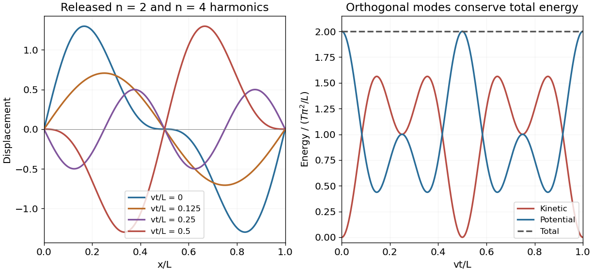

<h1 id="10/c/solution">Solution</h1>

↑ **Parent:** [C](../c.md)

The total [kinetic energy](../../../../kinetic-energy.md) and small-slope elastic [potential energy](../../../../potential-energy.md) are

$$
K=\frac\mu2\int_0^Ly_t^2dx,\qquad V=\frac T2\int_0^Ly_x^2dx.
$$

Orthogonality removes cross terms between the two distinct sine or cosine modes. A mode of amplitude $A_n$ contributes $K_n=\mu LA_n^2\omega_n^2\sin^2(\omega_nt)/4$ and $V_n=TLA_n^2k_n^2\cos^2(\omega_nt)/4$. For amplitudes $1,1/2$ and $n=2,4$, the prefactors agree. Writing $\Omega=2\pi v/L$,

$$
\boxed{K(t)=\frac{T\pi^2}{L}[\sin^2\Omega t+\sin^2(2\Omega t)],\qquad V(t)=\frac{T\pi^2}{L}[\cos^2\Omega t+\cos^2(2\Omega t)].}
$$

Thus

$$
\boxed{E=K+V=\frac{2T\pi^2}{L},}
$$

independent of time. This is another instance of [equal modal energies for inverse-harmonic string amplitudes](../../../../equal-modal-energies-for-inverse-harmonic-string-amplitudes.md). An explicit initial amplitude $A$ multiplies every energy by $A^2$.

**[Figure 1](#10/c/image-two-harmonic-string-displacement-and-exchange-between-kinetic-and-potential-energy). Two-harmonic string displacement and exchange between kinetic and potential energy**.

## ↑ Ancestors (12)

1. [C](../c.md)
2. [10](../../10.md)
3. [2013 resit](../../../2013-resit-split.md)
4. [Past exam of the mathematical methods II course of the University of Oxford](../../../split.md)
5. [Mathematical methods II course of the University of Oxford](../../../../mathematical-methods-ii-course-of-the-university-of-oxford.md)
6. [Year 1 of the physics course of the University of Oxford](../../../../year-1-of-the-physics-course-of-the-university-of-oxford.md)
7. [Physics course of the University of Oxford](../../../../physics-course-of-the-university-of-oxford.md)
8. [Undergraduate course of the University of Oxford](../../../../undergraduate-course-of-the-university-of-oxford.md)
9. [Course of the University of Oxford](../../../../course-of-the-university-of-oxford.md)
10. [University of Oxford](../../../../university-of-oxford-split.md)
11. [List of universities](../../../../list-of-universities.md)
12. [Codex Wiki](../../../../split.md)
