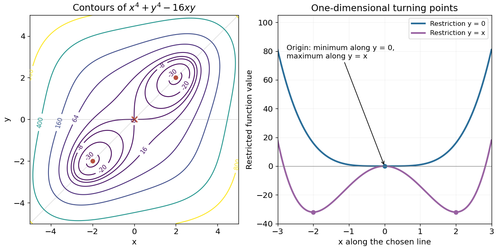

<h1 id="11/c/solution">Solution</h1>

↑ **Parent:** [C](../c.md)

The contours have exchange symmetry $f(x,y)=f(y,x)$ and inversion symmetry $f(-x,-y)=f(x,y)$. Negative levels between $-32$ and zero form separate loops around the two minima. The zero contour meets itself at the origin, reflecting the saddle there; positive levels form a single outer closed contour. At large radius the positive quartic terms dominate, so the contours remain bounded. There are no contours below $-32$.

**[Figure 2](#11/c/image-quartic-contours-on-the-required-square-and-one-dimensional-restrictions-near-their-turning-points). Quartic contours on the required square and one-dimensional restrictions near their turning points**.

The diagram marks the two minima and central saddle. The restrictions are classified separately below: a minimum or maximum along a single line need not be a two-dimensional extremum.

## ↑ Ancestors (12)

1. [C](../c.md)
2. [11](../../11.md)
3. [2013 resit](../../../2013-resit-split.md)
4. [Past exam of the mathematical methods II course of the University of Oxford](../../../split.md)
5. [Mathematical methods II course of the University of Oxford](../../../../mathematical-methods-ii-course-of-the-university-of-oxford.md)
6. [Year 1 of the physics course of the University of Oxford](../../../../year-1-of-the-physics-course-of-the-university-of-oxford.md)
7. [Physics course of the University of Oxford](../../../../physics-course-of-the-university-of-oxford.md)
8. [Undergraduate course of the University of Oxford](../../../../undergraduate-course-of-the-university-of-oxford.md)
9. [Course of the University of Oxford](../../../../course-of-the-university-of-oxford.md)
10. [University of Oxford](../../../../university-of-oxford-split.md)
11. [List of universities](../../../../list-of-universities.md)
12. [Codex Wiki](../../../../split.md)
