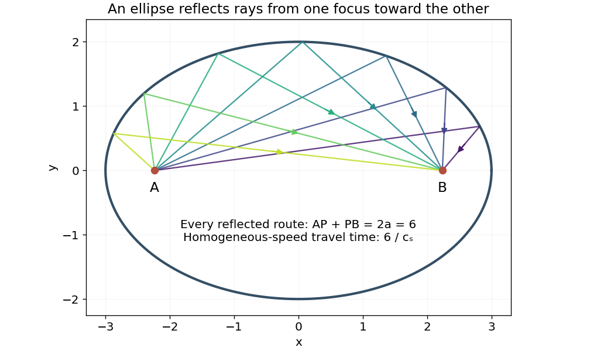

<h1 id="11/c/solution">Solution</h1>

↑ **Parent:** [C](../c.md)

For [reflection between the foci of an ellipse](../../../../reflection-between-the-foci-of-an-ellipse.md), assume $s>|A-B|$ and define $\Phi(P)=R_A(P)+R_B(P)$. From part (b),

$$
\nabla\Phi=\mathbf u_A+\mathbf u_B,\qquad\mathbf u_A=\frac{P-A}{|P-A|},\quad\mathbf u_B=\frac{P-B}{|P-B|}.
$$

On the ellipse this sum is normal to the tangent. Thus a unit tangent $\boldsymbol\tau$ obeys $\boldsymbol\tau\cdot\mathbf u_A=-\boldsymbol\tau\cdot\mathbf u_B$. The magnitudes of the projections of the two unit focal directions on the tangent are equal, proving

$$
\boxed{\angle(AP,T)=\angle(BP,T)}
$$

for the corresponding acute, unoriented line angles.

More explicitly, let $\mathbf n=(\mathbf u_A+\mathbf u_B)/|\mathbf u_A+\mathbf u_B|$. The [law of reflection](../../../../law-of-reflection.md) maps an incoming unit ray $\mathbf u_A$ to

$$
\mathbf u_A-2(\mathbf u_A\cdot\mathbf n)\mathbf n=\mathbf u_A-(\mathbf u_A+\mathbf u_B)=-\mathbf u_B,
$$

which points from $P$ toward $B$. Thus the equal-angle property has the correct incoming/outgoing ray orientation, rather than merely an algebraic bisector assertion.

**[Figure 3](#11/c/image-calculated-equal-length-reflected-ray-paths-between-the-foci-of-an-ellipse). Calculated equal-length reflected ray paths between the foci of an ellipse**.

## ↑ Ancestors (12)

1. [C](../c.md)
2. [11](../../11.md)
3. [2013](../../../2013-split.md)
4. [Past exam of the mathematical methods II course of the University of Oxford](../../../split.md)
5. [Mathematical methods II course of the University of Oxford](../../../../mathematical-methods-ii-course-of-the-university-of-oxford.md)
6. [Year 1 of the physics course of the University of Oxford](../../../../year-1-of-the-physics-course-of-the-university-of-oxford.md)
7. [Physics course of the University of Oxford](../../../../physics-course-of-the-university-of-oxford.md)
8. [Undergraduate course of the University of Oxford](../../../../undergraduate-course-of-the-university-of-oxford.md)
9. [Course of the University of Oxford](../../../../course-of-the-university-of-oxford.md)
10. [University of Oxford](../../../../university-of-oxford-split.md)
11. [List of universities](../../../../list-of-universities.md)
12. [Codex Wiki](../../../../split.md)
