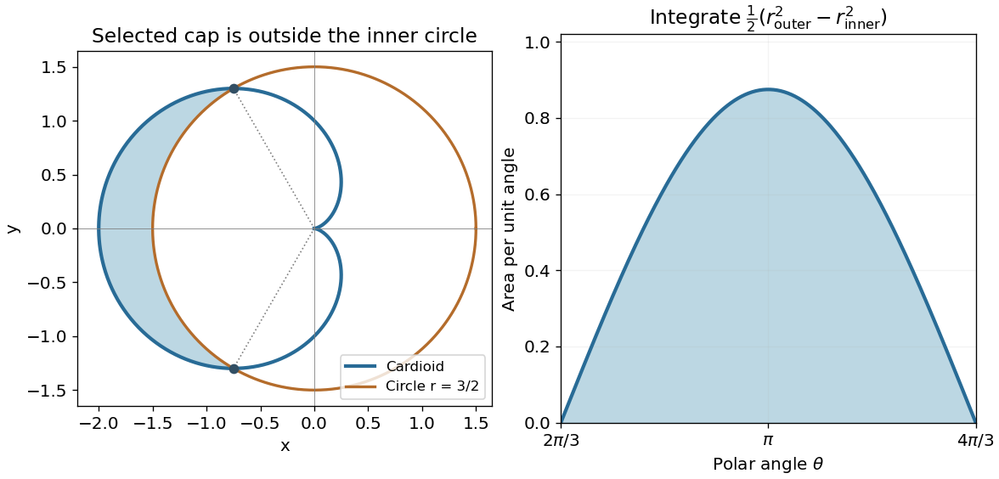

<h1 id="5/a/solution">Solution</h1>

↑ **Parent:** [A](../a.md)

The [cardioid](../../../../cardioid.md) has nonnegative polar radius $r=1-\cos\theta$, ranging from zero at the right-hand cusp to two on the negative $x$ axis. Its intersections with the circle $r=3/2$ satisfy $\cos\theta=-1/2$, giving $\theta=2\pi/3,4\pi/3$. The selected region is the left-hand cap between the two curves:

$$
\boxed{\frac{2\pi}{3}\leq\theta\leq\frac{4\pi}{3},\qquad\frac32\leq r\leq1-\cos\theta.}
$$

The endpoints in [Cartesian coordinates](../../../../cartesian-coordinate-system.md) are $(-3/4,\pm3\sqrt3/4)$.

**[Figure 1](#5/a/image-the-cardioid-cap-outside-the-circle-and-its-radial-area-integrand). The cardioid cap outside the circle and its radial area integrand**.

## ↑ Ancestors (12)

1. [A](../a.md)
2. [5](../../5.md)
3. [2013](../../../2013-split.md)
4. [Past exam of the mathematical methods II course of the University of Oxford](../../../split.md)
5. [Mathematical methods II course of the University of Oxford](../../../../mathematical-methods-ii-course-of-the-university-of-oxford.md)
6. [Year 1 of the physics course of the University of Oxford](../../../../year-1-of-the-physics-course-of-the-university-of-oxford.md)
7. [Physics course of the University of Oxford](../../../../physics-course-of-the-university-of-oxford.md)
8. [Undergraduate course of the University of Oxford](../../../../undergraduate-course-of-the-university-of-oxford.md)
9. [Course of the University of Oxford](../../../../course-of-the-university-of-oxford.md)
10. [University of Oxford](../../../../university-of-oxford-split.md)
11. [List of universities](../../../../list-of-universities.md)
12. [Codex Wiki](../../../../split.md)
