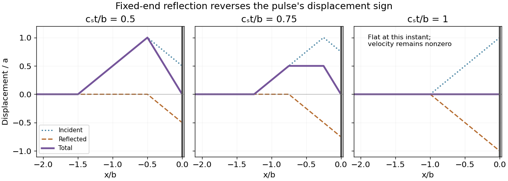

<h1 id="7/solution">Solution</h1>

↑ **Parent:** [7](../7.md)

Let $f(x)$ be the initial triangular profile, extended by zero for $x>0$. For [fixed-end reflection of a triangular pulse](../../../fixed-end-reflection-of-a-triangular-pulse.md), the right-moving incident component is $f(x-c_st)$; the reflected pulse at a fixed end has opposite sign. The full solution on $x\leq0$ is

$$
\boxed{y(x,t)=f(x-c_st)-f(-x-c_st).}
$$

It satisfies $y(0,t)=0$ exactly. Write $\xi=x/b\leq0$ and measure displacement in units of $a$, assuming $a,b,c_s>0$. At the first specified time the profile is

$$
\frac{y(x,t_1)}a=\begin{cases}0,&\xi<-3/2,\\\xi+3/2,&-3/2\leq\xi\leq-1/2,\\-2\xi,&-1/2\leq\xi\leq0.\end{cases}
$$

At the second time it is

$$
\frac{y(x,t_2)}a=\begin{cases}0,&\xi<-5/4,\\\xi+5/4,&-5/4\leq\xi\leq-3/4,\\1/2,&-3/4\leq\xi\leq-1/4,\\-2\xi,&-1/4\leq\xi\leq0.\end{cases}
$$

At the third time the two components cancel throughout the half-string:

$$
\boxed{y(x,t_3)=0\quad(x\leq0).}
$$

This flat instantaneous profile does not mean the wave energy has vanished. On $-b<x<0$, its velocity at $t_3$ is $-2ac_s/b$, and it subsequently becomes a negative reflected pulse travelling left.

**[Figure 2](#7/image-incident-reflected-and-total-profiles-at-the-three-specified-reflection-times). Incident, reflected and total profiles at the three specified reflection times**.

## ↑ Ancestors (11)

1. [7](../7.md)
2. [2013](../../2013-split.md)
3. [Past exam of the mathematical methods II course of the University of Oxford](../../split.md)
4. [Mathematical methods II course of the University of Oxford](../../../mathematical-methods-ii-course-of-the-university-of-oxford.md)
5. [Year 1 of the physics course of the University of Oxford](../../../year-1-of-the-physics-course-of-the-university-of-oxford.md)
6. [Physics course of the University of Oxford](../../../physics-course-of-the-university-of-oxford.md)
7. [Undergraduate course of the University of Oxford](../../../undergraduate-course-of-the-university-of-oxford.md)
8. [Course of the University of Oxford](../../../course-of-the-university-of-oxford.md)
9. [University of Oxford](../../../university-of-oxford-split.md)
10. [List of universities](../../../list-of-universities.md)
11. [Codex Wiki](../../../split.md)
