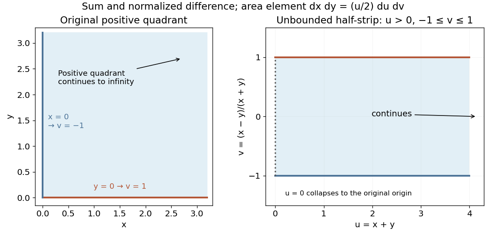
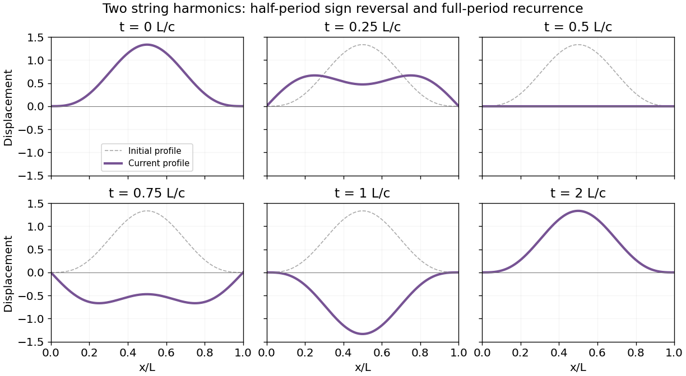

# 2014 resit

↑ **Parent:** [Past exam of the mathematical methods II course of the University of Oxford](../past-exam-of-the-mathematical-methods-ii-course-of-the-university-of-oxford.md)

Source: [public Oxford archive](https://www.whatdotheyknow.com/request/physics_preliminary_examinations/response/1162943/attach/3/Twain.7z?cookie_passthrough=1). The held cover dates this sitting to 11 September 2014, despite its retained Trinity Term heading. Unlettered marked blocks are indexed a and b; all Section B options are answered.

**Table of contents**

- [1](#1)
  - [Solution](#1/solution)
- [2](#2)
  - [a](#2/a)
    - [Solution](#2/a/solution)
  - [b](#2/b)
    - [Solution](#2/b/solution)
- [3](#3)
  - [a](#3/a)
    - [Solution](#3/a/solution)
  - [b](#3/b)
    - [Solution](#3/b/solution)
  - [c](#3/c)
    - [Solution](#3/c/solution)
- [4](#4)
  - [a](#4/a)
    - [Solution](#4/a/solution)
  - [b](#4/b)
    - [Solution](#4/b/solution)
- [5](#5)
  - [Solution](#5/solution)
- [6](#6)
  - [a](#6/a)
    - [Solution](#6/a/solution)
  - [b](#6/b)
    - [Solution](#6/b/solution)
- [7](#7)
  - [Solution](#7/solution)
- [8](#8)
  - [a](#8/a)
    - [Solution](#8/a/solution)
  - [b](#8/b)
    - [Solution](#8/b/solution)
  - [c](#8/c)
    - [Solution](#8/c/solution)
  - [d](#8/d)
    - [Solution](#8/d/solution)
  - [e](#8/e)
    - [Solution](#8/e/solution)
- [9](#9)
  - [a](#9/a)
    - [Solution](#9/a/solution)
  - [b](#9/b)
    - [Solution](#9/b/solution)
- [10](#10)
  - [a](#10/a)
    - [Solution](#10/a/solution)
  - [b](#10/b)
    - [Solution](#10/b/solution)
  - [c](#10/c)
    - [Solution](#10/c/solution)
  - [d](#10/d)
    - [Solution](#10/d/solution)
  - [e](#10/e)
    - [Solution](#10/e/solution)
- [11](#11)
  - [a](#11/a)
    - [Solution](#11/a/solution)
  - [b](#11/b)
    - [Solution](#11/b/solution)
  - [c](#11/c)
    - [Solution](#11/c/solution)
  - [d](#11/d)
    - [Solution](#11/d/solution)
  - [e](#11/e)
    - [Solution](#11/e/solution)

## 1

↑ **Parent:** [2014 resit](2014-resit.md)

<h3 id="1/solution">Solution</h3>

↑ **Parent:** [1](#1)

For a continuously differentiable [vector field](../multivariable-calculus.md#vector-field) on a bounded region with suitably piecewise smooth boundary, the [divergence theorem](../multivariable-calculus.md#divergence-theorem) gives

$$
\oint_S\mathbf F\cdot\hat{\mathbf n}\,dS=\int_V\nabla\cdot\mathbf F\,dV,
$$

where the [normal vector](../differential-geometry.md#normal-vector) points outward. In three dimensions, the [position vector](../classical-mechanics.md#position-vector) is $\mathbf r=(x,y,z)$ and $\nabla\cdot\mathbf r=1+1+1=3$. Therefore

$$
\boxed{\oint_S\mathbf r\cdot d\mathbf S=3V.}
$$

The result depends only on the enclosed [volume](../geometry-and-topology.md#volume), not on the shape or its location relative to the origin. Reversing the surface orientation reverses the sign.

## 2

↑ **Parent:** [2014 resit](2014-resit.md)

<h3 id="2/a">a</h3>

↑ **Parent:** [2](#2)

<h4 id="2/a/solution">Solution</h4>

↑ **Parent:** [A](#2/a)

Multiply the convergent [Taylor series](../calculus.md#taylor-series) $\cos x=1-x^2/2+x^4/24+\cdots$ and $\sinh y=y+y^3/6+y^5/120+\cdots$. Keeping all terms through total degree five gives

$$
\boxed{\cos x\sinh y=y+\frac{y^3}{6}-\frac{x^2y}{2}+\frac{y^5}{120}-\frac{x^2y^3}{12}+\frac{x^4y}{24}+O((|x|+|y|)^7).}
$$

There are six nonzero [monomials](../polynomial.md#monomial) displayed, so the answer does not select only part of the tied total-degree-five terms when asking for at least four terms. Both original series converge for every finite real $x,y$.

<h3 id="2/b">b</h3>

↑ **Parent:** [2](#2)

<h4 id="2/b/solution">Solution</h4>

↑ **Parent:** [B](#2/b)

Use the [Maclaurin series](../calculus.md#maclaurin-series) $\ln(1+x)=x-x^2/2+x^3/3+O(x^4)$ and the [geometric series](../sequence-and-series.md#geometric-series) $(1+y)^{-1}=1-y+y^2-y^3+\cdots$. Multiplication, grouped by total degree, gives

$$
\boxed{\frac{\ln(1+x)}{1+y}=x-\frac{x^2}{2}-xy+\frac{x^3}{3}+\frac{x^2y}{2}+xy^2+O((|x|+|y|)^4).}
$$

The six displayed nonzero terms include every contribution through total degree three. A sufficient open region for the convergent product expansion is $|x|<1$, $|y|<1$.

## 3

↑ **Parent:** [2014 resit](2014-resit.md)

<h3 id="3/a">a</h3>

↑ **Parent:** [3](#3)

<h4 id="3/a/solution">Solution</h4>

↑ **Parent:** [A](#3/a)

[Stokes theorem](../multivariable-calculus.md#stokes-theorem) equates the circulation of a continuously differentiable [vector field](../multivariable-calculus.md#vector-field) around an oriented boundary to the flux of its [curl](../multivariable-calculus.md#curl) across a spanning oriented [surface](../topological-surface.md):

$$
\oint_{\partial S}\mathbf A\cdot d\mathbf r=\int_S(\nabla\times\mathbf A)\cdot\hat{\mathbf n}\,dS.
$$

The boundary direction follows the [right-hand rule](../electromagnetism.md#right-hand-rule) relative to the [normal vector](../differential-geometry.md#normal-vector). For the polynomial [vector field](../multivariable-calculus.md#vector-field), only the $z$ component of the [curl](../multivariable-calculus.md#curl) can be nonzero, and

$$
\boxed{\nabla\times\mathbf A=\left(\frac{\partial(2xy)}{\partial x}-\frac{\partial(x^2-y^2)}{\partial y}\right)\hat{\mathbf z}=4y\hat{\mathbf z}.}
$$

<h3 id="3/b">b</h3>

↑ **Parent:** [3](#3)

<h4 id="3/b/solution">Solution</h4>

↑ **Parent:** [B](#3/b)

Orient the rectangle with [normal vector](../differential-geometry.md#normal-vector) $+\hat{\mathbf z}$. The [surface integral](../multivariable-calculus.md#surface-integral) of the [curl](../multivariable-calculus.md#curl) is an ordinary planar integral:

$$
I=\int_0^a\int_0^b4y\,dy\,dx=\boxed{2ab^2.}
$$

If the opposite orientation is chosen, both this flux and the corresponding boundary [line integral](../multivariable-calculus.md#line-integral) change sign.

<h3 id="3/c">c</h3>

↑ **Parent:** [3](#3)

<h4 id="3/c/solution">Solution</h4>

↑ **Parent:** [C](#3/c)

For positive $a,b$ and upward orientation, traverse the four edges counterclockwise. The bottom edge contributes $\int_0^a x^2dx=a^3/3$. The right edge contributes $\int_0^b2ay\,dy=ab^2$. On the top edge $x$ decreases, giving $\int_a^0(x^2-b^2)dx=-a^3/3+ab^2$. The left edge has $x=0$ and zero tangential component. Hence

$$
\boxed{\oint_{\partial S}\mathbf A\cdot d\mathbf r=\frac{a^3}{3}+ab^2-\frac{a^3}{3}+ab^2=2ab^2.}
$$

This agrees with the [surface integral](../multivariable-calculus.md#surface-integral) and explicitly verifies [Stokes theorem](../multivariable-calculus.md#stokes-theorem), including the direction of the top-edge traversal.

## 4

↑ **Parent:** [2014 resit](2014-resit.md)

<h3 id="4/a">a</h3>

↑ **Parent:** [4](#4)

<h4 id="4/a/solution">Solution</h4>

↑ **Parent:** [A](#4/a)

The cancellation of the quadratic terms makes the fourth-order terms decisive. The [Taylor expansions](../calculus.md#taylor-expansion) give

$$
1+x^2-e^{x^2}=-\frac{x^4}{2}-\frac{x^6}{6}+O(x^8),\qquad x\sin x-x^2=-\frac{x^4}{6}+\frac{x^6}{120}+O(x^8).
$$

Canceling $x^4$ for $x\ne0$ and taking the [limit](../calculus.md#limit-of-a-function) yields

$$
\boxed{\lim_{x\to0}\frac{1+x^2-e^{x^2}}{x\sin x-x^2}=3.}
$$

<h3 id="4/b">b</h3>

↑ **Parent:** [4](#4)

<h4 id="4/b/solution">Solution</h4>

↑ **Parent:** [B](#4/b)

On bounded intervals the [exponential series](../calculus.md#exponential-series) converges uniformly, allowing termwise [integration](../integral.md). Since $e^{-t^2}=1-t^2+t^4/2+O(t^6)$,

$$
I(x)=\frac2{\sqrt\pi}\left(x-\frac{x^3}{3}+\frac{x^5}{10}+O(x^7)\right).
$$

The requested first two nonzero terms are therefore

$$
\boxed{I(x)=\frac{2x}{\sqrt\pi}-\frac{2x^3}{3\sqrt\pi}+O(x^5).}
$$

The function is the [error function](../integral.md#error-function), with $I(0)=0$ and derivative $2e^{-x^2}/\sqrt\pi$.

## 5

↑ **Parent:** [2014 resit](2014-resit.md)

<h3 id="5/solution">Solution</h3>

↑ **Parent:** [5](#5)

The proposed [change of variables](../multivariable-calculus.md#change-of-variables-formula) gives $u=x-3y$, $v=2x+y$, with inverse $x=(u+3v)/7$, $y=(v-2u)/7$. The [Jacobian determinant](../multivariable-calculus.md#jacobian-determinant) is

$$
\frac{\partial(u,v)}{\partial(x,y)}=7,\qquad \left|\frac{\partial(x,y)}{\partial(u,v)}\right|=\frac17.
$$

The two lines of slope $-2$ become $v=1,4$, while the two lines of slope $1/3$ become $u=0,7$. Thus the parallelogram becomes $0\leq u\leq7$, $1\leq v\leq4$. Since $v$ stays positive, the transformed integrand has no singularity there. The [double integral](../integral.md#double-integral) is

$$
\boxed{\iint_D\frac{x-3y}{2x+y}\,dx\,dy=\frac17\int_0^7u\,du\int_1^4\frac{dv}{v}=\frac72\ln4=7\ln2.}
$$

## 6

↑ **Parent:** [2014 resit](2014-resit.md)

<h3 id="6/a">a</h3>

↑ **Parent:** [6](#6)

<h4 id="6/a/solution">Solution</h4>

↑ **Parent:** [A](#6/a)

For a differentiable function at an interior [stationary point](../calculus-of-variations.md#stationary-point), both first [partial derivatives](../multivariable-calculus.md#partial-derivative) vanish. If the second derivatives are continuous, form the symmetric [Hessian matrix](../multivariable-calculus.md#hessian-matrix)

$$
H=\begin{pmatrix}f_{xx}&f_{xy}\\f_{xy}&f_{yy}\end{pmatrix},\qquad D=f_{xx}f_{yy}-f_{xy}^2.
$$

The [second-derivative test](../multivariable-calculus.md#second-derivative-test) gives a strict local minimum if $D>0$ and $f_{xx}>0$, a strict local maximum if $D>0$ and $f_{xx}<0$, and a [saddle point](../analysis.md#saddle-point) if $D<0$. If $D=0$, higher-order terms must be examined. For example, $x^4+y^4$, $-x^4-y^4$ and $x^4-y^4$ all have zero [Hessian matrix](../multivariable-calculus.md#hessian-matrix) at the origin but respectively a minimum, maximum and saddle. These are local interior criteria; boundary extrema require separate treatment.

<h3 id="6/b">b</h3>

↑ **Parent:** [6](#6)

<h4 id="6/b/solution">Solution</h4>

↑ **Parent:** [B](#6/b)

The [gradient](../multivariable-calculus.md#gradient) is $(2x+2,-2y-4)$, so the only [stationary point](../calculus-of-variations.md#stationary-point) is $(x,y)=(-1,-2)$. Its [Hessian matrix](../multivariable-calculus.md#hessian-matrix) is $\operatorname{diag}(2,-2)$ and its determinant is $-4<0$. Thus

$$
\boxed{(x,y)=(-1,-2),\qquad f=13,\qquad\text{saddle point}.}
$$

Completing squares confirms the classification directly: $f=(x+1)^2-(y+2)^2+13$. Arbitrarily close to the point, moving in the $x$ direction increases the value and moving in the $y$ direction decreases it.

## 7

↑ **Parent:** [2014 resit](2014-resit.md)

<h3 id="7/solution">Solution</h3>

↑ **Parent:** [7](#7)

Choose both [waves](../wave.md) as [sinusoids](../geometry-and-topology.md#sinusoid) with a common zero phase and amplitude $A$. The trigonometric sum identity gives

$$
A\cos[(k+\delta)x-(\omega+\epsilon)t]+A\cos[(k-\delta)x-(\omega-\epsilon)t]=2A\cos(\delta x-\epsilon t)\cos(kx-\omega t).
$$

The slowly varying [wave envelope](../dispersion-relation.md#envelope-waves) has constant phase when $\delta x-\epsilon t$ is constant. Its speed is $\epsilon/\delta$, and in the close-frequency limit the [group velocity](../dispersion-relation.md#group-velocity) is

$$
\boxed{v_g=\frac{d\omega}{dk}.}
$$

It describes the motion of a narrow-band envelope in a medium where the constituent waves retain a coherent packet interpretation; it is not an unconditional signal-speed theorem in strongly absorbing or anomalously dispersive media. The carrier [phase velocity](../dispersion-relation.md#phase-velocity) is $v_p=\omega/k$. In a nondispersive medium, $\omega=vk$ with constant $v$, so $v_g=v=v_p$.

## 8

↑ **Parent:** [2014 resit](2014-resit.md)

<h3 id="8/a">a</h3>

↑ **Parent:** [8](#8)

<h4 id="8/a/solution">Solution</h4>

↑ **Parent:** [A](#8/a)

Measure each rod angle from the downward vertical, as in the held diagram. The upper mass rises by $2l(1-\cos\theta_1)$; the lower mass rises by $2l(1-\cos\theta_1)+l(1-\cos\theta_2)$. With the hanging equilibrium as the zero of [gravitational potential energy](../energy.md#gravitational-energy),

$$
U=mgl[4(1-\cos\theta_1)+(1-\cos\theta_2)]\simeq\boxed{\frac{mgl}{2}(4\theta_1^2+\theta_2^2).}
$$

The retained expression is quadratic in the small displacements. Both masses contribute to the upper rod's gravitational term.

<h3 id="8/b">b</h3>

↑ **Parent:** [8](#8)

<h4 id="8/b/solution">Solution</h4>

↑ **Parent:** [B](#8/b)

The two positions are $\mathbf r_1=(2l\sin\theta_1,-2l\cos\theta_1)$ and $\mathbf r_2=\mathbf r_1+(l\sin\theta_2,-l\cos\theta_2)$. Differentiating and summing their [kinetic energies](../energy.md#kinetic-energy) gives the exact expression

$$
K=\frac{ml^2}{2}[8\dot\theta_1^2+\dot\theta_2^2+4\dot\theta_1\dot\theta_2\cos(\theta_1-\theta_2)].
$$

In the linear small-oscillation approximation, set the cosine to one in this quadratic velocity expression:

$$
\boxed{K\simeq\frac{ml^2}{2}(8\dot\theta_1^2+4\dot\theta_1\dot\theta_2+\dot\theta_2^2).}
$$

The cross term arises because the lower mass participates in motion generated by both rods.

<h3 id="8/c">c</h3>

↑ **Parent:** [8](#8)

<h4 id="8/c/solution">Solution</h4>

↑ **Parent:** [C](#8/c)

A symmetric quadratic form has twice its off-diagonal entry as the coefficient of the mixed product. Comparing with the preceding [potential energy](../energy.md#potential-energy) and [kinetic energy](../energy.md#kinetic-energy) expressions gives

$$
\boxed{\mathbf V=mgl\begin{pmatrix}4&0\\0&1\end{pmatrix},\qquad \mathbf T=ml^2\begin{pmatrix}8&2\\2&1\end{pmatrix}.}
$$

Here $\mathbf V$ is the stiffness matrix and $\mathbf T$ the mass matrix in angular coordinates; their units differ accordingly. The dimensionless mass-matrix determinant is $8-4=4>0$ and its first diagonal entry is positive, so the [kinetic energy](../energy.md#kinetic-energy) is positive for every nonzero angular velocity.

<h3 id="8/d">d</h3>

↑ **Parent:** [8](#8)

<h4 id="8/d/solution">Solution</h4>

↑ **Parent:** [D](#8/d)

The quadratic total [mechanical energy](../energy.md#mechanical-energy) is

$$
E=\frac12\dot{\boldsymbol\theta}^{\mathsf T}\mathbf T\dot{\boldsymbol\theta}+\frac12\boldsymbol\theta^{\mathsf T}\mathbf V\boldsymbol\theta,\qquad \frac{dE}{dt}=\dot{\boldsymbol\theta}^{\mathsf T}(\mathbf T\ddot{\boldsymbol\theta}+\mathbf V\boldsymbol\theta).
$$

For this frictionless conservative [double pendulum](../lagrangian-mechanics.md#double-pendulum), the [Euler-Lagrange equations](../analysis.md#euler-lagrange-equation) for $L=K-U$ give

$$
\boxed{\mathbf T\ddot{\boldsymbol\theta}+\mathbf V\boldsymbol\theta=0,}
$$

or $8\ddot\theta_1+2\ddot\theta_2+(4g/l)\theta_1=0$ and $2\ddot\theta_1+\ddot\theta_2+(g/l)\theta_2=0$. Substitution immediately verifies [energy conservation](../mathematical-physics.md#conservation-of-energy).

**Logical qualification.** [Energy conservation does not uniquely determine equations of motion](../mathematical-physics.md#energy-conservation-does-not-uniquely-determine-equations-of-motion): the scalar equation $dE/dt=0$ alone does not determine both equations. For example, replacing their right side by $\mathbf G\dot{\boldsymbol\theta}$ with any nonzero antisymmetric matrix $\mathbf G$ preserves the same energy because $\dot{\boldsymbol\theta}^{\mathsf T}\mathbf G\dot{\boldsymbol\theta}=0$, while changing the dynamics. Such a gyroscopic force is absent from the specified pendulum. The conservative-force structure, supplied here by the [Lagrangian](../calculus-of-variations.md#lagrangian), is the additional information needed to justify the displayed equations rather than infer two independent equations from one scalar identity.

<h3 id="8/e">e</h3>

↑ **Parent:** [8](#8)

<h4 id="8/e/solution">Solution</h4>

↑ **Parent:** [E](#8/e)

For the [normal modes of a double pendulum with a two-to-one length ratio](../lagrangian-mechanics.md#normal-modes-of-a-double-pendulum-with-a-two-to-one-length-ratio), seek $\boldsymbol\theta=\mathbf a\cos(\Omega t+\varphi)$. The [generalized eigenvalue problem](../linear-operator-theory.md#generalized-eigenvalue-problem) is $(\mathbf V-\Omega^2\mathbf T)\mathbf a=0$. Put $s=\Omega^2l/g$. A nonzero mode requires

$$
0=\det\begin{pmatrix}4-8s&-2s\\-2s&1-s\end{pmatrix}=4(s^2-3s+1).
$$

Thus the two angular frequencies are

$$
\boxed{\Omega_\pm=\sqrt{\frac{g}{2l}(3\pm\sqrt5)},\qquad f_\pm=\frac{\Omega_\pm}{2\pi}.}
$$

Both squared frequencies are positive. The slower mode has $\theta_2/\theta_1=\sqrt5-1$ and is in phase; the faster mode has $\theta_2/\theta_1=-1-\sqrt5$ and is out of phase. These mode ratios also check the off-diagonal terms in the mass matrix.

## 9

↑ **Parent:** [2014 resit](2014-resit.md)

<h3 id="9/a">a</h3>

↑ **Parent:** [9](#9)

<h4 id="9/a/solution">Solution</h4>

↑ **Parent:** [A](#9/a)

Assume $0\leq a<R$. In [cylindrical coordinates](../multivariable-calculus.md#cylindrical-coordinate-system), the sphere imposes $r^2+z^2\leq R^2$, and the volume element is $r\,dr\,d\phi\,dz$. The required [triple integral](../integral.md#triple-integral) is

$$
V=\int_{-a}^a\int_0^{2\pi}\int_0^{\sqrt{R^2-z^2}}r\,dr\,d\phi\,dz=\pi\int_{-a}^a(R^2-z^2)\,dz.
$$

Hence

$$
\boxed{V=2\pi a\left(R^2-\frac{a^2}{3}\right).}
$$

It tends to zero as $a\to0$ and to the full sphere volume $4\pi R^3/3$ as $a\to R$, checking both limits.

<h3 id="9/b">b</h3>

↑ **Parent:** [9](#9)

<h4 id="9/b/solution">Solution</h4>

↑ **Parent:** [B](#9/b)

For the specified [change of variables](../multivariable-calculus.md#change-of-variables-formula),

$$
\frac{\partial(x,y)}{\partial(u,v)}=\det\begin{pmatrix}(1+v)/2&u/2\\(1-v)/2&-u/2\end{pmatrix}=-\frac u2.
$$

Thus the inverse-coordinate [Jacobian determinant](../multivariable-calculus.md#jacobian-determinant) is $\partial(u,v)/\partial(x,y)=-2/u$ where $u>0$, and the area element uses the absolute value $dx\,dy=(u/2)du\,dv$.

Now $u=x+y$, $v=(x-y)/(x+y)$ and $xy=u^2(1-v^2)/4$. The positive quadrant maps to the half-strip $u\geq0$, $-1\leq v\leq1$. The original origin corresponds to the collapsed boundary $u=0$, where $v$ is not unique; this measure-zero degeneracy does not affect the integral. Therefore

$$
I=\frac14\int_0^\infty u^2e^{-u}\,du\int_{-1}^1\sqrt{1-v^2}\,dv=\frac14(2!)\left(\frac\pi2\right)=\boxed{\frac\pi4}.
$$

The second factor is the area of a unit semicircle. Independently, the original integrand factors into two identical [gamma integrals](../complex-analysis.md#gamma-integral), giving $\Gamma(3/2)^2=\pi/4$.

**[Figure 1](#9/b/image-positive-quadrant-coordinates-mapped-to-an-unbounded-half-strip). Positive-quadrant coordinates mapped to an unbounded half-strip**.

## 10

↑ **Parent:** [2014 resit](2014-resit.md)

<h3 id="10/a">a</h3>

↑ **Parent:** [10](#10)

<h4 id="10/a/solution">Solution</h4>

↑ **Parent:** [A](#10/a)

Interpret “held” and then “released” as zero initial velocity. In the small-slope [wave equation on a string](../wave-equation.md#wave-equation-on-a-string) model, the elastic energy is $U=(T/2)\int_0^L y_x^2dx$ and the initial [kinetic energy](../energy.md#kinetic-energy) is zero. The given profile has

$$
y_x(x,0)=\frac\pi L\left(\cos\frac{\pi x}L-\cos\frac{3\pi x}L\right).
$$

The two cosine functions are orthogonal on $[0,L]$ and each has squared integral $L/2$. Thus

$$
\boxed{E(0)=\frac T2\frac{\pi^2}{L^2}\left(\frac L2+\frac L2\right)=\frac{T\pi^2}{2L}.}
$$

The implicit leading displacement amplitude is one in the source's chosen length units. If that amplitude is written explicitly as $A$, all energies here and below acquire a factor $A^2$.

<h3 id="10/b">b</h3>

↑ **Parent:** [10](#10)

<h4 id="10/b/solution">Solution</h4>

↑ **Parent:** [B](#10/b)

For a short string element $dx$, small slope makes its tension magnitude approximately constant and its vertical component approximately $Ty_x$. The net vertical force is $T[y_x(x+dx,t)-y_x(x,t)]\simeq Ty_{xx}dx$. Its [mass](../classical-mechanics.md#mass) is $\rho\,dx$. [Newton's second law](../force.md#newton-s-second-law) gives

$$
\rho\,dx\,y_{tt}=Ty_{xx}\,dx,\qquad \boxed{y_{tt}-c^2y_{xx}=0,\quad c=\sqrt{T/\rho}.}
$$

This assumes uniform equilibrium tension, small slopes, negligible bending stiffness and dissipation. The symbol $\rho$ is linear mass density here, not volume density.

<h3 id="10/c">c</h3>

↑ **Parent:** [10](#10)

<h4 id="10/c/solution">Solution</h4>

↑ **Parent:** [C](#10/c)

Fixed endpoints select the spatial [normal modes](../wave-equation.md#normal-mode) $\sin(n\pi x/L)$, with angular frequencies $\omega_n=n\pi c/L$. Zero initial velocity selects cosine time dependence. Matching the two nonzero initial amplitudes gives

$$
\boxed{y(x,t)=\sin\frac{\pi x}L\cos\frac{\pi ct}L-\frac13\sin\frac{3\pi x}L\cos\frac{3\pi ct}L.}
$$

Each term separately satisfies the [wave equation](../wave-equation.md) and fixed-end [boundary conditions](../differential-equation.md#boundary-condition). At $t=0$ the prescribed profile is recovered, and differentiating in time gives zero initial velocity.

**[Figure 2](#10/c/image-two-mode-string-motion-sign-reversal-at-half-a-period-and-exact-recurrence). Two-mode string motion, sign reversal at half a period and exact recurrence**.

<h3 id="10/d">d</h3>

↑ **Parent:** [10](#10)

<h4 id="10/d/solution">Solution</h4>

↑ **Parent:** [D](#10/d)

To recover the original signed displacement profile, orthogonality requires both cosine time factors to equal one. Since $\omega_3=3\omega_1$, the smallest positive time is

$$
\boxed{t_{\rm return}=\frac{2\pi}{\omega_1}=\frac{2L}{c}.}
$$

At $L/c$ both factors are $-1$, giving the negative of the initial profile, rather than the same profile. More generally, simultaneous recurrence requires commensurate excited-mode frequencies and undiminished amplitudes. The ideal nondispersive, fixed-end string has integer-multiple frequencies, whereas damping or a dispersive correction can destroy exact recurrence.

<h3 id="10/e">e</h3>

↑ **Parent:** [10](#10)

<h4 id="10/e/solution">Solution</h4>

↑ **Parent:** [E](#10/e)

For a mode $y_n=A_n\sin(n\pi x/L)\cos(\omega_nt)$, integrate the kinetic-energy density:

$$
K_n(t)=\frac\rho2\int_0^L(\partial_ty_n)^2dx=\frac{\rho L A_n^2\omega_n^2}{4}\sin^2(\omega_nt).
$$

Here $A_1=1$, $A_3=-1/3$ and $\omega_3=3\omega_1$, so

$$
\boxed{K_1(t)=\frac{T\pi^2}{4L}\sin^2\frac{\pi ct}L,\qquad K_3(t)=\frac{T\pi^2}{4L}\sin^2\frac{3\pi ct}L.}
$$

All other modes have zero energy. The [equal modal energies for inverse-harmonic string amplitudes](../wave-equation.md#equal-modal-energies-for-inverse-harmonic-string-amplitudes) give each excited mode total energy $T\pi^2/(4L)$, even though their displacement amplitudes differ. The corresponding potential energy replaces sine squared by cosine squared, so their sum recovers the constant total energy from part (a).

## 11

↑ **Parent:** [2014 resit](2014-resit.md)

<h3 id="11/a">a</h3>

↑ **Parent:** [11](#11)

<h4 id="11/a/solution">Solution</h4>

↑ **Parent:** [A](#11/a)

Write $\boldsymbol\omega=(\omega_x,\omega_y,\omega_z)$. The [cross product](../vector-space.md#cross-product) gives $\mathbf v=(\omega_yz-\omega_zy,\omega_zx-\omega_xz,\omega_xy-\omega_yx)$. Since the components of $\boldsymbol\omega$ are constant, direct [partial differentiation](../multivariable-calculus.md#partial-derivative) gives

$$
\nabla\times\mathbf v=(\omega_x-(-\omega_x),\omega_y-(-\omega_y),\omega_z-(-\omega_z))=2\boldsymbol\omega.
$$

Thus

$$
\boxed{\boldsymbol\omega=\tfrac12\nabla\times\mathbf v.}
$$

The [vorticity](../vorticity.md) is twice the local angular velocity of this rigid-body rotation.

<h3 id="11/b">b</h3>

↑ **Parent:** [11](#11)

<h4 id="11/b/solution">Solution</h4>

↑ **Parent:** [B](#11/b)

This is the [velocity field](../fluid-mechanics.md#velocity-field) of [solid-body rotation](../rigid-body-dynamics.md#solid-body-rotation) about the axis parallel to $\boldsymbol\omega$ through the origin. A fluid-following body's centre moves around that axis at angular speed $|\boldsymbol\omega|$, keeping its axial coordinate and perpendicular distance fixed. Its orientation rotates at the same angular velocity. The symmetric part of the velocity-gradient tensor is zero, so the prescribed flow produces no local strain or change of shape. Indeed, the separation $\mathbf d$ between two fluid points obeys $d|\mathbf d|^2/dt=2\mathbf d\cdot(\boldsymbol\omega\times\mathbf d)=0$.

This is a kinematic prediction for an entrained body or material object. A finite inertial body initially at rest cannot instantaneously acquire the prescribed velocity and rotation without forces and torques; its transient after placement would also require density, drag and coupling data. Neglecting gravity alone does not specify that transient. On the rotation axis its centre can remain fixed while its orientation still rotates.

<h3 id="11/c">c</h3>

↑ **Parent:** [11](#11)

<h4 id="11/c/solution">Solution</h4>

↑ **Parent:** [C](#11/c)

Take the [curl](../multivariable-calculus.md#curl) component by component:

$$
\nabla\times\mathbf F=\left(\frac{\partial(3x+cy-2z)}{\partial y}-\frac{\partial(bx+y-z)}{\partial z},\ \frac{\partial(x+3y+az)}{\partial z}-\frac{\partial(3x+cy-2z)}{\partial x},\ \frac{\partial(bx+y-z)}{\partial x}-\frac{\partial(x+3y+az)}{\partial y}\right)=(c+1,a-3,b-3).
$$

The field is [irrotational](../multivariable-calculus.md#irrotational-vector-field) exactly when all three constant components vanish:

$$
\boxed{a=3,\qquad b=3,\qquad c=-1.}
$$

<h3 id="11/d">d</h3>

↑ **Parent:** [11](#11)

<h4 id="11/d/solution">Solution</h4>

↑ **Parent:** [D](#11/d)

With those constants, integrate $\phi_x=x+3y+3z$ with respect to $x$ to obtain $\phi=x^2/2+3xy+3xz+g(y,z)$. Matching $\phi_y=3x+y-z$ gives $g=y^2/2-yz+h(z)$. Finally, matching $\phi_z=3x-y-2z$ gives $h=-z^2+C$. Thus a [potential of a conservative vector field](../multivariable-calculus.md#potential-of-a-conservative-vector-field) is

$$
\boxed{\phi(x,y,z)=\frac{x^2}{2}+3xy+3xz+\frac{y^2}{2}-yz-z^2+C,\qquad \mathbf F=\nabla\phi.}
$$

This explicit polynomial establishes a global potential on all of $\mathbb R^3$; no topological obstruction is present. Its additive constant is arbitrary.

<h3 id="11/e">e</h3>

↑ **Parent:** [11](#11)

<h4 id="11/e/solution">Solution</h4>

↑ **Parent:** [E](#11/e)

The only contributions to the [Laplacian](../multivariable-calculus.md#laplacian) come from the pure quadratic terms. Hence

$$
\boxed{\nabla^2\phi=1+1-2=0.}
$$

The scalar potential is therefore a [harmonic function](../partial-differential-equation.md#harmonic-function). Since $\mathbf F=\nabla\phi$,

$$
\boxed{\nabla\cdot\mathbf F=\nabla\cdot\nabla\phi=0.}
$$

Thus this field is both [irrotational](../multivariable-calculus.md#irrotational-vector-field) and divergence-free. By the [divergence theorem](../multivariable-calculus.md#divergence-theorem), its net flux through every sufficiently regular closed surface is zero.

## ↑ Ancestors (9)

1. [Past exam of the mathematical methods II course of the University of Oxford](../past-exam-of-the-mathematical-methods-ii-course-of-the-university-of-oxford.md)
2. [Mathematical methods II course of the University of Oxford](../university-of-oxford.md#mathematical-methods-ii-course-of-the-university-of-oxford)
3. [Year 1 of the physics course of the University of Oxford](../university-of-oxford.md#year-1-of-the-physics-course-of-the-university-of-oxford)
4. [Physics course of the University of Oxford](../university-of-oxford.md#physics-course-of-the-university-of-oxford)
5. [Undergraduate course of the University of Oxford](../university-of-oxford.md#undergraduate-course-of-the-university-of-oxford)
6. [Course of the University of Oxford](../university-of-oxford.md#course-of-the-university-of-oxford)
7. [University of Oxford](../university-of-oxford.md)
8. [List of universities](../README.md#list-of-universities)
9. [Codex Wiki](../README.md)
