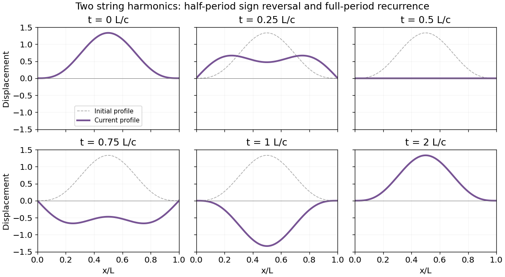

<h1 id="10/c/solution">Solution</h1>

↑ **Parent:** [C](../c.md)

Fixed endpoints select the spatial [normal modes](../../../../normal-mode.md) $\sin(n\pi x/L)$, with angular frequencies $\omega_n=n\pi c/L$. Zero initial velocity selects cosine time dependence. Matching the two nonzero initial amplitudes gives

$$
\boxed{y(x,t)=\sin\frac{\pi x}L\cos\frac{\pi ct}L-\frac13\sin\frac{3\pi x}L\cos\frac{3\pi ct}L.}
$$

Each term separately satisfies the [wave equation](../../../../wave-equation-split.md) and fixed-end [boundary conditions](../../../../boundary-condition.md). At $t=0$ the prescribed profile is recovered, and differentiating in time gives zero initial velocity.

**[Figure 2](#10/c/image-two-mode-string-motion-sign-reversal-at-half-a-period-and-exact-recurrence). Two-mode string motion, sign reversal at half a period and exact recurrence**.

## ↑ Ancestors (12)

1. [C](../c.md)
2. [10](../../10.md)
3. [2014 resit](../../../2014-resit-split.md)
4. [Past exam of the mathematical methods II course of the University of Oxford](../../../split.md)
5. [Mathematical methods II course of the University of Oxford](../../../../mathematical-methods-ii-course-of-the-university-of-oxford.md)
6. [Year 1 of the physics course of the University of Oxford](../../../../year-1-of-the-physics-course-of-the-university-of-oxford.md)
7. [Physics course of the University of Oxford](../../../../physics-course-of-the-university-of-oxford.md)
8. [Undergraduate course of the University of Oxford](../../../../undergraduate-course-of-the-university-of-oxford.md)
9. [Course of the University of Oxford](../../../../course-of-the-university-of-oxford.md)
10. [University of Oxford](../../../../university-of-oxford-split.md)
11. [List of universities](../../../../list-of-universities.md)
12. [Codex Wiki](../../../../split.md)
