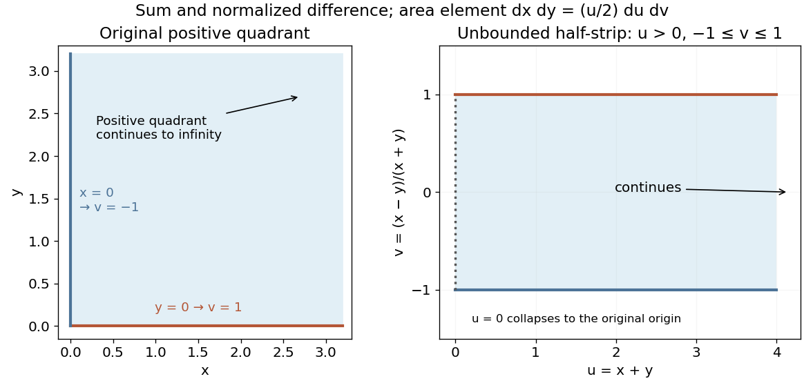

<h1 id="9/b/solution">Solution</h1>

↑ **Parent:** [B](../b.md)

For the specified [change of variables](../../../../change-of-variables-formula.md),

$$
\frac{\partial(x,y)}{\partial(u,v)}=\det\begin{pmatrix}(1+v)/2&u/2\\(1-v)/2&-u/2\end{pmatrix}=-\frac u2.
$$

Thus the inverse-coordinate [Jacobian determinant](../../../../jacobian-determinant.md) is $\partial(u,v)/\partial(x,y)=-2/u$ where $u>0$, and the area element uses the absolute value $dx\,dy=(u/2)du\,dv$.

Now $u=x+y$, $v=(x-y)/(x+y)$ and $xy=u^2(1-v^2)/4$. The positive quadrant maps to the half-strip $u\geq0$, $-1\leq v\leq1$. The original origin corresponds to the collapsed boundary $u=0$, where $v$ is not unique; this measure-zero degeneracy does not affect the integral. Therefore

$$
I=\frac14\int_0^\infty u^2e^{-u}\,du\int_{-1}^1\sqrt{1-v^2}\,dv=\frac14(2!)\left(\frac\pi2\right)=\boxed{\frac\pi4}.
$$

The second factor is the area of a unit semicircle. Independently, the original integrand factors into two identical [gamma integrals](../../../../gamma-integral.md), giving $\Gamma(3/2)^2=\pi/4$.

**[Figure 1](#9/b/image-positive-quadrant-coordinates-mapped-to-an-unbounded-half-strip). Positive-quadrant coordinates mapped to an unbounded half-strip**.

## ↑ Ancestors (12)

1. [B](../b.md)
2. [9](../../9.md)
3. [2014 resit](../../../2014-resit-split.md)
4. [Past exam of the mathematical methods II course of the University of Oxford](../../../split.md)
5. [Mathematical methods II course of the University of Oxford](../../../../mathematical-methods-ii-course-of-the-university-of-oxford.md)
6. [Year 1 of the physics course of the University of Oxford](../../../../year-1-of-the-physics-course-of-the-university-of-oxford.md)
7. [Physics course of the University of Oxford](../../../../physics-course-of-the-university-of-oxford.md)
8. [Undergraduate course of the University of Oxford](../../../../undergraduate-course-of-the-university-of-oxford.md)
9. [Course of the University of Oxford](../../../../course-of-the-university-of-oxford.md)
10. [University of Oxford](../../../../university-of-oxford-split.md)
11. [List of universities](../../../../list-of-universities.md)
12. [Codex Wiki](../../../../split.md)
