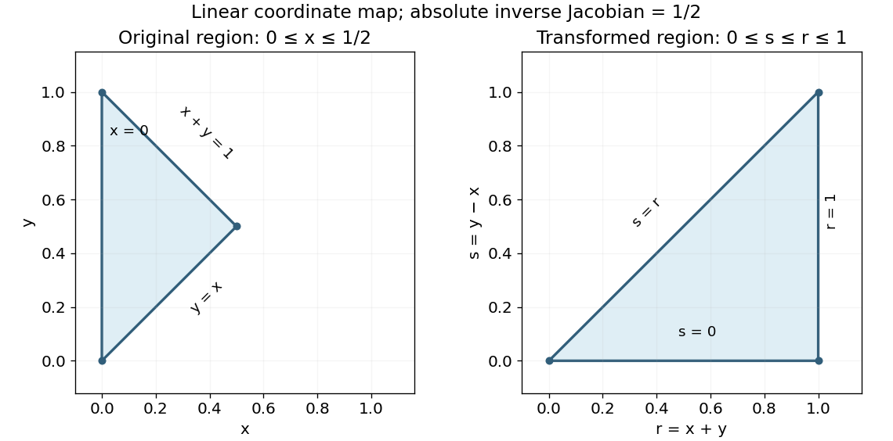

<h1 id="10/b/solution">Solution</h1>

↑ **Parent:** [B](../b.md)

The original integration region is the triangle with vertices $(0,0)$, $(0,1)$ and $(1/2,1/2)$. Under $r=x+y$, $s=y-x$, its inverse map is $x=(r-s)/2$, $y=(r+s)/2$, with absolute inverse [Jacobian determinant](../../../../jacobian-determinant.md) $1/2$. The boundaries $x=0$, $y=x$, $x+y=1$ become $s=r$, $s=0$, $r=1$. Thus the transformed triangle is $0\leq s\leq r\leq1$, and

$$
I=\frac12\int_0^1\int_0^r\frac{s}{r^2\sqrt{1-r^2}}\,ds\,dr=\frac14\int_0^1\frac{dr}{\sqrt{1-r^2}}=\boxed{\frac\pi8}.
$$

The endpoint singularities are integrable after the inner integral: $r=0$ is only a collapsed vertex, while $r=1$ has the usual inverse-square-root behavior. The diagrams indicate the complete triangles, rather than rectangular bounds that would include points absent from the original region.

**[Figure 2](#10/b/image-original-and-sum-difference-coordinate-triangles-for-the-transformed-double-integral). Original and sum-difference-coordinate triangles for the transformed double integral**.

## ↑ Ancestors (12)

1. [B](../b.md)
2. [10](../../10.md)
3. [2014](../../../2014-split.md)
4. [Past exam of the mathematical methods II course of the University of Oxford](../../../split.md)
5. [Mathematical methods II course of the University of Oxford](../../../../mathematical-methods-ii-course-of-the-university-of-oxford.md)
6. [Year 1 of the physics course of the University of Oxford](../../../../year-1-of-the-physics-course-of-the-university-of-oxford.md)
7. [Physics course of the University of Oxford](../../../../physics-course-of-the-university-of-oxford.md)
8. [Undergraduate course of the University of Oxford](../../../../undergraduate-course-of-the-university-of-oxford.md)
9. [Course of the University of Oxford](../../../../course-of-the-university-of-oxford.md)
10. [University of Oxford](../../../../university-of-oxford-split.md)
11. [List of universities](../../../../list-of-universities.md)
12. [Codex Wiki](../../../../split.md)
