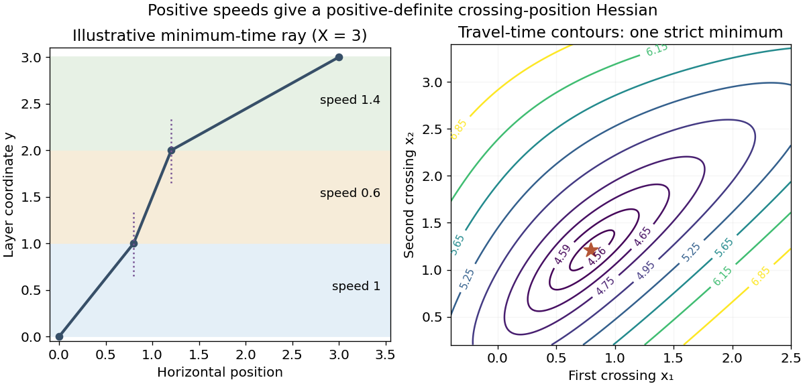

<h1 id="8/b/solution">Solution</h1>

↑ **Parent:** [B](../b.md)

At a smooth interior stationary point, define $D=t_{11}t_{22}-t_{12}^2$. The [second-derivative test](../../../../second-derivative-test.md) gives a minimum for $D>0,t_{11}>0$, a maximum for $D>0,t_{11}<0$, and a [saddle point](../../../../saddle-point.md) for $D<0$; $D=0$ is inconclusive.

For the stated time function, put

$$
p=\frac1{u(1+x_1^2)^{3/2}},\quad q=\frac1{v(1+(x_2-x_1)^2)^{3/2}},\quad r=\frac1{w(1+(X-x_2)^2)^{3/2}}.
$$

Positive physical speeds make all three coefficients positive. The [positive Hessian of a layered travel-time functional](../../../../positive-hessian-of-a-layered-travel-time-functional.md) here is

$$
H=\begin{pmatrix}p+q&-q\\-q&q+r\end{pmatrix},\qquad \boxed{t_{11}=p+q>0,\quad D=pq+pr+qr>0.}
$$

Thus the stationary path is a strict minimum, not merely a candidate of unspecified type. In fact the same positivity holds for all finite crossing positions, so the time function is strictly convex and the minimum is unique.

**[Figure 1](#8/b/image-minimum-travel-time-through-three-constant-speed-layers-and-the-crossing-position-time-surface). Minimum travel time through three constant-speed layers and the crossing-position time surface**.

## ↑ Ancestors (12)

1. [B](../b.md)
2. [8](../../8.md)
3. [2014](../../../2014-split.md)
4. [Past exam of the mathematical methods II course of the University of Oxford](../../../split.md)
5. [Mathematical methods II course of the University of Oxford](../../../../mathematical-methods-ii-course-of-the-university-of-oxford.md)
6. [Year 1 of the physics course of the University of Oxford](../../../../year-1-of-the-physics-course-of-the-university-of-oxford.md)
7. [Physics course of the University of Oxford](../../../../physics-course-of-the-university-of-oxford.md)
8. [Undergraduate course of the University of Oxford](../../../../undergraduate-course-of-the-university-of-oxford.md)
9. [Course of the University of Oxford](../../../../course-of-the-university-of-oxford.md)
10. [University of Oxford](../../../../university-of-oxford-split.md)
11. [List of universities](../../../../list-of-universities.md)
12. [Codex Wiki](../../../../split.md)
