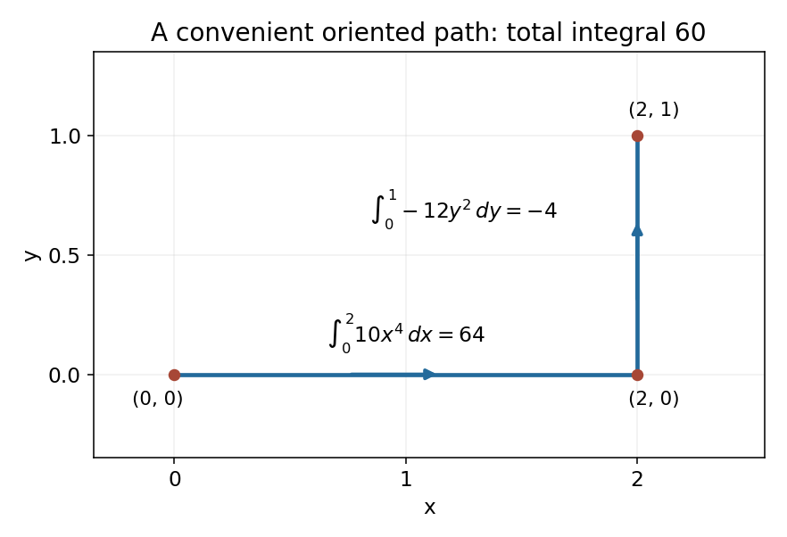
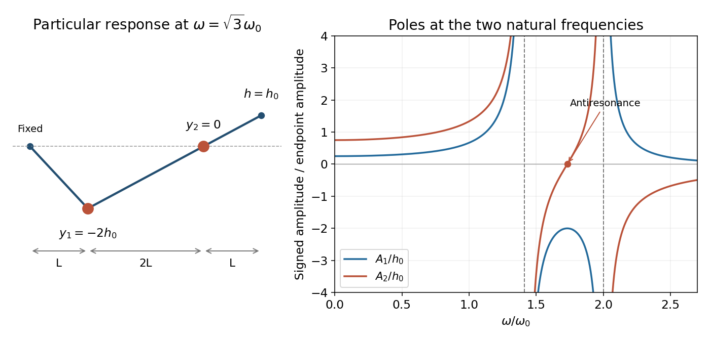
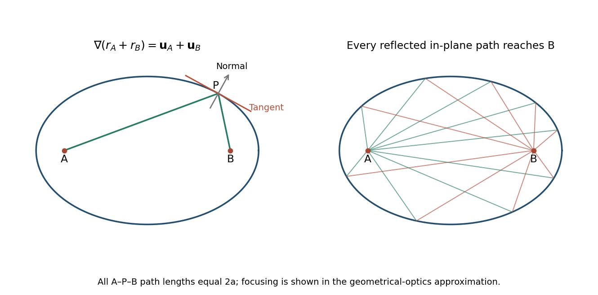
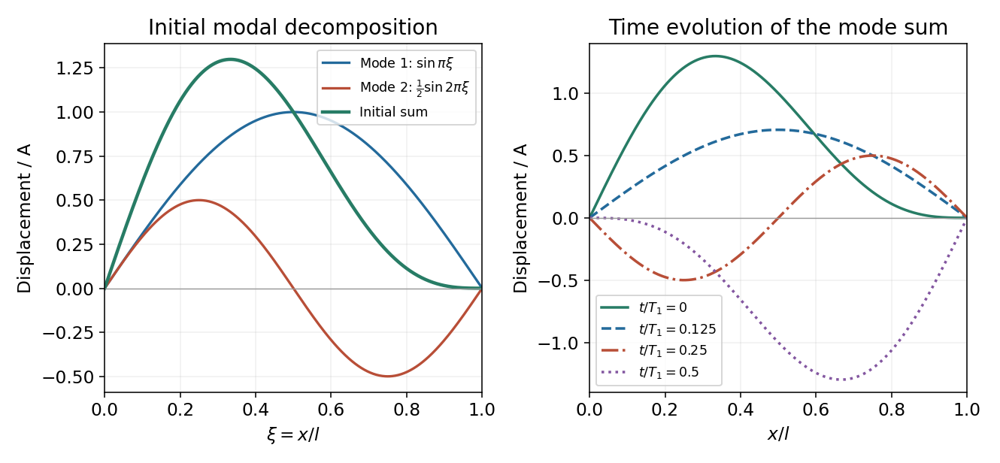

# 2015 resit

↑ **Parent:** [Past exam of the mathematical methods II course of the University of Oxford](../past-exam-of-the-mathematical-methods-ii-course-of-the-university-of-oxford.md)

Source paper: [Oxford source archive](https://www.whatdotheyknow.com/request/physics_preliminary_examinations/response/1162943/attach/3/Twain.7z?cookie_passthrough=1), member `2015/CP4_Sept_2015.pdf`. The dated cover establishes the 10 September 2015 resit despite its generic Trinity Term heading. All four Section B options are treated.

**Table of contents**

- [1](#1)
  - [Solution](#1/solution)
- [2](#2)
  - [a](#2/a)
    - [Solution](#2/a/solution)
  - [b](#2/b)
    - [Solution](#2/b/solution)
  - [c](#2/c)
    - [Solution](#2/c/solution)
- [3](#3)
  - [Solution](#3/solution)
- [4](#4)
  - [Solution](#4/solution)
- [5](#5)
  - [i](#5/i)
    - [Solution](#5/i/solution)
  - [ii](#5/ii)
    - [Solution](#5/ii/solution)
- [6](#6)
  - [a](#6/a)
    - [Solution](#6/a/solution)
  - [b](#6/b)
    - [Solution](#6/b/solution)
  - [c](#6/c)
    - [Solution](#6/c/solution)
- [7](#7)
  - [Solution](#7/solution)
- [8](#8)
  - [a](#8/a)
    - [Solution](#8/a/solution)
  - [b](#8/b)
    - [Solution](#8/b/solution)
  - [c](#8/c)
    - [Solution](#8/c/solution)
  - [d](#8/d)
    - [Solution](#8/d/solution)
- [9](#9)
  - [a](#9/a)
    - [Solution](#9/a/solution)
  - [b](#9/b)
    - [Solution](#9/b/solution)
  - [c](#9/c)
    - [Solution](#9/c/solution)
  - [d](#9/d)
    - [Solution](#9/d/solution)
- [10](#10)
  - [a](#10/a)
    - [Solution](#10/a/solution)
  - [b](#10/b)
    - [Solution](#10/b/solution)
  - [c](#10/c)
    - [Solution](#10/c/solution)
  - [d](#10/d)
    - [Solution](#10/d/solution)
- [11](#11)
  - [a](#11/a)
    - [Solution](#11/a/solution)
  - [b](#11/b)
    - [Solution](#11/b/solution)
  - [c](#11/c)
    - [Solution](#11/c/solution)
  - [d](#11/d)
    - [Solution](#11/d/solution)

## 1

↑ **Parent:** [2015 resit](2015-resit.md)

<h3 id="1/solution">Solution</h3>

↑ **Parent:** [1](#1)

Start with the [Maclaurin series](../calculus.md#maclaurin-series) $\cos x=1-x^2/2+x^4/24+O(x^6)$. Put $z=-x^2/2+x^4/24+O(x^6)$ into the [binomial series](../sequence-and-series.md#binomial-series) $(1+z)^{-2}=1-2z+3z^2+O(z^3)$. Keeping terms through $x^4$ gives

$$
(\cos x)^{-2}=1-2\left(-\frac{x^2}{2}+\frac{x^4}{24}\right)+3\left(\frac{x^4}{4}\right)+O(x^6),
$$

so

$$
\boxed{\sec^2x=1+x^2+\frac23x^4+O(x^6)}.
$$

Since $d(\tan x)/dx=\sec^2x$ and $\tan0=0$, term-by-term [integration](../integral.md) supplies the [constant of integration](../integral.md#constant-of-integration) and gives

$$
\boxed{\tan x=x+\frac{x^3}{3}+\frac{2x^5}{15}+O(x^7)}.
$$

The expansions hold near zero; the nearest real poles at $\pm\pi/2$ limit their [radius of convergence](../sequence-and-series.md#radius-of-convergence) to $\pi/2$. The derivative relation also independently checks all three displayed coefficients of the [tangent function](../geometry-and-topology.md#tangent-function).

## 2

↑ **Parent:** [2015 resit](2015-resit.md)

<h3 id="2/a">a</h3>

↑ **Parent:** [2](#2)

<h4 id="2/a/solution">Solution</h4>

↑ **Parent:** [A](#2/a)

The [Maclaurin series](../calculus.md#maclaurin-series) give $1-\cos(x^2)=x^4/2+O(x^8)$ and $\tan x=x+O(x^3)$. Therefore $x^2\tan^2x=x^4+O(x^6)$, and cancellation of the common leading power gives

$$
\boxed{\lim_{x\to0}\frac{1-\cos(x^2)}{x^2\tan^2x}=\frac12}.
$$

The argument applies from either side of zero: both leading terms involve the even power $x^4$. The expression need not be defined at zero itself for its [limit](../calculus.md#limit-of-a-function) to exist.

<h3 id="2/b">b</h3>

↑ **Parent:** [2](#2)

<h4 id="2/b/solution">Solution</h4>

↑ **Parent:** [B](#2/b)

Combine the two singular terms before taking the [limit](../calculus.md#limit-of-a-function):

$$
\frac{\log(1+x)}{x^2}-\frac1x=\frac{\log(1+x)-x}{x^2}.
$$

For $x$ near zero, within the real domain $x>-1$, the [Maclaurin series](../calculus.md#maclaurin-series) is $\log(1+x)=x-x^2/2+O(x^3)$. Hence

$$
\frac{\log(1+x)-x}{x^2}=-\frac12+O(x),\qquad\boxed{\lim_{x\to0}\left(\frac{\log(1+x)}{x^2}-\frac1x\right)=-\frac12}.
$$

The two individual terms have divergent limits; their leading singularities cancel. Evaluating them separately as an “infinity minus infinity” subtraction would not justify the finite result.

<h3 id="2/c">c</h3>

↑ **Parent:** [2](#2)

<h4 id="2/c/solution">Solution</h4>

↑ **Parent:** [C](#2/c)

Let $h=x-\pi/2$. The trigonometric identity $\sin(\pi/2+h)=\cos h$ changes the expression to $h^2/(\cos h-1)$. Since $\cos h-1=-h^2/2+O(h^4)$,

$$
\boxed{\lim_{x\to\pi/2}\frac{(x-\pi/2)^2}{\sin x-1}=-2}.
$$

The negative sign is also forced geometrically: near its maximum, $\sin x-1$ is negative while the numerator is nonnegative. Both numerator and denominator vanish quadratically, so one application of a first-derivative argument alone would not yet resolve the indeterminate form.

## 3

↑ **Parent:** [2015 resit](2015-resit.md)

<h3 id="3/solution">Solution</h3>

↑ **Parent:** [3](#3)

Work on a domain with $x\ne0$, and suppose $f$ is differentiable at $u=y/x$. The multivariable [chain rule](../calculus.md#chain-rule) gives

$$
\frac{\partial w}{\partial x}=f'(u)\frac{\partial u}{\partial x}=-\frac{y}{x^2}f'(u),\qquad\frac{\partial w}{\partial y}=f'(u)\frac{\partial u}{\partial y}=\frac1x f'(u).
$$

Multiplying the first equation by $x$ and the second by $y$ cancels their common terms:

$$
\boxed{x\frac{\partial w}{\partial x}+y\frac{\partial w}{\partial y}=0}.
$$

The geometry is that $y/x$ stays fixed along a radial dilation $(x,y)\mapsto(\lambda x,\lambda y)$. Thus $w$ is constant along each admissible radial ray, and the differential operator $x\partial_x+y\partial_y$ differentiates along that ray. This is the degree-zero case of [Euler homogeneous function theorem](../real-analysis.md#euler-theorem-for-homogeneous-functions). The displayed quotient does not define a function at $x=0$ without additional extension data.

## 4

↑ **Parent:** [2015 resit](2015-resit.md)

<h3 id="4/solution">Solution</h3>

↑ **Parent:** [4](#4)

The proposed linear [change of variables](../multivariable-calculus.md#change-of-variables-formula) makes the two pairs of boundary lines constant-coordinate lines: $v=1,4$ and $u=0,7$. Thus the image of the [parallelogram](../euclidean-geometry.md#parallelogram) is the rectangle $0\le u\le7$, $1\le v\le4$.

The forward [Jacobian matrix](../multivariable-calculus.md#jacobian-matrix) and its [determinant](../multilinear-algebra.md#determinant) are

$$
\frac{\partial(u,v)}{\partial(x,y)}=\begin{pmatrix}1&-3\\2&1\end{pmatrix},\qquad\det=7.
$$

Inverting gives $x=(u+3v)/7$, $y=(v-2u)/7$, so the area element is $dx\,dy=\tfrac17du\,dv$. The absolute inverse [Jacobian determinant](../multivariable-calculus.md#jacobian-determinant), rather than the forward determinant, belongs in the transformed area integral. Consequently

$$
\begin{aligned}
\iint_D\frac{x-3y}{2x+y}\,dx\,dy&=\frac17\int_0^7\int_1^4\frac uv\,dv\,du\\
&=\frac17\left[\frac{u^2}{2}\right]_0^7[\log v]_1^4,
\end{aligned}
$$

which yields $\boxed{\tfrac72\log4=7\log2}$. The transformed denominator is bounded below by one throughout the region, so no singular or improper integral is involved.

## 5

↑ **Parent:** [2015 resit](2015-resit.md)

<h3 id="5/i">i</h3>

↑ **Parent:** [5](#5)

<h4 id="5/i/solution">Solution</h4>

↑ **Parent:** [I](#5/i)

For a twice continuously differentiable function $F$, first check the stationary-point condition $F_x=F_y=0$. Write its [Hessian matrix](../multivariable-calculus.md#hessian-matrix) as $H=\begin{pmatrix}A&B\\B&C\end{pmatrix}$, with $A=F_{xx}$, $B=F_{xy}$ and $C=F_{yy}$. The [second-derivative test](../multivariable-calculus.md#second-derivative-test) uses $D=AC-B^2$: if $D>0$ and $A>0$, the point is a strict local minimum; if $D>0$ and $A<0$, it is a strict local maximum; if $D<0$, it is a saddle point. If $D=0$, the quadratic test is inconclusive and higher-order terms or a direct argument are needed.

For $F=e^{y^2-x^2}$, the first derivatives vanish at the origin and

$$
H(0,0)=\begin{pmatrix}-2&0\\0&2\end{pmatrix},\qquad D=-4<0.
$$

Thus $\boxed{(0,0)\text{ is a saddle point, with }F(0,0)=1}$. Directly, $F(x,0)=e^{-x^2}<1$ for nearby nonzero $x$, while $F(0,y)=e^{y^2}>1$ for nearby nonzero $y$. The presence of both increasing and decreasing directions confirms the [Hessian matrix](../multivariable-calculus.md#hessian-matrix) classification.

<h3 id="5/ii">ii</h3>

↑ **Parent:** [5](#5)

<h4 id="5/ii/solution">Solution</h4>

↑ **Parent:** [Ii](#5/ii)

Let $G=x^3e^{-x^2-y^2}$ and $a=\sqrt{3/2}$. Its [partial derivatives](../multivariable-calculus.md#partial-derivative) are

$$
G_x=x^2(3-2x^2)e^{-x^2-y^2},\qquad G_y=-2yx^3e^{-x^2-y^2},
$$

so both vanish at $(a,0)$ and $(-a,0)$. Evaluating the second derivatives at a point $(x,0)$ with $x^2=3/2$ gives

$$
G_{xx}=-6xe^{-3/2},\qquad G_{xy}=0,\qquad G_{yy}=-3xe^{-3/2}.
$$

Therefore the [Hessian determinant](../multivariable-calculus.md#hessian-determinant) is $18x^2e^{-3}=27e^{-3}>0$. Its two diagonal entries are negative at $x=a$ and positive at $x=-a$. Hence

$$
\boxed{\begin{aligned}
(a,0)&:\ \text{strict local maximum},&G&=\left(\frac{3}{2e}\right)^{3/2},\\
(-a,0)&:\ \text{strict local minimum},&G&=-\left(\frac{3}{2e}\right)^{3/2}.
\end{aligned}}
$$

These are also global extrema: for positive $x$, the factor $e^{-y^2}\le1$ maximizes the positive value at $y=0$, and differentiating $x^3e^{-x^2}$ fixes its positive maximum at $a$. Oddness in $x$ supplies the corresponding global minimum.

## 6

↑ **Parent:** [2015 resit](2015-resit.md)

<h3 id="6/a">a</h3>

↑ **Parent:** [6](#6)

<h4 id="6/a/solution">Solution</h4>

↑ **Parent:** [A](#6/a)

The [divergence theorem](../multivariable-calculus.md#divergence-theorem) states that, for a sufficiently smooth [vector field](../multivariable-calculus.md#vector-field) $\mathbf F$ on a volume $\Omega$ with piecewise smooth closed boundary $\partial\Omega$,

$$
\boxed{\oiint_{\partial\Omega}\mathbf F\cdot\hat{\mathbf n}\,dS=\iiint_\Omega\nabla\cdot\mathbf F\,dV}.
$$

Here $\hat{\mathbf n}$ is the outward unit normal. The left-hand side is the total outward [flux](../mathematical-physics.md#flux); the right-hand side adds the local [divergence](../multivariable-calculus.md#divergence) throughout the volume. The orientation and the requirement to include the complete closed boundary are essential.

<h3 id="6/b">b</h3>

↑ **Parent:** [6](#6)

<h4 id="6/b/solution">Solution</h4>

↑ **Parent:** [B](#6/b)

Read the given [vector field](../multivariable-calculus.md#vector-field) as the three-dimensional field $\mathbf F=(x,y,0)$. Its [divergence](../multivariable-calculus.md#divergence) is the sum of the three matching-coordinate [partial derivatives](../multivariable-calculus.md#partial-derivative):

$$
\boxed{\nabla\cdot\mathbf F=\frac{\partial x}{\partial x}+\frac{\partial y}{\partial y}+\frac{\partial0}{\partial z}=2}.
$$

The absence of a $z$ component does not make the three-dimensional [flux](../mathematical-physics.md#flux) vanish: the field still flows outward through surface normals with horizontal components.

<h3 id="6/c">c</h3>

↑ **Parent:** [6](#6)

<h4 id="6/c/solution">Solution</h4>

↑ **Parent:** [C](#6/c)

The enclosed volume lies above $z=0$ and below $z=4-x^2-y^2$. In [cylindrical coordinates](../multivariable-calculus.md#cylindrical-coordinate-system), its limits are $0\le r\le2$, $0\le\theta\le2\pi$, $0\le z\le4-r^2$, with volume element $r\,dz\,dr\,d\theta$. The [divergence theorem](../multivariable-calculus.md#divergence-theorem) gives

$$
\oiint\mathbf F\cdot d\mathbf S=2\int_0^{2\pi}\int_0^2\int_0^{4-r^2}r\,dz\,dr\,d\theta=4\pi\int_0^2(4r-r^3)\,dr.
$$

Thus the volume is $8\pi$, and the outward [flux](../mathematical-physics.md#flux) is $\boxed{16\pi}$.

A direct check separates the boundary into its cap and base. On the base, $\mathbf F\cdot(-\hat{\mathbf z})=0$. On the graph $z=4-x^2-y^2$, the upward vector area element is $(2x,2y,1)\,dx\,dy$, so the cap flux is $\iint_{x^2+y^2\le4}2(x^2+y^2)\,dx\,dy=16\pi$, in agreement with the volume calculation.

## 7

↑ **Parent:** [2015 resit](2015-resit.md)

<h3 id="7/solution">Solution</h3>

↑ **Parent:** [7](#7)

For a real propagating positive-frequency branch, require $\omega^2>a^2$ and $c\ne0$. If $a$ is the usual nonnegative cutoff, the source condition $\omega>a$ gives this branch. With an arbitrary real negative $a$, that inequality alone is insufficient: $a=-2$ and $\omega=1$ satisfy it but make the displayed square root imaginary.

On the positive-frequency real branch, the [phase velocity](../dispersion-relation.md#phase-velocity) $v_P=\omega/k$ gives

$$
v_P=\frac{c\omega}{\sqrt{\omega^2-a^2}},\qquad k=\frac{\sqrt{\omega^2-a^2}}c.
$$

Differentiate the [dispersion relation](../dispersion-relation.md) to obtain the [group velocity](../dispersion-relation.md#group-velocity):

$$
\frac{dk}{d\omega}=\frac{\omega}{c\sqrt{\omega^2-a^2}},\qquad v_G=\frac{d\omega}{dk}=\frac{c\sqrt{\omega^2-a^2}}\omega.
$$

Therefore

$$
\boxed{v_G=\frac{c^2}{v_P},\qquad v_Pv_G=c^2}.
$$

For $c>0$ and a nonzero cutoff, $v_P>c$ while $v_G<c$; when $a=0$, both equal $c$. The constant $c$ is the [velocity](../classical-mechanics.md#velocity) scale in this assumed medium, and need not independently be identified with the vacuum speed of light. A [group velocity](../dispersion-relation.md#group-velocity) describes a narrow-band wave packet on the chosen differentiable branch, rather than automatically fixing a signal front [velocity](../classical-mechanics.md#velocity) in every dispersive model.

## 8

↑ **Parent:** [2015 resit](2015-resit.md)

<h3 id="8/a">a</h3>

↑ **Parent:** [8](#8)

<h4 id="8/a/solution">Solution</h4>

↑ **Parent:** [A](#8/a)

Embed the planar [vector field](../multivariable-calculus.md#vector-field) as $\mathbf V=(A(x,y),B(x,y),0)$, independent of $z$. Applying the Cartesian [curl](../multivariable-calculus.md#curl) formula gives

$$
\nabla\times\mathbf V=\left(0,0,\frac{\partial B}{\partial x}-\frac{\partial A}{\partial y}\right).
$$

Consequently, for continuously differentiable components,

$$
\boxed{\nabla\times\mathbf V=0\quad\Longleftrightarrow\quad B_x=A_y}.
$$

This is the local closedness condition for the one-form $A\,dx+B\,dy$. To infer global [path independence](../multivariable-calculus.md#path-independence) from this condition alone, the domain also matters: it suffices that the planar domain is a [simply connected space](../algebraic-topology.md#simply-connected-space). The polynomial field in the next calculation is defined on the whole plane, so there is no missing-hole obstruction.

<h3 id="8/b">b</h3>

↑ **Parent:** [8](#8)

<h4 id="8/b/solution">Solution</h4>

↑ **Parent:** [B](#8/b)

Set $A=10x^4-2xy^3$ and $B=-3x^2y^2$. Their mixed derivatives agree: $A_y=-6xy^2=B_x$. Both components are smooth on all of $\mathbb R^2$, a [simply connected space](../algebraic-topology.md#simply-connected-space), so the [line integral](../multivariable-calculus.md#line-integral) is path independent.

Choose a horizontal segment from $(0,0)$ to $(2,0)$ followed by a vertical segment to $(2,1)$. On the first, $y=0$ and $dy=0$; on the second, $x=2$ and $dx=0$. Thus

$$
I=\int_0^2 10x^4\,dx+\int_0^1(-12y^2)\,dy=64-4=\boxed{60}.
$$

The selected path and its orientation are shown below. No contribution comes from a differential whose coordinate is held constant on a segment.

**[Figure 1](#8/b/image-two-straight-segments-used-to-evaluate-the-path-independent-integral). Two straight segments used to evaluate the path-independent integral**.

<h3 id="8/c">c</h3>

↑ **Parent:** [8](#8)

<h4 id="8/c/solution">Solution</h4>

↑ **Parent:** [C](#8/c)

A one-form $A(x,y)\,dx+B(x,y)\,dy$ is an [exact differential](../differential-form.md#exact-differential) if a single-valued differentiable [potential of a conservative vector field](../multivariable-calculus.md#potential-of-a-conservative-vector-field) $f$ satisfies $A=f_x$ and $B=f_y$ on the domain. Then it equals $df$, and its integral along a path is the endpoint difference of $f$.

Integrate $f_x=10x^4-2xy^3$ with respect to $x$:

$$
f(x,y)=2x^5-x^2y^3+g(y).
$$

Its $y$ derivative is $-3x^2y^2+g'(y)$. Matching the required second component [forces](../force.md) $g'(y)=0$, so the additive constant is arbitrary and

$$
df=(10x^4-2xy^3)\,dx-3x^2y^2\,dy.
$$

The [fundamental theorem for line integrals](../multivariable-calculus.md#fundamental-theorem-for-line-integrals) now gives

$$
\boxed{I=f(2,1)-f(0,0)=2(2^5)-2^2=60},
$$

independently of the convenient segmented path used before. Merely checking equality of mixed partial derivatives on an unspecified domain would not by itself construct this globally defined potential.

<h3 id="8/d">d</h3>

↑ **Parent:** [8](#8)

<h4 id="8/d/solution">Solution</h4>

↑ **Parent:** [D](#8/d)

Take $C$ to be a simple closed, piecewise smooth curve oriented counterclockwise around its interior $D$. [Green's theorem](../multivariable-calculus.md#green-theorem) applied to $P=-y$ and $Q=x$ gives

$$
\oint_C(x\,dy-y\,dx)=\iint_D\left(\frac{\partial x}{\partial x}-\frac{\partial(-y)}{\partial y}\right)dx\,dy=2\iint_Ddx\,dy=2\mathcal A.
$$

The orientation is essential: a clockwise unit circle gives $-2\pi$, whereas twice its ordinary unsigned area is $+2\pi$. For a nonsimple curve, the corresponding formula concerns signed area with winding multiplicity rather than one unsigned enclosed area.

For positive semiaxes $a,b$, parametrize the [ellipse](../euclidean-geometry.md#ellipse) counterclockwise by $x=a\cos\theta$, $y=b\sin\theta$, $0\le\theta\le2\pi$. Then

$$
x\,dy-y\,dx=ab\cos^2\theta\,d\theta+ab\sin^2\theta\,d\theta=ab\,d\theta.
$$

Hence $2\mathcal A=\int_0^{2\pi}ab\,d\theta=2\pi ab$, and

$$
\boxed{\mathcal A=\pi ab}.
$$

## 9

↑ **Parent:** [2015 resit](2015-resit.md)

<h3 id="9/a">a</h3>

↑ **Parent:** [9](#9)

<h4 id="9/a/solution">Solution</h4>

↑ **Parent:** [A](#9/a)

The original diagram has three horizontal spans $L$, $2L$ and $L$. In the small-slope approximation the massless string segments are straight and their transverse [force](../force.md) components are [tension](../force.md#tension) times slope. The horizontal [tension](../force.md#tension) components cancel to first order.

For the first bead, the left segment contributes $-Ty_1/L$ and the middle segment contributes $T(y_2-y_1)/(2L)$. For the second bead, the middle contribution is $T(y_1-y_2)/(2L)$ and the driven right segment contributes $T(h-y_2)/L$. [Newton's second law](../force.md#newton-s-second-law) therefore gives

$$
M\ddot y_1=\frac{T}{2L}(y_2-3y_1),\qquad M\ddot y_2=\frac{T}{2L}(y_1-3y_2+2h).
$$

With $\omega_0^2=T/(2ML)$ and $h=h_0\cos\omega t$, the coupled [equations of motion](../classical-mechanics.md#equation-of-motion) are

$$
\boxed{\begin{aligned}
\ddot y_1+3\omega_0^2y_1-\omega_0^2y_2&=0,\\
\ddot y_2+3\omega_0^2y_2-\omega_0^2y_1&=2\omega_0^2h_0\cos\omega t.
\end{aligned}}
$$

The factor two in the driving term follows from the right span having length $L$, while the middle span has length $2L$. Treating all three spans as equal would change both the coupling and the [normal mode](../wave-equation.md#normal-mode) [frequencies](../wave.md#frequency).

<h3 id="9/b">b</h3>

↑ **Parent:** [9](#9)

<h4 id="9/b/solution">Solution</h4>

↑ **Parent:** [B](#9/b)

The natural [normal modes](../wave-equation.md#normal-mode) belong to the homogeneous system with both end displacements fixed at zero. Seek $\mathbf y=\mathbf a\cos\Omega t$, so

$$
\omega_0^2\begin{pmatrix}3&-1\\-1&3\end{pmatrix}\mathbf a=\Omega^2\mathbf a.
$$

The [characteristic polynomial](../linear-operator-theory.md#characteristic-polynomial) is $(3\omega_0^2-\Omega^2)^2-\omega_0^4=0$. The [eigenvectors](../linear-operator-theory.md#eigenvector) $(1,1)$ and $(1,-1)$ therefore give

$$
\boxed{\Omega_+=\sqrt2\,\omega_0,\quad y_1=y_2;\qquad\Omega_-=2\omega_0,\quad y_1=-y_2}.
$$

The symmetric mode leaves the middle segment horizontal, while the antisymmetric mode bends it strongly and has the higher restoring stiffness. Defining $q_+=(y_1+y_2)/2$ and $q_-=(y_1-y_2)/2$ diagonalizes the driven equations too:

$$
\ddot q_++2\omega_0^2q_+=\omega_0^2h(t),\qquad\ddot q_-+4\omega_0^2q_-=-\omega_0^2h(t).
$$

This shows that the boundary drive excites both natural modes; neither natural [resonance](../dynamical-systems.md#resonance) is removed by a zero drive projection.

<h3 id="9/c">c</h3>

↑ **Parent:** [9](#9)

<h4 id="9/c/solution">Solution</h4>

↑ **Parent:** [C](#9/c)

Away from the natural [resonances](../dynamical-systems.md#resonance), seek a periodic particular solution $y_j=A_j\cos\omega t$. Let $s=\omega^2/\omega_0^2$. The amplitude equations are

$$
(3-s)A_1-A_2=0,\qquad-A_1+(3-s)A_2=2h_0.
$$

Their determinant is $(3-s)^2-1=(2-s)(4-s)$, giving the signed displacement amplitudes

$$
\boxed{A_1=\frac{2h_0}{(2-s)(4-s)},\qquad A_2=\frac{2(3-s)h_0}{(2-s)(4-s)}}.
$$

A negative sign denotes a [phase](../wave.md#phase-waves) reversal relative to the prescribed cosine; physical amplitude magnitudes are $|A_j|$. In the quasistatic limit,

$$
\boxed{A_1\longrightarrow h_0/4,\qquad A_2\longrightarrow3h_0/4}.
$$

These are the values of a straight string interpolating between endpoint displacements $0$ and $h_0$ at bead positions $L$ and $3L$ along a total length $4L$.

Because damping is explicitly absent, this periodic response is not a unique attracting late-time state. Arbitrary homogeneous oscillations at $\sqrt2\omega_0$ and $2\omega_0$ persist unless the initial conditions eliminate them. At either natural [resonance](../dynamical-systems.md#resonance), the drive produces secular growth rather than a finite bounded periodic response. Thus “steady state” here refers to the selected particular solution away from the poles.

<h3 id="9/d">d</h3>

↑ **Parent:** [9](#9)

<h4 id="9/d/solution">Solution</h4>

↑ **Parent:** [D](#9/d)

At $\omega=\sqrt3\omega_0$, $s=3$, so the periodic amplitudes become

$$
\boxed{A_1=-2h_0,\qquad A_2=0}.
$$

The second bead is stationary in this particular motion, although the endpoint oscillates. The first bead moves at twice the endpoint amplitude and in opposite [phase](../wave.md#phase-waves). This is an [antiresonance](../electrical-engineering.md#antiresonance) of the second-bead response, not a natural [resonance](../dynamical-systems.md#resonance) of the complete two-bead system.

The [force](../force.md) balance makes the cancellation explicit. At $y_2=0$, the middle segment supplies transverse [force](../force.md) $Ty_1/(2L)=-Th/L$, while the end segment supplies $Th/L$; these cancel on the second bead. The first bead then oscillates between two effectively fixed neighbours with restoring coefficient $3T/(2L)$, whose single-coordinate natural [angular frequency](../lagrangian-mechanics.md#angular-frequency) is $\sqrt3\omega_0$.

**[Figure 2](#9/d/image-periodic-bead-responses-and-the-stationary-second-bead-at-antiresonance). Periodic bead responses and the stationary second bead at antiresonance**.

As elsewhere in the undamped problem, this exact nodal motion presumes initial conditions selecting the periodic particular response. Additional free [normal modes](../wave-equation.md#normal-mode) would move the second bead as well; they do not decay automatically.

## 10

↑ **Parent:** [2015 resit](2015-resit.md)

<h3 id="10/a">a</h3>

↑ **Parent:** [10](#10)

<h4 id="10/a/solution">Solution</h4>

↑ **Parent:** [A](#10/a)

Let a differentiable curve $\mathbf r(s)$ lie on the [level surface](../topology.md#level-surface) $\phi=c$, and pass through the point under consideration. Differentiating the constant relation along the curve gives

$$
0=\frac{d}{ds}\phi(\mathbf r(s))=\nabla\phi\cdot\mathbf r'(s).
$$

Every surface [tangent vector](../tangent-vector.md) arises as the [velocity](../classical-mechanics.md#velocity) of such a surface curve, so the [gradient](../multivariable-calculus.md#gradient) is orthogonal to every tangent direction. At a regular point, where $\nabla\phi\ne0$, it therefore defines a normal direction, with unit normal

$$
\boxed{\hat{\mathbf n}=\pm\frac{\nabla\phi}{|\nabla\phi|}}.
$$

If $\nabla\phi=0$, the dot-product identity is still true but the zero vector does not determine a normal direction; a regularity hypothesis or another defining function is needed. For example, $\phi=z^3$ defines the plane $z=0$ at level zero but has vanishing [gradient](../multivariable-calculus.md#gradient) everywhere on that plane.

<h3 id="10/b">b</h3>

↑ **Parent:** [10](#10)

<h4 id="10/b/solution">Solution</h4>

↑ **Parent:** [B](#10/b)

Write the fixed point as $\mathbf a=(a_1,a_2,a_3)$ and the variable point as $\mathbf r=(x_1,x_2,x_3)$. Then $\mathbf R=\mathbf r-\mathbf a$ and

$$
R=\left[\sum_{j=1}^3(x_j-a_j)^2\right]^{1/2}.
$$

Since the fixed point is not on the surface, $R>0$ at every point being considered. Componentwise differentiation gives $\partial R/\partial x_j=(x_j-a_j)/R$, hence

$$
\boxed{\nabla R=\frac{\mathbf R}{R},\qquad|\nabla R|=1}.
$$

Thus the [gradient](../multivariable-calculus.md#gradient) points from the fixed point towards the variable point and is a [unit vector](../vector-space.md#unit-vector). Keeping the fixed point fixed is important: differentiating a distance between two simultaneously moving points would include both endpoint derivatives.

<h3 id="10/c">c</h3>

↑ **Parent:** [10](#10)

<h4 id="10/c/solution">Solution</h4>

↑ **Parent:** [C](#10/c)

Let $r_A=|\mathbf P-\mathbf A|$, $r_B=|\mathbf P-\mathbf B|$, and define the outward-from-focus unit vectors $\mathbf u_A=(\mathbf P-\mathbf A)/r_A$ and $\mathbf u_B=(\mathbf P-\mathbf B)/r_B$. The [ellipse](../euclidean-geometry.md#ellipse) is the nondegenerate level curve $r_A+r_B=s$, with $s>|\mathbf A-\mathbf B|$. The previous [gradient](../multivariable-calculus.md#gradient) result gives

$$
\nabla(r_A+r_B)=\mathbf u_A+\mathbf u_B.
$$

If $\mathbf t$ is a unit tangent at $P$, [orthogonality](../inner-product.md#orthogonal-vectors) to the level-curve [gradient](../multivariable-calculus.md#gradient) implies

$$
\mathbf t\cdot\mathbf u_A=-\mathbf t\cdot\mathbf u_B.
$$

Therefore $|\mathbf t\cdot\mathbf u_A|=|\mathbf t\cdot\mathbf u_B|$. These absolute dot products are the cosines of the acute angles made by the two focal lines with the unoriented [tangent line](../calculus.md#tangent-line). Thus those angles are equal.

Equivalently, the outward unit normal is $\mathbf n=(\mathbf u_A+\mathbf u_B)/|\mathbf u_A+\mathbf u_B|$, the bisector of the two unit focal directions. Its denominator is nonzero for a nondegenerate [ellipse](../euclidean-geometry.md#ellipse). Using $|\mathbf u_A|=|\mathbf u_B|=1$, the [specular reflection](../optics.md#specular-reflection) formula becomes

$$
\mathbf u_A-2(\mathbf u_A\cdot\mathbf n)\mathbf n=\mathbf u_A-(\mathbf u_A+\mathbf u_B)=\boxed{-\mathbf u_B}.
$$

This algebra proves the equal-angle statement with the incident and reflected ray directions correctly oriented, rather than confusing the line $BP$ with the outgoing direction $PB$.

**[Figure 3](#10/c/image-the-focal-distance-gradient-bisects-the-normal-and-reflects-one-focus-to-the-other). The focal-distance gradient bisects the normal and reflects one focus to the other**.

<h3 id="10/d">d</h3>

↑ **Parent:** [10](#10)

<h4 id="10/d/solution">Solution</h4>

↑ **Parent:** [D](#10/d)

A ray leaving focus $A$ and reaching a boundary point $P$ has incoming unit direction $\mathbf u_A$. By the [law of reflection](../geometrical-optics.md#law-of-reflection), its normal component reverses and its tangential component stays fixed. The result just derived shows that the reflected direction is $-\mathbf u_B$, pointing exactly from $P$ to focus $B$. Thus all such in-plane rays from one focus converge to the other after one reflection, in the ideal [geometrical optics](../geometrical-optics.md) model.

Moreover, every reflected path has the same total length $AP+PB=s$. In a uniform medium their propagation times are equal as well, so different reflection points do not introduce a geometrical path-length spread. Finite [wavelength](../wave-equation.md#wavelength), surface errors and incomplete reflecting coverage limit a real focus; the ideal argument concerns rays in the plane of the [ellipse](../euclidean-geometry.md#ellipse). It does not assert that an arbitrary three-dimensional surface with only one elliptical section focuses every out-of-plane ray.

## 11

↑ **Parent:** [2015 resit](2015-resit.md)

<h3 id="11/a">a</h3>

↑ **Parent:** [11](#11)

<h4 id="11/a/solution">Solution</h4>

↑ **Parent:** [A](#11/a)

Consider a string element of equilibrium length $dx$. Its [mass](../classical-mechanics.md#mass) is $\rho\,dx$, where $\rho$ is mass per unit length. Under the small-slope approximation, the [tension](../force.md#tension) is approximately uniform and its transverse component at an endpoint is $T\,\partial y/\partial x$. The two endpoint [forces](../force.md) have net transverse component

$$
T\left[\frac{\partial y}{\partial x}(x+dx,t)-\frac{\partial y}{\partial x}(x,t)\right]\simeq T\frac{\partial^2y}{\partial x^2}\,dx.
$$

[Newton's second law](../force.md#newton-s-second-law) gives $\rho\,dx\,y_{tt}=T\,dx\,y_{xx}$. Cancelling the element length yields

$$
\boxed{\frac{\partial^2y}{\partial t^2}-c^2\frac{\partial^2y}{\partial x^2}=0,\qquad c=\sqrt{\frac{T}{\rho}}}.
$$

This is the one-dimensional [wave equation](../wave-equation.md) for transverse displacement. Its derivation neglects gravity, bending stiffness and nonlinear changes in [tension](../force.md#tension) and segment length; the given small slope makes those omissions consistent to first order in the displacement.

<h3 id="11/b">b</h3>

↑ **Parent:** [11](#11)

<h4 id="11/b/solution">Solution</h4>

↑ **Parent:** [B](#11/b)

Seek a separated [normal mode](../wave-equation.md#normal-mode) $y(x,t)=X(x)Q(t)$. Substitution in the [wave equation](../wave-equation.md) gives $XQ''=c^2X''Q$. For an oscillatory mode choose the separation constant $-\omega^2$:

$$
Q''+\omega^2Q=0,\qquad\boxed{X''+k^2X=0,\qquad k=\omega/c}.
$$

The fixed endpoints impose $X(0)=X(l)=0$. In $X=A\sin kx+B\cos kx$, the first condition gives $B=0$, and the second requires $\sin kl=0$. Nonzero displacement therefore requires

$$
\boxed{k_n=\frac{n\pi}{l},\quad\omega_n=\frac{n\pi c}{l},\quad f_n=\frac{nc}{2l},\qquad n=1,2,3,\ldots}.
$$

Each spatial shape $\sin(n\pi x/l)$ has fixed nodes and an oscillating overall amplitude: a [standing wave](../mathematical-physics.md#standing-wave). A general lossless motion is a superposition of these standing [normal modes](../wave-equation.md#normal-mode), not necessarily one single-frequency standing wave. The $n=0$ solution is trivial under both fixed-end conditions and does not supply an additional vibrational mode.

<h3 id="11/c">c</h3>

↑ **Parent:** [11](#11)

<h4 id="11/c/solution">Solution</h4>

↑ **Parent:** [C](#11/c)

Use $\sin\theta\cos\theta=\tfrac12\sin2\theta$ with $\theta=\pi x/l$. The initial shape becomes

$$
y(x,0)=A\sin\frac{\pi x}{l}+\frac A2\sin\frac{2\pi x}{l}.
$$

The [sine](../geometry-and-topology.md#sine) functions are orthogonal on $[0,l]$, so this decomposition directly identifies the two nonzero spatial [normal mode](../wave-equation.md#normal-mode) coefficients. Since the string is released from rest, every time-dependent sine coefficient vanishes and the subsequent motion is

$$
\boxed{y(x,t)=A\sin\frac{\pi x}{l}\cos\omega_1t+\frac A2\sin\frac{2\pi x}{l}\cos2\omega_1t},\qquad\omega_1=\frac{\pi c}{l}.
$$

Thus the signed mode amplitudes are $A_1=A$, $A_2=A/2$ and $A_n=0$ for $n\ge3$; their magnitude amplitudes are $|A|$ and $|A|/2$. The factor of two in the second [angular frequency](../lagrangian-mechanics.md#angular-frequency) is fixed by the same boundary conditions as its spatial [wavelength](../wave-equation.md#wavelength).

**[Figure 4](#11/c/image-motion-obtained-from-the-first-two-string-modes-with-initially-zero-velocity). Motion obtained from the first two string modes with initially zero velocity**.

<h3 id="11/d">d</h3>

↑ **Parent:** [11](#11)

<h4 id="11/d/solution">Solution</h4>

↑ **Parent:** [D](#11/d)

For a single [normal mode](../wave-equation.md#normal-mode) $y_n=A_n\sin(k_nx)\cos(\omega_nt+\phi_n)$, the [kinetic energy](../energy.md#kinetic-energy) is the integral of $\tfrac12\rho y_t^2$. Using $\int_0^l\sin^2(k_nx)\,dx=l/2$ gives

$$
\boxed{K_n(t)=\frac{\rho l\omega_n^2A_n^2}{4}\sin^2(\omega_nt+\phi_n)}.
$$

The extra string length is $\int_0^l[\sqrt{1+y_x^2}-1]dx\simeq\tfrac12\int_0^l y_x^2dx$. Multiplying by [tension](../force.md#tension) gives the quadratic [potential energy](../energy.md#potential-energy), so $\int_0^l\cos^2(k_nx)dx=l/2$ implies

$$
\boxed{U_n(t)=\frac{Tl k_n^2A_n^2}{4}\cos^2(\omega_nt+\phi_n)}.
$$

Since $\rho\omega_n^2=Tk_n^2$, the sum is time independent:

$$
\boxed{E_n=K_n+U_n=\frac{Tl k_n^2A_n^2}{4}=\frac{n^2\pi^2TA_n^2}{4l}}.
$$

For the released shape, $A_1=A$ and $A_2=A/2$, so

$$
\boxed{E_1=E_2=\frac{\pi^2TA^2}{4l},\qquad E_{\rm total}=\frac{\pi^2TA^2}{2l}}.
$$

The second mode's smaller displacement is offset by its doubled spatial [wavenumber](../wave-equation.md#wavenumber) and [angular frequency](../lagrangian-mechanics.md#angular-frequency). [orthogonality](../inner-product.md#orthogonal-vectors) of distinct sine and cosine spatial modes eliminates cross terms in the integrated energies, so the total is their sum. Initially the [kinetic energy](../energy.md#kinetic-energy) is zero and all the [energy](../energy.md) is stored in the string's deformation; during the motion the total remains constant.

## ↑ Ancestors (9)

1. [Past exam of the mathematical methods II course of the University of Oxford](../past-exam-of-the-mathematical-methods-ii-course-of-the-university-of-oxford.md)
2. [Mathematical methods II course of the University of Oxford](../university-of-oxford.md#mathematical-methods-ii-course-of-the-university-of-oxford)
3. [Year 1 of the physics course of the University of Oxford](../university-of-oxford.md#year-1-of-the-physics-course-of-the-university-of-oxford)
4. [Physics course of the University of Oxford](../university-of-oxford.md#physics-course-of-the-university-of-oxford)
5. [Undergraduate course of the University of Oxford](../university-of-oxford.md#undergraduate-course-of-the-university-of-oxford)
6. [Course of the University of Oxford](../university-of-oxford.md#course-of-the-university-of-oxford)
7. [University of Oxford](../university-of-oxford.md)
8. [List of universities](../README.md#list-of-universities)
9. [Codex Wiki](../README.md)
