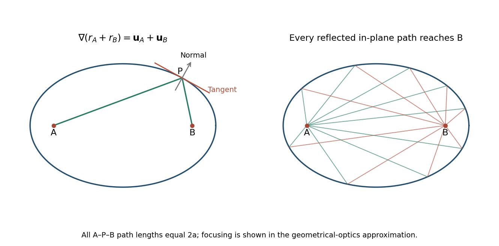

<h1 id="10/c/solution">Solution</h1>

↑ **Parent:** [C](../c.md)

Let $r_A=|\mathbf P-\mathbf A|$, $r_B=|\mathbf P-\mathbf B|$, and define the outward-from-focus unit vectors $\mathbf u_A=(\mathbf P-\mathbf A)/r_A$ and $\mathbf u_B=(\mathbf P-\mathbf B)/r_B$. The [ellipse](../../../../ellipse.md) is the nondegenerate level curve $r_A+r_B=s$, with $s>|\mathbf A-\mathbf B|$. The previous [gradient](../../../../gradient.md) result gives

$$
\nabla(r_A+r_B)=\mathbf u_A+\mathbf u_B.
$$

If $\mathbf t$ is a unit tangent at $P$, [orthogonality](../../../../orthogonal-vectors.md) to the level-curve [gradient](../../../../gradient.md) implies

$$
\mathbf t\cdot\mathbf u_A=-\mathbf t\cdot\mathbf u_B.
$$

Therefore $|\mathbf t\cdot\mathbf u_A|=|\mathbf t\cdot\mathbf u_B|$. These absolute dot products are the cosines of the acute angles made by the two focal lines with the unoriented [tangent line](../../../../tangent-line.md). Thus those angles are equal.

Equivalently, the outward unit normal is $\mathbf n=(\mathbf u_A+\mathbf u_B)/|\mathbf u_A+\mathbf u_B|$, the bisector of the two unit focal directions. Its denominator is nonzero for a nondegenerate [ellipse](../../../../ellipse.md). Using $|\mathbf u_A|=|\mathbf u_B|=1$, the [specular reflection](../../../../specular-reflection.md) formula becomes

$$
\mathbf u_A-2(\mathbf u_A\cdot\mathbf n)\mathbf n=\mathbf u_A-(\mathbf u_A+\mathbf u_B)=\boxed{-\mathbf u_B}.
$$

This algebra proves the equal-angle statement with the incident and reflected ray directions correctly oriented, rather than confusing the line $BP$ with the outgoing direction $PB$.

**[Figure 3](#10/c/image-the-focal-distance-gradient-bisects-the-normal-and-reflects-one-focus-to-the-other). The focal-distance gradient bisects the normal and reflects one focus to the other**.

## ↑ Ancestors (12)

1. [C](../c.md)
2. [10](../../10.md)
3. [2015 resit](../../../2015-resit-split.md)
4. [Past exam of the mathematical methods II course of the University of Oxford](../../../split.md)
5. [Mathematical methods II course of the University of Oxford](../../../../mathematical-methods-ii-course-of-the-university-of-oxford.md)
6. [Year 1 of the physics course of the University of Oxford](../../../../year-1-of-the-physics-course-of-the-university-of-oxford.md)
7. [Physics course of the University of Oxford](../../../../physics-course-of-the-university-of-oxford.md)
8. [Undergraduate course of the University of Oxford](../../../../undergraduate-course-of-the-university-of-oxford.md)
9. [Course of the University of Oxford](../../../../course-of-the-university-of-oxford.md)
10. [University of Oxford](../../../../university-of-oxford-split.md)
11. [List of universities](../../../../list-of-universities.md)
12. [Codex Wiki](../../../../split.md)
