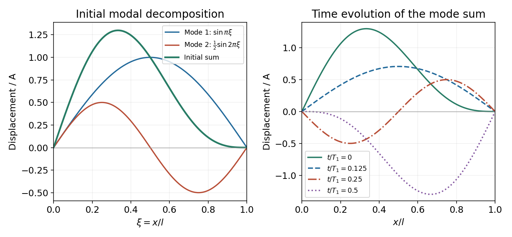

<h1 id="11/c/solution">Solution</h1>

↑ **Parent:** [C](../c.md)

Use $\sin\theta\cos\theta=\tfrac12\sin2\theta$ with $\theta=\pi x/l$. The initial shape becomes

$$
y(x,0)=A\sin\frac{\pi x}{l}+\frac A2\sin\frac{2\pi x}{l}.
$$

The [sine](../../../../sine.md) functions are orthogonal on $[0,l]$, so this decomposition directly identifies the two nonzero spatial [normal mode](../../../../normal-mode.md) coefficients. Since the string is released from rest, every time-dependent sine coefficient vanishes and the subsequent motion is

$$
\boxed{y(x,t)=A\sin\frac{\pi x}{l}\cos\omega_1t+\frac A2\sin\frac{2\pi x}{l}\cos2\omega_1t},\qquad\omega_1=\frac{\pi c}{l}.
$$

Thus the signed mode amplitudes are $A_1=A$, $A_2=A/2$ and $A_n=0$ for $n\ge3$; their magnitude amplitudes are $|A|$ and $|A|/2$. The factor of two in the second [angular frequency](../../../../angular-frequency.md) is fixed by the same boundary conditions as its spatial [wavelength](../../../../wavelength.md).

**[Figure 4](#11/c/image-motion-obtained-from-the-first-two-string-modes-with-initially-zero-velocity). Motion obtained from the first two string modes with initially zero velocity**.

## ↑ Ancestors (12)

1. [C](../c.md)
2. [11](../../11.md)
3. [2015 resit](../../../2015-resit-split.md)
4. [Past exam of the mathematical methods II course of the University of Oxford](../../../split.md)
5. [Mathematical methods II course of the University of Oxford](../../../../mathematical-methods-ii-course-of-the-university-of-oxford.md)
6. [Year 1 of the physics course of the University of Oxford](../../../../year-1-of-the-physics-course-of-the-university-of-oxford.md)
7. [Physics course of the University of Oxford](../../../../physics-course-of-the-university-of-oxford.md)
8. [Undergraduate course of the University of Oxford](../../../../undergraduate-course-of-the-university-of-oxford.md)
9. [Course of the University of Oxford](../../../../course-of-the-university-of-oxford.md)
10. [University of Oxford](../../../../university-of-oxford-split.md)
11. [List of universities](../../../../list-of-universities.md)
12. [Codex Wiki](../../../../split.md)
