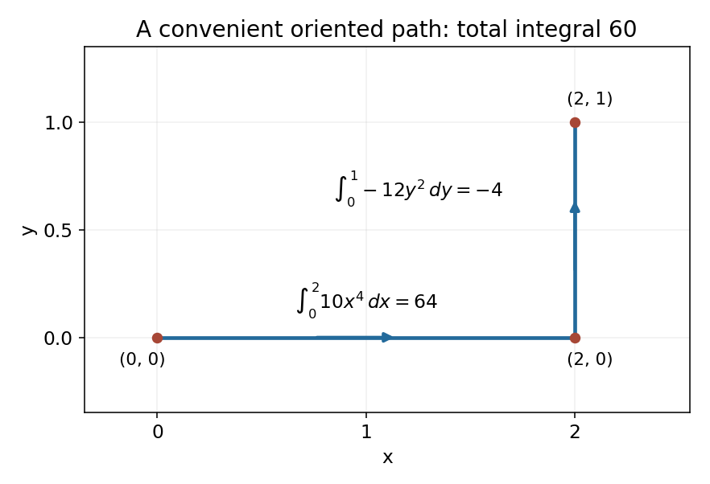

<h1 id="8/b/solution">Solution</h1>

↑ **Parent:** [B](../b.md)

Set $A=10x^4-2xy^3$ and $B=-3x^2y^2$. Their mixed derivatives agree: $A_y=-6xy^2=B_x$. Both components are smooth on all of $\mathbb R^2$, a [simply connected space](../../../../simply-connected-space.md), so the [line integral](../../../../line-integral.md) is path independent.

Choose a horizontal segment from $(0,0)$ to $(2,0)$ followed by a vertical segment to $(2,1)$. On the first, $y=0$ and $dy=0$; on the second, $x=2$ and $dx=0$. Thus

$$
I=\int_0^2 10x^4\,dx+\int_0^1(-12y^2)\,dy=64-4=\boxed{60}.
$$

The selected path and its orientation are shown below. No contribution comes from a differential whose coordinate is held constant on a segment.

**[Figure 1](#8/b/image-two-straight-segments-used-to-evaluate-the-path-independent-integral). Two straight segments used to evaluate the path-independent integral**.

## ↑ Ancestors (12)

1. [B](../b.md)
2. [8](../../8.md)
3. [2015 resit](../../../2015-resit-split.md)
4. [Past exam of the mathematical methods II course of the University of Oxford](../../../split.md)
5. [Mathematical methods II course of the University of Oxford](../../../../mathematical-methods-ii-course-of-the-university-of-oxford.md)
6. [Year 1 of the physics course of the University of Oxford](../../../../year-1-of-the-physics-course-of-the-university-of-oxford.md)
7. [Physics course of the University of Oxford](../../../../physics-course-of-the-university-of-oxford.md)
8. [Undergraduate course of the University of Oxford](../../../../undergraduate-course-of-the-university-of-oxford.md)
9. [Course of the University of Oxford](../../../../course-of-the-university-of-oxford.md)
10. [University of Oxford](../../../../university-of-oxford-split.md)
11. [List of universities](../../../../list-of-universities.md)
12. [Codex Wiki](../../../../split.md)
