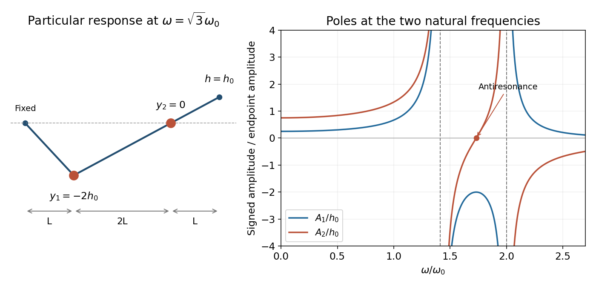

<h1 id="9/d/solution">Solution</h1>

↑ **Parent:** [D](../d.md)

At $\omega=\sqrt3\omega_0$, $s=3$, so the periodic amplitudes become

$$
\boxed{A_1=-2h_0,\qquad A_2=0}.
$$

The second bead is stationary in this particular motion, although the endpoint oscillates. The first bead moves at twice the endpoint amplitude and in opposite [phase](../../../../phase-waves.md). This is an [antiresonance](../../../../antiresonance.md) of the second-bead response, not a natural [resonance](../../../../resonance.md) of the complete two-bead system.

The [force](../../../../force-split.md) balance makes the cancellation explicit. At $y_2=0$, the middle segment supplies transverse [force](../../../../force-split.md) $Ty_1/(2L)=-Th/L$, while the end segment supplies $Th/L$; these cancel on the second bead. The first bead then oscillates between two effectively fixed neighbours with restoring coefficient $3T/(2L)$, whose single-coordinate natural [angular frequency](../../../../angular-frequency.md) is $\sqrt3\omega_0$.

**[Figure 2](#9/d/image-periodic-bead-responses-and-the-stationary-second-bead-at-antiresonance). Periodic bead responses and the stationary second bead at antiresonance**.

As elsewhere in the undamped problem, this exact nodal motion presumes initial conditions selecting the periodic particular response. Additional free [normal modes](../../../../normal-mode.md) would move the second bead as well; they do not decay automatically.

## ↑ Ancestors (12)

1. [D](../d.md)
2. [9](../../9.md)
3. [2015 resit](../../../2015-resit-split.md)
4. [Past exam of the mathematical methods II course of the University of Oxford](../../../split.md)
5. [Mathematical methods II course of the University of Oxford](../../../../mathematical-methods-ii-course-of-the-university-of-oxford.md)
6. [Year 1 of the physics course of the University of Oxford](../../../../year-1-of-the-physics-course-of-the-university-of-oxford.md)
7. [Physics course of the University of Oxford](../../../../physics-course-of-the-university-of-oxford.md)
8. [Undergraduate course of the University of Oxford](../../../../undergraduate-course-of-the-university-of-oxford.md)
9. [Course of the University of Oxford](../../../../course-of-the-university-of-oxford.md)
10. [University of Oxford](../../../../university-of-oxford-split.md)
11. [List of universities](../../../../list-of-universities.md)
12. [Codex Wiki](../../../../split.md)
