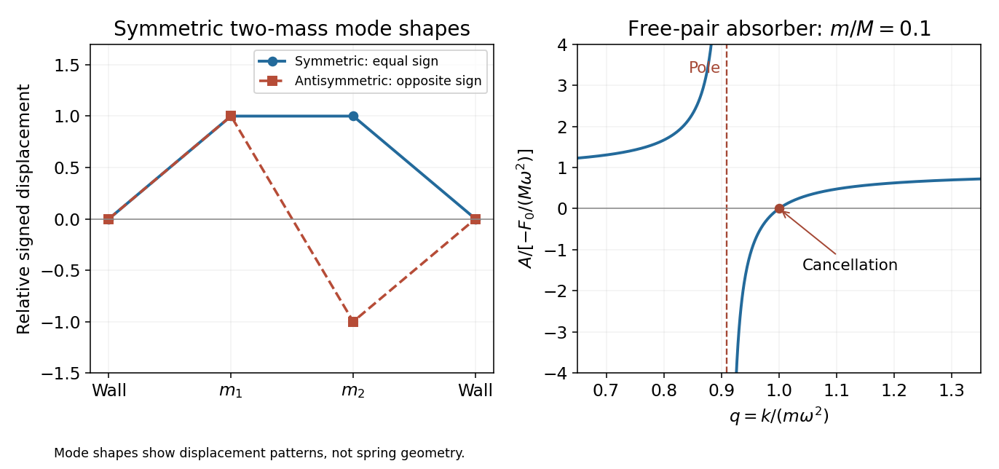

<h1 id="10/b/solution">Solution</h1>

↑ **Parent:** [B](../b.md)

Both masses in the source's absorber diagram are free: there is no additional [spring](../../../../spring.md) attaching $M$ to a wall. Let their [displacements](../../../../displacement.md) be $X$ and $x$. The equations are

$$
M\ddot X=F_0\cos\omega t+k(x-X),\qquad m\ddot x=-k(x-X).
$$

For a periodic particular response $X=A\cos\omega t$, $x=B\cos\omega t$, the [amplitude](../../../../wave-amplitude.md) equations are $(k-M\omega^2)A-kB=F_0$ and $-kA+(k-m\omega^2)B=0$. Their solution is

$$
\boxed{A=\frac{F_0(k-m\omega^2)}{\omega^2[Mm\omega^2-k(M+m)]},\qquad B=\frac{F_0k}{\omega^2[Mm\omega^2-k(M+m)]}}.
$$

At $\boxed{k=m\omega^2}$, $A=0$ and $B=-F_0/k$: the [spring](../../../../spring.md) [force](../../../../force-split.md) on the larger mass cancels the applied [force](../../../../force-split.md) at every instant. This is [antiresonance](../../../../antiresonance.md), a frequency-selective cancellation, rather than dissipation of [energy](../../../../energy-split.md).

There is a nearby undamped resonance at $k_{\rm res}=Mm\omega^2/(M+m)$. For $m\ll M$ it lies close to the cancellation setting. More quantitatively, write $k=m\omega^2(1+\epsilon)$. Then

$$
A=-\frac{F_0\epsilon}{\omega^2[m+\epsilon(M+m)]}.
$$

For $|\epsilon|\ll m/(M+m)$, the [amplitude](../../../../wave-amplitude.md) relative to the unconnected mass's [amplitude](../../../../wave-amplitude.md) $F_0/(M\omega^2)$ is approximately $(M/m)|\epsilon|$. A light absorber therefore needs very accurate tuning and loses suppression when the driving [frequency](../../../../frequency.md) changes. Its own travel $|B|=F_0/(m\omega^2)$ can also become large, limiting linearity and available stroke.

**[Figure 2](#10/b/image-symmetric-spring-modes-and-narrow-tuning-of-a-free-pair-dynamic-absorber). Symmetric spring modes and narrow tuning of a free-pair dynamic absorber**.

Without damping, resonance growth and persistent free oscillations remain; special initial conditions select the displayed periodic particular response. The free pair also has rigid-translation motion. These limitations prevent interpreting the cancellation as broadband damping or as a unique attracting late-time state.

## ↑ Ancestors (12)

1. [B](../b.md)
2. [10](../../10.md)
3. [2015](../../../2015-split.md)
4. [Past exam of the mathematical methods II course of the University of Oxford](../../../split.md)
5. [Mathematical methods II course of the University of Oxford](../../../../mathematical-methods-ii-course-of-the-university-of-oxford.md)
6. [Year 1 of the physics course of the University of Oxford](../../../../year-1-of-the-physics-course-of-the-university-of-oxford.md)
7. [Physics course of the University of Oxford](../../../../physics-course-of-the-university-of-oxford.md)
8. [Undergraduate course of the University of Oxford](../../../../undergraduate-course-of-the-university-of-oxford.md)
9. [Course of the University of Oxford](../../../../course-of-the-university-of-oxford.md)
10. [University of Oxford](../../../../university-of-oxford-split.md)
11. [List of universities](../../../../list-of-universities.md)
12. [Codex Wiki](../../../../split.md)
