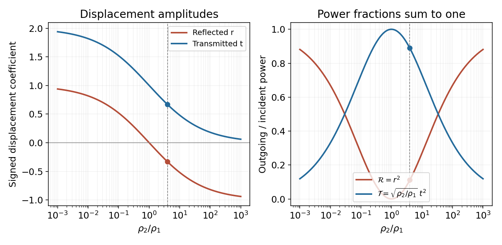

<h1 id="11/d/ii/solution">Solution</h1>

↑ **Parent:** [Ii](../ii.md)

The reflected wave remains on the incident string, so its [wavenumber](../../../../../wavenumber.md) magnitude is still $k_1$. Its outward [power](../../../../../power.md) magnitude is

$$
\boxed{\frac{|P_r|}{P_i}=\frac{|A_r|^2}{|A_i|^2}=\frac19}.
$$

Thus $|P_r|+P_t=(1/9+8/9)P_i=P_i$, verifying [energy conservation](../../../../../conservation-of-energy.md). With signed positive-$x$ fluxes, $P_r=-P_i/9$ and the same statement is $P_i+P_r=P_t$. The minus sign of the reflected [displacement](../../../../../displacement.md) is a [phase](../../../../../phase-waves.md) reversal, whereas the minus sign of its flux records travel in the opposite direction; these are different uses of a sign.

**[Figure 3](#11/d/ii/image-signed-displacement-coefficients-and-conserved-power-fractions-at-a-string-junction). Signed displacement coefficients and conserved power fractions at a string junction**.

## ↑ Ancestors (13)

1. [Ii](../ii.md)
2. [D](../../d.md)
3. [11](../../../11.md)
4. [2015](../../../../2015-split.md)
5. [Past exam of the mathematical methods II course of the University of Oxford](../../../../split.md)
6. [Mathematical methods II course of the University of Oxford](../../../../../mathematical-methods-ii-course-of-the-university-of-oxford.md)
7. [Year 1 of the physics course of the University of Oxford](../../../../../year-1-of-the-physics-course-of-the-university-of-oxford.md)
8. [Physics course of the University of Oxford](../../../../../physics-course-of-the-university-of-oxford.md)
9. [Undergraduate course of the University of Oxford](../../../../../undergraduate-course-of-the-university-of-oxford.md)
10. [Course of the University of Oxford](../../../../../course-of-the-university-of-oxford.md)
11. [University of Oxford](../../../../../university-of-oxford-split.md)
12. [List of universities](../../../../../list-of-universities.md)
13. [Codex Wiki](../../../../../split.md)
