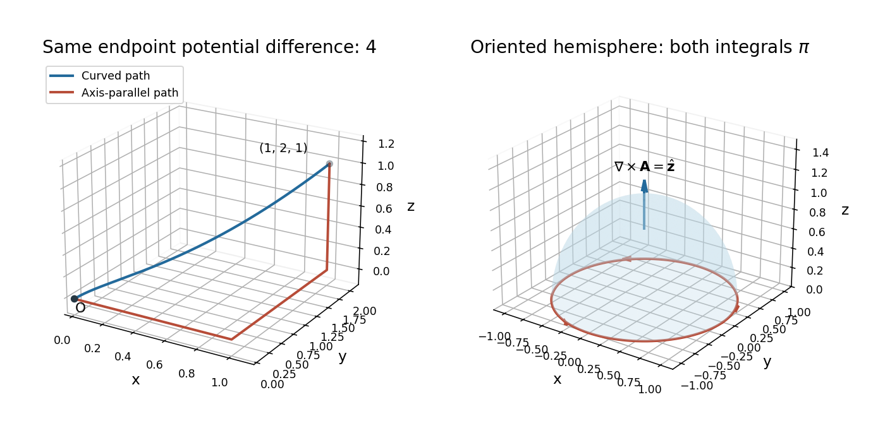

<h1 id="12/e/solution">Solution</h1>

↑ **Parent:** [E](../e.md)

[Stokes theorem](../../../../stokes-theorem.md) states

$$
\boxed{\oint_C\mathbf A\cdot d\mathbf r=\iint_S(\nabla\times\mathbf A)\cdot\hat{\mathbf n}\,dS},
$$

with boundary orientation induced by the chosen [surface](../../../../topological-surface-split.md) normal and with sufficient smoothness of the field and [surface](../../../../topological-surface-split.md). Choose the outward normal on the upper unit hemisphere; its equatorial boundary runs counterclockwise as viewed from $+z$.

For the stated field, the [curl](../../../../curl.md) is

$$
\nabla\times\mathbf A=\bigl(-2yz-(-2yz),\ 0-0,\ 0-(-1)\bigr)=\hat{\mathbf z}.
$$

On the unit sphere, the outward normal is $\hat{\mathbf n}=(x,y,z)$. In [spherical coordinates](../../../../spherical-coordinate-system.md), the [surface](../../../../topological-surface-split.md) integral over the upper hemisphere is

$$
\int_0^{2\pi}\int_0^{\pi/2}\cos\theta\sin\theta\,d\theta\,d\varphi=\pi.
$$

For the boundary calculation, parametrize $\mathbf r(\varphi)=(\cos\varphi,\sin\varphi,0)$, with $0\le\varphi\le2\pi$. Then $\mathbf A=(2\cos\varphi-\sin\varphi,0,0)$ and

$$
\oint_C\mathbf A\cdot d\mathbf r=\int_0^{2\pi}\left[-2\cos\varphi\sin\varphi+\sin^2\varphi\right]d\varphi=\pi.
$$

Thus both sides equal $\boxed{\pi}$. Reversing the hemisphere orientation reverses both signs. The hemisphere's flux calculation can also be read as the projected area of its equatorial unit disk.

**[Figure 4](#12/e/image-two-equal-endpoint-paths-and-the-oriented-hemisphere-used-in-stokes-theorem). Two equal-endpoint paths and the oriented hemisphere used in Stokes' theorem**.

## ↑ Ancestors (12)

1. [E](../e.md)
2. [12](../../12.md)
3. [2015](../../../2015-split.md)
4. [Past exam of the mathematical methods II course of the University of Oxford](../../../split.md)
5. [Mathematical methods II course of the University of Oxford](../../../../mathematical-methods-ii-course-of-the-university-of-oxford.md)
6. [Year 1 of the physics course of the University of Oxford](../../../../year-1-of-the-physics-course-of-the-university-of-oxford.md)
7. [Physics course of the University of Oxford](../../../../physics-course-of-the-university-of-oxford.md)
8. [Undergraduate course of the University of Oxford](../../../../undergraduate-course-of-the-university-of-oxford.md)
9. [Course of the University of Oxford](../../../../course-of-the-university-of-oxford.md)
10. [University of Oxford](../../../../university-of-oxford-split.md)
11. [List of universities](../../../../list-of-universities.md)
12. [Codex Wiki](../../../../split.md)
