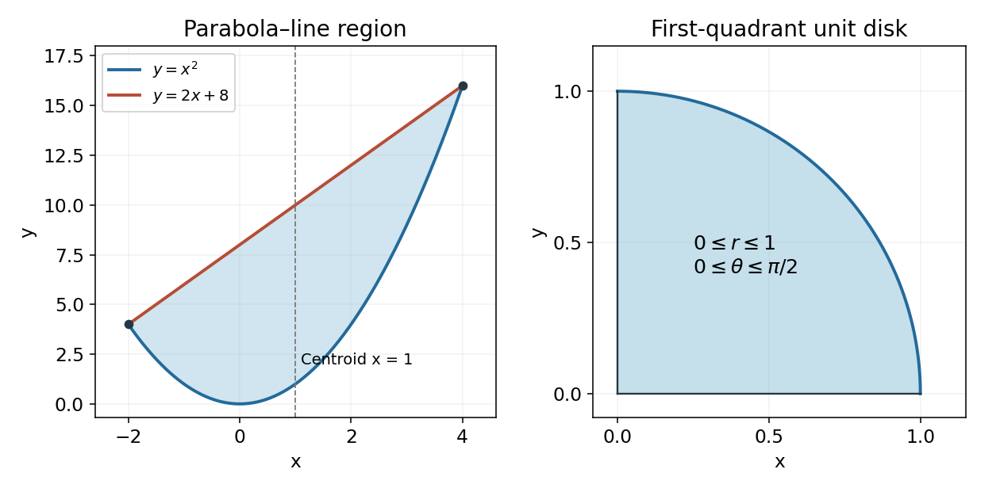

<h1 id="7/solution">Solution</h1>

↑ **Parent:** [7](../7.md)

The integration limits describe the first-quadrant quarter of the unit disk: $x\ge0$, $y\ge0$, $x^2+y^2\le1$. Its circular boundary and the axes are shown in the right-hand panel below; the left panel gives the bounded region used in the preceding calculation.

**[Figure 1](#7/image-the-parabolic-strip-and-quarter-disk-integration-regions). The parabolic strip and quarter-disk integration regions**.

Use [polar coordinates](../../../polar-coordinates.md) $x=r\cos\theta$, $y=r\sin\theta$ with $0\le r\le1$ and $0\le\theta\le\pi/2$. The [Jacobian determinant](../../../jacobian-determinant.md) gives $dx\,dy=r\,dr\,d\theta$, so

$$
I=\int_0^{\pi/2}\int_0^1 e^{-r^2}r\,dr\,d\theta=\frac\pi2\left[-\frac12e^{-r^2}\right]_0^1.
$$

Thus $\boxed{I=\tfrac\pi4(1-e^{-1})}$. Including the radial Jacobian is essential; the exponential becomes radial, but the area element does not remain $dr\,d\theta$.

## ↑ Ancestors (11)

1. [7](../7.md)
2. [2015](../../2015-split.md)
3. [Past exam of the mathematical methods II course of the University of Oxford](../../split.md)
4. [Mathematical methods II course of the University of Oxford](../../../mathematical-methods-ii-course-of-the-university-of-oxford.md)
5. [Year 1 of the physics course of the University of Oxford](../../../year-1-of-the-physics-course-of-the-university-of-oxford.md)
6. [Physics course of the University of Oxford](../../../physics-course-of-the-university-of-oxford.md)
7. [Undergraduate course of the University of Oxford](../../../undergraduate-course-of-the-university-of-oxford.md)
8. [Course of the University of Oxford](../../../course-of-the-university-of-oxford.md)
9. [University of Oxford](../../../university-of-oxford-split.md)
10. [List of universities](../../../list-of-universities.md)
11. [Codex Wiki](../../../split.md)
