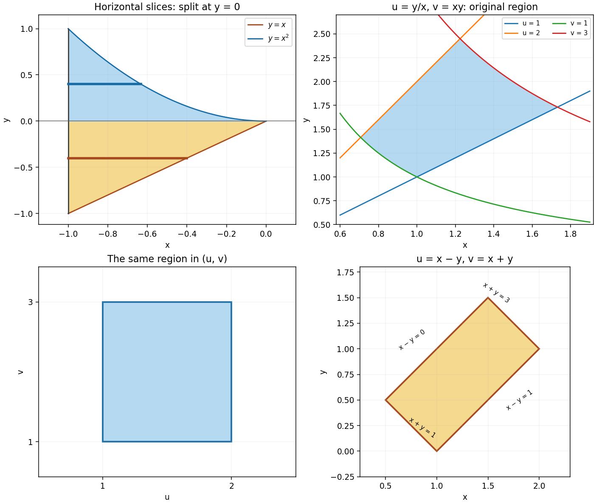
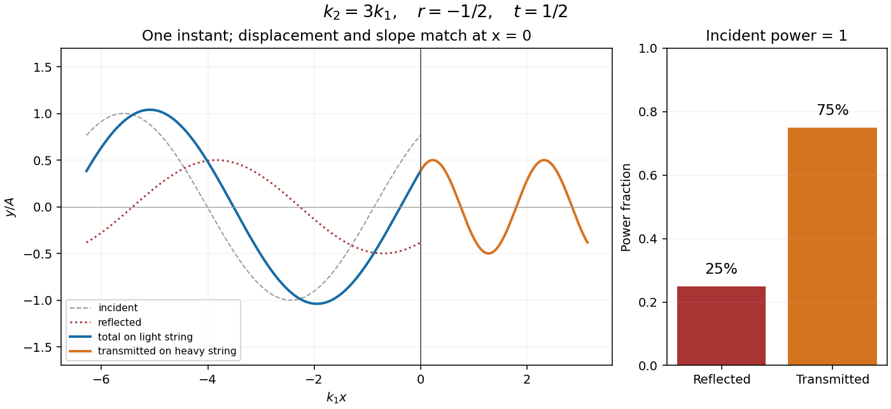
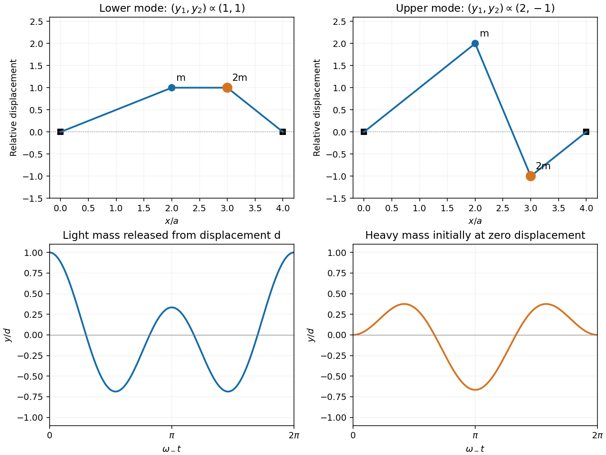
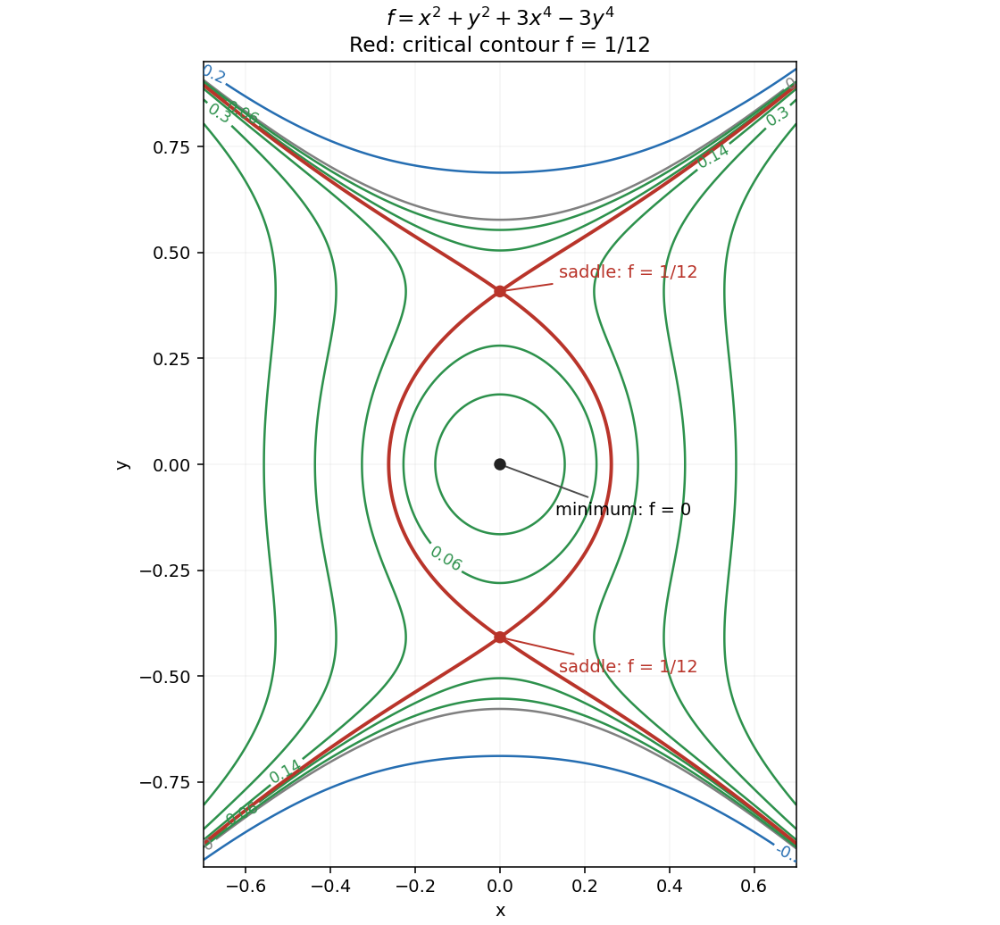

# 2016 resit

↑ **Parent:** [Past exam of the mathematical methods II course of the University of Oxford](../past-exam-of-the-mathematical-methods-ii-course-of-the-university-of-oxford.md)

Source paper: [https://www.whatdotheyknow.com/request/physics_past_exam_papers_2015_16/response/973997/attach/3/Cowell%20Attachment.zip?cookie_passthrough=1](https://www.whatdotheyknow.com/request/physics_past_exam_papers_2015_16/response/973997/attach/3/Cowell%20Attachment.zip?cookie_passthrough=1)

**Table of contents**

- [1](#1)
  - [a](#1/a)
    - [Solution](#1/a/solution)
  - [b](#1/b)
    - [Solution](#1/b/solution)
- [2](#2)
  - [i](#2/i)
    - [Solution](#2/i/solution)
  - [ii](#2/ii)
    - [Solution](#2/ii/solution)
  - [iii](#2/iii)
    - [Solution](#2/iii/solution)
- [3](#3)
  - [i](#3/i)
    - [Solution](#3/i/solution)
  - [ii](#3/ii)
    - [Solution](#3/ii/solution)
  - [iii](#3/iii)
    - [Solution](#3/iii/solution)
- [4](#4)
  - [Solution](#4/solution)
- [5](#5)
  - [Solution](#5/solution)
- [6](#6)
  - [Solution](#6/solution)
- [7](#7)
  - [Solution](#7/solution)
- [8](#8)
  - [Solution](#8/solution)
- [9](#9)
  - [a](#9/a)
    - [Solution](#9/a/solution)
  - [b](#9/b)
    - [Solution](#9/b/solution)
  - [c](#9/c)
    - [Solution](#9/c/solution)
- [10](#10)
  - [a](#10/a)
    - [Solution](#10/a/solution)
  - [b](#10/b)
    - [Solution](#10/b/solution)
  - [c](#10/c)
    - [i](#10/c/i)
      - [Solution](#10/c/i/solution)
    - [ii](#10/c/ii)
      - [Solution](#10/c/ii/solution)
- [11](#11)
  - [a](#11/a)
    - [Solution](#11/a/solution)
  - [b](#11/b)
    - [Solution](#11/b/solution)
  - [c](#11/c)
    - [Solution](#11/c/solution)
  - [d](#11/d)
    - [Solution](#11/d/solution)
  - [e](#11/e)
    - [Solution](#11/e/solution)
- [12](#12)
  - [a](#12/a)
    - [Solution](#12/a/solution)
  - [b](#12/b)
    - [Solution](#12/b/solution)
  - [c](#12/c)
    - [Solution](#12/c/solution)
  - [d](#12/d)
    - [Solution](#12/d/solution)

## 1

↑ **Parent:** [2016 resit](2016-resit.md)

<h3 id="1/a">a</h3>

↑ **Parent:** [1](#1)

<h4 id="1/a/solution">Solution</h4>

↑ **Parent:** [A](#1/a)

For real $x>0$, use [logarithmic differentiation](../calculus.md#logarithmic-differentiation): $\log y=\tan x\log x$. The [product rule](../calculus.md#product-rule) gives $y'/y=\sec^2x\log x+\tan x/x$, hence

$$
\boxed{\frac{dy}{dx}=x^{\tan x}\left(\sec^2x\log x+\frac{\tan x}{x}\right).}
$$

Work on an interval where $\tan x$ is defined. The positive-base condition makes the variable real power unambiguous.

<h3 id="1/b">b</h3>

↑ **Parent:** [1](#1)

<h4 id="1/b/solution">Solution</h4>

↑ **Parent:** [B](#1/b)

[Implicit differentiation](../multivariable-calculus.md#implicit-differentiation) gives $2y'=15x^2+(\cos y)y'$. Therefore

$$
\boxed{y'=\frac{15x^2}{2-\cos y}.}
$$

For real $y$, the denominator is at least one, so division introduces no singularity. In fact the function $2y-\sin y$ is strictly increasing, consistent with a unique real branch $y(x)$.

## 2

↑ **Parent:** [2016 resit](2016-resit.md)

<h3 id="2/i">i</h3>

↑ **Parent:** [2](#2)

<h4 id="2/i/solution">Solution</h4>

↑ **Parent:** [I](#2/i)

The [integration region](../integral.md#domain-of-integration) lies between the line $y=x$ and the [parabola](../euclidean-geometry.md#parabola) $y=x^2$, with $-1\le x\le0$. It has a portion below the $x$-axis bounded above by $y=0$, and a portion above it bounded below by $y=0$. Horizontal slices change form at $y=0$; keeping that split is essential when reversing the [order of integration](../integral.md#order-of-integration).

**[Figure 1](#2/i/image-horizontal-slicing-and-two-changes-of-variables-for-the-integration-regions). Horizontal slicing and two changes of variables for the integration regions**.

<h3 id="2/ii">ii</h3>

↑ **Parent:** [2](#2)

<h4 id="2/ii/solution">Solution</h4>

↑ **Parent:** [Ii](#2/ii)

For $-1\le y\le0$, a horizontal slice runs from $x=-1$ to the line $x=y$. For $0\le y\le1$, it runs from $x=-1$ to the negative branch $x=-\sqrt y$ of the [parabola](../euclidean-geometry.md#parabola). Thus the reversed [iterated integral](../integral.md#iterated-integral) is

$$
\boxed{\int_{-1}^{0}\int_{-1}^{y}y\,dx\,dy
+\int_0^1\int_{-1}^{-\sqrt y}y\,dx\,dy.}
$$

The positive branch $x=\sqrt y$ is outside the original [integration region](../integral.md#domain-of-integration).

<h3 id="2/iii">iii</h3>

↑ **Parent:** [2](#2)

<h4 id="2/iii/solution">Solution</h4>

↑ **Parent:** [Iii](#2/iii)

In the original [order of integration](../integral.md#order-of-integration),

$$
I=\frac12\int_{-1}^0(x^4-x^2)\,dx
=\frac12\left(\frac15-\frac13\right)=\boxed{-\frac1{15}.}
$$

In the reversed order, the below-axis contribution is $\int_{-1}^0y(1+y)\,dy=-1/6$, and the above-axis contribution is $\int_0^1y(1-\sqrt y)\,dy=1/10$. Their sum is again $-1/15$. A negative answer is possible because the [integrand](../integral.md#integrand) $y$ changes sign; the integral is not the [area](../differential-geometry.md#surface-area) of the region.

## 3

↑ **Parent:** [2016 resit](2016-resit.md)

<h3 id="3/i">i</h3>

↑ **Parent:** [3](#3)

<h4 id="3/i/solution">Solution</h4>

↑ **Parent:** [I](#3/i)

In Cartesian components, $\mathbf a\cdot\mathbf r=a_xx+a_yy+a_zz$, with constant $a_i$. Taking the [gradient](../multivariable-calculus.md#gradient) component by component gives

$$
\boxed{\nabla(\mathbf a\cdot\mathbf r)=\mathbf a.}
$$

The constancy of $\mathbf a$ matters: if it depended on position, derivatives of its components would also contribute.

<h3 id="3/ii">ii</h3>

↑ **Parent:** [3](#3)

<h4 id="3/ii/solution">Solution</h4>

↑ **Parent:** [Ii](#3/ii)

The [vector calculus identity](../multivariable-calculus.md#vector-calculus-identity) $\nabla\cdot(\mathbf A\times\mathbf B)=\mathbf B\cdot(\nabla\times\mathbf A)-\mathbf A\cdot(\nabla\times\mathbf B)$ gives zero because a constant [vector field](../multivariable-calculus.md#vector-field) has zero [curl](../multivariable-calculus.md#curl) and $\nabla\times\mathbf r=0$. Thus

$$
\boxed{\nabla\cdot(\mathbf a\times\mathbf r)=0.}
$$

Equivalently, the Cartesian components are $(a_yz-a_zy,a_zx-a_xz,a_xy-a_yx)$, and each component is independent of the coordinate used in its contribution to the [divergence](../multivariable-calculus.md#divergence).

<h3 id="3/iii">iii</h3>

↑ **Parent:** [3](#3)

<h4 id="3/iii/solution">Solution</h4>

↑ **Parent:** [Iii](#3/iii)

Away from the origin, the [product rule](../calculus.md#product-rule) and $\nabla r=\mathbf r/r$ give

$$
\nabla\cdot(r^{-3}\mathbf r)
=r^{-3}(3)+\mathbf r\cdot(-3r^{-5}\mathbf r)
=\boxed{0\quad(r\ne0).}
$$

The field is undefined at $r=0$. It has outward [flux](../mathematical-physics.md#flux) $4\pi$ through any sphere centred there, so its global [distributional divergence](../multivariable-calculus.md#distributional-divergence) is $4\pi\delta^{(3)}(\mathbf r)$, not the zero distribution. The pointwise result must not be extended through the singularity when applying the [divergence theorem](../multivariable-calculus.md#divergence-theorem).

## 4

↑ **Parent:** [2016 resit](2016-resit.md)

<h3 id="4/solution">Solution</h3>

↑ **Parent:** [4](#4)

For a [dispersion relation](../dispersion-relation.md) $\omega(k)$, [phase velocity](../dispersion-relation.md#phase-velocity) is $v_p=\omega/k$ and [group velocity](../dispersion-relation.md#group-velocity) is $v_g=d\omega/dk=v_p+k\,dv_p/dk$. Their [local equality of phase and group velocity](../dispersion-relation.md#local-equality-of-phase-and-group-velocity) holds throughout an interval for a nondispersive branch $\omega=ck$. Equality at one particular $k$ requires only that $v_p$ have zero [derivative](../calculus.md#derivative) there, so it does not imply a globally nondispersive medium.

Use $k=2\pi/\lambda$ in the prescribed [gravity-capillary wave](../surface-tension.md#gravity-capillary-wave) relation. Then $\omega^2=gk+(T/\rho)k^3$, and differentiation gives

$$
\boxed{v_g=
\frac{g\lambda/(2\pi)+6\pi T/(\lambda\rho)}
{2\sqrt{g\lambda/(2\pi)+2\pi T/(\lambda\rho)}}.}
$$

In the gravity-dominated [limit](../calculus.md#limit-of-a-function), $v_g=v_p/2$; in the surface-tension-dominated [limit](../calculus.md#limit-of-a-function), $v_g=3v_p/2$. For $g,T,\rho>0$, the two are equal at $\lambda=2\pi\sqrt{T/(\rho g)}$, the minimum of the [phase velocity](../dispersion-relation.md#phase-velocity) for this dispersion relation.

## 5

↑ **Parent:** [2016 resit](2016-resit.md)

<h3 id="5/solution">Solution</h3>

↑ **Parent:** [5](#5)

The [total derivative](../calculus.md#total-derivative) follows the curve $x\mapsto(x,y(x))$, so the [chain rule](../calculus.md#chain-rule) gives

$$
\boxed{\frac{du}{dx}=\left(\frac{\partial u}{\partial x}\right)_y+
\left(\frac{\partial u}{\partial y}\right)_x\frac{dy}{dx}.}
$$

For the stated functions, $u_x=6x$, $u_y=2y$ and $y'=\cos x$, hence

$$
\boxed{\frac{du}{dx}=6x+2\sin x\cos x=6x+\sin2x.}
$$

Direct differentiation of $u(x,\sin x)=3x^2+\sin^2x$ gives the same result.

## 6

↑ **Parent:** [2016 resit](2016-resit.md)

<h3 id="6/solution">Solution</h3>

↑ **Parent:** [6](#6)

The field is the [gradient](../multivariable-calculus.md#gradient) of a globally defined polynomial:

$$
\phi(x,y,z)=2xy+y^2z,\qquad
\nabla\phi=(2y,2x+2yz,y^2)=\mathbf v.
$$

It is therefore a [conservative vector field](../multivariable-calculus.md#conservative-vector-field) on all of $\mathbb R^3$. The [fundamental theorem for line integrals](../multivariable-calculus.md#fundamental-theorem-for-line-integrals) gives

$$
\boxed{\oint_C\mathbf v\cdot d\mathbf l=\phi(C_{\rm end})-\phi(C_{\rm start})=0}
$$

for every closed piecewise smooth loop. Constructing the global [vector-field potential](../multivariable-calculus.md#potential-of-a-conservative-vector-field) avoids relying on a zero-[curl](../multivariable-calculus.md#curl) test without checking the topology of the domain.

## 7

↑ **Parent:** [2016 resit](2016-resit.md)

<h3 id="7/solution">Solution</h3>

↑ **Parent:** [7](#7)

Subtract the [Maclaurin series](../calculus.md#maclaurin-series) of $\log(1-x)$ from that of $\log(1+x)$. Their even powers cancel, giving

$$
\boxed{\log\frac{1+x}{1-x}=2x+\frac23x^3+\frac25x^5+O(x^7).}
$$

The full [power series](../sequence-and-series.md#power-series) is $2\sum_{n\ge0}x^{2n+1}/(2n+1)$, with [radius of convergence](../sequence-and-series.md#radius-of-convergence) one. For the real logarithm, the stated series applies on $|x|<1$.

## 8

↑ **Parent:** [2016 resit](2016-resit.md)

<h3 id="8/solution">Solution</h3>

↑ **Parent:** [8](#8)

Let $D$ be the disk $x^2+y^2\le3$. The upper boundary is the graph $z=3-x^2-y^2$, with outward vector [vector surface element](../differential-geometry.md#vector-area-element) $(2x,2y,1)\,dx\,dy$. Thus its [flux](../mathematical-physics.md#flux) is

$$
\iint_D(2x^2+2y^2)\,dx\,dy
=\int_0^{2\pi}\int_0^{\sqrt3}2r^3\,dr\,d\theta=9\pi.
$$

The lower disk has outward [normal vector](../differential-geometry.md#normal-vector) $-\mathbf e_z$ and zero [flux](../mathematical-physics.md#flux), since $F_z=0$. The total outward [surface integral](../multivariable-calculus.md#surface-integral) is therefore $9\pi$.

Independently, $\nabla\cdot\mathbf F=2$ and the enclosed [volume](../geometry-and-topology.md#volume) is

$$
V=\int_0^{2\pi}\int_0^{\sqrt3}(3-r^2)r\,dr\,d\theta=\frac{9\pi}{2}.
$$

Consequently $\iiint_V\nabla\cdot\mathbf F\,dV=2V=\boxed{9\pi}$, agreeing with the [divergence theorem](../multivariable-calculus.md#divergence-theorem). Both the orientation of the cap and inclusion of the closing disk have been accounted for.

## 9

↑ **Parent:** [2016 resit](2016-resit.md)

<h3 id="9/a">a</h3>

↑ **Parent:** [9](#9)

<h4 id="9/a/solution">Solution</h4>

↑ **Parent:** [A](#9/a)

For a [change of variables](../multivariable-calculus.md#change-of-variables-formula) in a [double integral](../integral.md#double-integral), first solve for $x=x(u,v)$ and $y=y(u,v)$ and transform every boundary inequality to identify the new [integration region](../integral.md#domain-of-integration) $S$. Compute the [Jacobian determinant](../multivariable-calculus.md#jacobian-determinant), replace the integrand by its expression in $u,v$, and use

$$
\boxed{\iint_R f(x,y)\,dx\,dy
=\iint_S f(x(u,v),y(u,v))\left|\frac{\partial(x,y)}{\partial(u,v)}\right|\,du\,dv.}
$$

A sufficient standard hypothesis is a continuously differentiable one-to-one transformation with nonzero [Jacobian determinant](../multivariable-calculus.md#jacobian-determinant) in the interior, with harmless measure-zero boundaries. If one coordinate chart does not cover the region injectively, split into suitable pieces rather than silently counting points multiple times. The absolute value is essential for an ordinary area integral.

<h3 id="9/b">b</h3>

↑ **Parent:** [9](#9)

<h4 id="9/b/solution">Solution</h4>

↑ **Parent:** [B](#9/b)

In the positive quadrant, the inverse transformation is single-valued:

$$
x=\sqrt{v/u},\qquad y=\sqrt{uv}.
$$

The two rays become $1\le u\le2$ and the two [hyperbolas](../euclidean-geometry.md#hyperbola) become $1\le v\le3$, so the curved original region becomes a rectangle. These are the middle two panels of the figure in part 2i. The forward [Jacobian determinant](../multivariable-calculus.md#jacobian-determinant) is

$$
\frac{\partial(u,v)}{\partial(x,y)}
=\begin{vmatrix}-y/x^2&1/x\\y&x\end{vmatrix}=-2u,
\qquad dx\,dy=\frac{du\,dv}{2u}.
$$

Since $x^3y=v^2/u$, the required [double integral](../integral.md#double-integral) is

$$
\int_1^2\int_1^3\frac{v^2}{2u^2}\,dv\,du
=\frac12\left(\frac12\right)\left(\frac{26}{3}\right)
=\boxed{\frac{13}{6}.}
$$

The signs of $x,y$ and $u>0$ justify the chosen square-root branch and the simplified absolute [Jacobian determinant](../multivariable-calculus.md#jacobian-determinant).

<h3 id="9/c">c</h3>

↑ **Parent:** [9](#9)

<h4 id="9/c/solution">Solution</h4>

↑ **Parent:** [C](#9/c)

Choose $u=x-y$ and $v=x+y$. Then $0\le u\le1$, $1\le v\le3$, while $x=(v+u)/2$, $y=(v-u)/2$ and the inverse [Jacobian determinant](../multivariable-calculus.md#jacobian-determinant) has magnitude $1/2$. Hence

$$
\iint_R\left(\frac{x-y}{x+y+3}\right)^2\,dx\,dy
=\frac12\int_0^1u^2\,du\int_1^3(v+3)^{-2}\,dv
=\frac16\left(\frac14-\frac16\right)
=\boxed{\frac1{72}.}
$$

The denominator is bounded away from zero on the transformed rectangle, so no singularity or improper-integral qualification is needed.

## 10

↑ **Parent:** [2016 resit](2016-resit.md)

<h3 id="10/a">a</h3>

↑ **Parent:** [10](#10)

<h4 id="10/a/solution">Solution</h4>

↑ **Parent:** [A](#10/a)

For a right-moving sinusoidal string displacement $y=A\cos(kx-\omega t)$, the instantaneous [energy flux of a transverse string wave](../wave-equation.md#energy-flux-of-a-transverse-string-wave) is $P(x,t)=-T y_x y_t=T A^2k\omega\sin^2(kx-\omega t)$. Averaging over one [period](../mathematics.md#period-of-a-function) gives $\langle\sin^2\rangle=1/2$. Since $c=\omega/k$ and $T=\rho c^2$,

$$
\boxed{\overline P=\frac12T A^2k\omega
=\frac12c\rho A^2\omega^2.}
$$

The displayed power is a cycle average, not the time-dependent instantaneous power. Here $\rho$ denotes linear [mass density](../fluid-mechanics.md#density), rather than the volume density used in the surface-wave calculation.

<h3 id="10/b">b</h3>

↑ **Parent:** [10](#10)

<h4 id="10/b/solution">Solution</h4>

↑ **Parent:** [B](#10/b)

The [wave speed](../wave-equation.md#wave-speed) is $c=\sqrt{T/\rho}=50\,\mathrm{m\,s^{-1}}$, so the [frequency](../wave.md#frequency) is $f=c/\lambda=100\,\mathrm{Hz}$ and $\omega=200\pi\,\mathrm{s^{-1}}$. Substituting the amplitude in metres,

$$
\boxed{\overline P=\frac12(50)(0.1)(0.005)^2(200\pi)^2
=2.5\pi^2\,\mathrm W\simeq24.67\,\mathrm W.}
$$

Power scales with the square of amplitude; converting millimetres to metres before squaring is essential.

<h3 id="10/c">c</h3>

↑ **Parent:** [10](#10)

<h4 id="10/c/i">i</h4>

↑ **Parent:** [C](#10/c)

<h5 id="10/c/i/solution">Solution</h5>

↑ **Parent:** [I](#10/c/i)

Write the complex displacements as $y_1=(A e^{ik_1x}+B e^{-ik_1x})e^{-i\omega t}$ and $y_2=C e^{ik_2x-i\omega t}$. At a massless join, continuity of displacement and transverse [force](../force.md) gives

$$
A+B=C,\qquad T k_1(A-B)=T k_2C.
$$

Eliminating $B$ gives the displacement [transmission coefficient](../partial-differential-equation.md#transmission-coefficient) and [reflection coefficient](../partial-differential-equation.md#reflection-coefficient),

$$
\boxed{t=\frac CA=\frac{2k_1}{k_1+k_2},\qquad
r=\frac BA=\frac{k_1-k_2}{k_1+k_2}.}
$$

The [angular frequency](../lagrangian-mechanics.md#angular-frequency) is shared across a stationary interface, whereas the [wavelength](../wave-equation.md#wavelength) changes. The equal-tension assumption is used in the slope condition.

**[Figure 2](#10/c/i/image-displacement-continuity-and-energy-sharing-at-a-light-to-heavy-string-junction). Displacement continuity and energy sharing at a light-to-heavy string junction**.

<h4 id="10/c/ii">ii</h4>

↑ **Parent:** [C](#10/c)

<h5 id="10/c/ii/solution">Solution</h5>

↑ **Parent:** [Ii](#10/c/ii)

At the same [tension](../force.md#tension), $k\propto\sqrt\rho$, so $k_2/k_1=3$, $t=1/2$ and $r=-1/2$. The [transmitted power](../electromagnetic-wave.md#transmitted-power) fraction is not $t^2$, because the two strings have different [wave impedances](../electromagnetic-wave.md#wave-impedance). Using the [energy flux of a transverse string wave](../wave-equation.md#energy-flux-of-a-transverse-string-wave),

$$
\boxed{\mathcal T=\frac{\rho_2c_2}{\rho_1c_1}|t|^2
=\sqrt{\frac{\rho_2}{\rho_1}}\,\frac14=\frac34.}
$$

The reflected fraction is $\mathcal R=|r|^2=1/4$, so $\mathcal R+\mathcal T=1$. The transmitted displacement amplitude is $2.5\,\mathrm{mm}$ and its [wavelength](../wave-equation.md#wavelength) is $0.5/3\,\mathrm m$. The negative $r$ indicates a reflected phase reversal; it does not mean negative reflected energy.

## 11

↑ **Parent:** [2016 resit](2016-resit.md)

<h3 id="11/a">a</h3>

↑ **Parent:** [11](#11)

<h4 id="11/a/solution">Solution</h4>

↑ **Parent:** [A](#11/a)

The three nearly horizontal segments have lengths $2a,a,a$. To first order in small transverse slopes, the upward [force](../force.md) on the first [point mass](../classical-mechanics.md#point-mass) is $T[(y_2-y_1)/a-y_1/(2a)]$. The force on the second is $T[(y_1-y_2)/a-y_2/a]$. Applying [Newton's second law](../force.md#newton-s-second-law) to masses $m,2m$ therefore gives

$$
\boxed{\ddot y_1+\frac{T}{2ma}(3y_1-2y_2)=0,\qquad
\ddot y_2+\frac{T}{2ma}(2y_2-y_1)=0.}
$$

The approximation treats the string as massless, retains the imposed equilibrium [tension](../force.md#tension) and neglects gravity, as stipulated.

<h3 id="11/b">b</h3>

↑ **Parent:** [11](#11)

<h4 id="11/b/solution">Solution</h4>

↑ **Parent:** [B](#11/b)

Let $\kappa=T/(2ma)$ and seek a [normal mode](../wave-equation.md#normal-mode) $\mathbf y=\mathbf a e^{i\omega t}$. Its [eigenvalue equation](../linear-operator-theory.md#eigenvalue-equation) is

$$
\det\begin{pmatrix}3-\omega^2/\kappa&-2\\-1&2-\omega^2/\kappa\end{pmatrix}=0,
$$

or $\lambda^2-5\lambda+4=(\lambda-1)(\lambda-4)=0$, where $\lambda=\omega^2/\kappa$. Thus

$$
\boxed{\omega_-=\sqrt{\frac{T}{2ma}},\qquad
\omega_+=2\sqrt{\frac{T}{2ma}}.}
$$

These are [angular frequencies](../lagrangian-mechanics.md#angular-frequency); the corresponding ordinary [frequencies](../wave.md#frequency) are $f_\pm=\omega_\pm/(2\pi)$.

<h3 id="11/c">c</h3>

↑ **Parent:** [11](#11)

<h4 id="11/c/solution">Solution</h4>

↑ **Parent:** [C](#11/c)

For $\lambda=1$, the first [eigenvector](../linear-operator-theory.md#eigenvector) equation gives $y_1=y_2$. For $\lambda=4$, it gives $y_1=-2y_2$. Therefore

$$
\boxed{\mathbf a_-\propto(1,1),\qquad \mathbf a_+\propto(2,-1).}
$$

The lower mode moves the masses in phase with equal displacements. In the higher mode they move in opposite directions, with the lighter mass's amplitude twice that of the heavier mass. Their [eigenvectors](../linear-operator-theory.md#eigenvector) satisfy [mass-weighted orthogonality](../wave-equation.md#mass-weighted-orthogonality-of-normal-modes) with respect to the physical [mass matrix](../finite-element-method.md#mass-matrix) $\operatorname{diag}(m,2m)$, although their ordinary Euclidean [dot product](../inner-product.md#dot-product) is nonzero.

**[Figure 3](#11/c/image-normal-mode-shapes-and-an-initially-displaced-light-mass-on-a-string-with-two-point-masses). Normal-mode shapes and an initially displaced light mass on a string with two point masses**.

<h3 id="11/d">d</h3>

↑ **Parent:** [11](#11)

<h4 id="11/d/solution">Solution</h4>

↑ **Parent:** [D](#11/d)

The independent [normal modes](../wave-equation.md#normal-mode) span the two displacement coordinates. With arbitrary real constants $A,B,C,D$, the general real solution is

$$
\boxed{\begin{pmatrix}y_1\\y_2\end{pmatrix}
=(A\cos\omega_-t+B\sin\omega_-t)\begin{pmatrix}1\\1\end{pmatrix}
+(C\cos\omega_+t+D\sin\omega_+t)\begin{pmatrix}2\\-1\end{pmatrix}.}
$$

Four constants are required for two second-order [ordinary differential equations](../differential-equation.md#ordinary-differential-equation), corresponding to two initial displacements and two initial [velocities](../classical-mechanics.md#velocity).

<h3 id="11/e">e</h3>

↑ **Parent:** [11](#11)

<h4 id="11/e/solution">Solution</h4>

↑ **Parent:** [E](#11/e)

Release from rest gives $B=D=0$. At $t=0$, $A+2C=d$ and $A-C=0$, so $A=C=d/3$. Consequently

$$
\boxed{y_1(t)=\frac d3\bigl(\cos\omega_-t+2\cos2\omega_-t\bigr),\qquad
y_2(t)=\frac d3\bigl(\cos\omega_-t-\cos2\omega_-t\bigr).}
$$

The [frequency ratio](../wave.md#frequency-ratio) is exactly two, so both motions repeat after $2\pi/\omega_-$. These are commensurate [normal modes](../wave-equation.md#normal-mode), rather than a pair of nearly equal frequencies producing slow [beats](../physical-optics.md#beat).

## 12

↑ **Parent:** [2016 resit](2016-resit.md)

<h3 id="12/a">a</h3>

↑ **Parent:** [12](#12)

<h4 id="12/a/solution">Solution</h4>

↑ **Parent:** [A](#12/a)

For $f$ with continuous second [partial derivatives](../multivariable-calculus.md#partial-derivative) near $(a,b)$, its [multivariable Taylor expansion](../calculus.md#multivariable-taylor-expansion) is

$$
\boxed{f(a+h,b+k)=f(a,b)+f_xh+f_yk
+\frac12\bigl(f_{xx}h^2+2f_{xy}hk+f_{yy}k^2\bigr)
+o(h^2+k^2),}
$$

where all displayed derivatives are evaluated at $(a,b)$. Continuity of the second derivatives justifies equality of the mixed partials and the stated remainder. A cubic-order remainder requires additional regularity.

<h3 id="12/b">b</h3>

↑ **Parent:** [12](#12)

<h4 id="12/b/solution">Solution</h4>

↑ **Parent:** [B](#12/b)

The notation $(\partial f/\partial x)_y$ means the [derivative](../calculus.md#derivative) with respect to $x$ while $y$ is held fixed:

$$
\left(\frac{\partial f}{\partial x}\right)_y
=\lim_{h\to0}\frac{f(x+h,y)-f(x,y)}h.
$$

For a [differentiable](../analysis.md#differentiable-function) function, its first-order height change is $df=f_x\,dx+f_y\,dy$. If both coefficients vanish, the [tangent plane](../tangent-vector.md#tangent-plane) is horizontal and every [directional derivative](../multivariable-calculus.md#directional-derivative) vanishes: the surface is flat to first order at that point. It need not be constant in a neighbourhood; $f=x^2+y^2$ at the origin is a counterexample. Existence of coordinate partials alone, without [differentiability](../analysis.md#differentiability), would not justify this tangent-plane conclusion.

<h3 id="12/c">c</h3>

↑ **Parent:** [12](#12)

<h4 id="12/c/solution">Solution</h4>

↑ **Parent:** [C](#12/c)

At a [stationary point](../calculus-of-variations.md#stationary-point), the linear terms vanish, so $\Delta f\simeq\tfrac12(Ah^2+2Bhk+Ck^2)$, with $A=f_{xx}$, $B=f_{xy}$, $C=f_{yy}$. Let $D=AC-B^2$ be the [Hessian determinant](../multivariable-calculus.md#hessian-determinant). For $A\ne0$, completing the square gives

$$
2\Delta f\simeq A\left(h+\frac BA k\right)^2+\frac DA k^2.
$$

The [second-derivative test](../multivariable-calculus.md#second-derivative-test) therefore yields

$$
\boxed{D>0,\ A>0:\text{ strict local minimum};\quad
D>0,\ A<0:\text{ strict local maximum};\quad
D<0:\text{ saddle point}.}
$$

When $D<0$ the quadratic form is indefinite, including the case $A=0$, $B\ne0$. When $D=0$, the quadratic approximation is degenerate and the test is inconclusive: higher-order terms may produce a minimum, maximum or saddle. For nondegenerate cases the quadratic term dominates the Taylor remainder sufficiently close to the point.

<h3 id="12/d">d</h3>

↑ **Parent:** [12](#12)

<h4 id="12/d/solution">Solution</h4>

↑ **Parent:** [D](#12/d)

The [gradient](../multivariable-calculus.md#gradient) components are $f_x=2x(1+6x^2)$ and $f_y=2y(1-6y^2)$. Their real simultaneous zeros are $(0,0)$ and $(0,\pm1/\sqrt6)$. The [Hessian matrix](../multivariable-calculus.md#hessian-matrix) is diagonal:

$$
H=\operatorname{diag}(2+36x^2,2-36y^2).
$$

At the origin it is positive definite; at each other critical point it is $\operatorname{diag}(2,-4)$ and indefinite. Hence

$$
\boxed{(0,0):\text{ strict local minimum},\ f=0;\qquad
(0,\pm1/\sqrt6):\text{ saddle points},\ f=1/12.}
$$

There are no local maxima. The [contours](../complex-analysis.md#complex-integration-contour) are symmetric under either coordinate reflection. Small positive levels have a closed component surrounding the minimum; these meet the saddle-level separatrices at level $1/12$. That critical contour has the useful exact form $3x^4+x^2=3(y^2-1/6)^2$. Other components extend toward large $|y|$, where the $-3y^4$ term makes the function unbounded below.

**[Figure 4](#12/d/image-contours-near-a-minimum-and-two-saddle-points-including-the-critical-level-one-twelfth). Contours near a minimum and two saddle points, including the critical level one twelfth**.

## ↑ Ancestors (9)

1. [Past exam of the mathematical methods II course of the University of Oxford](../past-exam-of-the-mathematical-methods-ii-course-of-the-university-of-oxford.md)
2. [Mathematical methods II course of the University of Oxford](../university-of-oxford.md#mathematical-methods-ii-course-of-the-university-of-oxford)
3. [Year 1 of the physics course of the University of Oxford](../university-of-oxford.md#year-1-of-the-physics-course-of-the-university-of-oxford)
4. [Physics course of the University of Oxford](../university-of-oxford.md#physics-course-of-the-university-of-oxford)
5. [Undergraduate course of the University of Oxford](../university-of-oxford.md#undergraduate-course-of-the-university-of-oxford)
6. [Course of the University of Oxford](../university-of-oxford.md#course-of-the-university-of-oxford)
7. [University of Oxford](../university-of-oxford.md)
8. [List of universities](../README.md#list-of-universities)
9. [Codex Wiki](../README.md)
