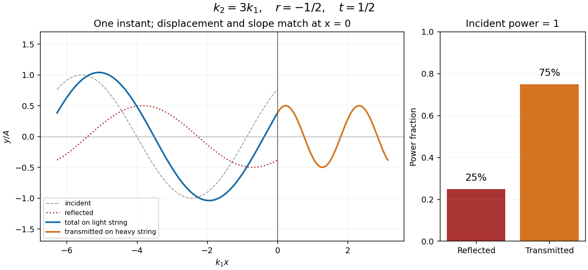

<h1 id="10/c/i/solution">Solution</h1>

↑ **Parent:** [I](../i.md)

Write the complex displacements as $y_1=(A e^{ik_1x}+B e^{-ik_1x})e^{-i\omega t}$ and $y_2=C e^{ik_2x-i\omega t}$. At a massless join, continuity of displacement and transverse [force](../../../../../force-split.md) gives

$$
A+B=C,\qquad T k_1(A-B)=T k_2C.
$$

Eliminating $B$ gives the displacement [transmission coefficient](../../../../../transmission-coefficient.md) and [reflection coefficient](../../../../../reflection-coefficient.md),

$$
\boxed{t=\frac CA=\frac{2k_1}{k_1+k_2},\qquad
r=\frac BA=\frac{k_1-k_2}{k_1+k_2}.}
$$

The [angular frequency](../../../../../angular-frequency.md) is shared across a stationary interface, whereas the [wavelength](../../../../../wavelength.md) changes. The equal-tension assumption is used in the slope condition.

**[Figure 2](#10/c/i/image-displacement-continuity-and-energy-sharing-at-a-light-to-heavy-string-junction). Displacement continuity and energy sharing at a light-to-heavy string junction**.

## ↑ Ancestors (13)

1. [I](../i.md)
2. [C](../../c.md)
3. [10](../../../10.md)
4. [2016 resit](../../../../2016-resit-split.md)
5. [Past exam of the mathematical methods II course of the University of Oxford](../../../../split.md)
6. [Mathematical methods II course of the University of Oxford](../../../../../mathematical-methods-ii-course-of-the-university-of-oxford.md)
7. [Year 1 of the physics course of the University of Oxford](../../../../../year-1-of-the-physics-course-of-the-university-of-oxford.md)
8. [Physics course of the University of Oxford](../../../../../physics-course-of-the-university-of-oxford.md)
9. [Undergraduate course of the University of Oxford](../../../../../undergraduate-course-of-the-university-of-oxford.md)
10. [Course of the University of Oxford](../../../../../course-of-the-university-of-oxford.md)
11. [University of Oxford](../../../../../university-of-oxford-split.md)
12. [List of universities](../../../../../list-of-universities.md)
13. [Codex Wiki](../../../../../split.md)
