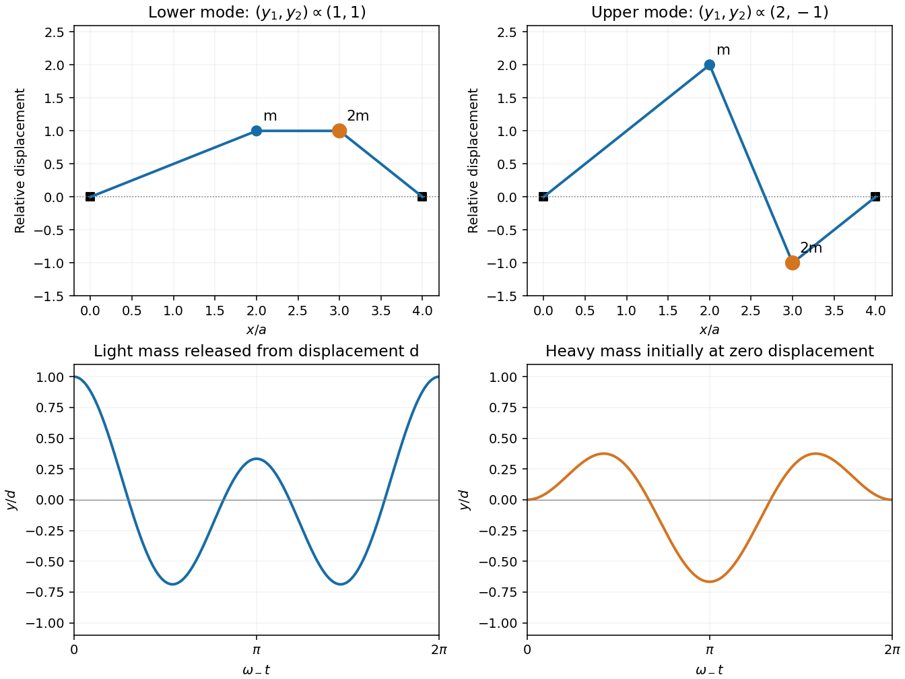

<h1 id="11/c/solution">Solution</h1>

↑ **Parent:** [C](../c.md)

For $\lambda=1$, the first [eigenvector](../../../../eigenvector.md) equation gives $y_1=y_2$. For $\lambda=4$, it gives $y_1=-2y_2$. Therefore

$$
\boxed{\mathbf a_-\propto(1,1),\qquad \mathbf a_+\propto(2,-1).}
$$

The lower mode moves the masses in phase with equal displacements. In the higher mode they move in opposite directions, with the lighter mass's amplitude twice that of the heavier mass. Their [eigenvectors](../../../../eigenvector.md) satisfy [mass-weighted orthogonality](../../../../mass-weighted-orthogonality-of-normal-modes.md) with respect to the physical [mass matrix](../../../../mass-matrix.md) $\operatorname{diag}(m,2m)$, although their ordinary Euclidean [dot product](../../../../dot-product.md) is nonzero.

**[Figure 3](#11/c/image-normal-mode-shapes-and-an-initially-displaced-light-mass-on-a-string-with-two-point-masses). Normal-mode shapes and an initially displaced light mass on a string with two point masses**.

## ↑ Ancestors (12)

1. [C](../c.md)
2. [11](../../11.md)
3. [2016 resit](../../../2016-resit-split.md)
4. [Past exam of the mathematical methods II course of the University of Oxford](../../../split.md)
5. [Mathematical methods II course of the University of Oxford](../../../../mathematical-methods-ii-course-of-the-university-of-oxford.md)
6. [Year 1 of the physics course of the University of Oxford](../../../../year-1-of-the-physics-course-of-the-university-of-oxford.md)
7. [Physics course of the University of Oxford](../../../../physics-course-of-the-university-of-oxford.md)
8. [Undergraduate course of the University of Oxford](../../../../undergraduate-course-of-the-university-of-oxford.md)
9. [Course of the University of Oxford](../../../../course-of-the-university-of-oxford.md)
10. [University of Oxford](../../../../university-of-oxford-split.md)
11. [List of universities](../../../../list-of-universities.md)
12. [Codex Wiki](../../../../split.md)
