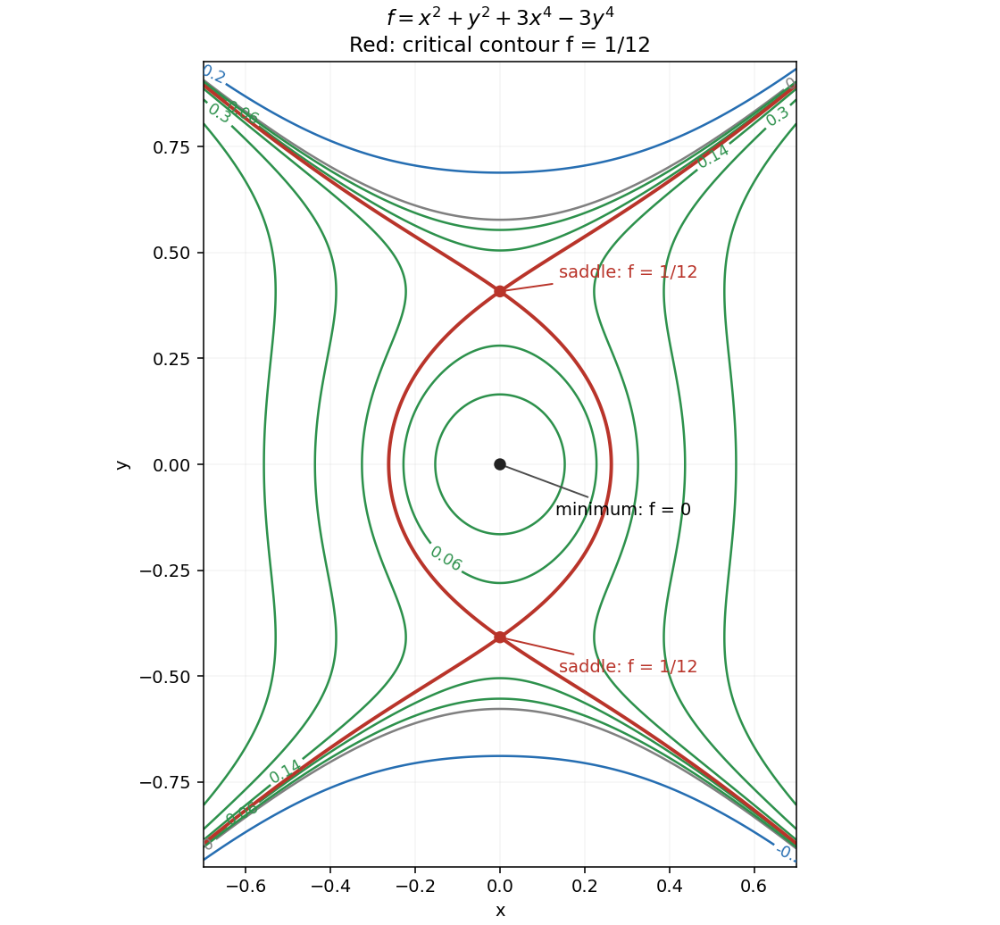

<h1 id="12/d/solution">Solution</h1>

↑ **Parent:** [D](../d.md)

The [gradient](../../../../gradient.md) components are $f_x=2x(1+6x^2)$ and $f_y=2y(1-6y^2)$. Their real simultaneous zeros are $(0,0)$ and $(0,\pm1/\sqrt6)$. The [Hessian matrix](../../../../hessian-matrix.md) is diagonal:

$$
H=\operatorname{diag}(2+36x^2,2-36y^2).
$$

At the origin it is positive definite; at each other critical point it is $\operatorname{diag}(2,-4)$ and indefinite. Hence

$$
\boxed{(0,0):\text{ strict local minimum},\ f=0;\qquad
(0,\pm1/\sqrt6):\text{ saddle points},\ f=1/12.}
$$

There are no local maxima. The [contours](../../../../complex-integration-contour.md) are symmetric under either coordinate reflection. Small positive levels have a closed component surrounding the minimum; these meet the saddle-level separatrices at level $1/12$. That critical contour has the useful exact form $3x^4+x^2=3(y^2-1/6)^2$. Other components extend toward large $|y|$, where the $-3y^4$ term makes the function unbounded below.

**[Figure 4](#12/d/image-contours-near-a-minimum-and-two-saddle-points-including-the-critical-level-one-twelfth). Contours near a minimum and two saddle points, including the critical level one twelfth**.

## ↑ Ancestors (12)

1. [D](../d.md)
2. [12](../../12.md)
3. [2016 resit](../../../2016-resit-split.md)
4. [Past exam of the mathematical methods II course of the University of Oxford](../../../split.md)
5. [Mathematical methods II course of the University of Oxford](../../../../mathematical-methods-ii-course-of-the-university-of-oxford.md)
6. [Year 1 of the physics course of the University of Oxford](../../../../year-1-of-the-physics-course-of-the-university-of-oxford.md)
7. [Physics course of the University of Oxford](../../../../physics-course-of-the-university-of-oxford.md)
8. [Undergraduate course of the University of Oxford](../../../../undergraduate-course-of-the-university-of-oxford.md)
9. [Course of the University of Oxford](../../../../course-of-the-university-of-oxford.md)
10. [University of Oxford](../../../../university-of-oxford-split.md)
11. [List of universities](../../../../list-of-universities.md)
12. [Codex Wiki](../../../../split.md)
