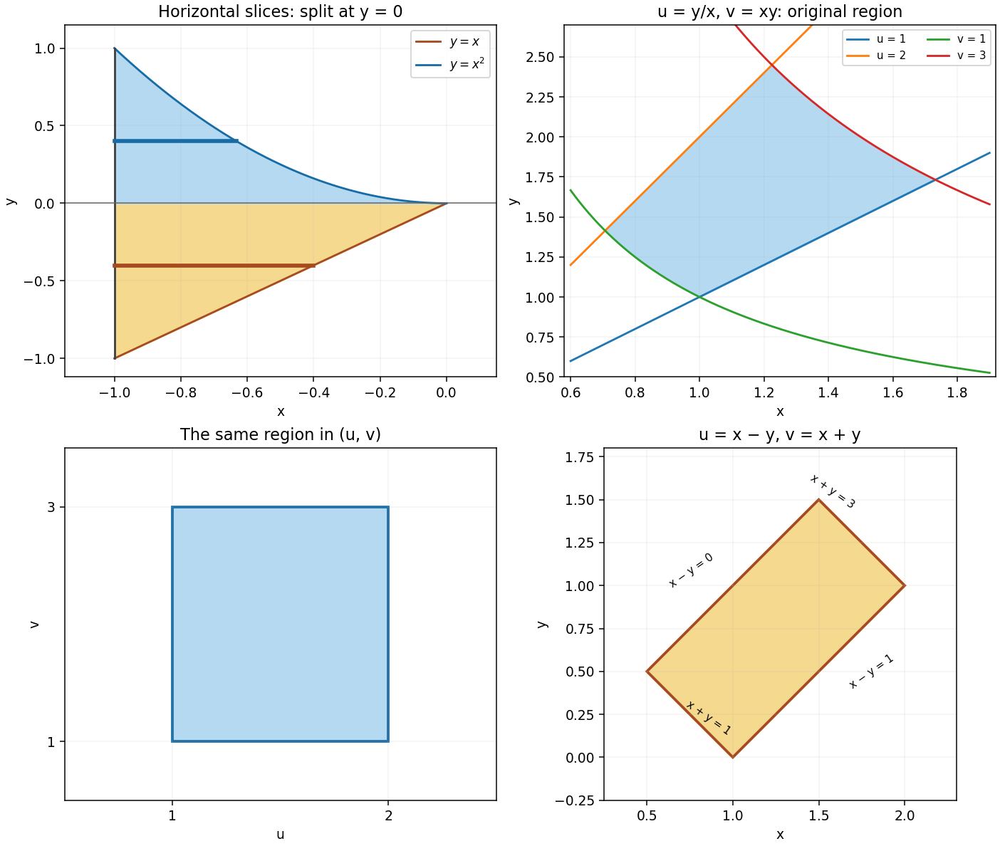

<h1 id="2/i/solution">Solution</h1>

↑ **Parent:** [I](../i.md)

The [integration region](../../../../domain-of-integration.md) lies between the line $y=x$ and the [parabola](../../../../parabola.md) $y=x^2$, with $-1\le x\le0$. It has a portion below the $x$-axis bounded above by $y=0$, and a portion above it bounded below by $y=0$. Horizontal slices change form at $y=0$; keeping that split is essential when reversing the [order of integration](../../../../order-of-integration.md).

**[Figure 1](#2/i/image-horizontal-slicing-and-two-changes-of-variables-for-the-integration-regions). Horizontal slicing and two changes of variables for the integration regions**.

## ↑ Ancestors (12)

1. [I](../i.md)
2. [2](../../2.md)
3. [2016 resit](../../../2016-resit-split.md)
4. [Past exam of the mathematical methods II course of the University of Oxford](../../../split.md)
5. [Mathematical methods II course of the University of Oxford](../../../../mathematical-methods-ii-course-of-the-university-of-oxford.md)
6. [Year 1 of the physics course of the University of Oxford](../../../../year-1-of-the-physics-course-of-the-university-of-oxford.md)
7. [Physics course of the University of Oxford](../../../../physics-course-of-the-university-of-oxford.md)
8. [Undergraduate course of the University of Oxford](../../../../undergraduate-course-of-the-university-of-oxford.md)
9. [Course of the University of Oxford](../../../../course-of-the-university-of-oxford.md)
10. [University of Oxford](../../../../university-of-oxford-split.md)
11. [List of universities](../../../../list-of-universities.md)
12. [Codex Wiki](../../../../split.md)
