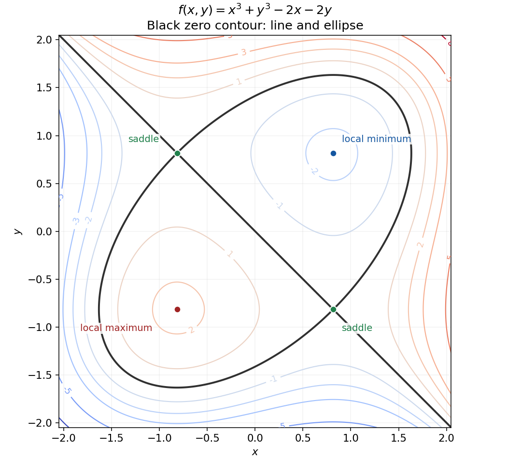
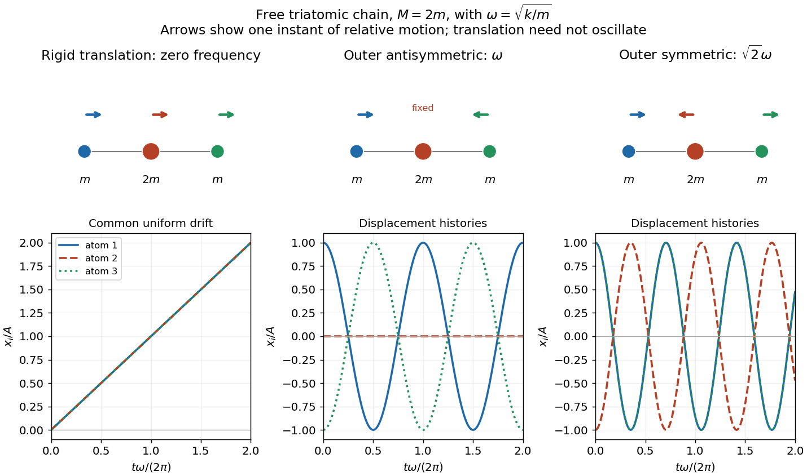
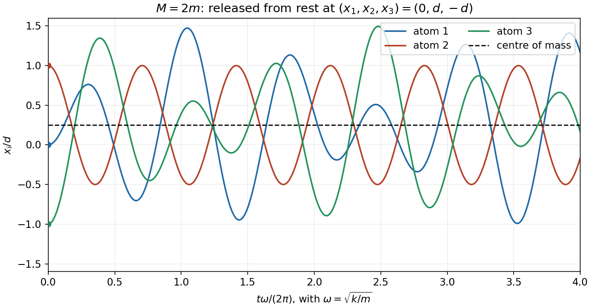
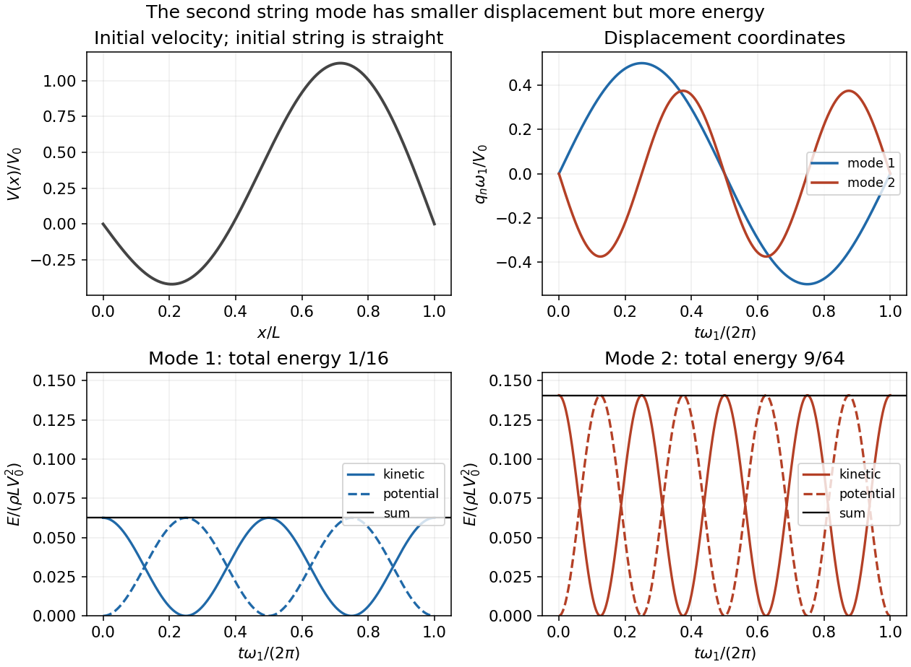

# 2016

↑ **Parent:** [Past exam of the mathematical methods II course of the University of Oxford](../past-exam-of-the-mathematical-methods-ii-course-of-the-university-of-oxford.md)

Source paper: [https://www.whatdotheyknow.com/request/physics_past_exam_papers_2015_16/response/973997/attach/3/Cowell%20Attachment.zip?cookie_passthrough=1](https://www.whatdotheyknow.com/request/physics_past_exam_papers_2015_16/response/973997/attach/3/Cowell%20Attachment.zip?cookie_passthrough=1)

**Table of contents**

- [1](#1)
  - [Solution](#1/solution)
- [2](#2)
  - [a](#2/a)
    - [Solution](#2/a/solution)
  - [b](#2/b)
    - [Solution](#2/b/solution)
- [3](#3)
  - [Solution](#3/solution)
- [4](#4)
  - [Solution](#4/solution)
- [5](#5)
  - [Solution](#5/solution)
- [6](#6)
  - [Solution](#6/solution)
- [7](#7)
  - [Solution](#7/solution)
- [8](#8)
  - [a](#8/a)
    - [Solution](#8/a/solution)
  - [b](#8/b)
    - [Solution](#8/b/solution)
  - [c](#8/c)
    - [Solution](#8/c/solution)
  - [d](#8/d)
    - [Solution](#8/d/solution)
- [9](#9)
  - [a](#9/a)
    - [Solution](#9/a/solution)
  - [b](#9/b)
    - [Solution](#9/b/solution)
  - [c](#9/c)
    - [Solution](#9/c/solution)
  - [d](#9/d)
    - [Solution](#9/d/solution)
  - [e](#9/e)
    - [Solution](#9/e/solution)
- [10](#10)
  - [a](#10/a)
    - [Solution](#10/a/solution)
  - [b](#10/b)
    - [i](#10/b/i)
      - [Solution](#10/b/i/solution)
    - [ii](#10/b/ii)
      - [Solution](#10/b/ii/solution)
- [11](#11)
  - [a](#11/a)
    - [Solution](#11/a/solution)
  - [b](#11/b)
    - [Solution](#11/b/solution)
  - [c](#11/c)
    - [Solution](#11/c/solution)
  - [d](#11/d)
    - [Solution](#11/d/solution)
  - [e](#11/e)
    - [Solution](#11/e/solution)

## 1

↑ **Parent:** [2016](2016.md)

<h3 id="1/solution">Solution</h3>

↑ **Parent:** [1](#1)

The [arc length](../riemannian-geometry.md#arc-length) of this [parametric curve](../topology.md#parametric-curve) is the integral of its speed. [Differentiation](../calculus.md#differentiation) gives $x'(t)=at\cos t$ and $y'(t)=at\sin t$, so

$$
\sqrt{x'(t)^2+y'(t)^2}=|a|t\qquad(0\leq t\leq1),\qquad \boxed{\ell=\int_0^1|a|t\,dt=\frac{|a|}{2}.}
$$

For a positive scale parameter this is $a/2$. The absolute value is necessary when $a$ is allowed to be any real constant; $a=0$ gives a degenerate curve of zero length. The nondegenerate curve is an [involute](../topology.md#involute) of a circle.

## 2

↑ **Parent:** [2016](2016.md)

<h3 id="2/a">a</h3>

↑ **Parent:** [2](#2)

<h4 id="2/a/solution">Solution</h4>

↑ **Parent:** [A](#2/a)

Recognize the [derivative](../calculus.md#derivative) of the [exponential function](../calculus.md#exponential-function) at $x=1$:

$$
\boxed{\lim_{x\to1}\frac{2^x-2}{x-1}=\left.\frac{d}{dx}2^x\right|_{x=1}=2\ln2.}
$$

Here $2^x=e^{x\ln2}$ and the [chain rule](../calculus.md#chain-rule) supplies the factor $\ln2$.

<h3 id="2/b">b</h3>

↑ **Parent:** [2](#2)

<h4 id="2/b/solution">Solution</h4>

↑ **Parent:** [B](#2/b)

For the real-valued expression, first consider the [one-sided limit](../calculus.md#one-sided-limit) $x\to0^+$. Its [natural logarithm](../calculus.md#natural-logarithm) is $x\ln(\ln(1+x))$. Since $\ln(1+x)/x\to1$,

$$
x\ln(\ln(1+x))=x\ln x+x\ln\left(\frac{\ln(1+x)}x\right)\longrightarrow0,
$$

using $x\ln x\to0$. The continuity of the [exponential function](../calculus.md#exponential-function) therefore gives **right-hand limit $1$**.

The printed two-sided notation needs qualification: $\ln(1+x)<0$ for $-1<x<0$, so raising it to an arbitrary real power does not define a real-valued function throughout a left neighbourhood of zero. There is consequently no ordinary two-sided real limit on an open punctured neighbourhood with the expression as written. The value $1$ is the natural right-hand interpretation.

## 3

↑ **Parent:** [2016](2016.md)

<h3 id="3/solution">Solution</h3>

↑ **Parent:** [3](#3)

Use [implicit differentiation](../multivariable-calculus.md#implicit-differentiation) while holding $x$ fixed. Writing $y_z=(\partial y/\partial z)_x$, the constraint gives

$$
2xyy_z+z^2y_z+2yz=0,\qquad y_z=-\frac{2yz}{2xy+z^2}.
$$

The [chain rule](../calculus.md#chain-rule) applied to $v=xy^3$ now yields

$$
\boxed{\left(\frac{\partial v}{\partial z}\right)_x=3xy^2y_z=-\frac{6xy^3z}{2xy+z^2},\qquad \left(\frac{\partial v}{\partial z}\right)_{x,(1,1,1)}=-2.}
$$

This local formula requires $2xy+z^2\ne0$, as in the [implicit function theorem](../multivariable-calculus.md#implicit-function-theorem); that denominator equals $3$ at the specified point.

## 4

↑ **Parent:** [2016](2016.md)

<h3 id="4/solution">Solution</h3>

↑ **Parent:** [4](#4)

The [divergence theorem](../multivariable-calculus.md#divergence-theorem) includes every part of the closed boundary, including the two vertical cut faces. Its volume integrand simplifies because the terms linear in $x$ cancel:

$$
\nabla\cdot\mathbf F=3x^2+(3y^2+2x)-2x=3(x^2+y^2).
$$

In [cylindrical coordinates](../multivariable-calculus.md#cylindrical-coordinate-system), the remaining [integration region](../integral.md#domain-of-integration) is $0\leq r\leq1$, $0\leq z\leq1-r^2$, $\pi/2\leq\theta\leq2\pi$. With the [Jacobian determinant](../multivariable-calculus.md#jacobian-determinant) $r$, the outward [flux](../mathematical-physics.md#flux) is

$$
\boxed{\int_{\partial V}\mathbf F\cdot d\mathbf S=\int_{\pi/2}^{2\pi}\int_0^1\int_0^{1-r^2}3r^3\,dz\,dr\,d\theta=\frac{9\pi}{2}\left(\frac14-\frac16\right)=\frac{3\pi}{8}.}
$$

The angular range is three quarters of a full revolution. The volume calculation already accounts for the base and cut faces, so no additional surface terms should be appended.

## 5

↑ **Parent:** [2016](2016.md)

<h3 id="5/solution">Solution</h3>

↑ **Parent:** [5](#5)

The first-order [multivariable Taylor expansion](../calculus.md#multivariable-taylor-expansion) is

$$
f(x,y)=e^{y_0}\bigl[x_0^2+2x_0(x-x_0)+x_0^2(y-y_0)\bigr]+O\bigl((x-x_0)^2+(y-y_0)^2\bigr).
$$

Taking $(x_0,y_0)=(2,0)$ gives the [linear approximation](../calculus.md#linear-approximation)

$$
\boxed{f(2.03,-0.01)\simeq4+4(0.03)+4(-0.01)=4.08.}
$$

To assess its [significant figures](../numerical-analysis.md#significant-figures), the quadratic [Taylor polynomial](../calculus.md#taylor-polynomial) supplies the correction $h^2+4hk+2k^2=-0.0001$ for $h=0.03$, $k=-0.01$. Direct evaluation gives $2.03^2e^{-0.01}=4.0798963599\ldots$. Thus the estimate is **correct to four significant figures**: both round to $4.080$, whereas to five significant figures the exact value is $4.0799$ and the approximation is $4.0800$. The unexpectedly small quadratic correction results partly from cancellation of its mixed and unmixed terms.

## 6

↑ **Parent:** [2016](2016.md)

<h3 id="6/solution">Solution</h3>

↑ **Parent:** [6](#6)

Construct a global [vector-field potential](../multivariable-calculus.md#potential-of-a-conservative-vector-field) rather than relying only on vanishing [curl](../multivariable-calculus.md#curl):

$$
\phi(x,y,z)=x^2z+\frac{y^2}{2},\qquad \nabla\phi=(2xz,y,x^2)=\mathbf F.
$$

Thus $\mathbf F$ is a [conservative vector field](../multivariable-calculus.md#conservative-vector-field). The endpoints of the given [parametric curve](../topology.md#parametric-curve) are $\mathbf r(0)=(3,0,0)$ and $\mathbf r(\pi/2)=(0,2,1)$. The [fundamental theorem for line integrals](../multivariable-calculus.md#fundamental-theorem-for-line-integrals) gives

$$
\boxed{\int_C\mathbf F\cdot d\mathbf r=\phi(0,2,1)-\phi(3,0,0)=2.}
$$

The intervening turns of the curve have no effect because this [line integral](../multivariable-calculus.md#line-integral) is [path independent](../multivariable-calculus.md#path-independence).

## 7

↑ **Parent:** [2016](2016.md)

<h3 id="7/solution">Solution</h3>

↑ **Parent:** [7](#7)

The [gradient](../multivariable-calculus.md#gradient) vanishes when $3x^2-2=3y^2-2=0$. Put $s=\sqrt{2/3}$. The [Hessian matrix](../multivariable-calculus.md#hessian-matrix) is $\operatorname{diag}(6x,6y)$, so the [second-derivative test](../multivariable-calculus.md#second-derivative-test) gives:

- $(s,s)$: a **strict local minimum**, with $f=-8s/3$;
- $(-s,-s)$: a **strict local maximum**, with $f=8s/3$;
- $(s,-s)$ and $(-s,s)$: **saddle points**, both with $f=0$.

The [positive-definite](../bilinear-form.md#positive-definite-bilinear-form) and [negative definite](../quadratic-form.md#negative-definite-matrix) cases give small closed [level curves](../topology.md#level-curve) around the minimum and maximum. At each saddle, the zero contour crosses itself. In fact,

$$
f=(x+y)(x^2-xy+y^2-2),
$$

so the entire zero [level curve](../topology.md#level-curve) is the union of the line $y=-x$ and the [ellipse](../euclidean-geometry.md#ellipse) $x^2-xy+y^2=2$. This factorization fixes the topology of a rough contour sketch. Neither local extremum is global, since the cubic is unbounded above and below.

**[Figure 1](#7/image-contours-of-the-cubic-surface-with-its-two-local-extrema-two-saddles-and-exact-zero-contour). Contours of the cubic surface, with its two local extrema, two saddles and exact zero contour**.

## 8

↑ **Parent:** [2016](2016.md)

<h3 id="8/a">a</h3>

↑ **Parent:** [8](#8)

<h4 id="8/a/solution">Solution</h4>

↑ **Parent:** [A](#8/a)

For a continuously differentiable [vector field](../multivariable-calculus.md#vector-field) $\mathbf F$ near a piecewise smooth [oriented surface](../differential-geometry.md#oriented-surface) $S$, [Stokes theorem](../multivariable-calculus.md#stokes-theorem) states

$$
\boxed{\oint_{\partial S}\mathbf F\cdot d\mathbf r=\iint_S(\nabla\times\mathbf F)\cdot\hat{\mathbf n}\,dS.}
$$

The [circulation](../vorticity.md#circulation-physics) around the whole boundary equals the [flux](../mathematical-physics.md#flux) of the [curl](../multivariable-calculus.md#curl) through the surface. The [unit normal vector](../differential-geometry.md#unit-normal) and boundary direction must be compatible with the [right-hand rule](../electromagnetism.md#right-hand-rule): curling the right-hand fingers in the boundary direction points the thumb along the normal. Reversing both orientations reverses both integrals.

<h3 id="8/b">b</h3>

↑ **Parent:** [8](#8)

<h4 id="8/b/solution">Solution</h4>

↑ **Parent:** [B](#8/b)

Apply [Stokes theorem](../multivariable-calculus.md#stokes-theorem) to $\mathbf F=\psi\mathbf B$, with $\mathbf B$ an arbitrary constant vector. The [curl product rule for a scalar field](../multivariable-calculus.md#curl-product-rule-for-a-scalar-field) reduces to $\nabla\times(\psi\mathbf B)=\nabla\psi\times\mathbf B$. Using the [scalar triple product](../multilinear-algebra.md#scalar-triple-product),

$$
\mathbf B\cdot\oint_C\psi\,d\mathbf r=\iint_S\hat{\mathbf n}\cdot(\nabla\psi\times\mathbf B)\,dS=\mathbf B\cdot\iint_S(\hat{\mathbf n}\times\nabla\psi)\,dS.
$$

Since these scalar products agree for every $\mathbf B$, the vectors agree. This proves the [vector-valued Stokes identity](../multivariable-calculus.md#vector-valued-stokes-identity)

$$
\boxed{\oint_C\psi\,d\mathbf r=\iint_S(\hat{\mathbf n}\times\nabla\psi)\,dS.}
$$

In particular, the ordering of the [cross product](../vector-space.md#cross-product) is normal crossed with gradient; reversing it would change the sign.

<h3 id="8/c">c</h3>

↑ **Parent:** [8](#8)

<h4 id="8/c/solution">Solution</h4>

↑ **Parent:** [C](#8/c)

By [Stokes theorem](../multivariable-calculus.md#stokes-theorem), it suffices to calculate the boundary [line integral](../multivariable-calculus.md#line-integral). On the $xz$ plane, $y=0$ and $dy=0$, so

$$
\mathbf V\cdot d\mathbf r=e^x\,dx+z^2\,dz=d\left(e^x+\frac{z^3}{3}\right).
$$

This [exact differential](../differential-form.md#exact-differential) has zero integral around a closed curve. Therefore

$$
\boxed{\iint_S(\nabla\times\mathbf V)\cdot\hat{\mathbf n}\,dS=0.}
$$

The argument applies to any admissible spanning surface, including a curved one; the surface itself need not lie in the $xz$ plane.

<h3 id="8/d">d</h3>

↑ **Parent:** [8](#8)

<h4 id="8/d/solution">Solution</h4>

↑ **Parent:** [D](#8/d)

Choose the [oriented surface](../differential-geometry.md#oriented-surface) parametrization $\mathbf r(x,y)=(x,y,1-x)$, with $0\leq x,y\leq1$. Then $\mathbf r_x\times\mathbf r_y=(1,0,1)$ and $\nabla\times\mathbf A=(-3z,x^2,y)$. The [surface integral](../multivariable-calculus.md#surface-integral) is

$$
\iint_S(\nabla\times\mathbf A)\cdot d\mathbf S=\int_0^1\int_0^1[-3(1-x)+y]\,dx\,dy=-1.
$$

For the compatible boundary direction, use successive vertices $(0,0,1)$, $(1,0,0)$, $(1,1,0)$, $(0,1,1)$ and back. The four [line integrals](../multivariable-calculus.md#line-integral) are respectively

$$
\int_0^1x^2(1-x)\,dx=\frac1{12},\qquad \int_0^1y\,dy=\frac12,\qquad \int_1^0[x^2(1-x)+3(1-x)]\,dx=-\frac{19}{12},\qquad0.
$$

Their sum is **$-1$, agreeing with the surface integral**. Choosing the opposite normal and reversing the boundary direction gives $+1$ on both sides. Stating an orientation is necessary because the question does not prescribe one.

## 9

↑ **Parent:** [2016](2016.md)

<h3 id="9/a">a</h3>

↑ **Parent:** [9](#9)

<h4 id="9/a/solution">Solution</h4>

↑ **Parent:** [A](#9/a)

Each spring [force](../force.md) is its extension multiplied by the [spring constant](../elasticity-physics.md#spring-constant), acting to restore the [equilibrium](../dynamical-systems.md#equilibrium-point-of-a-dynamical-system). The [equations of motion](../classical-mechanics.md#equation-of-motion) are

$$
\boxed{m\ddot x_1=k(x_2-x_1),\qquad M\ddot x_2=k(x_1-2x_2+x_3),\qquad m\ddot x_3=k(x_2-x_3).}
$$

No end is attached to a wall. The spring extensions are $x_2-x_1$ and $x_3-x_2$, giving [potential energy](../energy.md#potential-energy) $k[(x_2-x_1)^2+(x_3-x_2)^2]/2$.

<h3 id="9/b">b</h3>

↑ **Parent:** [9](#9)

<h4 id="9/b/solution">Solution</h4>

↑ **Parent:** [B](#9/b)

A [normal mode](../wave-equation.md#normal-mode) has a fixed pattern of relative [displacements](../classical-mechanics.md#displacement), with every coordinate proportional to one common time-dependent factor. There are **three independent normal modes** in this three-coordinate model: two internal vibrations and one zero-frequency [rigid-body translation](../rigid-body-dynamics.md#rigid-body-translation). The latter moves all three atoms together without stretching either spring. This count concerns the specified one-dimensional model, rather than a molecule with unrestricted three-dimensional motion.

<h3 id="9/c">c</h3>

↑ **Parent:** [9](#9)

<h4 id="9/c/solution">Solution</h4>

↑ **Parent:** [C](#9/c)

Write the displacement as $\mathbf x=\mathbf a\cos(\omega t+\phi)$. The [generalized eigenvalue problem](../linear-operator-theory.md#generalized-eigenvalue-problem) is

$$
k\begin{pmatrix}1&-1&0\\-1&2&-1\\0&-1&1\end{pmatrix}\mathbf a=\omega^2\operatorname{diag}(m,M,m)\mathbf a.
$$

The symmetry of the two end atoms suggests an end-antisymmetric shape $(1,0,-1)$ and two end-symmetric shapes. Direct substitution gives the [normal modes of three masses connected by two equal springs](../lagrangian-mechanics.md#normal-modes-of-three-masses-connected-by-two-equal-springs):

$$
\boxed{\begin{array}{c|c}
\mathbf a&\omega^2\\\hline
(1,1,1)&0\\
(1,0,-1)&k/m\\
(1,-2m/M,1)&k/m+2k/M
\end{array}}
$$

These three independent [eigenvectors](../linear-operator-theory.md#eigenvector) exhaust the three-dimensional system. The ordinary [frequencies](../wave.md#frequency) are $\omega/(2\pi)$; the values $\omega$ above are [angular frequencies](../lagrangian-mechanics.md#angular-frequency).

<h3 id="9/d">d</h3>

↑ **Parent:** [9](#9)

<h4 id="9/d/solution">Solution</h4>

↑ **Parent:** [D](#9/d)

For the zero [normal mode](../wave-equation.md#normal-mode), $x_1=x_2=x_3=A+Bt$. The molecule translates uniformly; a common constant displacement is the special case $B=0$. For the lower vibrational [normal mode](../wave-equation.md#normal-mode), put $\omega=\sqrt{k/m}$:

$$
\mathbf x(t)=A(1,0,-1)\cos(\omega t+\phi).
$$

The end atoms move oppositely with equal [amplitudes](../wave.md#wave-amplitude), while the central atom remains stationary. In the higher vibrational [normal mode](../wave-equation.md#normal-mode), with $\Omega=\sqrt{k/m+2k/M}$,

$$
\mathbf x(t)=C(1,-2m/M,1)\cos(\Omega t+\chi).
$$

The ends move together and the centre moves in the opposite direction, with central amplitude $2m/M$ times an end amplitude. Both internal modes keep the [centre of mass](../classical-mechanics.md#center-of-mass) fixed and obey [mass-weighted orthogonality](../wave-equation.md#mass-weighted-orthogonality-of-normal-modes). The zero mode instead describes motion of that [centre of mass](../classical-mechanics.md#center-of-mass).

**[Figure 2](#9/d/image-three-free-chain-mode-shapes-and-their-displacement-histories-shown-for-central-mass-twice-an-end-mass). Three free-chain mode shapes and their displacement histories, shown for central mass twice an end mass**.

<h3 id="9/e">e</h3>

↑ **Parent:** [9](#9)

<h4 id="9/e/solution">Solution</h4>

↑ **Parent:** [E](#9/e)

For $M=2m$, take the mode shapes $v_0=(1,1,1)$, $v_a=(1,0,-1)$ and $v_s=(1,-1,1)$. Their [angular frequencies](../lagrangian-mechanics.md#angular-frequency) are $0$, $\omega=\sqrt{k/m}$ and $\sqrt2\omega$. The initial [displacement](../classical-mechanics.md#displacement) decomposes as

$$
(0,d,-d)=\frac d4v_0+\frac d2v_a-\frac{3d}{4}v_s.
$$

All initial [velocities](../classical-mechanics.md#velocity) vanish, so the zero-mode coefficient stays constant and the two oscillatory coefficients use cosines. Thus

$$
\boxed{\begin{aligned}
x_1(t)&=\frac d4+\frac d2\cos(\omega t)-\frac{3d}{4}\cos(\sqrt2\omega t),\\
x_2(t)&=\frac d4+\frac{3d}{4}\cos(\sqrt2\omega t),\\
x_3(t)&=\frac d4-\frac d2\cos(\omega t)-\frac{3d}{4}\cos(\sqrt2\omega t).
\end{aligned}}
$$

The conserved [centre of mass](../classical-mechanics.md#center-of-mass) is $(x_1+2x_2+x_3)/4=d/4$. Omitting the zero mode would incorrectly force this to zero. The two vibrational frequencies are in the ratio $\sqrt2$, so there is no common nonzero period.

**[Figure 3](#9/e/image-triatomic-chain-motion-from-the-specified-initial-displacement-including-its-constant-centre-of-mass). Triatomic-chain motion from the specified initial displacement, including its constant centre of mass**.

## 10

↑ **Parent:** [2016](2016.md)

<h3 id="10/a">a</h3>

↑ **Parent:** [10](#10)

<h4 id="10/a/solution">Solution</h4>

↑ **Parent:** [A](#10/a)

Parametrize the graph by $\mathbf r(x,y)=(x,y,f(x,y))$ over its projection $D$ onto the $xy$ plane. The tangent vectors are $(1,0,f_x)$ and $(0,1,f_y)$, so their [cross product](../vector-space.md#cross-product) is $(-f_x,-f_y,1)$. Hence the scalar [surface element](../differential-geometry.md#area-element-of-a-surface) is

$$
dS=|\mathbf r_x\times\mathbf r_y|\,dx\,dy=\sqrt{1+f_x^2+f_y^2}\,dx\,dy,
$$

and

$$
\boxed{\operatorname{area}(S)=\iint_D\sqrt{1+f_x^2+f_y^2}\,dx\,dy.}
$$

The printed subscript $S$ is shorthand for integrating over the projected parameter region: $dx\,dy$ belongs to $D$, while the square-root factor converts projected area into actual surface area. The corresponding upward [vector surface element of a graph](../multivariable-calculus.md#vector-surface-element-of-a-graph) is $(-f_x,-f_y,1)\,dx\,dy$.

<h3 id="10/b">b</h3>

↑ **Parent:** [10](#10)

<h4 id="10/b/i">i</h4>

↑ **Parent:** [B](#10/b)

<h5 id="10/b/i/solution">Solution</h5>

↑ **Parent:** [I](#10/b/i)

Use the [cone](../euclidean-geometry.md#cone-geometry) parametrization $\mathbf r(x,\theta)=(x,x\cos\theta,x\sin\theta)$ for $2\leq x\leq3$, $0\leq\theta\leq2\pi$. Its [surface element](../differential-geometry.md#area-element-of-a-surface) is $\sqrt2x\,dx\,d\theta$. Since $x^2y^2=x^4\cos^2\theta$, the scalar [surface integral](../multivariable-calculus.md#surface-integral) is

$$
\boxed{\iint_Sx^2y^2\,dS=\sqrt2\int_2^3x^5\,dx\int_0^{2\pi}\cos^2\theta\,d\theta=\frac{665\pi\sqrt2}{6}.}
$$

This uses only the curved conical surface. There are no closing discs in the specified integration surface.

<h4 id="10/b/ii">ii</h4>

↑ **Parent:** [B](#10/b)

<h5 id="10/b/ii/solution">Solution</h5>

↑ **Parent:** [Ii](#10/b/ii)

The plane cuts the positive coordinate axes at $(3,0,0)$, $(0,3,0)$ and $(0,0,3/2)$. Choose its [unit normal vector](../differential-geometry.md#unit-normal) $(1,1,2)/\sqrt6$, pointing away from the origin. In the parametrization $(x,3-x-2z,z)$, the [vector surface element](../differential-geometry.md#vector-area-element) for this orientation is $(1,1,2)\,dx\,dz$. Thus

$$
\mathbf A\cdot d\mathbf S=(x,-x,z)\cdot(1,1,2)\,dx\,dz=2z\,dx\,dz,
$$

and the triangular projection gives

$$
\boxed{\iint_S\mathbf A\cdot d\mathbf S=\int_0^3\int_0^{(3-x)/2}2z\,dz\,dx=\frac94.}
$$

For the opposite orientation the answer is $-9/4$. The normal direction must be stated because this open surface has no prescribed orientation in the question.

## 11

↑ **Parent:** [2016](2016.md)

<h3 id="11/a">a</h3>

↑ **Parent:** [11](#11)

<h4 id="11/a/solution">Solution</h4>

↑ **Parent:** [A](#11/a)

Substituting $y(x,t)=f(x)g(t)$ into the [wave equation on a string](../wave-equation.md#wave-equation-on-a-string) gives $f''g=fg''/c^2$. Wherever both factors are nonzero,

$$
\frac{f''(x)}{f(x)}=\frac{g''(t)}{c^2g(t)}.
$$

The left side depends only on $x$ and the right side only on $t$, so both equal a [separation constant](../partial-differential-equation.md#separation-constant) $\alpha$. Therefore

$$
\boxed{f''=\alpha f,\qquad g''=\alpha c^2g.}
$$

The resulting differential equations extend through zeros of $f$ or $g$ by continuity; division at a node is unnecessary.

<h3 id="11/b">b</h3>

↑ **Parent:** [11](#11)

<h4 id="11/b/solution">Solution</h4>

↑ **Parent:** [B](#11/b)

The fixed-end [boundary conditions](../differential-equation.md#boundary-condition) require $f(0)=f(L)=0$. For $\alpha=0$, the spatial solution is linear and both endpoints force it to vanish; for $\alpha>0$, the exponential solutions likewise cannot satisfy both conditions nontrivially. Write $\alpha=-k^2$ with $k>0$. Then $f=A\sin(kx)$ and $\sin(kL)=0$, giving

$$
\boxed{\alpha_n=-\left(\frac{n\pi}{L}\right)^2,\qquad f_n(x)=A\sin\left(\frac{n\pi x}{L}\right),\qquad n=1,2,\ldots.}
$$

Their [angular frequencies](../lagrangian-mechanics.md#angular-frequency) are $\omega_n=cn\pi/L$. Unlike the freely translating chain, this fixed string has no translational zero [normal mode](../wave-equation.md#normal-mode).

<h3 id="11/c">c</h3>

↑ **Parent:** [11](#11)

<h4 id="11/c/solution">Solution</h4>

↑ **Parent:** [C](#11/c)

The zero initial [displacement](../classical-mechanics.md#displacement) selects sine time factors. Put $\omega_1=\pi c/L$. The [Fourier sine series](../fourier-series.md#fourier-sine-series) of the initial [velocity](../classical-mechanics.md#velocity) has coefficients $V_1=V_0/2$, $V_2=-3V_0/4$, with all other coefficients zero. Since differentiation in time multiplies a sine by its [angular frequency](../lagrangian-mechanics.md#angular-frequency),

$$
\boxed{y(x,t)=\frac{V_0}{2\omega_1}\sin\left(\frac{\pi x}{L}\right)\sin(\omega_1t)-\frac{3V_0}{8\omega_1}\sin\left(\frac{2\pi x}{L}\right)\sin(2\omega_1t).}
$$

The [normal mode coordinates](../classical-mechanics.md#normal-coordinate) are $q_1(t)=V_0\sin(\omega_1t)/(2\omega_1)$ and $q_2(t)=-3V_0\sin(2\omega_1t)/(8\omega_1)$. Their peak displacement [amplitudes](../wave.md#wave-amplitude) are $|V_0|/(2\omega_1)$ and $3|V_0|/(8\omega_1)$. Both the initial [displacement](../classical-mechanics.md#displacement) and the initial [velocity](../classical-mechanics.md#velocity) can be checked directly from this expression.

<h3 id="11/d">d</h3>

↑ **Parent:** [11](#11)

<h4 id="11/d/solution">Solution</h4>

↑ **Parent:** [D](#11/d)

For either [normal mode](../wave-equation.md#normal-mode), let $k_n=n\pi/L$ and write its contribution as $B_n\sin(k_nx)\sin(\omega_nt)$. The product-to-sum identity gives

$$
\boxed{B_n\sin(k_nx)\sin(\omega_nt)=\frac{B_n}{2}\left[\cos(k_nx-\omega_nt)-\cos(k_nx+\omega_nt)\right].}
$$

This [standing wave](../mathematical-physics.md#standing-wave) is a [superposition](../vector-space.md#superposition-principle) of two [travelling waves](../analysis.md#travelling-wave) of equal [amplitude](../wave.md#wave-amplitude) $|B_n|/2$, moving oppositely with [phase velocity](../dispersion-relation.md#phase-velocity) $\omega_n/k_n=c$. Their cancellation at $x=0,L$ enforces the fixed-end [boundary conditions](../differential-equation.md#boundary-condition) at every time.

<h3 id="11/e">e</h3>

↑ **Parent:** [11](#11)

<h4 id="11/e/solution">Solution</h4>

↑ **Parent:** [E](#11/e)

For small transverse [displacements](../classical-mechanics.md#displacement), the string's [kinetic energy](../energy.md#kinetic-energy) and extra elastic [potential energy](../energy.md#potential-energy) are

$$
K=\frac\rho2\int_0^Ly_t^2\,dx,\qquad U=\frac T2\int_0^Ly_x^2\,dx.
$$

The [orthogonality of trigonometric functions](../fourier-series.md#orthogonality-of-trigonometric-functions) removes cross terms between the two [normal modes](../wave-equation.md#normal-mode). For a mode $B_n\sin(k_nx)\sin(\omega_nt)$, use $Tk_n^2=\rho\omega_n^2$ and $\int_0^L\sin^2(k_nx)\,dx=\int_0^L\cos^2(k_nx)\,dx=L/2$ to obtain

$$
K_n=\frac{\rho L B_n^2\omega_n^2}{4}\cos^2(\omega_nt),\quad U_n=\frac{\rho L B_n^2\omega_n^2}{4}\sin^2(\omega_nt),\quad E_n=\frac{\rho L B_n^2\omega_n^2}{4}.
$$

Consequently the [modal energy distribution](../wave-equation.md#modal-energy-distribution) is

$$
\boxed{E_1=\frac{\rho LV_0^2}{16},\qquad E_2=\frac{9\rho LV_0^2}{64},\qquad \frac{E_2}{E_1}=\frac94.}
$$

**The second mode contributes more total energy at every time**, despite its smaller displacement amplitude. The total [energy](../energy.md) is $13\rho LV_0^2/64$, with fractions $4/13$ and $9/13$ in the first and second modes. Each mode exchanges [kinetic energy](../energy.md#kinetic-energy) and [potential energy](../energy.md#potential-energy), while its sum is conserved; the comparison is of these sums, not of instantaneous kinetic energies alone.

**[Figure 4](#11/e/image-string-modal-coordinates-and-separate-kinetic-and-potential-energies-showing-the-larger-energy-of-the-second-mode). String modal coordinates and separate kinetic and potential energies, showing the larger energy of the second mode**.

## ↑ Ancestors (9)

1. [Past exam of the mathematical methods II course of the University of Oxford](../past-exam-of-the-mathematical-methods-ii-course-of-the-university-of-oxford.md)
2. [Mathematical methods II course of the University of Oxford](../university-of-oxford.md#mathematical-methods-ii-course-of-the-university-of-oxford)
3. [Year 1 of the physics course of the University of Oxford](../university-of-oxford.md#year-1-of-the-physics-course-of-the-university-of-oxford)
4. [Physics course of the University of Oxford](../university-of-oxford.md#physics-course-of-the-university-of-oxford)
5. [Undergraduate course of the University of Oxford](../university-of-oxford.md#undergraduate-course-of-the-university-of-oxford)
6. [Course of the University of Oxford](../university-of-oxford.md#course-of-the-university-of-oxford)
7. [University of Oxford](../university-of-oxford.md)
8. [List of universities](../README.md#list-of-universities)
9. [Codex Wiki](../README.md)
