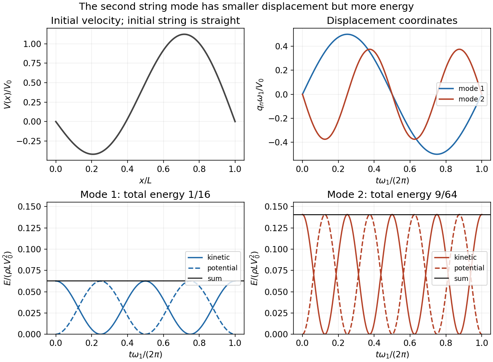

<h1 id="11/e/solution">Solution</h1>

↑ **Parent:** [E](../e.md)

For small transverse [displacements](../../../../displacement.md), the string's [kinetic energy](../../../../kinetic-energy.md) and extra elastic [potential energy](../../../../potential-energy.md) are

$$
K=\frac\rho2\int_0^Ly_t^2\,dx,\qquad U=\frac T2\int_0^Ly_x^2\,dx.
$$

The [orthogonality of trigonometric functions](../../../../orthogonality-of-trigonometric-functions.md) removes cross terms between the two [normal modes](../../../../normal-mode.md). For a mode $B_n\sin(k_nx)\sin(\omega_nt)$, use $Tk_n^2=\rho\omega_n^2$ and $\int_0^L\sin^2(k_nx)\,dx=\int_0^L\cos^2(k_nx)\,dx=L/2$ to obtain

$$
K_n=\frac{\rho L B_n^2\omega_n^2}{4}\cos^2(\omega_nt),\quad U_n=\frac{\rho L B_n^2\omega_n^2}{4}\sin^2(\omega_nt),\quad E_n=\frac{\rho L B_n^2\omega_n^2}{4}.
$$

Consequently the [modal energy distribution](../../../../modal-energy-distribution.md) is

$$
\boxed{E_1=\frac{\rho LV_0^2}{16},\qquad E_2=\frac{9\rho LV_0^2}{64},\qquad \frac{E_2}{E_1}=\frac94.}
$$

**The second mode contributes more total energy at every time**, despite its smaller displacement amplitude. The total [energy](../../../../energy-split.md) is $13\rho LV_0^2/64$, with fractions $4/13$ and $9/13$ in the first and second modes. Each mode exchanges [kinetic energy](../../../../kinetic-energy.md) and [potential energy](../../../../potential-energy.md), while its sum is conserved; the comparison is of these sums, not of instantaneous kinetic energies alone.

**[Figure 4](#11/e/image-string-modal-coordinates-and-separate-kinetic-and-potential-energies-showing-the-larger-energy-of-the-second-mode). String modal coordinates and separate kinetic and potential energies, showing the larger energy of the second mode**.

## ↑ Ancestors (12)

1. [E](../e.md)
2. [11](../../11.md)
3. [2016](../../../2016-split.md)
4. [Past exam of the mathematical methods II course of the University of Oxford](../../../split.md)
5. [Mathematical methods II course of the University of Oxford](../../../../mathematical-methods-ii-course-of-the-university-of-oxford.md)
6. [Year 1 of the physics course of the University of Oxford](../../../../year-1-of-the-physics-course-of-the-university-of-oxford.md)
7. [Physics course of the University of Oxford](../../../../physics-course-of-the-university-of-oxford.md)
8. [Undergraduate course of the University of Oxford](../../../../undergraduate-course-of-the-university-of-oxford.md)
9. [Course of the University of Oxford](../../../../course-of-the-university-of-oxford.md)
10. [University of Oxford](../../../../university-of-oxford-split.md)
11. [List of universities](../../../../list-of-universities.md)
12. [Codex Wiki](../../../../split.md)
