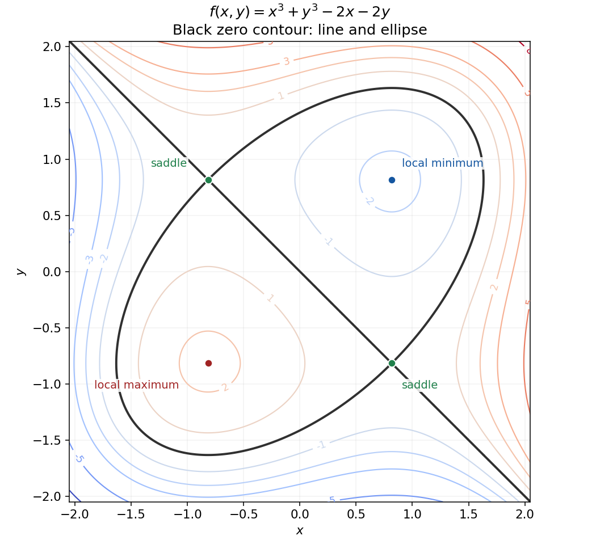

<h1 id="7/solution">Solution</h1>

↑ **Parent:** [7](../7.md)

The [gradient](../../../gradient.md) vanishes when $3x^2-2=3y^2-2=0$. Put $s=\sqrt{2/3}$. The [Hessian matrix](../../../hessian-matrix.md) is $\operatorname{diag}(6x,6y)$, so the [second-derivative test](../../../second-derivative-test.md) gives:

- $(s,s)$: a **strict local minimum**, with $f=-8s/3$;
- $(-s,-s)$: a **strict local maximum**, with $f=8s/3$;
- $(s,-s)$ and $(-s,s)$: **saddle points**, both with $f=0$.

The [positive-definite](../../../positive-definite-bilinear-form.md) and [negative definite](../../../negative-definite-matrix.md) cases give small closed [level curves](../../../level-curve.md) around the minimum and maximum. At each saddle, the zero contour crosses itself. In fact,

$$
f=(x+y)(x^2-xy+y^2-2),
$$

so the entire zero [level curve](../../../level-curve.md) is the union of the line $y=-x$ and the [ellipse](../../../ellipse.md) $x^2-xy+y^2=2$. This factorization fixes the topology of a rough contour sketch. Neither local extremum is global, since the cubic is unbounded above and below.

**[Figure 1](#7/image-contours-of-the-cubic-surface-with-its-two-local-extrema-two-saddles-and-exact-zero-contour). Contours of the cubic surface, with its two local extrema, two saddles and exact zero contour**.

## ↑ Ancestors (11)

1. [7](../7.md)
2. [2016](../../2016-split.md)
3. [Past exam of the mathematical methods II course of the University of Oxford](../../split.md)
4. [Mathematical methods II course of the University of Oxford](../../../mathematical-methods-ii-course-of-the-university-of-oxford.md)
5. [Year 1 of the physics course of the University of Oxford](../../../year-1-of-the-physics-course-of-the-university-of-oxford.md)
6. [Physics course of the University of Oxford](../../../physics-course-of-the-university-of-oxford.md)
7. [Undergraduate course of the University of Oxford](../../../undergraduate-course-of-the-university-of-oxford.md)
8. [Course of the University of Oxford](../../../course-of-the-university-of-oxford.md)
9. [University of Oxford](../../../university-of-oxford-split.md)
10. [List of universities](../../../list-of-universities.md)
11. [Codex Wiki](../../../split.md)
