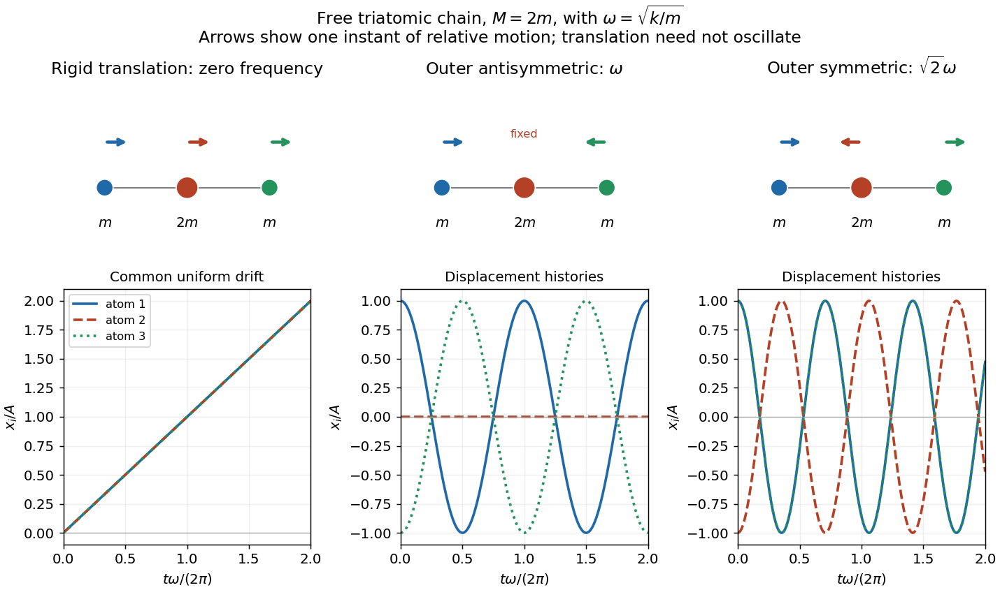

<h1 id="9/d/solution">Solution</h1>

↑ **Parent:** [D](../d.md)

For the zero [normal mode](../../../../normal-mode.md), $x_1=x_2=x_3=A+Bt$. The molecule translates uniformly; a common constant displacement is the special case $B=0$. For the lower vibrational [normal mode](../../../../normal-mode.md), put $\omega=\sqrt{k/m}$:

$$
\mathbf x(t)=A(1,0,-1)\cos(\omega t+\phi).
$$

The end atoms move oppositely with equal [amplitudes](../../../../wave-amplitude.md), while the central atom remains stationary. In the higher vibrational [normal mode](../../../../normal-mode.md), with $\Omega=\sqrt{k/m+2k/M}$,

$$
\mathbf x(t)=C(1,-2m/M,1)\cos(\Omega t+\chi).
$$

The ends move together and the centre moves in the opposite direction, with central amplitude $2m/M$ times an end amplitude. Both internal modes keep the [centre of mass](../../../../center-of-mass.md) fixed and obey [mass-weighted orthogonality](../../../../mass-weighted-orthogonality-of-normal-modes.md). The zero mode instead describes motion of that [centre of mass](../../../../center-of-mass.md).

**[Figure 2](#9/d/image-three-free-chain-mode-shapes-and-their-displacement-histories-shown-for-central-mass-twice-an-end-mass). Three free-chain mode shapes and their displacement histories, shown for central mass twice an end mass**.

## ↑ Ancestors (12)

1. [D](../d.md)
2. [9](../../9.md)
3. [2016](../../../2016-split.md)
4. [Past exam of the mathematical methods II course of the University of Oxford](../../../split.md)
5. [Mathematical methods II course of the University of Oxford](../../../../mathematical-methods-ii-course-of-the-university-of-oxford.md)
6. [Year 1 of the physics course of the University of Oxford](../../../../year-1-of-the-physics-course-of-the-university-of-oxford.md)
7. [Physics course of the University of Oxford](../../../../physics-course-of-the-university-of-oxford.md)
8. [Undergraduate course of the University of Oxford](../../../../undergraduate-course-of-the-university-of-oxford.md)
9. [Course of the University of Oxford](../../../../course-of-the-university-of-oxford.md)
10. [University of Oxford](../../../../university-of-oxford-split.md)
11. [List of universities](../../../../list-of-universities.md)
12. [Codex Wiki](../../../../split.md)
