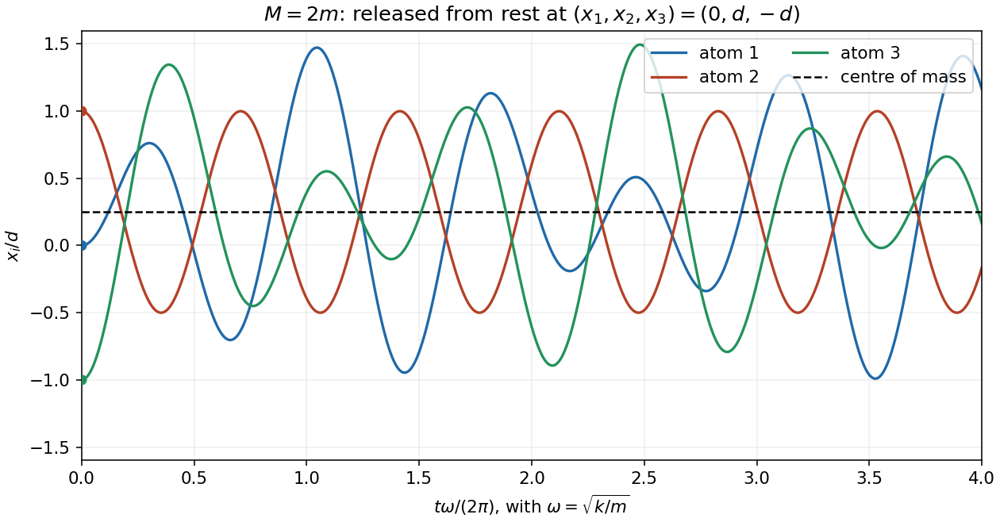

<h1 id="9/e/solution">Solution</h1>

↑ **Parent:** [E](../e.md)

For $M=2m$, take the mode shapes $v_0=(1,1,1)$, $v_a=(1,0,-1)$ and $v_s=(1,-1,1)$. Their [angular frequencies](../../../../angular-frequency.md) are $0$, $\omega=\sqrt{k/m}$ and $\sqrt2\omega$. The initial [displacement](../../../../displacement.md) decomposes as

$$
(0,d,-d)=\frac d4v_0+\frac d2v_a-\frac{3d}{4}v_s.
$$

All initial [velocities](../../../../velocity.md) vanish, so the zero-mode coefficient stays constant and the two oscillatory coefficients use cosines. Thus

$$
\boxed{\begin{aligned}
x_1(t)&=\frac d4+\frac d2\cos(\omega t)-\frac{3d}{4}\cos(\sqrt2\omega t),\\
x_2(t)&=\frac d4+\frac{3d}{4}\cos(\sqrt2\omega t),\\
x_3(t)&=\frac d4-\frac d2\cos(\omega t)-\frac{3d}{4}\cos(\sqrt2\omega t).
\end{aligned}}
$$

The conserved [centre of mass](../../../../center-of-mass.md) is $(x_1+2x_2+x_3)/4=d/4$. Omitting the zero mode would incorrectly force this to zero. The two vibrational frequencies are in the ratio $\sqrt2$, so there is no common nonzero period.

**[Figure 3](#9/e/image-triatomic-chain-motion-from-the-specified-initial-displacement-including-its-constant-centre-of-mass). Triatomic-chain motion from the specified initial displacement, including its constant centre of mass**.

## ↑ Ancestors (12)

1. [E](../e.md)
2. [9](../../9.md)
3. [2016](../../../2016-split.md)
4. [Past exam of the mathematical methods II course of the University of Oxford](../../../split.md)
5. [Mathematical methods II course of the University of Oxford](../../../../mathematical-methods-ii-course-of-the-university-of-oxford.md)
6. [Year 1 of the physics course of the University of Oxford](../../../../year-1-of-the-physics-course-of-the-university-of-oxford.md)
7. [Physics course of the University of Oxford](../../../../physics-course-of-the-university-of-oxford.md)
8. [Undergraduate course of the University of Oxford](../../../../undergraduate-course-of-the-university-of-oxford.md)
9. [Course of the University of Oxford](../../../../course-of-the-university-of-oxford.md)
10. [University of Oxford](../../../../university-of-oxford-split.md)
11. [List of universities](../../../../list-of-universities.md)
12. [Codex Wiki](../../../../split.md)
