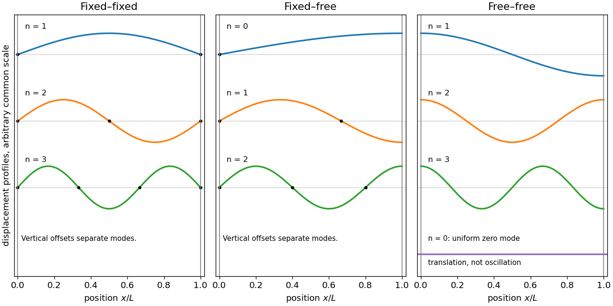

<h1 id="11/b/i/solution">Solution</h1>

↑ **Parent:** [I](../i.md)

For a uniform string, let $c=\sqrt{T/\mu}$. A separated mode obeys $Y''+k^2Y=0$, $\omega=ck$. Fixed ends require $Y(0)=Y(L)=0$, so

$$
\boxed{k_n=\frac{n\pi}L,\qquad
y_n(x,t)=A_n\sin\frac{n\pi x}L\cos(ck_nt+\phi_n),\qquad n=1,2,\ldots.}
$$

The first three [normal modes](../../../../../normal-mode.md) have one, two and three half-waves respectively. Their interior [nodes of a standing wave](../../../../../node-physics.md) are at $x=jL/n$ for $j=1,\ldots,n-1$.

**[Figure 3](#11/b/i/image-the-first-oscillatory-string-modes-for-fixed-and-free-boundaries). The first oscillatory string modes for fixed and free boundaries**. Original analytic mode shapes for three boundary conditions. Vertical offsets separate the shapes; the free-free column also includes the uniform zero mode.

## ↑ Ancestors (13)

1. [I](../i.md)
2. [B](../../b.md)
3. [11](../../../11.md)
4. [2017 resit](../../../../2017-resit-split.md)
5. [Past exam of the mathematical methods II course of the University of Oxford](../../../../split.md)
6. [Mathematical methods II course of the University of Oxford](../../../../../mathematical-methods-ii-course-of-the-university-of-oxford.md)
7. [Year 1 of the physics course of the University of Oxford](../../../../../year-1-of-the-physics-course-of-the-university-of-oxford.md)
8. [Physics course of the University of Oxford](../../../../../physics-course-of-the-university-of-oxford.md)
9. [Undergraduate course of the University of Oxford](../../../../../undergraduate-course-of-the-university-of-oxford.md)
10. [Course of the University of Oxford](../../../../../course-of-the-university-of-oxford.md)
11. [University of Oxford](../../../../../university-of-oxford-split.md)
12. [List of universities](../../../../../list-of-universities.md)
13. [Codex Wiki](../../../../../split.md)
