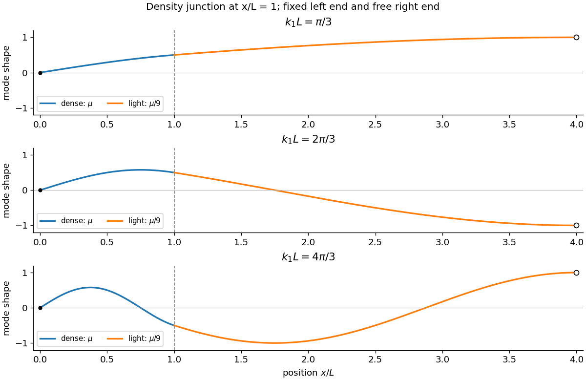

<h1 id="11/c/solution">Solution</h1>

↑ **Parent:** [C](../c.md)

At common tension, the lighter segment has three times the [wave speed](../../../../wave-speed.md), so its [wavenumber](../../../../wavenumber.md) at the same frequency is $k_2=k_1/3$. The fixed left end and free right end select

$$
Y_1(x)=A\sin k_1x,\qquad
Y_2(x)=B\cos[k_2(4L-x)].
$$

Let $q=k_1L$. Since $k_2(4L-L)=q$, continuity of displacement and of transverse force at the junction gives

$$
A\sin q=B\cos q,\qquad
Ak_1\cos q=Bk_2\sin q.
$$

Equal tension makes the second condition continuity of slope. A nontrivial pair of amplitudes requires the coefficient [determinant](../../../../determinant.md) to vanish:

$$
k_1\cos^2q-k_2\sin^2q=0.
$$

For positive frequency, $k_2/k_1=1/3$, so

$$
\boxed{\sin^2(k_1L)=\frac34,\qquad\sin(k_1L)=\pm\frac{\sqrt3}{2}.}
$$

Neither $\sin q=0$ nor $\cos q=0$ gives a nonzero mode, as direct substitution into the two matching equations confirms. The positive roots are $q=\pi/3+n\pi$ or $q=2\pi/3+n\pi$ for $n\ge0$. The first modes in the figure show the changing wavelength across the junction while retaining continuous displacement and slope. The zero-frequency limit must be solved separately; the fixed and free boundary conditions allow only the trivial static solution.

**[Figure 4](#11/c/image-the-first-three-modes-of-a-fixed-free-string-with-a-density-junction). The first three modes of a fixed-free string with a density junction**. Original eigenfunctions for the two segment densities. Displacement and slope are continuous at x equal to L; the lighter segment has three times the local wavelength.

## ↑ Ancestors (12)

1. [C](../c.md)
2. [11](../../11.md)
3. [2017 resit](../../../2017-resit-split.md)
4. [Past exam of the mathematical methods II course of the University of Oxford](../../../split.md)
5. [Mathematical methods II course of the University of Oxford](../../../../mathematical-methods-ii-course-of-the-university-of-oxford.md)
6. [Year 1 of the physics course of the University of Oxford](../../../../year-1-of-the-physics-course-of-the-university-of-oxford.md)
7. [Physics course of the University of Oxford](../../../../physics-course-of-the-university-of-oxford.md)
8. [Undergraduate course of the University of Oxford](../../../../undergraduate-course-of-the-university-of-oxford.md)
9. [Course of the University of Oxford](../../../../course-of-the-university-of-oxford.md)
10. [University of Oxford](../../../../university-of-oxford-split.md)
11. [List of universities](../../../../list-of-universities.md)
12. [Codex Wiki](../../../../split.md)
