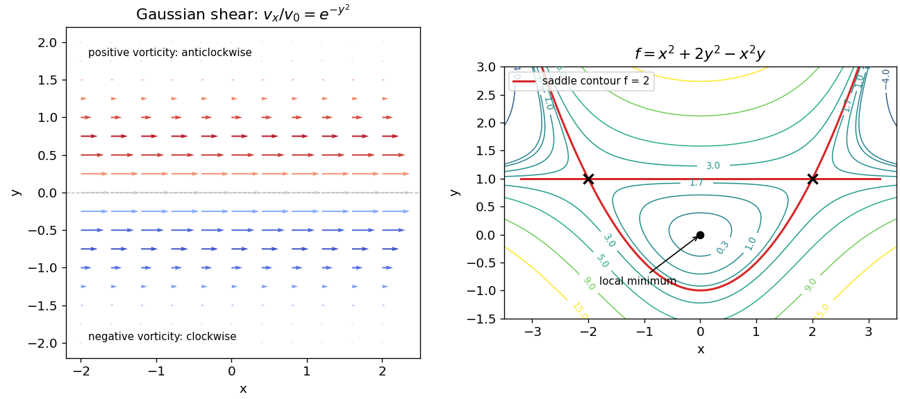

<h1 id="3/a/solution">Solution</h1>

↑ **Parent:** [A](../a.md)

The arrows point in the positive $x$ direction, with largest speed $v_0$ on $y=0$ and rapidly decreasing length away from that line. Since only $v_x$ is nonzero,

$$
\boxed{\nabla\times v=-\frac{\partial v_x}{\partial y}\,e_z
=2v_0y e^{-y^2}e_z.}
$$

The [vorticity](../../../../vorticity-split.md) points towards positive $z$ above the centre line and negative $z$ below it. A small fluid element therefore has local [angular velocity](../../../../angular-velocity.md) $(\nabla\times v)/2$: anticlockwise above and clockwise below when viewed from positive $z$. At $y=0$, its speed is maximal but its local [vorticity](../../../../vorticity-split.md) is zero. Translation speed and local rotation are different properties.

**[Figure 1](#3/a/image-gaussian-shear-vorticity-and-contours-around-a-minimum-and-two-saddles). Gaussian shear vorticity and contours around a minimum and two saddles**. Original analytic field and contour plots. The shear arrows are scaled uniformly; the marked contour at level two factors into a line and a parabola through the saddle points.

## ↑ Ancestors (12)

1. [A](../a.md)
2. [3](../../3.md)
3. [2017 resit](../../../2017-resit-split.md)
4. [Past exam of the mathematical methods II course of the University of Oxford](../../../split.md)
5. [Mathematical methods II course of the University of Oxford](../../../../mathematical-methods-ii-course-of-the-university-of-oxford.md)
6. [Year 1 of the physics course of the University of Oxford](../../../../year-1-of-the-physics-course-of-the-university-of-oxford.md)
7. [Physics course of the University of Oxford](../../../../physics-course-of-the-university-of-oxford.md)
8. [Undergraduate course of the University of Oxford](../../../../undergraduate-course-of-the-university-of-oxford.md)
9. [Course of the University of Oxford](../../../../course-of-the-university-of-oxford.md)
10. [University of Oxford](../../../../university-of-oxford-split.md)
11. [List of universities](../../../../list-of-universities.md)
12. [Codex Wiki](../../../../split.md)
