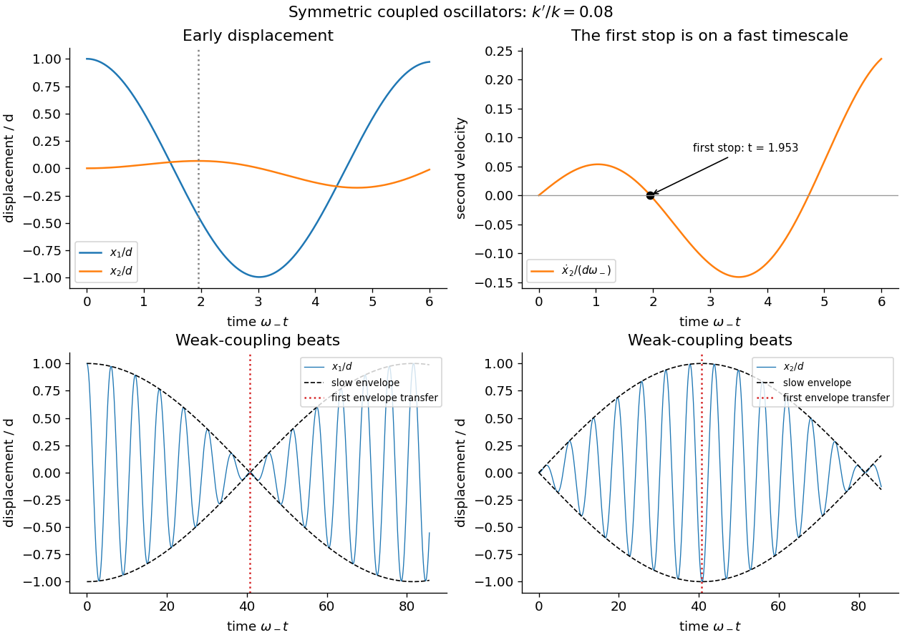

<h1 id="9/d/solution">Solution</h1>

↑ **Parent:** [D](../d.md)

Let $\bar\omega=(\omega_++\omega_-)/2$ and $\delta=(\omega_+-\omega_-)/2$. The sum and difference identities give

$$
x_1=d\cos\bar\omega t\cos\delta t,\qquad
x_2=d\sin\bar\omega t\sin\delta t.
$$

For weak coupling, $\omega_+-\omega_-=\omega_-\epsilon+O(\epsilon^2)$, so the slow sine and cosine envelopes produce [beats](../../../../beat.md). The first maximum of the second envelope is at $t=\pi/(\omega_+-\omega_-)$, when the first envelope vanishes.

A literal [first turning point of an initially stationary coupled oscillator](../../../../first-turning-point-of-an-initially-stationary-coupled-oscillator.md) is different from that slow envelope maximum. The first nonzero time at which the second mass is instantaneously at rest satisfies

$$
\boxed{\bar\omega\cos(\bar\omega t)\sin(\delta t)
+\delta\sin(\bar\omega t)\cos(\delta t)=0.}
$$

Set $z=\bar\omega t$ and $\eta=\delta/\bar\omega\ll1$. Dividing the derivative by $d\delta$ and expanding at $z$ of order one gives $z\cos z+\sin z+O(\eta^2)=0$. The first positive root lies in $(\pi/2,\pi)$, where $\tan z=-z$, so

$$
\boxed{t_{\rm first}=\frac{2.028757838\ldots}{\bar\omega}
+O\left(\frac{\eta^2}{\bar\omega}\right).}
$$

There is no earlier root: for $0<z\le\pi/2$, both terms in the exact derivative are positive when $\eta$ is sufficiently small. At the root the second displacement reaches its first local maximum. If the question instead intends the first _envelope_ maximum, its time is $\pi/(\omega_+-\omega_-)\simeq\pi/(\epsilon\omega_-)$. That is a slow amplitude-transfer time, and is not generally a time of zero instantaneous velocity. The distinction matters because both masses keep oscillating while the envelopes change.

**[Figure 2](#9/d/image-the-first-turning-point-and-the-much-slower-envelope-transfer-of-coupled-oscillators). The first turning point and the much slower envelope transfer of coupled oscillators**. Original dimensionless solutions at weak nonzero coupling. An early-time panel marks the first zero of the second velocity, while long-time curves show the separate beat envelopes.

## ↑ Ancestors (12)

1. [D](../d.md)
2. [9](../../9.md)
3. [2017 resit](../../../2017-resit-split.md)
4. [Past exam of the mathematical methods II course of the University of Oxford](../../../split.md)
5. [Mathematical methods II course of the University of Oxford](../../../../mathematical-methods-ii-course-of-the-university-of-oxford.md)
6. [Year 1 of the physics course of the University of Oxford](../../../../year-1-of-the-physics-course-of-the-university-of-oxford.md)
7. [Physics course of the University of Oxford](../../../../physics-course-of-the-university-of-oxford.md)
8. [Undergraduate course of the University of Oxford](../../../../undergraduate-course-of-the-university-of-oxford.md)
9. [Course of the University of Oxford](../../../../course-of-the-university-of-oxford.md)
10. [University of Oxford](../../../../university-of-oxford-split.md)
11. [List of universities](../../../../list-of-universities.md)
12. [Codex Wiki](../../../../split.md)
