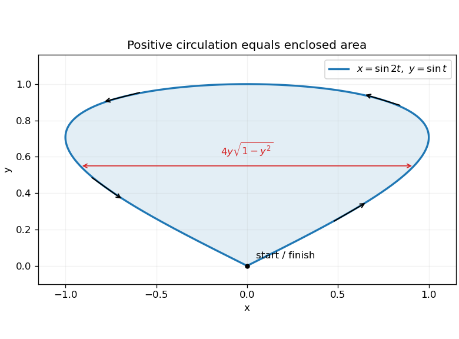
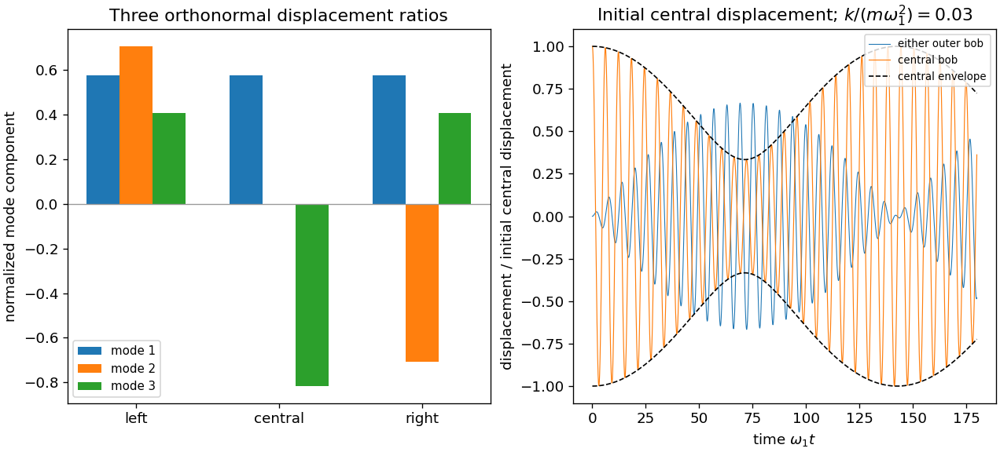
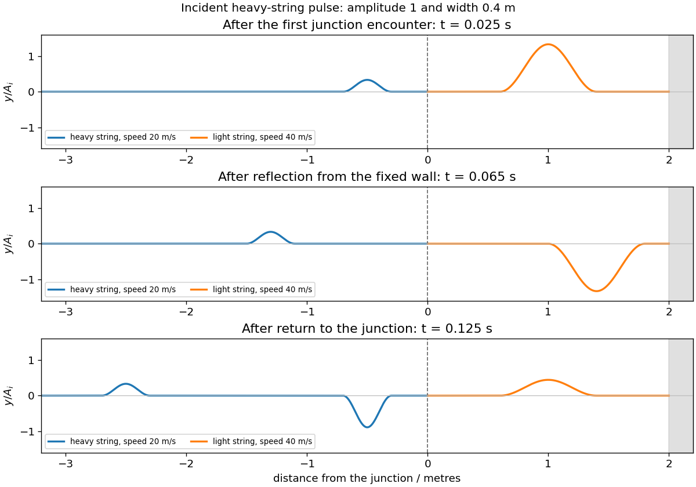
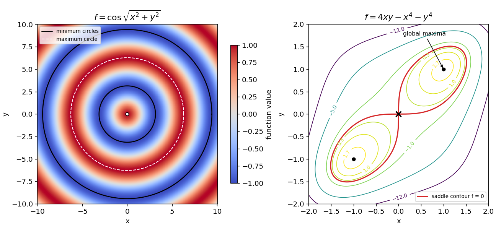

# 2017

↑ **Parent:** [Past exam of the mathematical methods II course of the University of Oxford](../past-exam-of-the-mathematical-methods-ii-course-of-the-university-of-oxford.md)

Source paper: [https://www.whatdotheyknow.com/request/physics_past_papers_21/response/3037379/attach/2/FOI%20202505%20441%20Response.pdf?cookie_passthrough=1](https://www.whatdotheyknow.com/request/physics_past_papers_21/response/3037379/attach/2/FOI%20202505%20441%20Response.pdf?cookie_passthrough=1)

**Table of contents**

- [1](#1)
  - [Solution](#1/solution)
- [2](#2)
  - [Solution](#2/solution)
- [3](#3)
  - [a](#3/a)
    - [Solution](#3/a/solution)
  - [b](#3/b)
    - [Solution](#3/b/solution)
- [4](#4)
  - [Solution](#4/solution)
- [5](#5)
  - [Solution](#5/solution)
- [6](#6)
  - [Solution](#6/solution)
- [7](#7)
  - [Solution](#7/solution)
- [8](#8)
  - [a](#8/a)
    - [Solution](#8/a/solution)
  - [b](#8/b)
    - [Solution](#8/b/solution)
  - [c](#8/c)
    - [Solution](#8/c/solution)
- [9](#9)
  - [a](#9/a)
    - [Solution](#9/a/solution)
  - [b](#9/b)
    - [Solution](#9/b/solution)
  - [c](#9/c)
    - [Solution](#9/c/solution)
  - [d](#9/d)
    - [Solution](#9/d/solution)
  - [e](#9/e)
    - [Solution](#9/e/solution)
- [10](#10)
  - [Solution](#10/solution)
  - [a](#10/a)
    - [Solution](#10/a/solution)
  - [b](#10/b)
    - [i](#10/b/i)
      - [Solution](#10/b/i/solution)
    - [ii](#10/b/ii)
      - [Solution](#10/b/ii/solution)
    - [iii](#10/b/iii)
      - [Solution](#10/b/iii/solution)
  - [c](#10/c)
    - [Solution](#10/c/solution)
- [11](#11)
  - [a](#11/a)
    - [Solution](#11/a/solution)
  - [b](#11/b)
    - [Solution](#11/b/solution)
  - [c](#11/c)
    - [Solution](#11/c/solution)
  - [d](#11/d)
    - [Solution](#11/d/solution)

## 1

↑ **Parent:** [2017](2017.md)

<h3 id="1/solution">Solution</h3>

↑ **Parent:** [1](#1)

For an [exact differential](../differential-form.md#exact-differential) $Mdx+Ndy$, equality of the [mixed partial derivatives](../multivariable-calculus.md#mixed-partial-derivative) requires $M_y=N_x$. Here these are $\sin x+b\cos y$ and $\sin x+3\cos y$, so $\boxed{b=3}$. Integrating $M$ with respect to $x$ gives $f=-y\cos x+3x\sin y+g(y)$. Comparison with $N$ gives $g'=y^2$, and the specified value fixes the integration constant. Therefore

$$
\boxed{f(x,y)=-y\cos x+3x\sin y+\frac{y^3}{3}-\frac23.}
$$

Differentiating recovers both coefficients, and $f(0,2)=-2+8/3-2/3=0$. The explicit [potential function](../energy.md#potential-function) also proves exactness globally, without relying only on a local compatibility test.

## 2

↑ **Parent:** [2017](2017.md)

<h3 id="2/solution">Solution</h3>

↑ **Parent:** [2](#2)

Set $x=au$, $y=bv$, $z=cw$. For nonzero $a,b,c$, the absolute [Jacobian determinant](../multivariable-calculus.md#jacobian-determinant) is $|abc|$, and the transformed interior is the ball $u^2+v^2+w^2\le4$. Its radius is two, so

$$
V=|abc|\int_0^2\int_0^\pi\int_0^{2\pi}\rho^2\sin\theta\,d\phi\,d\theta\,d\rho
=\boxed{\frac{32\pi}{3}|abc|.}
$$

If $a,b,c$ are taken as positive semiaxis parameters, this is $32\pi abc/3$. The actual semiaxes are $2|a|,2|b|,2|c|$; omitting the factor two in the transformed radius would make the volume eight times too small.

## 3

↑ **Parent:** [2017](2017.md)

<h3 id="3/a">a</h3>

↑ **Parent:** [3](#3)

<h4 id="3/a/solution">Solution</h4>

↑ **Parent:** [A](#3/a)

Expand $f(s)=\sqrt s$ about $s=25$, with increment one. Since $f'(25)=1/10$ and $f''(25)=-1/500$, the second-order [Taylor series](../calculus.md#taylor-series) approximation is

$$
\boxed{\sqrt{26}\simeq5+\frac1{10}-\frac1{1000}=5.099.}
$$

The third derivative is $3/(8s^{5/2})>0$, decreasing on $[25,26]$. The [Taylor remainder](../calculus.md#taylor-remainder) is therefore positive and less than $f'''(25)/6=1/50000$, so $0<\sqrt{26}-5.099<0.00002$.

<h3 id="3/b">b</h3>

↑ **Parent:** [3](#3)

<h4 id="3/b/solution">Solution</h4>

↑ **Parent:** [B](#3/b)

For real $x$ sufficiently close to zero, $1+x>0$. Taking the logarithm and using its [Maclaurin series](../calculus.md#maclaurin-series) gives

$$
\log[(1+x)^{1/x}]=\frac{\log(1+x)}x
=1-\frac x2+\frac{x^2}{3}+O(x^3)\longrightarrow1.
$$

Continuity of the exponential then gives

$$
\boxed{\lim_{x\to0}(1+x)^{1/x}=e.}
$$

This is a two-sided real limit on the punctured neighbourhood where the base is positive.

## 4

↑ **Parent:** [2017](2017.md)

<h3 id="4/solution">Solution</h3>

↑ **Parent:** [4](#4)

[Stokes theorem](../multivariable-calculus.md#stokes-theorem) states that $\oint_C A\cdot dr=\iint_S(\nabla\times A)\cdot n\,dS$, with consistent boundary orientation. Here $\nabla\times A=e_z$, so the circulation around the positively oriented planar curve equals its area. Substituting the given parametrization gives

$$
\frac12(x\dot y-y\dot x)
=\frac12[\sin2t\cos t-2\sin t\cos2t]=\sin^3t.
$$

The curve closes at the origin, passes along the right side to $(0,1)$ and returns along the left side, so it is anticlockwise. Consequently

$$
\boxed{\operatorname{Area}=\int_0^\pi\sin^3t\,dt=\frac43.}
$$

Equivalently its two sides are $x=\pm2y\sqrt{1-y^2}$, $0\le y\le1$, whose horizontal width integrates to the same result.

**[Figure 1](#4/image-the-enclosed-lobe-and-its-positive-boundary-orientation). The enclosed lobe and its positive boundary orientation**. Original analytic plot. Arrows follow increasing parameter from the origin along the right side and back along the left; horizontal widths provide an independent area integral.

## 5

↑ **Parent:** [2017](2017.md)

<h3 id="5/solution">Solution</h3>

↑ **Parent:** [5](#5)

Let $G(s)=\int_0^se^{t^2}\,dt$. The [fundamental theorem of calculus](../calculus.md#fundamental-theorem-of-calculus) gives $G'(s)=e^{s^2}$. Applying the [chain rule](../calculus.md#chain-rule) to $F(x,y)=G(xy^2)$ gives

$$
\boxed{F_x=y^2e^{x^2y^4},\qquad F_y=2xy\,e^{x^2y^4}.}
$$

No elementary antiderivative of $e^{t^2}$ is needed: differentiation of the variable upper limit supplies the integrand directly.

## 6

↑ **Parent:** [2017](2017.md)

<h3 id="6/solution">Solution</h3>

↑ **Parent:** [6](#6)

A [standing wave](../mathematical-physics.md#standing-wave) has a fixed spatial amplitude profile and oscillates in time, with stationary [nodes of a standing wave](../wave-equation.md#node-physics). It arises from equal-amplitude waves of the same frequency travelling in opposite directions. For a uniform string with [linear mass density](../fluid-mechanics.md#linear-mass-density) $\mu$, the [wave speed](../wave-equation.md#wave-speed) is $c=\sqrt{T/\mu}$ and a separated mode has $Y''+k^2Y=0$.

The fixed boundary requires $Y(0)=0$, while the free boundary requires $TY'(L)=0$. Thus $Y=A\sin kx$ and $\cos kL=0$, giving

$$
\boxed{k_n=\frac{(n+1/2)\pi}{L},\qquad
y_n(x,t)=A_n\sin(k_nx)\cos(ck_nt+\phi_n),\quad n=0,1,2,\ldots.}
$$

The fixed end is a [node of a standing wave](../wave-equation.md#node-physics) and the free end an [antinode](../wave-equation.md#antinode). Arbitrary small motions are superpositions of these [normal modes](../wave-equation.md#normal-mode); the [tension](../force.md#tension) alone determines their frequencies only when $\mu$ is also specified.

## 7

↑ **Parent:** [2017](2017.md)

<h3 id="7/solution">Solution</h3>

↑ **Parent:** [7](#7)

Holding $y$ fixed gives $u_x=v_x=1$, whereas holding $x$ fixed gives $u_y=1$ and $v_y=-1$. The [chain rule](../calculus.md#chain-rule) therefore gives $w_x=w_u+w_v$ and $w_y=w_u-w_v$. Multiplication yields

$$
\boxed{\left(\frac{\partial w}{\partial x}\right)_y
\left(\frac{\partial w}{\partial y}\right)_x
=\left(\frac{\partial w}{\partial u}\right)_v^2-
\left(\frac{\partial w}{\partial v}\right)_u^2.}
$$

The subscripts specify the independent coordinate held fixed; they are necessary because changing coordinates changes which direction a partial derivative follows.

## 8

↑ **Parent:** [2017](2017.md)

<h3 id="8/a">a</h3>

↑ **Parent:** [8](#8)

<h4 id="8/a/solution">Solution</h4>

↑ **Parent:** [A](#8/a)

Let $a=h/2$ and place the hole axis along $z$. At the rim, $r_0^2=R^2-a^2$. A horizontal slice at $|z|\le a$ is an annulus of area $\pi[(R^2-z^2)-r_0^2]=\pi(a^2-z^2)$. Thus the [napkin ring problem](../euclidean-geometry.md#napkin-ring-problem) gives

$$
\boxed{V=\pi\int_{-a}^{a}(a^2-z^2)\,dz
=\frac{4\pi a^3}{3}=\frac{\pi h^3}{6}.}
$$

Each slice depends only on $a$ and $z$, explaining the independence from the original sphere radius, rather than obtaining it merely by cancellation after integration.

<h3 id="8/b">b</h3>

↑ **Parent:** [8](#8)

<h4 id="8/b/solution">Solution</h4>

↑ **Parent:** [B](#8/b)

The [divergence theorem](../multivariable-calculus.md#divergence-theorem) states $\iint_SF\cdot n\,dS=\iiint_V\nabla\cdot F\,dV$ for a sufficiently smooth field and a piecewise smooth closed boundary with outward [unit normal](../differential-geometry.md#unit-normal). Choose $F=r/3$. Since $\nabla\cdot r=3$,

$$
\boxed{V=\frac13\iint_Sn\cdot r\,dS.}
$$

The factor $1/3$ comes from the three spatial dimensions; the outward orientation is especially important on the inner wall of the drilled solid.

<h3 id="8/c">c</h3>

↑ **Parent:** [8](#8)

<h4 id="8/c/solution">Solution</h4>

↑ **Parent:** [C](#8/c)

The boundary consists of the spherical zone $-a\le z\le a$ and the inner cylindrical wall. On the sphere, $n=r/R$, so $n\cdot r=R$. Its area element is $R\,d\phi\,dz$, giving the flux

$$
\int_{-a}^{a}\int_0^{2\pi}R^2\,d\phi\,dz=4\pi aR^2.
$$

On the inner cylinder, the outward normal of the remaining material points _towards the hole_: $n=-e_\rho$. Therefore $n\cdot r=-r_0$, and $dS=r_0\,d\phi\,dz$, giving flux $-4\pi ar_0^2$. There are no planar end faces of positive area: the two surfaces meet along the rim circles. Hence

$$
\boxed{V=\frac{4\pi a}{3}(R^2-r_0^2)
=\frac{4\pi a^3}{3}=\frac{\pi h^3}{6}.}
$$

Using the cylinder's radial normal with the opposite sign would count the hole as extra material and lose the required cancellation.

## 9

↑ **Parent:** [2017](2017.md)

<h3 id="9/a">a</h3>

↑ **Parent:** [9](#9)

<h4 id="9/a/solution">Solution</h4>

↑ **Parent:** [A](#9/a)

For small horizontal displacement $x_i\simeq l\theta_i$, the gravitational restoring force is $-mg\theta_i\simeq-(mg/l)x_i$. A spring between adjacent bobs has extension equal to their displacement difference; [Hooke's law](../elasticity-physics.md#hooke-s-law) pulls each bob towards its neighbour's displaced position. Thus comparison with the stated equations gives

$$
\boxed{a=\frac gl,\qquad b=k.}
$$

The small-angle approximation makes the bob motion horizontal to first order; its vertical shift changes spring geometry only at higher order. Multiplying all force equations by minus one puts the positive restoring coefficients on the displayed right-hand side.

<h3 id="9/b">b</h3>

↑ **Parent:** [9](#9)

<h4 id="9/b/solution">Solution</h4>

↑ **Parent:** [B](#9/b)

In one [normal mode](../wave-equation.md#normal-mode), all moving bobs share the same frequency and fixed amplitude ratios. A real mode vector allows their phases to be chosen equal or differing by $\pi$, according to the signs of its components. A component equal to zero means that bob remains at rest in that mode and has no oscillation phase to assign.

<h3 id="9/c">c</h3>

↑ **Parent:** [9](#9)

<h4 id="9/c/solution">Solution</h4>

↑ **Parent:** [C](#9/c)

The squared-frequency matrix is

$$
\frac gl I+\frac km\begin{pmatrix}1&-1&0\\-1&2&-1\\0&-1&1\end{pmatrix}.
$$

The dimensionless spring matrix has an [orthonormal eigenbasis](../linear-operator-theory.md#orthonormal-eigenbasis)

$$
v_1=\frac1{\sqrt3}(1,1,1),\quad
v_2=\frac1{\sqrt2}(1,0,-1),\quad
v_3=\frac1{\sqrt6}(1,-2,1),
$$

with [eigenvalues](../linear-operator-theory.md#eigenvalue) $0,1,3$. Adding the gravitational term therefore gives

$$
\boxed{\omega_1=\sqrt{\frac gl},\quad
\omega_2=\sqrt{\frac gl+\frac km},\quad
\omega_3=\sqrt{\frac gl+\frac{3k}m}.}
$$

The uniform mode leaves both springs unstretched. The other two modes deform the springs and so have higher frequencies.

<h3 id="9/d">d</h3>

↑ **Parent:** [9](#9)

<h4 id="9/d/solution">Solution</h4>

↑ **Parent:** [D](#9/d)

With zero initial velocities, choosing the initial displacement proportional to one [eigenvector](../linear-operator-theory.md#eigenvector) excites only its [normal mode](../wave-equation.md#normal-mode). Suitable ratios are

$$
\boxed{x_1:x_2:x_3=1:1:1,\qquad1:0:-1,\qquad1:-2:1.}
$$

The overall scale must remain small compared with $l$. Release each configuration from rest; its subsequent vector is its initial displacement multiplied by $\cos\omega_jt$. The middle bob is stationary in the second mode, while it moves oppositely with twice either outer amplitude in the third.

<h3 id="9/e">e</h3>

↑ **Parent:** [9](#9)

<h4 id="9/e/solution">Solution</h4>

↑ **Parent:** [E](#9/e)

For a [central displacement in three freely ended coupled pendulums](../wave-equation.md#central-displacement-in-three-freely-ended-coupled-pendulums), the initial vector decomposes as $(0,\epsilon,0)=(\epsilon/3)(1,1,1)-(\epsilon/3)(1,-2,1)$. The antisymmetric second mode is absent. Hence

$$
\boxed{x_1=x_3=\frac\epsilon3(\cos\omega_1t-\cos\omega_3t),\qquad
x_2=\frac\epsilon3(\cos\omega_1t+2\cos\omega_3t).}
$$

Let $\bar\omega=(\omega_3+\omega_1)/2$ and $\delta=(\omega_3-\omega_1)/2$. The outer displacement is $(2\epsilon/3)\sin\bar\omega t\sin\delta t$, explicitly exhibiting an amplitude modulation. The middle displacement is $\epsilon\cos\bar\omega t\cos\delta t-(\epsilon/3)\sin\bar\omega t\sin\delta t$, whose modulation envelope is

$$
\frac{|\epsilon|}{3}\sqrt{5+4\cos[(\omega_3-\omega_1)t]}.
$$

It ranges from $|\epsilon|/3$ to $|\epsilon|$, so it does not vanish completely. These are [beats](../physical-optics.md#beat) between the two excited frequencies. A slow envelope well separated from the carrier requires $k/m\ll g/l$; in that limit $\omega_3-\omega_1\simeq3k/(2m\omega_1)$. The exact two-mode formulas remain valid without that additional weak-coupling assumption.

**[Figure 2](#9/e/image-normal-mode-displacement-ratios-and-beating-after-releasing-the-central-pendulum). Normal-mode displacement ratios and beating after releasing the central pendulum**. Original eigenvectors and dimensionless time-domain solutions. The central initial displacement excites the uniform and highest-frequency modes, leaving the antisymmetric mode absent.

## 10

↑ **Parent:** [2017](2017.md)

<h3 id="10/solution">Solution</h3>

↑ **Parent:** [10](#10)

For a short length $\delta x$, the [kinetic energy](../energy.md#kinetic-energy) is $\tfrac12\mu y_t^2\delta x$. For small slope, its increase in length is $[\sqrt{1+y_x^2}-1]\delta x\simeq\tfrac12y_x^2\delta x$, so its [elastic potential energy](../elasticity-physics.md#elastic-energy) is $\tfrac12Ty_x^2\delta x$. For a [travelling wave](../analysis.md#travelling-wave) $y=f(x-vt)$, $y_t=-vf'$ and $y_x=f'$. Using $v^2=T/\mu$ gives

$$
\boxed{\delta K=\delta U=\frac T2(f')^2\delta x,\qquad\delta E=T(f')^2\delta x.}
$$

Writing a pulse as $f(x)=A g(x/w)$ yields $E=(TA^2/w)\int[g'(s)]^2ds$. Thus energy is proportional to amplitude squared for a fixed shape and width. Width must also be retained when comparing pulses on different strings.

<h3 id="10/a">a</h3>

↑ **Parent:** [10](#10)

<h4 id="10/a/solution">Solution</h4>

↑ **Parent:** [A](#10/a)

At fixed frequency $k_j=\omega/v_j$, so the displacement reflection and transmission coefficients are

$$
\boxed{r=\frac{v_2-v_1}{v_2+v_1},\qquad t=\frac{2v_2}{v_2+v_1}.}
$$

The heavy-string speed is $v_h=20\,\mathrm{m\,s^{-1}}$ and the light-string speed is $v_l=40\,\mathrm{m\,s^{-1}}$. Therefore

$$
\boxed{r_{h\to l}=\frac13,\quad t_{h\to l}=\frac43,\qquad
r_{l\to h}=-\frac13,\quad t_{l\to h}=\frac23.}
$$

A displacement amplitude greater than the incident amplitude does not mean energy is created: the transmitted pulse also has a different width and propagates in a different medium.

<h3 id="10/b">b</h3>

↑ **Parent:** [10](#10)

<h4 id="10/b/i">i</h4>

↑ **Parent:** [B](#10/b)

<h5 id="10/b/i/solution">Solution</h5>

↑ **Parent:** [I](#10/b/i)

After the first encounter, the reflected pulse travels backwards through the heavy string with amplitude $A_i/3$ and width $w$. The transmitted pulse has amplitude $4A_i/3$ and speed $40\,\mathrm{m\,s^{-1}}$. Its temporal duration is unchanged at the stationary junction, so its spatial width doubles to $2w$. Both pulses retain the original displacement sign.

**[Figure 3](#10/b/i/image-pulse-splitting-inversion-at-the-fixed-wall-and-the-first-return-through-the-junction). Pulse splitting, inversion at the fixed wall and the first return through the junction**. Original compact-pulse examples with incident width 0.4 metres. The junction is at zero and the fixed wall at two metres; amplitudes are normalized by the initial heavy-string pulse amplitude.

<h4 id="10/b/ii">ii</h4>

↑ **Parent:** [B](#10/b)

<h5 id="10/b/ii/solution">Solution</h5>

↑ **Parent:** [Ii](#10/b/ii)

Reflection at a fixed end has displacement coefficient $-1$. The light-string pulse therefore returns from the wall with amplitude $-4A_i/3$ and width $2w$. It is inverted and travels left at $40\,\mathrm{m\,s^{-1}}$. Taking the first junction encounter as time zero, its centre reaches the wall after $2/40=0.05\,\mathrm s$ and returns to the junction after $0.10\,\mathrm s$; a finite pulse takes its own duration to complete each encounter.

<h4 id="10/b/iii">iii</h4>

↑ **Parent:** [B](#10/b)

<h5 id="10/b/iii/solution">Solution</h5>

↑ **Parent:** [Iii](#10/b/iii)

At the return encounter, transmission from light to heavy multiplies the amplitude by $2/3$, giving a backward heavy-string pulse of amplitude $-8A_i/9$. Its speed halves, so its width returns to $w$. Reflection within the light segment multiplies the incoming amplitude by $-1/3$, giving a right-going pulse of amplitude $4A_i/9$ and width $2w$. The earlier $A_i/3$ reflected pulse is already farther along the heavy string.

The sketches show these as separate pulses in the short-pulse regime $w/20\ll0.10\,\mathrm s$. For longer pulses the corresponding components overlap and must be superposed rather than interpreted as isolated visible humps.

<h3 id="10/c">c</h3>

↑ **Parent:** [10](#10)

<h4 id="10/c/solution">Solution</h4>

↑ **Parent:** [C](#10/c)

Each light-string round trip combines wall reflection $-1$ with junction reflection $-1/3$, multiplying the remaining pulse amplitude by $1/3$. The initial directly reflected heavy-string pulse has amplitude $A_i/3$. The subsequent outgoing heavy pulses have amplitudes

$$
A_n=-\frac89\left(\frac13\right)^{n-1}A_i,\qquad n=1,2,\ldots.
$$

They all have width $w$ in the same heavy medium. For nonoverlapping pulses their [energy](../energy.md) fractions therefore sum to

$$
\boxed{\frac{E_{\rm out}}{E_i}
=\frac19+\frac{64}{81}\sum_{n=0}^\infty\left(\frac19\right)^n
=\frac19+\frac89=1.}
$$

The first transmission leaves energy fraction $8/9$ in the light segment; each return encounter leaves only $1/9$ of the previous stored energy there, so this residual tends to zero.

For [reflection from a finite string segment with a fixed far end](../wave-equation.md#reflection-from-a-finite-string-segment-with-a-fixed-far-end), if pulses overlap, squared amplitudes cannot simply be added because of [interference](../physical-optics.md#interference-wave-propagation). The same result follows frequency by frequency: with round-trip phase $q=e^{2ik_lL_l}$, $L_l=2\,\mathrm m$, the total amplitude coefficient is

$$
R(q)=\frac13-\frac{8q/9}{1-q/3}=\frac{1/3-q}{1-q/3}.
$$

For real frequencies $|q|=1$, so $|1/3-q|=|1-q/3|$ and $|R|=1$. Thus the ideal lossless fixed-ended segment returns all incident finite-pulse energy even when individual echoes overlap; their relative phases must be retained.

## 11

↑ **Parent:** [2017](2017.md)

<h3 id="11/a">a</h3>

↑ **Parent:** [11](#11)

<h4 id="11/a/solution">Solution</h4>

↑ **Parent:** [A](#11/a)

The [mixed partial derivative](../multivariable-calculus.md#mixed-partial-derivative) $f_{xy}$ measures how the slope $f_y$ changes as $x$ varies while $y$ is fixed:

$$
f_{xy}(x,y)=\lim_{h\to0}\frac{f_y(x+h,y)-f_y(x,y)}h,
$$

when this limit exists. For a small rectangle, the cross-difference $f(x+h,y+k)-f(x+h,y)-f(x,y+k)+f(x,y)$ is approximately $hkf_{xy}(x,y)$ if the second derivatives are continuous. It measures a change of transverse slope, rather than either first slope alone. Mere continuous differentiability does not ensure that this second derivative exists; equality with $f_{yx}$ follows under the usual hypotheses of [Clairaut's theorem](../multivariable-calculus.md#symmetry-of-second-derivatives).

<h3 id="11/b">b</h3>

↑ **Parent:** [11](#11)

<h4 id="11/b/solution">Solution</h4>

↑ **Parent:** [B](#11/b)

An interior [stationary point](../calculus-of-variations.md#stationary-point) has $f_x=f_y=0$. Assuming twice continuous differentiability nearby, the two-dimensional [Taylor series](../calculus.md#taylor-series) about it is

$$
f(p+h)=f(p)+\frac12h^THh+o(|h|^2),\qquad
H=\begin{pmatrix}A&B\\B&C\end{pmatrix},
$$

where $A=f_{xx}$, $B=f_{xy}$ and $C=f_{yy}$. Let $D=AC-B^2$. The [second-derivative test](../multivariable-calculus.md#second-derivative-test) gives a strict local minimum if $D>0,A>0$, a strict local maximum if $D>0,A<0$, and a [saddle point](../analysis.md#saddle-point) if $D<0$.

For example, if $A\ne0$, the quadratic form is $A(h_x+Bh_y/A)^2+(D/A)h_y^2$, which proves these sign tests. If $D=0$, the quadratic part is inconclusive: $x^4+y^4$ has a minimum while $x^4-y^4$ has a saddle at the origin, although both have zero [Hessian matrix](../multivariable-calculus.md#hessian-matrix) there. Higher-order terms or direct inequalities must then be examined.

<h3 id="11/c">c</h3>

↑ **Parent:** [11](#11)

<h4 id="11/c/solution">Solution</h4>

↑ **Parent:** [C](#11/c)

Writing $r=\sqrt{x^2+y^2}$, the absolute lower bound is $\cos r\ge-1$, attained exactly when

$$
\boxed{x^2+y^2=[(2n+1)\pi]^2,\qquad n=0,1,2,\ldots.}
$$

Every point on these circles is a global and local minimum, but not a strict minimum: neighbouring points on the same circle have exactly the same value. At such a point the radial [Hessian](../multivariable-calculus.md#hessian-matrix) eigenvalue is one and the tangential eigenvalue is zero, illustrating why a degenerate [second-derivative test](../multivariable-calculus.md#second-derivative-test) does not exclude a minimum.

There are no other local minima: between successive multiples of $\pi$, moving radially changes the value monotonically. The positive even-radius circles are maxima. At the origin the apparently singular radial expression is smooth, since $\cos\sqrt{x^2+y^2}=1-(x^2+y^2)/2+O(r^4)$, and the origin is a strict local maximum.

**[Figure 4](#11/c/image-nonisolated-radial-minima-and-a-two-lobed-saddle-contour). Nonisolated radial minima and a two-lobed saddle contour**. Original level plots. The left panel marks whole circles of global minima; the right marks the saddle at the origin, two global maxima and the exact zero contour.

<h3 id="11/d">d</h3>

↑ **Parent:** [11](#11)

<h4 id="11/d/solution">Solution</h4>

↑ **Parent:** [D](#11/d)

The [gradient](../multivariable-calculus.md#gradient) equations are $y=x^3$ and $x=y^3$. Their real solutions are $(0,0)$, $(1,1)$ and $(-1,-1)$. The [Hessian matrix](../multivariable-calculus.md#hessian-matrix) is $\begin{pmatrix}-12x^2&4\\4&-12y^2\end{pmatrix}$, so the origin has [eigenvalues](../linear-operator-theory.md#eigenvalue) $\pm4$ and is a [saddle point](../analysis.md#saddle-point), with value zero. At either other point the [eigenvalues](../linear-operator-theory.md#eigenvalue) are $-8,-16$, giving strict maxima with value two. They are global maxima because

$$
4xy-x^4-y^4\le4xy-2x^2y^2=2-2(xy-1)^2\le2,
$$

and equality occurs precisely at those two points.

In [polar coordinates](../multivariable-calculus.md#polar-coordinates), the zero contour is

$$
0=2r^2\sin2\theta-r^4(\cos^4\theta+\sin^4\theta).
$$

Besides the saddle $r=0$, its nonzero branches satisfy

$$
\boxed{r^2=\frac{2\sin2\theta}{\cos^4\theta+\sin^4\theta}
=\frac{8\sin2\theta}{3+\cos4\theta}.}
$$

The denominator is positive; real radii require $\sin2\theta\ge0$. The branches form two closed lobes in the first and third quadrants, meeting at the origin. Positive contours lie inside these lobes around the maxima, and negative contours extend outside. Along the coordinate axes the function is negative away from the saddle, whereas along $y=x$ it is initially positive; these signs show the crossing geometry in the sketch.

## ↑ Ancestors (9)

1. [Past exam of the mathematical methods II course of the University of Oxford](../past-exam-of-the-mathematical-methods-ii-course-of-the-university-of-oxford.md)
2. [Mathematical methods II course of the University of Oxford](../university-of-oxford.md#mathematical-methods-ii-course-of-the-university-of-oxford)
3. [Year 1 of the physics course of the University of Oxford](../university-of-oxford.md#year-1-of-the-physics-course-of-the-university-of-oxford)
4. [Physics course of the University of Oxford](../university-of-oxford.md#physics-course-of-the-university-of-oxford)
5. [Undergraduate course of the University of Oxford](../university-of-oxford.md#undergraduate-course-of-the-university-of-oxford)
6. [Course of the University of Oxford](../university-of-oxford.md#course-of-the-university-of-oxford)
7. [University of Oxford](../university-of-oxford.md)
8. [List of universities](../README.md#list-of-universities)
9. [Codex Wiki](../README.md)
