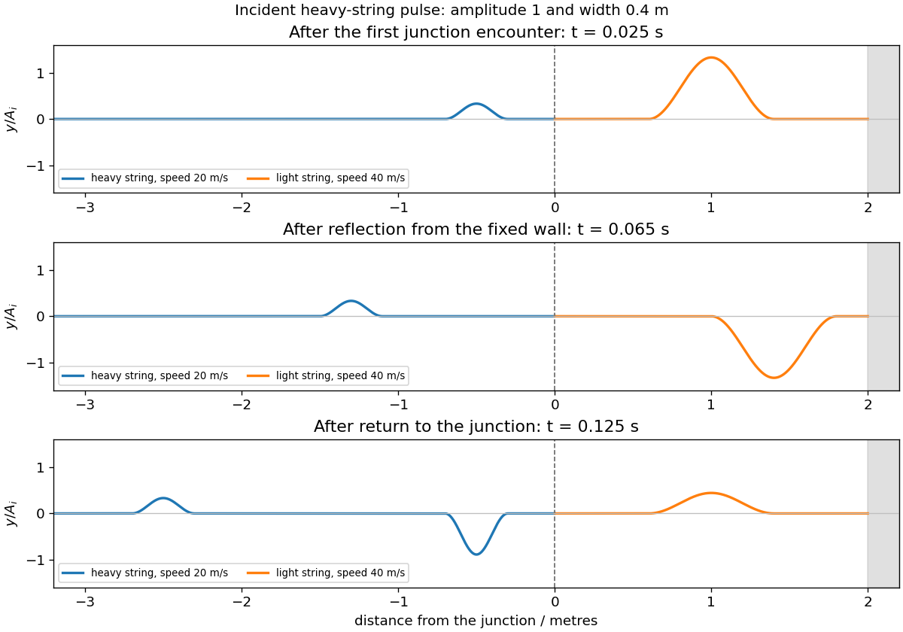

<h1 id="10/b/i/solution">Solution</h1>

↑ **Parent:** [I](../i.md)

After the first encounter, the reflected pulse travels backwards through the heavy string with amplitude $A_i/3$ and width $w$. The transmitted pulse has amplitude $4A_i/3$ and speed $40\,\mathrm{m\,s^{-1}}$. Its temporal duration is unchanged at the stationary junction, so its spatial width doubles to $2w$. Both pulses retain the original displacement sign.

**[Figure 3](#10/b/i/image-pulse-splitting-inversion-at-the-fixed-wall-and-the-first-return-through-the-junction). Pulse splitting, inversion at the fixed wall and the first return through the junction**. Original compact-pulse examples with incident width 0.4 metres. The junction is at zero and the fixed wall at two metres; amplitudes are normalized by the initial heavy-string pulse amplitude.

## ↑ Ancestors (13)

1. [I](../i.md)
2. [B](../../b.md)
3. [10](../../../10.md)
4. [2017](../../../../2017-split.md)
5. [Past exam of the mathematical methods II course of the University of Oxford](../../../../split.md)
6. [Mathematical methods II course of the University of Oxford](../../../../../mathematical-methods-ii-course-of-the-university-of-oxford.md)
7. [Year 1 of the physics course of the University of Oxford](../../../../../year-1-of-the-physics-course-of-the-university-of-oxford.md)
8. [Physics course of the University of Oxford](../../../../../physics-course-of-the-university-of-oxford.md)
9. [Undergraduate course of the University of Oxford](../../../../../undergraduate-course-of-the-university-of-oxford.md)
10. [Course of the University of Oxford](../../../../../course-of-the-university-of-oxford.md)
11. [University of Oxford](../../../../../university-of-oxford-split.md)
12. [List of universities](../../../../../list-of-universities.md)
13. [Codex Wiki](../../../../../split.md)
