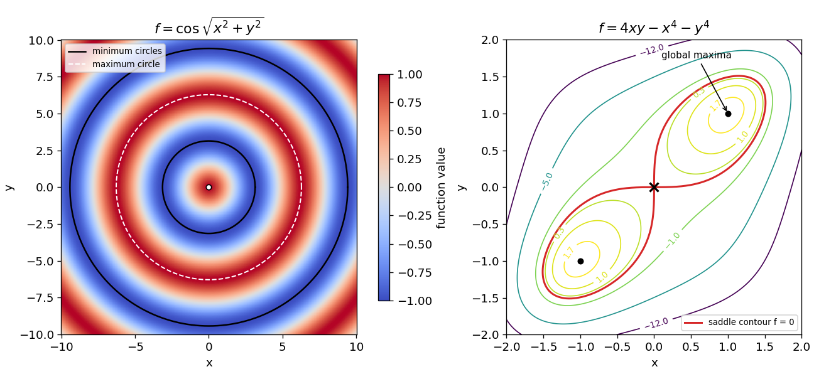

<h1 id="11/c/solution">Solution</h1>

↑ **Parent:** [C](../c.md)

Writing $r=\sqrt{x^2+y^2}$, the absolute lower bound is $\cos r\ge-1$, attained exactly when

$$
\boxed{x^2+y^2=[(2n+1)\pi]^2,\qquad n=0,1,2,\ldots.}
$$

Every point on these circles is a global and local minimum, but not a strict minimum: neighbouring points on the same circle have exactly the same value. At such a point the radial [Hessian](../../../../hessian-matrix.md) eigenvalue is one and the tangential eigenvalue is zero, illustrating why a degenerate [second-derivative test](../../../../second-derivative-test.md) does not exclude a minimum.

There are no other local minima: between successive multiples of $\pi$, moving radially changes the value monotonically. The positive even-radius circles are maxima. At the origin the apparently singular radial expression is smooth, since $\cos\sqrt{x^2+y^2}=1-(x^2+y^2)/2+O(r^4)$, and the origin is a strict local maximum.

**[Figure 4](#11/c/image-nonisolated-radial-minima-and-a-two-lobed-saddle-contour). Nonisolated radial minima and a two-lobed saddle contour**. Original level plots. The left panel marks whole circles of global minima; the right marks the saddle at the origin, two global maxima and the exact zero contour.

## ↑ Ancestors (12)

1. [C](../c.md)
2. [11](../../11.md)
3. [2017](../../../2017-split.md)
4. [Past exam of the mathematical methods II course of the University of Oxford](../../../split.md)
5. [Mathematical methods II course of the University of Oxford](../../../../mathematical-methods-ii-course-of-the-university-of-oxford.md)
6. [Year 1 of the physics course of the University of Oxford](../../../../year-1-of-the-physics-course-of-the-university-of-oxford.md)
7. [Physics course of the University of Oxford](../../../../physics-course-of-the-university-of-oxford.md)
8. [Undergraduate course of the University of Oxford](../../../../undergraduate-course-of-the-university-of-oxford.md)
9. [Course of the University of Oxford](../../../../course-of-the-university-of-oxford.md)
10. [University of Oxford](../../../../university-of-oxford-split.md)
11. [List of universities](../../../../list-of-universities.md)
12. [Codex Wiki](../../../../split.md)
