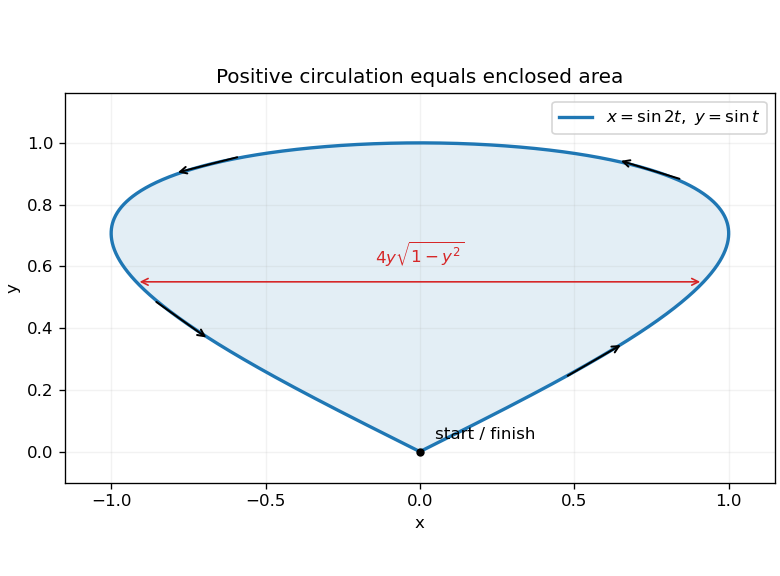

<h1 id="4/solution">Solution</h1>

↑ **Parent:** [4](../4.md)

[Stokes theorem](../../../stokes-theorem.md) states that $\oint_C A\cdot dr=\iint_S(\nabla\times A)\cdot n\,dS$, with consistent boundary orientation. Here $\nabla\times A=e_z$, so the circulation around the positively oriented planar curve equals its area. Substituting the given parametrization gives

$$
\frac12(x\dot y-y\dot x)
=\frac12[\sin2t\cos t-2\sin t\cos2t]=\sin^3t.
$$

The curve closes at the origin, passes along the right side to $(0,1)$ and returns along the left side, so it is anticlockwise. Consequently

$$
\boxed{\operatorname{Area}=\int_0^\pi\sin^3t\,dt=\frac43.}
$$

Equivalently its two sides are $x=\pm2y\sqrt{1-y^2}$, $0\le y\le1$, whose horizontal width integrates to the same result.

**[Figure 1](#4/image-the-enclosed-lobe-and-its-positive-boundary-orientation). The enclosed lobe and its positive boundary orientation**. Original analytic plot. Arrows follow increasing parameter from the origin along the right side and back along the left; horizontal widths provide an independent area integral.

## ↑ Ancestors (11)

1. [4](../4.md)
2. [2017](../../2017-split.md)
3. [Past exam of the mathematical methods II course of the University of Oxford](../../split.md)
4. [Mathematical methods II course of the University of Oxford](../../../mathematical-methods-ii-course-of-the-university-of-oxford.md)
5. [Year 1 of the physics course of the University of Oxford](../../../year-1-of-the-physics-course-of-the-university-of-oxford.md)
6. [Physics course of the University of Oxford](../../../physics-course-of-the-university-of-oxford.md)
7. [Undergraduate course of the University of Oxford](../../../undergraduate-course-of-the-university-of-oxford.md)
8. [Course of the University of Oxford](../../../course-of-the-university-of-oxford.md)
9. [University of Oxford](../../../university-of-oxford-split.md)
10. [List of universities](../../../list-of-universities.md)
11. [Codex Wiki](../../../split.md)
