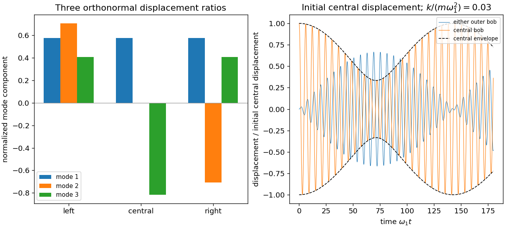

<h1 id="9/e/solution">Solution</h1>

↑ **Parent:** [E](../e.md)

For a [central displacement in three freely ended coupled pendulums](../../../../central-displacement-in-three-freely-ended-coupled-pendulums.md), the initial vector decomposes as $(0,\epsilon,0)=(\epsilon/3)(1,1,1)-(\epsilon/3)(1,-2,1)$. The antisymmetric second mode is absent. Hence

$$
\boxed{x_1=x_3=\frac\epsilon3(\cos\omega_1t-\cos\omega_3t),\qquad
x_2=\frac\epsilon3(\cos\omega_1t+2\cos\omega_3t).}
$$

Let $\bar\omega=(\omega_3+\omega_1)/2$ and $\delta=(\omega_3-\omega_1)/2$. The outer displacement is $(2\epsilon/3)\sin\bar\omega t\sin\delta t$, explicitly exhibiting an amplitude modulation. The middle displacement is $\epsilon\cos\bar\omega t\cos\delta t-(\epsilon/3)\sin\bar\omega t\sin\delta t$, whose modulation envelope is

$$
\frac{|\epsilon|}{3}\sqrt{5+4\cos[(\omega_3-\omega_1)t]}.
$$

It ranges from $|\epsilon|/3$ to $|\epsilon|$, so it does not vanish completely. These are [beats](../../../../beat.md) between the two excited frequencies. A slow envelope well separated from the carrier requires $k/m\ll g/l$; in that limit $\omega_3-\omega_1\simeq3k/(2m\omega_1)$. The exact two-mode formulas remain valid without that additional weak-coupling assumption.

**[Figure 2](#9/e/image-normal-mode-displacement-ratios-and-beating-after-releasing-the-central-pendulum). Normal-mode displacement ratios and beating after releasing the central pendulum**. Original eigenvectors and dimensionless time-domain solutions. The central initial displacement excites the uniform and highest-frequency modes, leaving the antisymmetric mode absent.

## ↑ Ancestors (12)

1. [E](../e.md)
2. [9](../../9.md)
3. [2017](../../../2017-split.md)
4. [Past exam of the mathematical methods II course of the University of Oxford](../../../split.md)
5. [Mathematical methods II course of the University of Oxford](../../../../mathematical-methods-ii-course-of-the-university-of-oxford.md)
6. [Year 1 of the physics course of the University of Oxford](../../../../year-1-of-the-physics-course-of-the-university-of-oxford.md)
7. [Physics course of the University of Oxford](../../../../physics-course-of-the-university-of-oxford.md)
8. [Undergraduate course of the University of Oxford](../../../../undergraduate-course-of-the-university-of-oxford.md)
9. [Course of the University of Oxford](../../../../course-of-the-university-of-oxford.md)
10. [University of Oxford](../../../../university-of-oxford-split.md)
11. [List of universities](../../../../list-of-universities.md)
12. [Codex Wiki](../../../../split.md)
