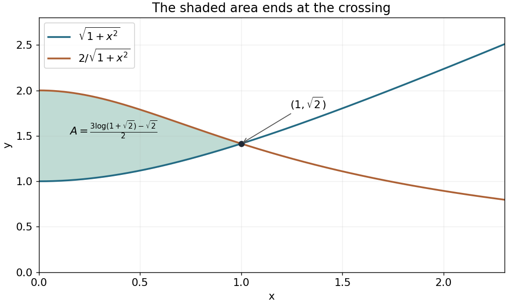
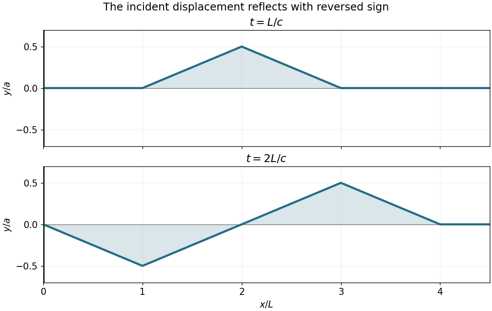
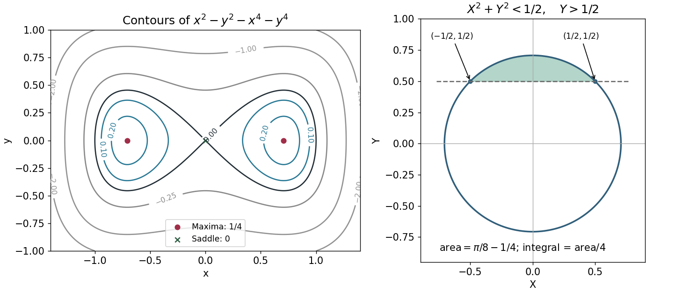

# 2018

↑ **Parent:** [Past exam of the mathematical methods II course of the University of Oxford](../past-exam-of-the-mathematical-methods-ii-course-of-the-university-of-oxford.md)

Source paper: [https://www.whatdotheyknow.com/request/oxford_physics_past_papers_2/response/2340696/attach/6/Physics%20Papers%202017.pdf?cookie_passthrough=1](https://www.whatdotheyknow.com/request/oxford_physics_past_papers_2/response/2340696/attach/6/Physics%20Papers%202017.pdf?cookie_passthrough=1)

**Table of contents**

- [1](#1)
  - [Solution](#1/solution)
- [2](#2)
  - [Solution](#2/solution)
- [3](#3)
  - [Solution](#3/solution)
- [4](#4)
  - [Solution](#4/solution)
- [5](#5)
  - [Solution](#5/solution)
- [6](#6)
  - [Solution](#6/solution)
- [7](#7)
  - [Solution](#7/solution)
- [8](#8)
  - [Solution](#8/solution)
- [9](#9)
  - [a](#9/a)
    - [Solution](#9/a/solution)
  - [b](#9/b)
    - [Solution](#9/b/solution)
  - [c](#9/c)
    - [Solution](#9/c/solution)
- [10](#10)
  - [a](#10/a)
    - [Solution](#10/a/solution)
  - [b](#10/b)
    - [Solution](#10/b/solution)
  - [c](#10/c)
    - [Solution](#10/c/solution)
  - [d](#10/d)
    - [Solution](#10/d/solution)
- [11](#11)
  - [Solution](#11/solution)

## 1

↑ **Parent:** [2018](2018.md)

<h3 id="1/solution">Solution</h3>

↑ **Parent:** [1](#1)

The [Stokes theorem](../multivariable-calculus.md#stokes-theorem) states that for an oriented smooth [surface](../topological-surface.md) $S$ with compatible oriented boundary $C$ and a continuously differentiable [vector field](../multivariable-calculus.md#vector-field),

$$
\oint_C F\cdot d\ell=\int_S(\nabla\times F)\cdot n\,dS.
$$

Here $\nabla\times F=(-2,-2,-2)$, whereas a [normal vector](../differential-geometry.md#normal-vector) to the specified [plane](../geometry-and-topology.md#plane) is $(1,0,-1)$. Their [dot product](../inner-product.md#dot-product) is zero. Thus **every closed curve in that [plane](../geometry-and-topology.md#plane) has zero circulation** by the [Stokes theorem](../multivariable-calculus.md#stokes-theorem).

The source says “any curve” and displays an ordinary [line integral](../multivariable-calculus.md#line-integral), without specifying that it is closed or giving endpoints. An open [curve](../topology.md#curve) need not give zero. On the [plane](../geometry-and-topology.md#plane), put $z=x-1$ and $dz=dx$; the pulled-back [differential one-form](../differential-form.md#one-form) becomes

$$
F\cdot d\ell=(y-x+1)dx-dy+(x-y)dx=dx-dy=d(x-y).
$$

Therefore the complete endpoint-dependent answer is

$$
\boxed{\int_{P}^{Q}F\cdot d\ell=(x_Q-y_Q)-(x_P-y_P),}
$$

which specializes to zero for a closed [curve](../topology.md#curve). For example, the path from $(1,0,0)$ to $(2,0,1)$ lies in the [plane](../geometry-and-topology.md#plane) and has integral $1$. This illustrates a [conservative restriction of a vector field to a plane](../multivariable-calculus.md#conservative-restriction-of-a-vector-field-to-a-plane) despite nonzero ambient [curl](../multivariable-calculus.md#curl).

## 2

↑ **Parent:** [2018](2018.md)

<h3 id="2/solution">Solution</h3>

↑ **Parent:** [2](#2)

The [velocity vector](../tangent-vector.md#velocity-vector) of the [helix](../topology.md#helix) is $r'(t)=(-\sin t,\cos t,1)$, whose [Euclidean norm](../normed-vector-space.md#euclidean-norm) is $\sqrt2$. Thus its [arc length](../riemannian-geometry.md#arc-length) over the stated parameter interval is

$$
\boxed{L=\int_0^{2\pi}\|r'(t)\|\,dt=2\pi\sqrt2.}
$$

Omitting the two endpoints does not change this finite [arc length](../riemannian-geometry.md#arc-length).

## 3

↑ **Parent:** [2018](2018.md)

<h3 id="3/solution">Solution</h3>

↑ **Parent:** [3](#3)

Rationalize the difference of [square roots](../algebra.md#square-root) before taking the [limit](../calculus.md#limit-of-a-function). For positive $x$, divide the resulting numerator and denominator by $x^2$:

$$
\frac{8x^2+2x}{\bigl(\sqrt{x^3+10x^2}+\sqrt{x^3+2x^2-2x}\bigr)\sqrt{6x+3}}
=\frac{8+2/x}{\bigl(\sqrt{1+10/x}+\sqrt{1+2/x-2/x^2}\bigr)\sqrt{6+3/x}}.
$$

Each factor now has a finite nonzero denominator [limit](../calculus.md#limit-of-a-function), giving

$$
\boxed{\frac4{\sqrt6}=\frac{2\sqrt6}{3}.}
$$

## 4

↑ **Parent:** [2018](2018.md)

<h3 id="4/solution">Solution</h3>

↑ **Parent:** [4](#4)

For $x>0$, $\sqrt{1+x^2}$ increases from $1$, while $2/\sqrt{1+x^2}$ decreases from $2$. They meet at $(1,\sqrt2)$, after which their order reverses. In particular, their positive separation on $0<x<1$ is $(1-x^2)/\sqrt{1+x^2}$.

**[Figure 1](#4/image-the-two-curves-and-their-enclosed-positive-area-on-0-x-1-with-crossing-at-1-sqrt2). The two curves and their enclosed positive area on $0<x<1$, with crossing at $(1,\sqrt2)$**.

Use the [hyperbolic substitution](../multivariable-calculus.md#hyperbolic-substitution) $x=\sinh t$, $dx=\cosh t\,dt$. With $T=\operatorname{arsinh}1$, the [definite integral](../integral.md#definite-integral) for the area becomes

$$
A=\int_0^T(2-\cosh^2t)\,dt
=\left[\frac32t-\frac14\sinh2t\right]_0^T.
$$

Since $\sinh T=1$, $\cosh T=\sqrt2$ and $T=\log(1+\sqrt2)$, the answer is

$$
\boxed{A=\frac{3\log(1+\sqrt2)-\sqrt2}{2}.}
$$

## 5

↑ **Parent:** [2018](2018.md)

<h3 id="5/solution">Solution</h3>

↑ **Parent:** [5](#5)

Let $D=y(3y-2)$. [Implicit differentiation](../multivariable-calculus.md#implicit-differentiation) of the two constraints gives the [linear system](../linear-algebra.md#system-of-linear-equations)

$$
D y'-2zz'=-2x,\qquad aD y'+2zz'=-2.
$$

Adding them, then substituting back, gives at regular points

$$
\boxed{\frac{dy}{dx}=-\frac{2(x+1)}{(1+a)y(3y-2)},\qquad
\frac{dz}{dx}=\frac{ax-1}{(1+a)z}.}
$$

The relevant [Jacobian determinant](../multivariable-calculus.md#jacobian-determinant) is $2(1+a)yz(3y-2)$. Thus the special parameter value is $\boxed{a=-1}$, assuming the other factors are nonzero. At that parameter, adding the original constraints gives $(x+1)^2=0$: the [intersection curve](../topology.md#intersection-curve) lies wholly in the [plane](../geometry-and-topology.md#plane) $x=-1$ and cannot be parametrized by $x$ on an interval. Calling its derivatives “infinite” describes a vertical [projection](../vector-space.md#projection-linear-algebra), not a finite-valued differentiable pair $y(x),z(x)$ at $a=-1$; the displayed ratios then have simultaneous zero numerators on the intersection and are undefined.

There are also point-dependent failures when $y=0$, $y=2/3$ or $z=0$. These can produce vertical [tangents](../geometry-and-topology.md#tangent) or require a different local parameter, and simultaneous numerator zeros need separate analysis. The [implicit function theorem](../multivariable-calculus.md#implicit-function-theorem) guarantees finite $y',z'$ only where the stated [Jacobian determinant](../multivariable-calculus.md#jacobian-determinant) is nonzero. This distinction is the geometry of a [singular projection of an implicit curve](../multivariable-calculus.md#singular-projection-of-an-implicit-curve).

## 6

↑ **Parent:** [2018](2018.md)

<h3 id="6/solution">Solution</h3>

↑ **Parent:** [6](#6)

Multiply the [secant function](../geometry-and-topology.md#secant-trigonometry) integrand by $(\sec\theta+\tan\theta)/(\sec\theta+\tan\theta)$:

$$
\int\sec\theta\,d\theta
=\int\frac{\sec^2\theta+\sec\theta\tan\theta}{\sec\theta+\tan\theta}\,d\theta
=\boxed{\log|\sec\theta+\tan\theta|+C.}
$$

The numerator is the [derivative](../calculus.md#derivative) of the denominator. The formula holds on any real interval avoiding zeros of $\cos\theta$; on such an interval $\sec\theta+\tan\theta$ cannot vanish because $(\sec\theta+\tan\theta)(\sec\theta-\tan\theta)=1$.

## 7

↑ **Parent:** [2018](2018.md)

<h3 id="7/solution">Solution</h3>

↑ **Parent:** [7](#7)

Write the initial [triangular pulse](../fourier-analysis.md#triangular-function) as the function $h$, extended by zero to negative arguments:

$$
h(s)=\begin{cases}as/L,&0\leq s\leq L,\\a(2L-s)/L,&L\leq s\leq2L,\\0,&\text{otherwise}.\end{cases}
$$

At $t=0$, the initial [displacement](../classical-mechanics.md#displacement) and zero [velocity](../classical-mechanics.md#velocity) give $f+g=h$ and $-cf'+cg'=0$ on the positive half-line. Fix the harmless opposite additive constants by taking both [travelling waves](../analysis.md#travelling-wave) to vanish at positive infinity. Then

$$
\boxed{f(s)=g(s)=\tfrac12h(s)\quad(s>0),\qquad f(s)=-\tfrac12h(-s)\quad(s<0).}
$$

The second formula follows from the fixed-end [boundary condition](../differential-equation.md#boundary-condition) $f(-ct)+g(ct)=0$. Thus $f$ is one-half of the [odd extension](../calculus.md#odd-extension) $H$ of the initial [displacement](../classical-mechanics.md#displacement), and

$$
y(x,t)=\tfrac12[H(x-ct)+H(x+ct)],\qquad x\geq0.
$$

This is the [odd-extension solution for a semi-infinite fixed string](../wave-equation.md#odd-extension-solution-for-a-semi-infinite-fixed-string): the reflected [displacement](../classical-mechanics.md#displacement) reverses sign. Evaluating the travelling profiles gives

$$
\boxed{y(x,L/c)=\tfrac12h(x-L),\qquad
y(x,2L/c)=\tfrac12[h(x-2L)-h(x)].}
$$

The first profile is a positive triangle supported on $[L,3L]$, with peak $a/2$ at $2L$. The second has a negative triangle on $[0,2L]$ with minimum $-a/2$ at $L$, and a positive triangle on $[2L,4L]$ with maximum $a/2$ at $3L$.

**[Figure 2](#7/image-the-two-requested-displacement-profiles-after-fixed-end-reflection-of-a-triangular-pulse-with-lengths-scaled-by-l-and-heights-by-a). The two requested displacement profiles after fixed-end reflection of a triangular pulse, with lengths scaled by $L$ and heights by $a$**.

## 8

↑ **Parent:** [2018](2018.md)

<h3 id="8/solution">Solution</h3>

↑ **Parent:** [8](#8)

The [gradient](../multivariable-calculus.md#gradient) is $\nabla f=(2x-4x^3,-2y-4y^3)$, so the real [stationary points](../calculus-of-variations.md#stationary-point) are $(0,0)$ and $(\pm1/\sqrt2,0)$. The [Hessian matrix](../multivariable-calculus.md#hessian-matrix) is diagonal, with entries $2-12x^2$ and $-2-12y^2$. At the origin it has opposite-sign [eigenvalues](../linear-operator-theory.md#eigenvalue), giving a [saddle point](../analysis.md#saddle-point). At each of the other two [stationary points](../calculus-of-variations.md#stationary-point) it is negative definite, giving **strict maxima of value $1/4$**. These are also the global maxima, since

$$
f(x,y)=\frac14-\left(x^2-\frac12\right)^2-y^2-y^4\leq\frac14.
$$

There are **no local minima**, and the [function](../function.md) is unbounded below. The zero [contour](../complex-analysis.md#complex-integration-contour) has two lobes touching at the saddle; positive [contours](../complex-analysis.md#complex-integration-contour) are closed curves around the maxima.

Under the stated [change of variables](../multivariable-calculus.md#change-of-variables-formula),

$$
f=\frac12-X^2-Y^2,\qquad x>0\Longleftrightarrow X>-\frac12,\qquad y>0\Longleftrightarrow Y>\frac12.
$$

Inside the resulting circular cap the constraint $X>-1/2$ is automatic. Comparing its [circle](../topology.md#circle) and horizontal boundary gives

$$
\boxed{r=\frac1{\sqrt2},\qquad a=\frac12,\qquad b=\frac12.}
$$

Here $a$ is the positive half-width used in the source figure, independent of the pulse-height notation in the preceding question. The [Jacobian determinant](../multivariable-calculus.md#jacobian-determinant) is $\partial(X,Y)/\partial(x,y)=4xy>0$ in the chosen quadrant, so the integral is one-quarter of the [circular segment](../topology.md#circular-segment) area:

$$
\int_Rxy\,dx\,dy=\frac14\left[r^2\arccos\frac br-b\sqrt{r^2-b^2}\right]
=\frac14\left(\frac\pi8-\frac14\right)
=\boxed{\frac{\pi-2}{32}.}
$$

**[Figure 3](#8/image-the-contours-maxima-and-saddle-and-the-circular-cap-produced-by-the-change-of-variables). The contours, maxima and saddle, and the circular cap produced by the change of variables**.

## 9

↑ **Parent:** [2018](2018.md)

<h3 id="9/a">a</h3>

↑ **Parent:** [9](#9)

<h4 id="9/a/solution">Solution</h4>

↑ **Parent:** [A](#9/a)

Apply the [divergence theorem](../multivariable-calculus.md#divergence-theorem) to $A(r)=(C\cdot r)(C'\cdot r)J(r)$. Since $C,C'$ are constant and $J$ is a [solenoidal vector field](../multivariable-calculus.md#solenoidal-vector-field), the [product rule](../calculus.md#product-rule) gives

$$
\nabla\cdot A=(C\cdot J)(C'\cdot r)+(C'\cdot J)(C\cdot r).
$$

Its boundary flux vanishes when $J$ has [compact support](../function.md#compact-support), or when its normal component vanishes on the boundary of the integration volume. Integrating therefore proves

$$
\boxed{\int_V(C\cdot r)(C'\cdot J)\,dV=-\int_V(C'\cdot r)(C\cdot J)\,dV.}
$$

For a discontinuous field, the divergence-free hypothesis must include its boundary jump, in the sense of a [weak derivative](../distribution-theory.md#weak-derivative). A field that merely has zero [divergence](../multivariable-calculus.md#divergence) at interior points can still have a nonzero surface source; that weaker hypothesis would not justify discarding the flux. The result is the [antisymmetric first moment of a localized solenoidal field](../multivariable-calculus.md#antisymmetric-first-moment-of-a-localized-solenoidal-field).

<h3 id="9/b">b</h3>

↑ **Parent:** [9](#9)

<h4 id="9/b/solution">Solution</h4>

↑ **Parent:** [B](#9/b)

Use the [vector triple product](../multivariable-calculus.md#vector-triple-product) identity:

$$
C\times(J\times r)=J(C\cdot r)-r(C\cdot J).
$$

For the $i$th component of the second integral, the [antisymmetric first moment of a localized solenoidal field](../multivariable-calculus.md#antisymmetric-first-moment-of-a-localized-solenoidal-field) with $C'=e_i$ gives $\int_Vr_i(C\cdot J)\,dV=-\int_V(C\cdot r)J_i\,dV$. Thus the two terms on the right have opposite integrals. Consequently

$$
\boxed{\int_V(C\cdot r)J\,dV=\frac12C\times\int_V(J\times r)\,dV.}
$$

<h3 id="9/c">c</h3>

↑ **Parent:** [9](#9)

<h4 id="9/c/solution">Solution</h4>

↑ **Parent:** [C](#9/c)

Inside the unit [ball](../topological-analysis.md#ball-mathematics), $\nabla\cdot J=0$. On its [sphere](../euclidean-geometry.md#sphere), $J\cdot r=xy-xy=0$, so the jump to zero outside adds no surface [divergence](../multivariable-calculus.md#divergence). The field therefore satisfies the required [weak derivative](../distribution-theory.md#weak-derivative) condition.

By reflection [symmetry](../physics.md#symmetry-physics), integrals of $xy,xz,yz$ over the [ball](../topological-analysis.md#ball-mathematics) vanish. Rotational [symmetry](../physics.md#symmetry-physics) and [spherical coordinates](../multivariable-calculus.md#spherical-coordinate-system) give

$$
\int_{B_1}x^2\,dV=\frac13\int_{B_1}r^2\,dV=\frac{4\pi}{3}\int_0^1r^4\,dr=\frac{4\pi}{15}.
$$

Hence the left side is $\int x(y,-x,0)\,dV=(0,-4\pi/15,0)$. Meanwhile $J\times r=(-xz,-yz,x^2+y^2)$, so its integral is $(0,0,8\pi/15)$. Therefore

$$
\frac12(1,0,0)\times(0,0,8\pi/15)=\boxed{(0,-4\pi/15,0),}
$$

exactly the same [vector](../vector-space.md#vector).

## 10

↑ **Parent:** [2018](2018.md)

<h3 id="10/a">a</h3>

↑ **Parent:** [10](#10)

<h4 id="10/a/solution">Solution</h4>

↑ **Parent:** [A](#10/a)

Let $\delta=x_2-x_1$. The inextensible-string constraint gives the upward displacement $y_2=l-\sqrt{l^2-\delta^2}=\delta^2/(2l)+O(\delta^4/l^3)$. Thus the quadratic [potential energy](../energy.md#potential-energy) is $U=kx_1^2/2+mg(x_2-x_1)^2/(2l)$. The vertical [velocity](../classical-mechanics.md#velocity) of the second [mass](../classical-mechanics.md#mass) is of second order in the small motion, so the quadratic [kinetic energy](../energy.md#kinetic-energy) is $m(\dot x_1^2+\dot x_2^2)/2$.

The [Euler-Lagrange equations](../analysis.md#euler-lagrange-equation) for this quadratic [Lagrangian](../calculus-of-variations.md#lagrangian) give

$$
\boxed{\ddot x_1=-\left(\frac km+\frac gl\right)x_1+\frac glx_2,\qquad
\ddot x_2=\frac glx_1-\frac glx_2.}
$$

Small [displacements](../classical-mechanics.md#displacement) are used both in the quadratic approximation to the [gravitational potential energy](../energy.md#gravitational-energy) and in neglecting the higher-order vertical [kinetic energy](../energy.md#kinetic-energy). These are the [spring-supported pendulum normal modes](../wave-equation.md#spring-supported-pendulum-normal-modes) at linear order. The corresponding force picture sets the string [tension](../force.md#tension) to $mg$ at leading order and its horizontal angle to $\delta/l$.

<h3 id="10/b">b</h3>

↑ **Parent:** [10](#10)

<h4 id="10/b/solution">Solution</h4>

↑ **Parent:** [B](#10/b)

Put $\kappa=k/m$, $q=g/l$. The positive stiffness-per-mass [matrix](../vector-space.md#matrix) is

$$
K=\begin{pmatrix}\kappa+q&-q\\-q&q\end{pmatrix}.
$$

Substitution of a [normal mode](../wave-equation.md#normal-mode) $x=v\cos\omega t$ requires $Kv=\omega^2v$. Its [characteristic equation](../linear-ordinary-differential-equation.md#characteristic-equation-of-a-constant-coefficient-differential-equation) is $\lambda^2-(\kappa+2q)\lambda+\kappa q=0$. Therefore

$$
\boxed{\omega_\pm^2=\frac\kappa2+q\pm\sqrt{\frac{\kappa^2}{4}+q^2}.}
$$

For $k,m,g,l>0$, their sum and product are positive, so both squared [angular frequencies](../lagrangian-mechanics.md#angular-frequency) are positive and $\omega_+>\omega_->0$.

<h3 id="10/c">c</h3>

↑ **Parent:** [10](#10)

<h4 id="10/c/solution">Solution</h4>

↑ **Parent:** [C](#10/c)

Define $D=\sqrt{\kappa^2/4+q^2}$. Normalizing the first [displacement](../classical-mechanics.md#displacement) [amplitude](../wave.md#wave-amplitude) to one, either row of the [eigenvector](../linear-operator-theory.md#eigenvector) equation gives

$$
\boxed{v_\pm=\begin{pmatrix}1\\r_\pm\end{pmatrix},\qquad r_\pm=\frac{\kappa/2\mp D}{q}.}
$$

The two [normal modes](../wave-equation.md#normal-mode) are $x(t)=A_\pm v_\pm\cos(\omega_\pm t+\phi_\pm)$, and arbitrary small motion is their [superposition](../vector-space.md#superposition-principle). The lower-frequency mode has $r_->0$, so the [masses](../classical-mechanics.md#mass) move in phase; the upper-frequency mode has $r_+<0$, so they move in opposite phase. The identity $r_+r_-=-1$ verifies [orthogonality](../inner-product.md#orthogonal-vectors) of these [eigenvectors](../linear-operator-theory.md#eigenvector) for equal [masses](../classical-mechanics.md#mass).

<h3 id="10/d">d</h3>

↑ **Parent:** [10](#10)

<h4 id="10/d/solution">Solution</h4>

↑ **Parent:** [D](#10/d)

The product-to-sum identity gives $\sin\Omega t\sin\omega t=[\cos(\Omega-\omega)t-\cos(\Omega+\omega)t]/2$. Thus the first [mass](../classical-mechanics.md#mass) must have equal and opposite cosine-mode amplitudes and no sine-mode amplitudes. Equivalently, release the second [mass](../classical-mechanics.md#mass) from a [displacement](../classical-mechanics.md#displacement) $X$ while the first is at equilibrium, both initially at rest:

$$
\boxed{x_1(0)=0,\quad x_2(0)=X,\quad\dot x_1(0)=\dot x_2(0)=0.}
$$

The two [normal mode](../wave-equation.md#normal-mode) coefficients in $x_1$ are $qX/(2D)$ and $-qX/(2D)$. Therefore, with

$$
\boxed{\Omega=\frac{\omega_++\omega_-}{2},\qquad\omega=\frac{\omega_+-\omega_-}{2},}
$$

the two [displacements](../classical-mechanics.md#displacement) are

$$
\boxed{x_1(t)=\frac{qX}{D}\sin\Omega t\sin\omega t,\qquad
x_2(t)=X\left[\cos\Omega t\cos\omega t+\frac{\kappa}{2D}\sin\Omega t\sin\omega t\right].}
$$

These initial conditions are necessary for a nontrivial product with exactly the stated time origin, as well as sufficient: $x_1(0)=\dot x_1(0)=0$ follows from the product, and its zero third derivative at zero, together with the first coupled equation, forces $\dot x_2(0)=0$. Since both [normal frequencies](../wave-equation.md#eigenfrequency) are positive, $\Omega>\omega>0$. This is the product form used to describe [beating](../physical-optics.md#beat), although a well-separated slow envelope requires the two [normal frequencies](../wave-equation.md#eigenfrequency) to be close. No such extra near-degeneracy is assumed in the exact formula.

## 11

↑ **Parent:** [2018](2018.md)

<h3 id="11/solution">Solution</h3>

↑ **Parent:** [11](#11)

For a [plane wave](../wave-function.md#plane-wave), $\partial_t$ acts as $-i\omega$ and $\partial_x$ as $ik$. Substitution gives

$$
\omega^2(\omega-\omega_n)-c^2k^2(\omega-\omega_d)=0,
$$

so, for $\omega\ne\omega_d$, the [dispersion relation](../dispersion-relation.md) is

$$
\boxed{k^2=\frac{\omega^2(\omega-\omega_n)}{c^2(\omega-\omega_d)}.}
$$

Assume $\omega_n>\omega_d>0$ and real [angular frequency](../lagrangian-mechanics.md#angular-frequency). The ratio is negative exactly on $\omega_d<\omega<\omega_n$, giving imaginary [wavenumbers](../wave-equation.md#wavenumber) and an [evanescent wave](../elasticity-physics.md#evanescent-wave). Thus **the propagating frequency gap is $(\omega_d,\omega_n)$**. At $\omega_d$ there is no finite-$k$ solution, while $\omega_n$ has $k=0$; neither endpoint is an ordinary finite-wavelength propagating mode.

Choose the branch $k=(\omega/c)\sqrt{(\omega-\omega_n)/(\omega-\omega_d)}$, so the [phase velocity](../dispersion-relation.md#phase-velocity) is positive in the allowed bands. Direct differentiation gives the [phase velocity](../dispersion-relation.md#phase-velocity) and [group velocity](../dispersion-relation.md#group-velocity)

$$
v_p=c\sqrt{\frac{\omega-\omega_d}{\omega-\omega_n}},\qquad
v_g=\frac{v_p}{1+\dfrac{\omega(\omega_n-\omega_d)}{2(\omega-\omega_n)(\omega-\omega_d)}}.
$$

The opposite spatial branch reverses both signs. On the chosen branch, the requested [limits](../calculus.md#limit-of-a-function) are

$$
\boxed{\begin{array}{c|cc}
\text{frequency limit}&v_p&v_g\\\hline
\omega\to0&c\sqrt{\omega_d/\omega_n}&c\sqrt{\omega_d/\omega_n}\\
|\omega|\to\infty&c&c\\
\omega\to\omega_n^+&+\infty&0^+\\
\omega\to\omega_d^-&0^+&0^+
\end{array}}
$$

The band-edge limits are taken from their propagating sides. More precisely, with $\epsilon=\omega-\omega_n\downarrow0$ and $\delta=\omega_d-\omega\downarrow0$,

$$
v_p\sim c\sqrt{\frac{\omega_n-\omega_d}{\epsilon}},\quad
v_g\sim\frac{2c}{\omega_n}\sqrt{(\omega_n-\omega_d)\epsilon};\qquad
v_p\sim c\sqrt{\frac\delta{\omega_n-\omega_d}},\quad
v_g\sim\frac{2c\delta^{3/2}}{\omega_d\sqrt{\omega_n-\omega_d}}.
$$

For the final case, set $K=k_0c>0$. Substitution of $T(t)e^{ik_0x}$ at $\omega_d=0$ gives $T^{(3)}+(3iK/2)T''+K^2T'=0$. Its [characteristic polynomial](../linear-operator-theory.md#characteristic-polynomial) factors as $r(r+2iK)(r-iK/2)$, hence

$$
T=A+Be^{-2iKt}+Ce^{iKt/2}.
$$

The initial data give $A+B+C=1$, $-2B+C/2=0$ and $-4B-C/4=-5$. Thus $B=1$, $C=4$, $A=-4$, and

$$
\boxed{\phi(x,t)=e^{ik_0x}\left[-4+e^{-2ik_0ct}+4e^{ik_0ct/2}\right].}
$$

The time-independent contribution is essential: [static modes lost by cancelling frequency](../dispersion-relation.md#static-mode-lost-by-cancelling-frequency) would be missed if one divided the $\omega_d=0$ [dispersion relation](../dispersion-relation.md) by $\omega$ and retained only its two nonzero-frequency roots.

## ↑ Ancestors (9)

1. [Past exam of the mathematical methods II course of the University of Oxford](../past-exam-of-the-mathematical-methods-ii-course-of-the-university-of-oxford.md)
2. [Mathematical methods II course of the University of Oxford](../university-of-oxford.md#mathematical-methods-ii-course-of-the-university-of-oxford)
3. [Year 1 of the physics course of the University of Oxford](../university-of-oxford.md#year-1-of-the-physics-course-of-the-university-of-oxford)
4. [Physics course of the University of Oxford](../university-of-oxford.md#physics-course-of-the-university-of-oxford)
5. [Undergraduate course of the University of Oxford](../university-of-oxford.md#undergraduate-course-of-the-university-of-oxford)
6. [Course of the University of Oxford](../university-of-oxford.md#course-of-the-university-of-oxford)
7. [University of Oxford](../university-of-oxford.md)
8. [List of universities](../README.md#list-of-universities)
9. [Codex Wiki](../README.md)
