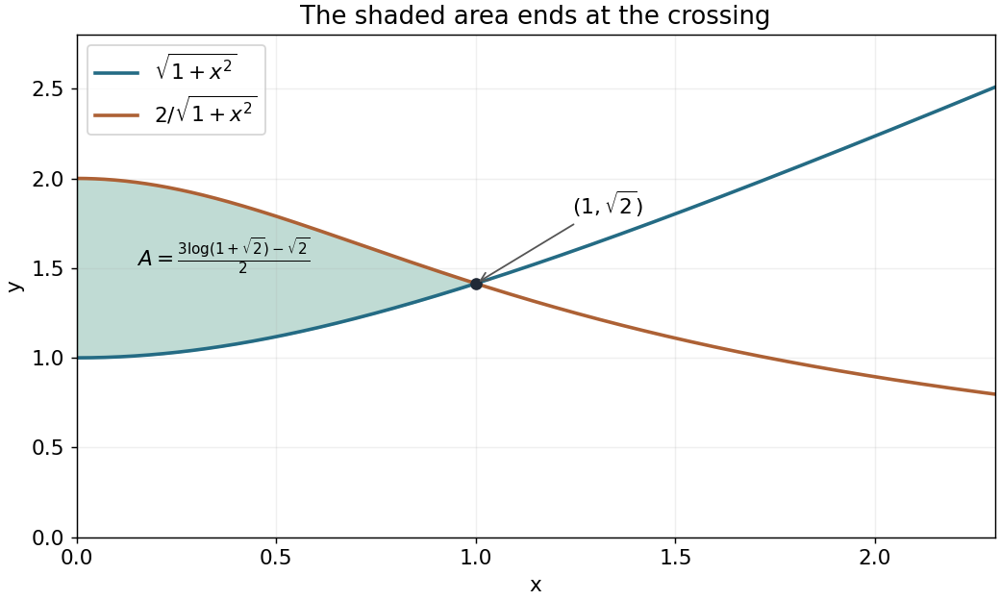

<h1 id="4/solution">Solution</h1>

↑ **Parent:** [4](../4.md)

For $x>0$, $\sqrt{1+x^2}$ increases from $1$, while $2/\sqrt{1+x^2}$ decreases from $2$. They meet at $(1,\sqrt2)$, after which their order reverses. In particular, their positive separation on $0<x<1$ is $(1-x^2)/\sqrt{1+x^2}$.

**[Figure 1](#4/image-the-two-curves-and-their-enclosed-positive-area-on-0-x-1-with-crossing-at-1-sqrt2). The two curves and their enclosed positive area on $0<x<1$, with crossing at $(1,\sqrt2)$**.

Use the [hyperbolic substitution](../../../hyperbolic-substitution.md) $x=\sinh t$, $dx=\cosh t\,dt$. With $T=\operatorname{arsinh}1$, the [definite integral](../../../definite-integral.md) for the area becomes

$$
A=\int_0^T(2-\cosh^2t)\,dt
=\left[\frac32t-\frac14\sinh2t\right]_0^T.
$$

Since $\sinh T=1$, $\cosh T=\sqrt2$ and $T=\log(1+\sqrt2)$, the answer is

$$
\boxed{A=\frac{3\log(1+\sqrt2)-\sqrt2}{2}.}
$$

## ↑ Ancestors (11)

1. [4](../4.md)
2. [2018](../../2018-split.md)
3. [Past exam of the mathematical methods II course of the University of Oxford](../../split.md)
4. [Mathematical methods II course of the University of Oxford](../../../mathematical-methods-ii-course-of-the-university-of-oxford.md)
5. [Year 1 of the physics course of the University of Oxford](../../../year-1-of-the-physics-course-of-the-university-of-oxford.md)
6. [Physics course of the University of Oxford](../../../physics-course-of-the-university-of-oxford.md)
7. [Undergraduate course of the University of Oxford](../../../undergraduate-course-of-the-university-of-oxford.md)
8. [Course of the University of Oxford](../../../course-of-the-university-of-oxford.md)
9. [University of Oxford](../../../university-of-oxford-split.md)
10. [List of universities](../../../list-of-universities.md)
11. [Codex Wiki](../../../split.md)
