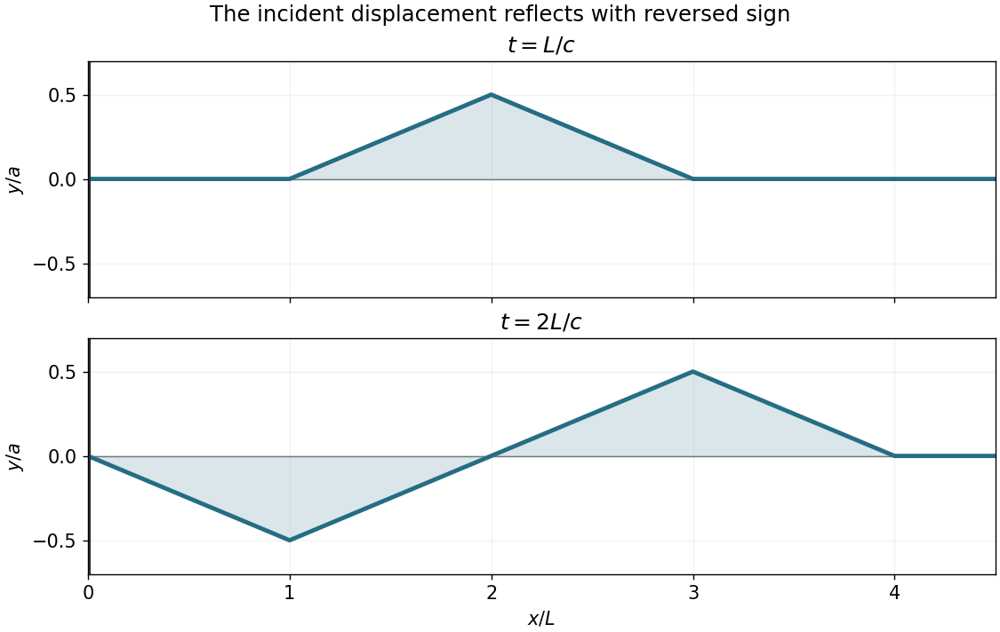

<h1 id="7/solution">Solution</h1>

↑ **Parent:** [7](../7.md)

Write the initial [triangular pulse](../../../triangular-function.md) as the function $h$, extended by zero to negative arguments:

$$
h(s)=\begin{cases}as/L,&0\leq s\leq L,\\a(2L-s)/L,&L\leq s\leq2L,\\0,&\text{otherwise}.\end{cases}
$$

At $t=0$, the initial [displacement](../../../displacement.md) and zero [velocity](../../../velocity.md) give $f+g=h$ and $-cf'+cg'=0$ on the positive half-line. Fix the harmless opposite additive constants by taking both [travelling waves](../../../travelling-wave.md) to vanish at positive infinity. Then

$$
\boxed{f(s)=g(s)=\tfrac12h(s)\quad(s>0),\qquad f(s)=-\tfrac12h(-s)\quad(s<0).}
$$

The second formula follows from the fixed-end [boundary condition](../../../boundary-condition.md) $f(-ct)+g(ct)=0$. Thus $f$ is one-half of the [odd extension](../../../odd-extension.md) $H$ of the initial [displacement](../../../displacement.md), and

$$
y(x,t)=\tfrac12[H(x-ct)+H(x+ct)],\qquad x\geq0.
$$

This is the [odd-extension solution for a semi-infinite fixed string](../../../odd-extension-solution-for-a-semi-infinite-fixed-string.md): the reflected [displacement](../../../displacement.md) reverses sign. Evaluating the travelling profiles gives

$$
\boxed{y(x,L/c)=\tfrac12h(x-L),\qquad
y(x,2L/c)=\tfrac12[h(x-2L)-h(x)].}
$$

The first profile is a positive triangle supported on $[L,3L]$, with peak $a/2$ at $2L$. The second has a negative triangle on $[0,2L]$ with minimum $-a/2$ at $L$, and a positive triangle on $[2L,4L]$ with maximum $a/2$ at $3L$.

**[Figure 2](#7/image-the-two-requested-displacement-profiles-after-fixed-end-reflection-of-a-triangular-pulse-with-lengths-scaled-by-l-and-heights-by-a). The two requested displacement profiles after fixed-end reflection of a triangular pulse, with lengths scaled by $L$ and heights by $a$**.

## ↑ Ancestors (11)

1. [7](../7.md)
2. [2018](../../2018-split.md)
3. [Past exam of the mathematical methods II course of the University of Oxford](../../split.md)
4. [Mathematical methods II course of the University of Oxford](../../../mathematical-methods-ii-course-of-the-university-of-oxford.md)
5. [Year 1 of the physics course of the University of Oxford](../../../year-1-of-the-physics-course-of-the-university-of-oxford.md)
6. [Physics course of the University of Oxford](../../../physics-course-of-the-university-of-oxford.md)
7. [Undergraduate course of the University of Oxford](../../../undergraduate-course-of-the-university-of-oxford.md)
8. [Course of the University of Oxford](../../../course-of-the-university-of-oxford.md)
9. [University of Oxford](../../../university-of-oxford-split.md)
10. [List of universities](../../../list-of-universities.md)
11. [Codex Wiki](../../../split.md)
