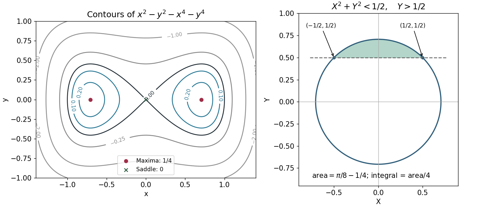

<h1 id="8/solution">Solution</h1>

↑ **Parent:** [8](../8.md)

The [gradient](../../../gradient.md) is $\nabla f=(2x-4x^3,-2y-4y^3)$, so the real [stationary points](../../../stationary-point.md) are $(0,0)$ and $(\pm1/\sqrt2,0)$. The [Hessian matrix](../../../hessian-matrix.md) is diagonal, with entries $2-12x^2$ and $-2-12y^2$. At the origin it has opposite-sign [eigenvalues](../../../eigenvalue.md), giving a [saddle point](../../../saddle-point.md). At each of the other two [stationary points](../../../stationary-point.md) it is negative definite, giving **strict maxima of value $1/4$**. These are also the global maxima, since

$$
f(x,y)=\frac14-\left(x^2-\frac12\right)^2-y^2-y^4\leq\frac14.
$$

There are **no local minima**, and the [function](../../../function-split.md) is unbounded below. The zero [contour](../../../complex-integration-contour.md) has two lobes touching at the saddle; positive [contours](../../../complex-integration-contour.md) are closed curves around the maxima.

Under the stated [change of variables](../../../change-of-variables-formula.md),

$$
f=\frac12-X^2-Y^2,\qquad x>0\Longleftrightarrow X>-\frac12,\qquad y>0\Longleftrightarrow Y>\frac12.
$$

Inside the resulting circular cap the constraint $X>-1/2$ is automatic. Comparing its [circle](../../../circle.md) and horizontal boundary gives

$$
\boxed{r=\frac1{\sqrt2},\qquad a=\frac12,\qquad b=\frac12.}
$$

Here $a$ is the positive half-width used in the source figure, independent of the pulse-height notation in the preceding question. The [Jacobian determinant](../../../jacobian-determinant.md) is $\partial(X,Y)/\partial(x,y)=4xy>0$ in the chosen quadrant, so the integral is one-quarter of the [circular segment](../../../circular-segment.md) area:

$$
\int_Rxy\,dx\,dy=\frac14\left[r^2\arccos\frac br-b\sqrt{r^2-b^2}\right]
=\frac14\left(\frac\pi8-\frac14\right)
=\boxed{\frac{\pi-2}{32}.}
$$

**[Figure 3](#8/image-the-contours-maxima-and-saddle-and-the-circular-cap-produced-by-the-change-of-variables). The contours, maxima and saddle, and the circular cap produced by the change of variables**.

## ↑ Ancestors (11)

1. [8](../8.md)
2. [2018](../../2018-split.md)
3. [Past exam of the mathematical methods II course of the University of Oxford](../../split.md)
4. [Mathematical methods II course of the University of Oxford](../../../mathematical-methods-ii-course-of-the-university-of-oxford.md)
5. [Year 1 of the physics course of the University of Oxford](../../../year-1-of-the-physics-course-of-the-university-of-oxford.md)
6. [Physics course of the University of Oxford](../../../physics-course-of-the-university-of-oxford.md)
7. [Undergraduate course of the University of Oxford](../../../undergraduate-course-of-the-university-of-oxford.md)
8. [Course of the University of Oxford](../../../course-of-the-university-of-oxford.md)
9. [University of Oxford](../../../university-of-oxford-split.md)
10. [List of universities](../../../list-of-universities.md)
11. [Codex Wiki](../../../split.md)
