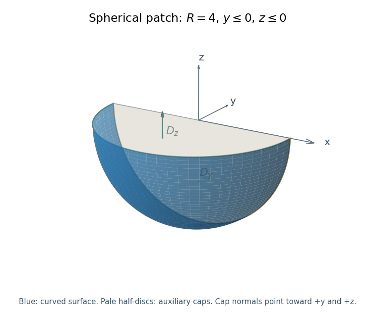
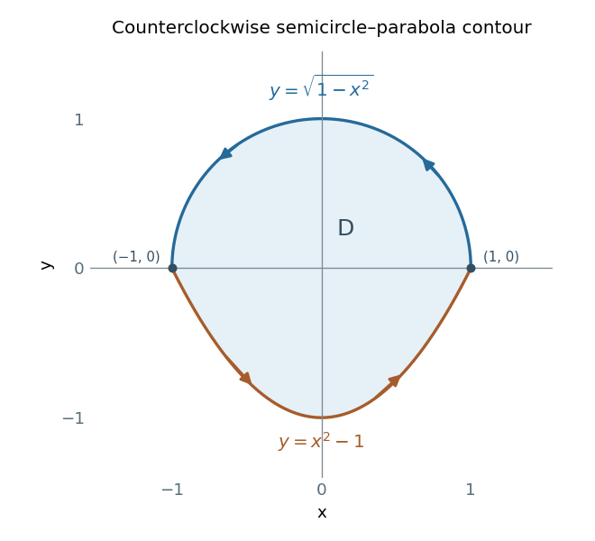

# 2019 resit

↑ **Parent:** [Past exam of the mathematical methods II course of the University of Oxford](../past-exam-of-the-mathematical-methods-ii-course-of-the-university-of-oxford.md)

Source paper: [https://www.whatdotheyknow.com/request/physics_past_papers_21/response/3037379/attach/2/FOI%20202505%20441%20Response.pdf?cookie_passthrough=1](https://www.whatdotheyknow.com/request/physics_past_papers_21/response/3037379/attach/2/FOI%20202505%20441%20Response.pdf?cookie_passthrough=1)

The cover dates this separate resit to 5 September 2019. The held source is explicitly marked “Draft Only”; these solutions follow that version without asserting that it matches a final paper. All eleven questions and all four Section B choices are covered. The inconsistent point in Question 2 is diagnosed explicitly.

**Table of contents**

- [1](#1)
  - [Solution](#1/solution)
- [2](#2)
  - [Solution](#2/solution)
- [3](#3)
  - [Solution](#3/solution)
- [4](#4)
  - [i](#4/i)
    - [Solution](#4/i/solution)
  - [ii](#4/ii)
    - [Solution](#4/ii/solution)
- [5](#5)
  - [Solution](#5/solution)
- [6](#6)
  - [Solution](#6/solution)
- [7](#7)
  - [Solution](#7/solution)
- [8](#8)
  - [a](#8/a)
    - [Solution](#8/a/solution)
  - [b](#8/b)
    - [i](#8/b/i)
      - [Solution](#8/b/i/solution)
    - [ii](#8/b/ii)
      - [Solution](#8/b/ii/solution)
  - [c](#8/c)
    - [Solution](#8/c/solution)
- [9](#9)
  - [a](#9/a)
    - [i](#9/a/i)
      - [Solution](#9/a/i/solution)
    - [ii](#9/a/ii)
      - [Solution](#9/a/ii/solution)
  - [b](#9/b)
    - [Solution](#9/b/solution)
  - [c](#9/c)
    - [Solution](#9/c/solution)
- [10](#10)
  - [a](#10/a)
    - [i](#10/a/i)
      - [Solution](#10/a/i/solution)
    - [ii](#10/a/ii)
      - [Solution](#10/a/ii/solution)
  - [b](#10/b)
    - [Solution](#10/b/solution)
  - [c](#10/c)
    - [Solution](#10/c/solution)
- [11](#11)
  - [a](#11/a)
    - [Solution](#11/a/solution)
  - [b](#11/b)
    - [Solution](#11/b/solution)
  - [c](#11/c)
    - [Solution](#11/c/solution)

## 1

↑ **Parent:** [2019 resit](2019-resit.md)

<h3 id="1/solution">Solution</h3>

↑ **Parent:** [1](#1)

Convert the fixed position to $x=0.20\ \mathrm m$. The element's [displacement](../classical-mechanics.md#displacement) is then $y(t)=0.27\sin(2.4-500t)\ \mathrm{mm}$. Taking time [derivatives](../calculus.md#derivative) at fixed position gives its transverse [velocity](../classical-mechanics.md#velocity) and [acceleration](../classical-mechanics.md#acceleration):

$$
\boxed{v_y(t)=-135\cos(2.4-500t)\ \mathrm{mm\,s^{-1}},\qquad
a_y(t)=-67500\sin(2.4-500t)\ \mathrm{mm\,s^{-2}}.}
$$

Equivalently the prefactors in SI units are $-0.135\ \mathrm{m\,s^{-1}}$ and $-67.5\ \mathrm{m\,s^{-2}}$. The [phase](../wave.md#phase-waves) is measured in radians. At $t=4\ \mathrm s$,

$$
\boxed{y(4)=0.27\sin(-1997.6)\ \mathrm{mm}
\simeq0.118152\ \mathrm{mm}=1.18152\times10^{-4}\ \mathrm m.}
$$

These are the transverse motions of the material element, not the propagation speed of the [wave](../wave.md) along the string.

## 2

↑ **Parent:** [2019 resit](2019-resit.md)

<h3 id="2/solution">Solution</h3>

↑ **Parent:** [2](#2)

**The printed point is not on the printed surface, so the requested tangent plane does not exist.** At $(2,-2,9)$, the left side of the defining equation is $x^2y=-8$, whereas the right side is $4ze^{x+y}-11=25$. This is a direct counterexample to the premise that the stated point belongs to the [surface](../topological-surface.md).

To make the obstruction precise, set $G(x,y,z)=x^2y-4ze^{x+y}+11$. The specified [surface](../topological-surface.md) is the [level set](../topology.md#level-set) $G=0$, but $G(2,-2,9)=-33$. Although $\nabla G(2,-2,9)=(-44,-32,-4)$, the resulting plane $11x+8y+z=15$ is tangent to the different [level set](../topology.md#level-set) $G=-33$ through that point. It is not an answer for the printed [surface](../topological-surface.md). A [tangent plane requires the point to lie on the surface](../tangent-vector.md#tangent-plane-requires-the-point-to-lie-on-the-surface).

If the intended correction preserves $x=2,y=-2$, the surface equation instead forces $z=3/4$. At the corrected point $p_*=(2,-2,3/4)$,

$$
\nabla G(p_*)=(-11,1,-4).
$$

The corresponding conditional [tangent plane](../tangent-vector.md#tangent-plane) is

$$
\boxed{11x-y+4z=27\qquad\text{at the corrected point }(2,-2,3/4).}
$$

This conditional calculation identifies a possible repair; it does not silently replace the source's coordinate $9$.

## 3

↑ **Parent:** [2019 resit](2019-resit.md)

<h3 id="3/solution">Solution</h3>

↑ **Parent:** [3](#3)

Assume $\lambda>0$, as required for normalization of the [exponential distribution](../continuous-probability-distribution.md#exponential-distribution). Its [cumulative distribution function](../probability-distribution.md#cumulative-distribution-function) is the integral of its [probability density function](../continuous-probability-distribution.md#probability-density-function) from $-\infty$ to $x$:

$$
\boxed{F_X(x)=\begin{cases}0,&x<0,\\1-e^{-\lambda x},&x\geq0.\end{cases}}
$$

For the [expected value](../expected-value.md), [integration by parts](../calculus.md#integration-by-parts) gives

$$
\begin{aligned}
\mathbb E[X]
&=\int_0^\infty x\lambda e^{-\lambda x}\,dx\\
&=\left[-xe^{-\lambda x}\right]_0^\infty+\int_0^\infty e^{-\lambda x}\,dx
=\frac1\lambda.
\end{aligned}
$$

Similarly,

$$
\mathbb E[X^2]=\left[-x^2e^{-\lambda x}\right]_0^\infty
+2\int_0^\infty xe^{-\lambda x}\,dx=\frac2{\lambda^2}.
$$

The endpoint terms vanish because exponential decay dominates each fixed power of $x$. Therefore

$$
\boxed{\mathbb E[X]=\frac1\lambda,\qquad
\operatorname{Var}(X)=\mathbb E[X^2]-\mathbb E[X]^2=\frac1{\lambda^2}.}
$$

The mean has the same units as $X$, while the [variance](../variance.md) has their square; $\lambda$ has reciprocal units.

## 4

↑ **Parent:** [2019 resit](2019-resit.md)

<h3 id="4/i">i</h3>

↑ **Parent:** [4](#4)

<h4 id="4/i/solution">Solution</h4>

↑ **Parent:** [I](#4/i)

A volume mean is the [volume integral](../multivariable-calculus.md#volume-integral) of the [temperature](../temperature.md) divided by the [volume](../geometry-and-topology.md#volume). On this cube,

$$
\overline T=\frac1{2^3}\int_0^2\int_0^2\int_0^2xyz\,dx\,dy\,dz
=\frac1{8}\left(\int_0^2x\,dx\right)^3.
$$

Each one-dimensional integral is two, giving

$$
\boxed{\overline T=1.}
$$

The number is in the temperature units implicit in the given field law and coordinate units.

<h3 id="4/ii">ii</h3>

↑ **Parent:** [4](#4)

<h4 id="4/ii/solution">Solution</h4>

↑ **Parent:** [Ii](#4/ii)

For a general positive side length $s$, the cube has [volume](../geometry-and-topology.md#volume) $s^3$, while separability of the [integral](../integral.md) gives

$$
\int_0^s\int_0^s\int_0^sxyz\,dx\,dy\,dz
=\left(\frac{s^2}{2}\right)^3=\frac{s^6}{8}.
$$

Thus the requested general dependence of the mean [temperature](../temperature.md) is

$$
\boxed{\overline T(s)=\frac{s^3}{8}.}
$$

For the cube with side length three this gives

$$
\boxed{\overline T(3)=\frac{27}{8}=3.375.}
$$

Equivalently each coordinate has volume-average value $s/2$, and the rectangular integration domain makes the mean of $xyz$ the product $(s/2)^3$.

## 5

↑ **Parent:** [2019 resit](2019-resit.md)

<h3 id="5/solution">Solution</h3>

↑ **Parent:** [5](#5)

A [conservative vector field](../multivariable-calculus.md#conservative-vector-field) can be written as $F=\nabla\Phi$ for a single-valued [scalar potential](../classical-field-theory.md#scalar-potential) $\Phi$. Its [line integral](../multivariable-calculus.md#line-integral) between two points depends only on the endpoints, and its integral around every closed curve is zero. A necessary local test for a smooth planar field $F=(P,Q)$ is $P_y=Q_x$. On a [simply connected](../algebraic-topology.md#simply-connected-space) domain such as the whole plane, this is also sufficient.

Here

$$
P_y=(3x^2+x^3y)e^{xy}=Q_x.
$$

An explicit [scalar potential](../classical-field-theory.md#scalar-potential) is even more decisive:

$$
\boxed{\Phi(x,y)=x^2e^{xy}+y^2,\qquad F=\nabla\Phi.}
$$

Indeed $\Phi_x=2xe^{xy}+x^2ye^{xy}$ and $\Phi_y=x^3e^{xy}+2y$. Thus the field is conservative on $\mathbb R^2$.

An [exact differential](../differential-form.md#exact-differential) is a [differential one-form](../differential-form.md#one-form) equal to $d\Phi$ on its domain; an [inexact differential](../differential-form.md#inexact-differential) is not the differential of a single-valued potential there. For example, $d(xy)=y\,dx+x\,dy$ is exact. For the supplied form $\eta=42y\,dx+x\,dy$, the cross derivatives are

$$
\frac{\partial(42y)}{\partial y}=42,\qquad
\frac{\partial x}{\partial x}=1.
$$

They disagree, so $\eta$ is not even closed and hence cannot be exact. Equivalently, its counterclockwise [line integral](../multivariable-calculus.md#line-integral) around the unit square is $1-42=-41\ne0$. Therefore

$$
\boxed{42y\,dx+x\,dy\text{ is inexact}.}
$$

The connection is $F\cdot d r=d\Phi$: a [vector field](../multivariable-calculus.md#vector-field) is conservative precisely when its work [differential one-form](../differential-form.md#one-form) is exact. Locally vanishing [curl](../multivariable-calculus.md#curl) alone need not guarantee global exactness on a domain with holes.

## 6

↑ **Parent:** [2019 resit](2019-resit.md)

<h3 id="6/solution">Solution</h3>

↑ **Parent:** [6](#6)

For an oriented piecewise smooth [surface](../topological-surface.md) $S$, a continuously differentiable [vector field](../multivariable-calculus.md#vector-field) $F$ on a neighborhood of it, and its compatibly oriented boundary $C=\partial S$, [Stokes theorem](../multivariable-calculus.md#stokes-theorem) states

$$
\boxed{\oint_CF\cdot d r=\iint_S(\nabla\times F)\cdot n\,dS.}
$$

Here $n$ is the chosen unit [normal vector](../differential-geometry.md#normal-vector), $dS$ is the unsigned [surface area element](../multivariable-calculus.md#surface-area-element), and $d r$ is the tangent displacement along $C$. The [right-hand rule](../electromagnetism.md#right-hand-rule) relates the boundary direction to $n$.

The supplied field has [curl](../multivariable-calculus.md#curl) $\nabla\times F=(2z,2x,2y)$. Parametrize the plane by $r(x,y)=(x,y,1-x-y)$ over the triangle $D=\{x,y\geq0:x+y\leq1\}$. Its upward oriented [surface area element](../multivariable-calculus.md#surface-area-element) is $(1,1,1)\,dx\,dy$, giving

$$
\iint_S(\nabla\times F)\cdot d\boldsymbol S
=\int_D2(x+y+z)\,dx\,dy
=2\operatorname{area}(D)=\boxed{1}.
$$

For the boundary [line integral](../multivariable-calculus.md#line-integral), take the positively oriented vertices $A=(1,0,0)$, $B=(0,1,0)$, $C=(0,0,1)$. Their projections run counterclockwise in the horizontal plane. With $0\leq t\leq1$, the three edges are

$$
r_{AB}=(1-t,t,0),\qquad r_{BC}=(0,1-t,t),\qquad r_{CA}=(t,0,1-t).
$$

On each edge, direct substitution gives $F(r(t))\cdot r'(t)=t^2+2t-1$. Hence

$$
\boxed{\oint_CF\cdot d r
=3\int_0^1(t^2+2t-1)\,dt=3\left(\frac13\right)=1.}
$$

The two independent computations agree, including the orientation sign.

## 7

↑ **Parent:** [2019 resit](2019-resit.md)

<h3 id="7/solution">Solution</h3>

↑ **Parent:** [7](#7)

Assume small planar oscillations about the vertical equilibrium, with the connecting [spring](../elasticity-physics.md#spring) relaxed in that equilibrium. Let $x_j=l\theta_j$ be the first-order horizontal [displacements](../classical-mechanics.md#displacement) of the two [simple pendulums](../simple-pendulum.md). The gravitational restoring [force](../force.md) on bob $j$ is $-(mg/l)x_j$; the spring extension to first order is $x_2-x_1$. Thus the linearized [equations of motion](../classical-mechanics.md#equation-of-motion) are

$$
\begin{aligned}
m\ddot x_1&=-\frac{mg}{l}x_1+k(x_2-x_1),\\
m\ddot x_2&=-\frac{mg}{l}x_2+k(x_1-x_2).
\end{aligned}
$$

Adding and subtracting them diagonalizes the system. For $q_+=x_1+x_2$ and $q_-=x_1-x_2$,

$$
\ddot q_++\frac glq_+=0,\qquad
\ddot q_-+\left(\frac gl+\frac{2k}{m}\right)q_-=0.
$$

The [normal modes](../wave-equation.md#normal-mode) and [angular frequencies](../lagrangian-mechanics.md#angular-frequency) are therefore

$$
\boxed{\begin{array}{c|c}
\text{mode shape}&\text{angular frequency}\\\hline
(1,1)^T&\omega_1=\sqrt{g/l}\\
(1,-1)^T&\omega_2=\sqrt{g/l+2k/m}
\end{array}}
$$

The in-phase mode does not stretch the spring, while the opposite-phase mode adds a restoring force of magnitude $2k$ times each bob's displacement. These are the small-oscillation frequencies, not exact amplitude-independent frequencies for arbitrary pendulum angles.

## 8

↑ **Parent:** [2019 resit](2019-resit.md)

<h3 id="8/a">a</h3>

↑ **Parent:** [8](#8)

<h4 id="8/a/solution">Solution</h4>

↑ **Parent:** [A](#8/a)

For a bounded [volume](../geometry-and-topology.md#volume) $V$ with outward-oriented piecewise smooth boundary $S$, the [divergence theorem](../multivariable-calculus.md#divergence-theorem) states

$$
\boxed{\iint_SG\cdot n\,dS=\iiint_V\nabla\cdot G\,dV.}
$$

Here $G$ is a continuously differentiable [vector field](../multivariable-calculus.md#vector-field) on a neighborhood of $V$, $n$ the outward unit [normal vector](../differential-geometry.md#normal-vector), and $dV$ the [volume element](../integral.md#volume-element). The left side is its outward [flux](../mathematical-physics.md#flux).

For a twice continuously differentiable field $F$, equality of mixed [partial derivatives](../multivariable-calculus.md#partial-derivative) gives

$$
\nabla\cdot(\nabla\times F)
=(F_{z,yx}-F_{y,zx})+(F_{x,zy}-F_{z,xy})+(F_{y,xz}-F_{x,yz})=0.
$$

Apply the [divergence theorem](../multivariable-calculus.md#divergence-theorem) to $G=\nabla\times F$ to obtain

$$
\boxed{\iint_S(\nabla\times F)\cdot d\boldsymbol S=0.}
$$

The regularity hypotheses justify differentiating and integrating the [curl](../multivariable-calculus.md#curl); a field singularity cannot simply be ignored in a volume argument.

<h3 id="8/b">b</h3>

↑ **Parent:** [8](#8)

<h4 id="8/b/i">i</h4>

↑ **Parent:** [B](#8/b)

<h5 id="8/b/i/solution">Solution</h5>

↑ **Parent:** [I](#8/b/i)

Away from the origin, the [electric field](../electric-field.md) is $E=A r/r^3$, with $r$ here denoting the position vector in the numerator and its [Euclidean norm](../normed-vector-space.md#euclidean-norm) in the denominator. The spherical-coordinate formula for [divergence](../multivariable-calculus.md#divergence) gives

$$
\boxed{\nabla\cdot E=\frac1{r^2}\frac{d}{dr}\left(r^2\frac A{r^2}\right)=0,\qquad r>0.}
$$

At the origin the [electric field](../electric-field.md) is singular, so the ordinary [divergence](../multivariable-calculus.md#divergence) is undefined there. The equation above must not be extended to the whole space as an ordinary smooth-field identity. Its correct [distributional divergence](../multivariable-calculus.md#distributional-divergence), derived in [solution](#8/b/ii/solution), includes the point source.

<h4 id="8/b/ii">ii</h4>

↑ **Parent:** [B](#8/b)

<h5 id="8/b/ii/solution">Solution</h5>

↑ **Parent:** [Ii](#8/b/ii)

On an outward-oriented sphere of radius $R>0$, the [electric field](../electric-field.md) is normal with constant magnitude $A/R^2$. Thus its [flux](../mathematical-physics.md#flux) is

$$
\boxed{\iint_{S_R}E\cdot d\boldsymbol S=\frac A{R^2}(4\pi R^2)=4\pi A=\frac Q{\epsilon_0}.}
$$

It is independent of $R$. There is no contradiction with [solution](#8/b/i/solution): the classical [divergence theorem](../multivariable-calculus.md#divergence-theorem) cannot be applied to a full ball while pretending that $E$ is smooth at its center. On a punctured ball the outer flux and the inward-normal inner flux cancel, in agreement with zero ordinary [divergence](../multivariable-calculus.md#divergence) there.

The three-dimensional [Dirac delta distribution](../distribution-theory.md#dirac-delta-function) $\delta^{(3)}(r)$ is supported at the origin and satisfies the sampling identity

$$
\int_{\mathbb R^3}\delta^{(3)}(r)\varphi(r)\,dV=\varphi(0)
$$

for smooth compactly supported test functions $\varphi$. It is not an ordinary function with a finite value at zero; its total integral is one, and translating it moves the point at which the test function is sampled.

The globally valid source equation is

$$
\boxed{\nabla\cdot E=4\pi A\delta^{(3)}(r)=\frac Q{\epsilon_0}\delta^{(3)}(r).}
$$

For a direct weak verification, excise a ball of radius $\varepsilon$ and integrate $-E\cdot\nabla\varphi$ outside it. Since the ordinary [divergence](../multivariable-calculus.md#divergence) vanishes there, the result is $A\int_{S^2}\varphi(\varepsilon\hat r)\,d\Omega\to4\pi A\varphi(0)$. This is precisely the displayed [distributional divergence](../multivariable-calculus.md#distributional-divergence) and restores the [divergence theorem](../multivariable-calculus.md#divergence-theorem) with the [point charge](../electric-field.md#point-charge) included.

<h3 id="8/c">c</h3>

↑ **Parent:** [8](#8)

<h4 id="8/c/solution">Solution</h4>

↑ **Parent:** [C](#8/c)

Use the outward normal on the spherical patch. It is the quarter of the spherical surface lying below both the horizontal plane and the plane $y=0$, with both signs of $x$ included. Close it by the two half-discs $D_y$ in $y=0,z\leq0$ and $D_z$ in $z=0,y\leq0$.

**[Figure 1](#8/c/image-the-spherical-patch-of-radius-four-with-y-and-z-nonpositive-shown-with-the-two-planar-caps-used-to-close-the-volume). The spherical patch of radius four with y and z nonpositive, shown with the two planar caps used to close the volume.** The colored curved part is the requested surface. The planar half-discs are auxiliary surfaces for the divergence theorem; their outward normals point in positive y and positive z.

The [divergence](../multivariable-calculus.md#divergence) of the polynomial [vector field](../multivariable-calculus.md#vector-field) is $\nabla\cdot F=4xy$. Its [volume integral](../multivariable-calculus.md#volume-integral) over the enclosed quarter-ball vanishes by oddness in $x$. Thus the [divergence theorem](../multivariable-calculus.md#divergence-theorem) gives $\Phi_S+\Phi_{D_y}+\Phi_{D_z}=0$.

On $D_y$, the outward normal is $+\hat y$ and $F_y=-3z^4$. On $D_z$, it is $+\hat z$ and $F_z=x^3+y^2$; the odd term integrates to zero. The needed half-disc moments for radius $R$ are

$$
\int_{D_y}z^4\,dx\,dz
=\left(\int_0^Rr^5\,dr\right)\left(\int_\pi^{2\pi}\sin^4\phi\,d\phi\right)
=\frac{\pi R^6}{16},
$$

and

$$
\int_{D_z}y^2\,dx\,dy
=\left(\int_0^Rr^3\,dr\right)\left(\int_\pi^{2\pi}\sin^2\phi\,d\phi\right)
=\frac{\pi R^4}{8}.
$$

At $R=4$, the cap [fluxes](../mathematical-physics.md#flux) are $-768\pi$ and $32\pi$, respectively. Therefore the [flux through a spherical quadrant by planar caps](../multivariable-calculus.md#flux-through-a-spherical-quadrant-by-planar-caps) is

$$
\boxed{\Phi_S=768\pi-32\pi=736\pi.}
$$

The source does not explicitly specify a normal for this part; the boxed answer adopts the usual outward spherical orientation. Choosing the inward normal reverses its sign.

## 9

↑ **Parent:** [2019 resit](2019-resit.md)

<h3 id="9/a">a</h3>

↑ **Parent:** [9](#9)

<h4 id="9/a/i">i</h4>

↑ **Parent:** [A](#9/a)

<h5 id="9/a/i/solution">Solution</h5>

↑ **Parent:** [I](#9/a/i)

A [stationary point](../calculus-of-variations.md#stationary-point) is a point where the function is differentiable and its first [derivative](../calculus.md#derivative) vanishes. Interpret the cube root as the real [cube root](../arithmetic.md#cube-root), and put $q(x)=x^2-8x+7$. Then $f(x)=15+(x-3)\sqrt[3]{q(x)}$. For $x\ne1,7$, the [product rule](../calculus.md#product-rule) and [chain rule](../calculus.md#chain-rule) give

$$
f'(x)=\frac{3q(x)+(x-3)q'(x)}{3\big(\sqrt[3]{q(x)}\big)^2}
=\frac{5x^2-38x+45}{3\big(\sqrt[3]{q(x)}\big)^2}.
$$

The denominator is positive wherever it is defined. Consequently the two stationary abscissae are

$$
\boxed{x_\pm=\frac{19\pm2\sqrt{34}}5.}
$$

Using the stationary equation to simplify the value of $q$ gives $q(x_\pm)=-2(x_\pm+5)/5$. Thus the complete stationary points are

$$
\boxed{\left(x_\pm,\ 15-(x_\pm-3)\sqrt[3]{\frac{2(x_\pm+5)}5}\right).}
$$

Numerically they are approximately $(1.46762,17.10362)$ and $(6.13238,9.84664)$. The numerator of $f'$ is positive outside $[x_-,x_+]$ and negative inside, so the first is a local maximum and the second a local minimum.

At $x=1,7$, the real function is continuous but has a vertical tangent; the factor $x-3$ does not cancel either cube-root singularity. Those points are not stationary points. This is the distinction required when finding [stationary points with real cube-root factors](../calculus-of-variations.md#stationary-points-with-real-cube-root-factors).

<h4 id="9/a/ii">ii</h4>

↑ **Parent:** [A](#9/a)

<h5 id="9/a/ii/solution">Solution</h5>

↑ **Parent:** [Ii](#9/a/ii)

Differentiate to obtain $g'(y)=-1-4\sin y$. Let $\alpha=\arcsin(1/4)$, with $0<\alpha<\pi/2$. All solutions of $g'=0$ are

$$
y=-\alpha+2\pi n\quad\text{or}\quad y=\pi+\alpha+2\pi n,\qquad n\in\mathbb Z.
$$

Since $g''(y)=-4\cos y$, the first family consists of local maxima and the second of local minima. Their function values follow from $4\cos\alpha=\sqrt{15}$:

$$
\boxed{\begin{aligned}
\text{maxima: }&(-\alpha+2\pi n,\ \alpha-2\pi n+\sqrt{15}),\\
\text{minima: }&(\pi+\alpha+2\pi n,\ -\pi-\alpha-2\pi n-\sqrt{15}).
\end{aligned}}
$$

The derivative is periodic, but $g$ itself is not: increasing $y$ by $2\pi$ lowers $g$ by $2\pi$, which accounts for the indexed vertical offsets.

<h3 id="9/b">b</h3>

↑ **Parent:** [9](#9)

<h4 id="9/b/solution">Solution</h4>

↑ **Parent:** [B](#9/b)

For $|x|<1$, the [geometric series](../sequence-and-series.md#geometric-series) gives $(1+x)^{-1}=\sum_{j=0}^\infty(-x)^j$. Integrating from zero to $x$ yields the [Maclaurin series](../calculus.md#maclaurin-series)

$$
\boxed{\ln(1+x)=\sum_{j=1}^\infty\frac{(-1)^{j+1}x^j}{j}
=x-\frac{x^2}{2}+\frac{x^3}{3}-\cdots.}
$$

On the real axis the series also converges at $x=1$ to $\ln2$, but diverges at $x=-1$.

For fixed real $a$ and sufficiently large positive $x$, the base in the requested limit is positive. Apply the series with argument $-a^2/x^2$:

$$
x^2\ln\left(1-\frac{a^2}{x^2}\right)
=-a^2-\frac{a^4}{2x^2}+O(x^{-4})\longrightarrow-a^2.
$$

Continuity of the [exponential function](../calculus.md#exponential-function) therefore gives

$$
\boxed{\lim_{x\to\infty}\left(1-\frac{a^2}{x^2}\right)^{x^2}=e^{-a^2}.}
$$

This includes $a=0$, when the expression is identically one.

<h3 id="9/c">c</h3>

↑ **Parent:** [9](#9)

<h4 id="9/c/solution">Solution</h4>

↑ **Parent:** [C](#9/c)

Set $h=x+3$, so $x=-3(1-h/3)$. The [negative binomial series](../sequence-and-series.md#negative-binomial-series) gives $(1-u)^{-4}=\sum_{n=0}^\infty\binom{n+3}{3}u^n$ for $|u|<1$. Hence the exact [Taylor series](../calculus.md#taylor-series) is

$$
\boxed{\frac7{x^4}=\frac7{81}\sum_{n=0}^\infty\binom{n+3}{3}\left(\frac{x+3}{3}\right)^n,\qquad|x+3|<3.}
$$

The initial terms are $\frac7{81}[1+4h/3+10h^2/9+20h^3/27+\cdots]$. Equivalently the coefficient of $(x+3)^n$ is $7(n+3)!/[6n!3^{n+4}]$, obtained by differentiating $7x^{-4}$ repeatedly and evaluating at $-3$.

The radius of convergence is three, set by the pole at $x=0$. At either endpoint $h=\pm3$, the terms fail to tend to zero, so neither endpoint is included.

## 10

↑ **Parent:** [2019 resit](2019-resit.md)

<h3 id="10/a">a</h3>

↑ **Parent:** [10](#10)

<h4 id="10/a/i">i</h4>

↑ **Parent:** [A](#10/a)

<h5 id="10/a/i/solution">Solution</h5>

↑ **Parent:** [I](#10/a/i)

For general coordinates $q=(a,b,c)$ expressed as functions of $u=(u,v,w)$, the [chain rule](../calculus.md#chain-rule) gives $dq=J\,du$, where

$$
J=\frac{\partial(a,b,c)}{\partial(u,v,w)}
=\begin{pmatrix}a_u&a_v&a_w\\b_u&b_v&b_w\\c_u&c_v&c_w\end{pmatrix}.
$$

The [Jacobian determinant](../multivariable-calculus.md#jacobian-determinant) is the oriented volume scaling of this linearized map. Thus the unsigned [volume element](../integral.md#volume-element) transforms as $da\,db\,dc=|\det J|\,du\,dv\,dw$. Where the coordinate change is invertible, the inverse [Jacobian determinant](../multivariable-calculus.md#jacobian-determinant) is $1/\det J$, by the [Jacobian chain rule](../calculus.md#multivariable-chain-rule).

For [cylindrical coordinates](../multivariable-calculus.md#cylindrical-coordinate-system), use $x=r\cos\phi$, $y=r\sin\phi$, and unchanged height $z$. Direct differentiation gives

$$
\frac{\partial(x,y,z)}{\partial(r,\phi,z)}
=\begin{pmatrix}\cos\phi&-r\sin\phi&0\\\sin\phi&r\cos\phi&0\\0&0&1\end{pmatrix},
$$

whose [determinant](../multilinear-algebra.md#determinant) is $r$. Therefore

$$
\boxed{dV=r\,dr\,d\phi\,dz,\qquad
\det\frac{\partial(r,\phi,z)}{\partial(x,y,z)}=\frac1r\quad(r>0).}
$$

Both directions are displayed because “from Cartesian to cylindrical” can refer either to the derivative of the new coordinates or to the factor used in transforming a Cartesian volume integral. They are reciprocals; the cylindrical axis is a coordinate degeneracy.

<h4 id="10/a/ii">ii</h4>

↑ **Parent:** [A](#10/a)

<h5 id="10/a/ii/solution">Solution</h5>

↑ **Parent:** [Ii](#10/a/ii)

Take [spherical polar coordinates](../multivariable-calculus.md#spherical-coordinate-system) with polar [angle](../geometry-and-topology.md#angle) $\theta$ measured from positive $z$ and [azimuthal angle](../multivariable-calculus.md#azimuthal-angle-in-cylindrical-coordinates) $\phi$:

$$
x=r\sin\theta\cos\phi,\qquad y=r\sin\theta\sin\phi,\qquad z=r\cos\theta.
$$

The derivative [matrix](../vector-space.md#matrix) is

$$
\frac{\partial(x,y,z)}{\partial(r,\theta,\phi)}
=\begin{pmatrix}
\sin\theta\cos\phi&r\cos\theta\cos\phi&-r\sin\theta\sin\phi\\
\sin\theta\sin\phi&r\cos\theta\sin\phi&r\sin\theta\cos\phi\\
\cos\theta&-r\sin\theta&0
\end{pmatrix}.
$$

Expanding its [determinant](../multilinear-algebra.md#determinant) gives $r^2\sin\theta$. Thus

$$
\boxed{dV=r^2\sin\theta\,dr\,d\theta\,d\phi,\qquad
\det\frac{\partial(r,\theta,\phi)}{\partial(x,y,z)}=\frac1{r^2\sin\theta}.}
$$

The inverse formula holds where $r>0$ and $0<\theta<\pi$; it excludes the origin and polar axis. These formulas use the general [chain rule](../calculus.md#chain-rule) and determinant construction in [solution](#10/a/i/solution).

<h3 id="10/b">b</h3>

↑ **Parent:** [10](#10)

<h4 id="10/b/solution">Solution</h4>

↑ **Parent:** [B](#10/b)

Assume a positive common density scale $\rho_0$ and use the unit-radius coordinates of the source. The cylinder's density depends on distance from its axis. Its [mass](../classical-mechanics.md#mass) is

$$
M_{\mathrm{cyl}}=\int_0^4\int_0^{2\pi}\int_0^1\rho_0r^{-1}\,r\,dr\,d\phi\,dz
=8\pi\rho_0.
$$

The radial factor in the [cylindrical volume element](../multivariable-calculus.md#cylindrical-volume-element) cancels the apparent density singularity.

For the sphere, the [spherical volume element](../multivariable-calculus.md#spherical-volume-element) gives

$$
M_{\mathrm{sph}}=4\pi\rho_0\int_0^1r^{n+2}\,dr
=\frac{4\pi\rho_0}{n+3},\qquad n>-3.
$$

The condition is necessary for finite [mass](../classical-mechanics.md#mass); the integral diverges for $n\leq-3$. Equating the two finite masses yields $1/(n+3)=2$, and hence

$$
\boxed{n=-\frac52.}
$$

This satisfies $n>-3$. A divergent pointwise density can therefore have finite total [mass](../classical-mechanics.md#mass): the [integrable power-law density at an axis or center](../fluid-mechanics.md#integrable-power-law-density-at-an-axis-or-center) must be tested together with its volume factor. Dimensionally, the density laws can be understood as $\rho_0(r/R)^{-1}$ and $\rho_0(r/R)^n$ with unit radius $R=1$ in the chosen length units.

<h3 id="10/c">c</h3>

↑ **Parent:** [10](#10)

<h4 id="10/c/solution">Solution</h4>

↑ **Parent:** [C](#10/c)

A scalar [line integral](../multivariable-calculus.md#line-integral) is $\int_Cf\,ds=\int f(r(t))\|r'(t)\|\,dt$: it weights arc length by a [scalar field](../classical-field-theory.md#scalar-field) and is unchanged by reversing orientation. A vector-work [line integral](../multivariable-calculus.md#line-integral) is $\int_CF\cdot d r=\int F(r(t))\cdot r'(t)\,dt$: it measures the tangent component of a [vector field](../multivariable-calculus.md#vector-field) and changes sign under reversal. Both are invariant under a regular orientation-preserving reparametrization.

For the prescribed counterclockwise curve, traverse the upper semicircle from $(1,0)$ to $(-1,0)$, then the lower parabola from $(-1,0)$ back to $(1,0)$.

**[Figure 2](#10/c/image-counterclockwise-contour-formed-by-the-upper-unit-semicircle-and-the-lower-parabolic-arc). Counterclockwise contour formed by the upper unit semicircle and the lower parabolic arc.** The upper arc runs from right to left; the lower arc runs from left to right. The enclosed area is the sum of a semicircle and a parabolic segment.

On the upper arc, use $x=\cos t$, $y=\sin t$, $0\leq t\leq\pi$. Then

$$
F\cdot d r=\big[-3\sin^2t+\cos^3t-\sin t\cos t\big]dt,
$$

so its integral is $-3\pi/2$: the last two terms integrate to zero by symmetry or direct integration. On the parabolic arc, use $x=t$, $y=t^2-1$ for $-1\leq t\leq1$. Here $x^2-y=1$ and

$$
F\cdot d r=(3t^2-3+2t)dt,
\qquad\int_{-1}^1(3t^2-3+2t)\,dt=-4.
$$

Therefore

$$
\boxed{\oint_CF\cdot d r=-\frac{3\pi}{2}-4.}
$$

As an independent check, [Green's theorem](../multivariable-calculus.md#green-theorem) gives the integrand $\partial_x(x^2-y)-\partial_y(3y)=2x-3$. The region is symmetric in $x$, so its odd part vanishes. Its area is $\pi/2+4/3$, giving $-3(\pi/2+4/3)$, exactly the same value.

## 11

↑ **Parent:** [2019 resit](2019-resit.md)

<h3 id="11/a">a</h3>

↑ **Parent:** [11](#11)

<h4 id="11/a/solution">Solution</h4>

↑ **Parent:** [A](#11/a)

For opposite propagation directions on a uniform string, write the equal-frequency [transverse waves](../wave.md#transverse-wave) as

$$
y_1=A\cos(kx-\omega t+\alpha),\qquad
y_2=A\cos(kx+\omega t+\beta).
$$

The cosine addition identity gives

$$
\boxed{y_1+y_2=2A\cos\left(kx+\frac{\alpha+\beta}{2}\right)
\cos\left(\omega t+\frac{\beta-\alpha}{2}\right).}
$$

This is a [standing wave](../mathematical-physics.md#standing-wave): the spatial pattern is fixed while its amplitude oscillates in time. Nodes occur at the zeros of the first cosine and are separated by $\pi/k$, half a [wavelength](../wave-equation.md#wavelength); antinodes have displacement amplitude $2A$. The two equal opposite travelling waves carry equal opposite average [energy flux](../mathematical-physics.md#energy-flux), so the net average transported [power](../energy.md#power) is zero.

For the same propagation direction, the same identity instead gives

$$
\boxed{A\cos(kx-\omega t+\alpha)+A\cos(kx-\omega t+\beta)
=2A\cos\frac{\alpha-\beta}{2}\,
\cos\left(kx-\omega t+\frac{\alpha+\beta}{2}\right).}
$$

For a nonzero resultant this is another travelling wave, with fixed [amplitude](../wave.md#wave-amplitude) and moving constant-phase points, not a nontrivial [standing wave](../mathematical-physics.md#standing-wave). If the prefactor vanishes, the waves cancel identically; the zero disturbance is a trivial exception rather than a standing oscillation. The argument assumes propagating waves with $k,\omega>0$ on the same uniform string.

<h3 id="11/b">b</h3>

↑ **Parent:** [11](#11)

<h4 id="11/b/solution">Solution</h4>

↑ **Parent:** [B](#11/b)

The [wave equation on a string](../wave-equation.md#wave-equation-on-a-string) gives $c_j=\sqrt{T/\rho_j}$ and $\omega=c_jk_j$, hence

$$
\boxed{k_j=\omega\sqrt{\frac{\rho_j}{T}},\qquad T k_j^2=\rho_j\omega^2.}
$$

The tension is common across the join, and the frequency is unchanged by reflection and transmission at the stationary boundary.

Use the complex time convention $e^{i\omega t}$. The physical displacement is the real part of

$$
y_L=(Ae^{-ik_1x}+Be^{ik_1x})e^{i\omega t},\qquad
y_R=Ce^{-ik_2x}e^{i\omega t}.
$$

The first term is incident from the left, the second reflected to the left, and the right-side term transmitted to the right. Continuity of [displacement](../classical-mechanics.md#displacement) gives $A+B=C$. At a massless join, continuity of the transverse [force](../force.md) $T y_x$ gives $k_1(A-B)=k_2C$. Solving these two equations yields

$$
\boxed{r=\frac BA=\frac{k_1-k_2}{k_1+k_2},\qquad
 t=\frac CA=\frac{2k_1}{k_1+k_2}=1+r.}
$$

These are displacement-amplitude coefficients for [reflection at a density step on a string](../wave-equation.md#reflection-at-a-density-step-on-a-string), not power fractions. Since the mean incident [power](../energy.md#power) is $T\omega k_1|A|^2/2$, the reflected and transmitted power fractions are $|r|^2$ and $(k_2/k_1)|t|^2$. They sum to one, as expected for the lossless join.

<h3 id="11/c">c</h3>

↑ **Parent:** [11](#11)

<h4 id="11/c/solution">Solution</h4>

↑ **Parent:** [C](#11/c)

Keep the $e^{i\omega t}$ convention of [solution](#11/b/solution). The point mass has the common displacement $y(0,t)=Ce^{i\omega t}$, so $A+B=C$ still holds. Its net transverse [force](../force.md) is the right-side string force minus the left-side one:

$$
-M\omega^2C=T\big[-ik_2C-(-ik_1A+ik_1B)\big].
$$

After rearranging,

$$
k_1T(A-B)=(k_2T+iM\omega^2)C.
$$

Eliminate $C=A+B$ to obtain the [reflection at a string junction carrying a point mass](../wave-equation.md#reflection-at-a-string-junction-carrying-a-point-mass):

$$
\boxed{r=\frac{(k_1-k_2)T-iM\omega^2}{(k_1+k_2)T+iM\omega^2},\qquad
 t=\frac{2k_1T}{(k_1+k_2)T+iM\omega^2}.}
$$

Continuity checks the identity $t=1+r$. Setting $M=0$ recovers [solution](#11/b/solution), while $M\to\infty$ at fixed nonzero frequency gives $r\to-1$ and $t\to0$, the fixed-boundary limit.

The signs of the imaginary terms depend on the time convention. With $e^{-i\omega t}$ and conjugate spatial conventions, both coefficients are complex conjugated; the source's displayed signs agree with the convention used here.

There is no damping in the point mass, so its cycle-averaged absorbed [power](../energy.md#power) is zero. Writing $D=T^2(k_1+k_2)^2+M^2\omega^4$, the power fractions are

$$
\mathcal R=\frac{T^2(k_1-k_2)^2+M^2\omega^4}{D},\qquad
\mathcal T=\frac{4T^2k_1k_2}{D},\qquad\mathcal R+\mathcal T=1.
$$

This provides an independent conservation check on both the numerator signs and the transmission prefactor.

## ↑ Ancestors (9)

1. [Past exam of the mathematical methods II course of the University of Oxford](../past-exam-of-the-mathematical-methods-ii-course-of-the-university-of-oxford.md)
2. [Mathematical methods II course of the University of Oxford](../university-of-oxford.md#mathematical-methods-ii-course-of-the-university-of-oxford)
3. [Year 1 of the physics course of the University of Oxford](../university-of-oxford.md#year-1-of-the-physics-course-of-the-university-of-oxford)
4. [Physics course of the University of Oxford](../university-of-oxford.md#physics-course-of-the-university-of-oxford)
5. [Undergraduate course of the University of Oxford](../university-of-oxford.md#undergraduate-course-of-the-university-of-oxford)
6. [Course of the University of Oxford](../university-of-oxford.md#course-of-the-university-of-oxford)
7. [University of Oxford](../university-of-oxford.md)
8. [List of universities](../README.md#list-of-universities)
9. [Codex Wiki](../README.md)
