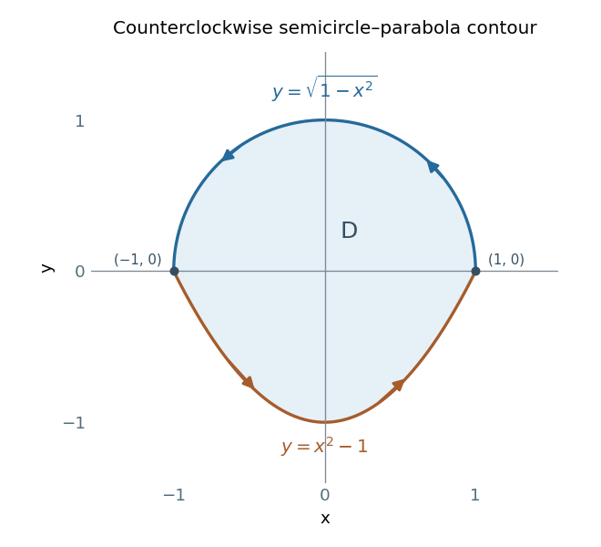

<h1 id="10/c/solution">Solution</h1>

↑ **Parent:** [C](../c.md)

A scalar [line integral](../../../../line-integral.md) is $\int_Cf\,ds=\int f(r(t))\|r'(t)\|\,dt$: it weights arc length by a [scalar field](../../../../scalar-field.md) and is unchanged by reversing orientation. A vector-work [line integral](../../../../line-integral.md) is $\int_CF\cdot d r=\int F(r(t))\cdot r'(t)\,dt$: it measures the tangent component of a [vector field](../../../../vector-field.md) and changes sign under reversal. Both are invariant under a regular orientation-preserving reparametrization.

For the prescribed counterclockwise curve, traverse the upper semicircle from $(1,0)$ to $(-1,0)$, then the lower parabola from $(-1,0)$ back to $(1,0)$.

**[Figure 2](#10/c/image-counterclockwise-contour-formed-by-the-upper-unit-semicircle-and-the-lower-parabolic-arc). Counterclockwise contour formed by the upper unit semicircle and the lower parabolic arc.** The upper arc runs from right to left; the lower arc runs from left to right. The enclosed area is the sum of a semicircle and a parabolic segment.

On the upper arc, use $x=\cos t$, $y=\sin t$, $0\leq t\leq\pi$. Then

$$
F\cdot d r=\big[-3\sin^2t+\cos^3t-\sin t\cos t\big]dt,
$$

so its integral is $-3\pi/2$: the last two terms integrate to zero by symmetry or direct integration. On the parabolic arc, use $x=t$, $y=t^2-1$ for $-1\leq t\leq1$. Here $x^2-y=1$ and

$$
F\cdot d r=(3t^2-3+2t)dt,
\qquad\int_{-1}^1(3t^2-3+2t)\,dt=-4.
$$

Therefore

$$
\boxed{\oint_CF\cdot d r=-\frac{3\pi}{2}-4.}
$$

As an independent check, [Green's theorem](../../../../green-theorem.md) gives the integrand $\partial_x(x^2-y)-\partial_y(3y)=2x-3$. The region is symmetric in $x$, so its odd part vanishes. Its area is $\pi/2+4/3$, giving $-3(\pi/2+4/3)$, exactly the same value.

## ↑ Ancestors (12)

1. [C](../c.md)
2. [10](../../10.md)
3. [2019 resit](../../../2019-resit-split.md)
4. [Past exam of the mathematical methods II course of the University of Oxford](../../../split.md)
5. [Mathematical methods II course of the University of Oxford](../../../../mathematical-methods-ii-course-of-the-university-of-oxford.md)
6. [Year 1 of the physics course of the University of Oxford](../../../../year-1-of-the-physics-course-of-the-university-of-oxford.md)
7. [Physics course of the University of Oxford](../../../../physics-course-of-the-university-of-oxford.md)
8. [Undergraduate course of the University of Oxford](../../../../undergraduate-course-of-the-university-of-oxford.md)
9. [Course of the University of Oxford](../../../../course-of-the-university-of-oxford.md)
10. [University of Oxford](../../../../university-of-oxford-split.md)
11. [List of universities](../../../../list-of-universities.md)
12. [Codex Wiki](../../../../split.md)
