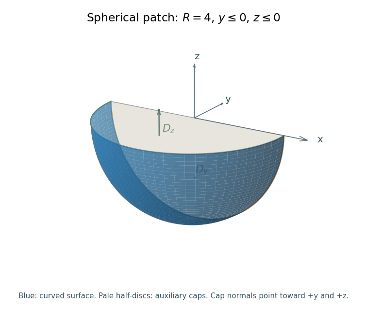

<h1 id="8/c/solution">Solution</h1>

↑ **Parent:** [C](../c.md)

Use the outward normal on the spherical patch. It is the quarter of the spherical surface lying below both the horizontal plane and the plane $y=0$, with both signs of $x$ included. Close it by the two half-discs $D_y$ in $y=0,z\leq0$ and $D_z$ in $z=0,y\leq0$.

**[Figure 1](#8/c/image-the-spherical-patch-of-radius-four-with-y-and-z-nonpositive-shown-with-the-two-planar-caps-used-to-close-the-volume). The spherical patch of radius four with y and z nonpositive, shown with the two planar caps used to close the volume.** The colored curved part is the requested surface. The planar half-discs are auxiliary surfaces for the divergence theorem; their outward normals point in positive y and positive z.

The [divergence](../../../../divergence.md) of the polynomial [vector field](../../../../vector-field.md) is $\nabla\cdot F=4xy$. Its [volume integral](../../../../volume-integral.md) over the enclosed quarter-ball vanishes by oddness in $x$. Thus the [divergence theorem](../../../../divergence-theorem.md) gives $\Phi_S+\Phi_{D_y}+\Phi_{D_z}=0$.

On $D_y$, the outward normal is $+\hat y$ and $F_y=-3z^4$. On $D_z$, it is $+\hat z$ and $F_z=x^3+y^2$; the odd term integrates to zero. The needed half-disc moments for radius $R$ are

$$
\int_{D_y}z^4\,dx\,dz
=\left(\int_0^Rr^5\,dr\right)\left(\int_\pi^{2\pi}\sin^4\phi\,d\phi\right)
=\frac{\pi R^6}{16},
$$

and

$$
\int_{D_z}y^2\,dx\,dy
=\left(\int_0^Rr^3\,dr\right)\left(\int_\pi^{2\pi}\sin^2\phi\,d\phi\right)
=\frac{\pi R^4}{8}.
$$

At $R=4$, the cap [fluxes](../../../../flux.md) are $-768\pi$ and $32\pi$, respectively. Therefore the [flux through a spherical quadrant by planar caps](../../../../flux-through-a-spherical-quadrant-by-planar-caps.md) is

$$
\boxed{\Phi_S=768\pi-32\pi=736\pi.}
$$

The source does not explicitly specify a normal for this part; the boxed answer adopts the usual outward spherical orientation. Choosing the inward normal reverses its sign.

## ↑ Ancestors (12)

1. [C](../c.md)
2. [8](../../8.md)
3. [2019 resit](../../../2019-resit-split.md)
4. [Past exam of the mathematical methods II course of the University of Oxford](../../../split.md)
5. [Mathematical methods II course of the University of Oxford](../../../../mathematical-methods-ii-course-of-the-university-of-oxford.md)
6. [Year 1 of the physics course of the University of Oxford](../../../../year-1-of-the-physics-course-of-the-university-of-oxford.md)
7. [Physics course of the University of Oxford](../../../../physics-course-of-the-university-of-oxford.md)
8. [Undergraduate course of the University of Oxford](../../../../undergraduate-course-of-the-university-of-oxford.md)
9. [Course of the University of Oxford](../../../../course-of-the-university-of-oxford.md)
10. [University of Oxford](../../../../university-of-oxford-split.md)
11. [List of universities](../../../../list-of-universities.md)
12. [Codex Wiki](../../../../split.md)
