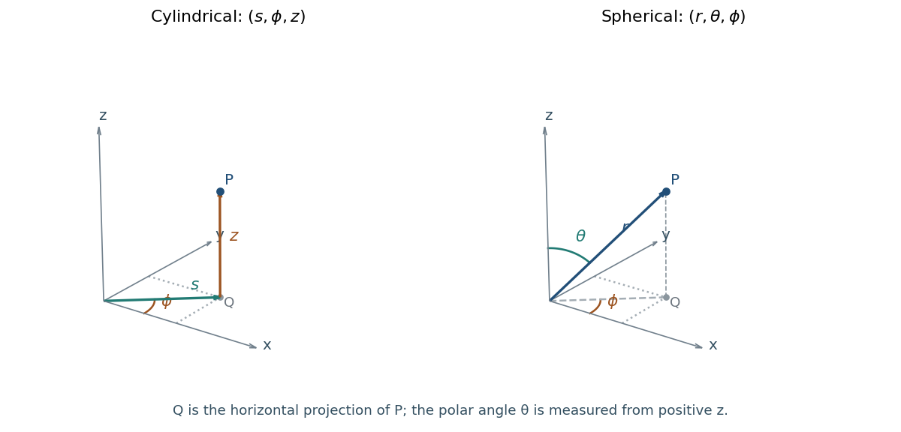
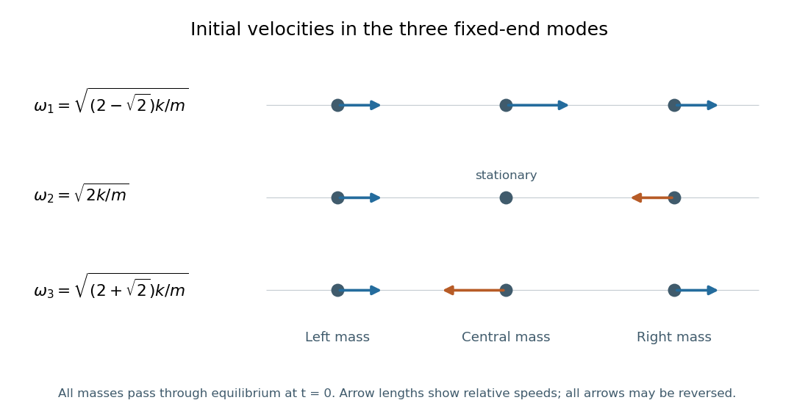

# 2019

↑ **Parent:** [Past exam of the mathematical methods II course of the University of Oxford](../past-exam-of-the-mathematical-methods-ii-course-of-the-university-of-oxford.md)

Source paper: [https://www.whatdotheyknow.com/request/oxford_physics_past_papers_2/response/2340696/attach/7/Physics%20Papers%202018.pdf?cookie_passthrough=1](https://www.whatdotheyknow.com/request/oxford_physics_past_papers_2/response/2340696/attach/7/Physics%20Papers%202018.pdf?cookie_passthrough=1)

The annual bundle is named “Physics Papers 2018”, but the cover dates this ordinary-sitting paper to 13 June 2019. The year follows the cover. All eleven questions are solved, including all four choices in Section B and the separate introductory request in Question 11.

**Table of contents**

- [1](#1)
  - [Solution](#1/solution)
- [2](#2)
  - [Solution](#2/solution)
- [3](#3)
  - [Solution](#3/solution)
- [4](#4)
  - [Solution](#4/solution)
- [5](#5)
  - [Solution](#5/solution)
- [6](#6)
  - [Solution](#6/solution)
- [7](#7)
  - [Solution](#7/solution)
- [8](#8)
  - [a](#8/a)
    - [Solution](#8/a/solution)
  - [b](#8/b)
    - [Solution](#8/b/solution)
  - [c](#8/c)
    - [i](#8/c/i)
      - [Solution](#8/c/i/solution)
    - [ii](#8/c/ii)
      - [Solution](#8/c/ii/solution)
    - [iii](#8/c/iii)
      - [Solution](#8/c/iii/solution)
- [9](#9)
  - [a](#9/a)
    - [i](#9/a/i)
      - [Solution](#9/a/i/solution)
    - [ii](#9/a/ii)
      - [Solution](#9/a/ii/solution)
  - [b](#9/b)
    - [Solution](#9/b/solution)
- [10](#10)
  - [a](#10/a)
    - [Solution](#10/a/solution)
  - [b](#10/b)
    - [Solution](#10/b/solution)
  - [c](#10/c)
    - [Solution](#10/c/solution)
- [11](#11)
  - [Solution](#11/solution)
  - [a](#11/a)
    - [Solution](#11/a/solution)
  - [b](#11/b)
    - [Solution](#11/b/solution)
  - [c](#11/c)
    - [Solution](#11/c/solution)

## 1

↑ **Parent:** [2019](2019.md)

<h3 id="1/solution">Solution</h3>

↑ **Parent:** [1](#1)

The successive [derivatives](../calculus.md#derivative) are $f^{(n)}(x)=(-6)^ne^{-6x}$, so $f^{(n)}(-4)=(-6)^ne^{24}$. Substitution in the [Taylor series](../calculus.md#taylor-series) formula about $a=-4$ gives

$$
\boxed{e^{-6x}=e^{24}\sum_{n=0}^{\infty}\frac{(-6)^n(x+4)^n}{n!}
=e^{24}\left[1-6(x+4)+18(x+4)^2-36(x+4)^3+\cdots\right].}
$$

The [ratio test](../sequence-and-series.md#ratio-test) shows convergence for every finite real or complex $x$: the absolute ratio of successive terms is $6|x+4|/(n+1)\to0$. This is also the usual [exponential function](../calculus.md#exponential-function) series applied to $e^{24}e^{-6(x+4)}$, proving that the series equals the stated function everywhere.

## 2

↑ **Parent:** [2019](2019.md)

<h3 id="2/solution">Solution</h3>

↑ **Parent:** [2](#2)

The [solid angle](../euclidean-geometry.md#solid-angle) is the intercepted [surface area](../differential-geometry.md#surface-area) on a sphere of radius $R$, divided by $R^2$. Take the cone axis as the polar axis of [spherical coordinates](../multivariable-calculus.md#spherical-coordinate-system), and call its half-opening [angle](../geometry-and-topology.md#angle) $\theta$. With polar integration variable $\vartheta$,

$$
\Omega=\frac1{R^2}\int_0^{2\pi}\int_0^\theta R^2\sin\vartheta\,d\vartheta\,d\phi
=\boxed{2\pi(1-\cos\theta).}
$$

For small $\theta$ measured in radians, the [Taylor series](../calculus.md#taylor-series) of the [cosine](../geometry-and-topology.md#cosine) gives

$$
\boxed{\Omega=\pi\theta^2-\frac{\pi\theta^4}{12}+O(\theta^6)\simeq\pi\theta^2.}
$$

This is the [solid angle of a circular cone](../euclidean-geometry.md#solid-angle-of-a-circular-cone), measured in [steradians](../euclidean-geometry.md#steradian).

The supplied angular diameter is twice the half-opening [angle](../geometry-and-topology.md#angle), so

$$
\theta=\frac{0.533}{2}\frac\pi{180}=0.00465130246\ldots\ \mathrm{rad}.
$$

Hence either apparent disc subtends

$$
\boxed{\Omega\simeq6.797\times10^{-5}\ \mathrm{sr},\qquad
\frac{\Omega}{4\pi}\simeq5.409\times10^{-6}.}
$$

The fraction is about $0.0005409\%$ of the entire celestial sphere. Using the angular diameter directly in $\pi\theta^2$ would give four times the correct small-angle answer.

## 3

↑ **Parent:** [2019](2019.md)

<h3 id="3/solution">Solution</h3>

↑ **Parent:** [3](#3)

The real [logarithm](../calculus.md#logarithm) restricts the domain to $x>0$. Differentiating gives

$$
f'(x)=2x\ln(3x)+x=x\big[2\ln(3x)+1\big].
$$

Since $x$ cannot vanish in the domain, a [stationary point](../calculus-of-variations.md#stationary-point) requires $\ln(3x)=-1/2$. The [logarithm](../calculus.md#logarithm) is strictly increasing, so this equation has exactly one solution:

$$
\boxed{x_* =\frac{e^{-1/2}}3=\frac1{3\sqrt e},\qquad
f(x_*)=-1-\frac1{18e}.}
$$

The [second derivative](../calculus.md#second-derivative) is $f''(x)=2\ln(3x)+3$, giving $f''(x_*)=2>0$. In fact $f'$ is negative below $x_*$ and positive above it, so the point is the unique global [minimum](../set.md#minimum-of-a-subset-of-a-total-order) on $x>0$. The boundary value $x=0$ is not an additional [stationary point](../calculus-of-variations.md#stationary-point), since the original function is not defined there.

## 4

↑ **Parent:** [2019](2019.md)

<h3 id="4/solution">Solution</h3>

↑ **Parent:** [4](#4)

For a continuous [random variable](../random-variable.md) with [probability density function](../continuous-probability-distribution.md#probability-density-function) $f_X$, its [cumulative distribution function](../probability-distribution.md#cumulative-distribution-function) is

$$
F_X(x)=\Pr(X\leq x)=\int_{-\infty}^{x}f_X(u)\,du.
$$

Consequently $F_X'=f_X$ wherever the density is continuous, and almost everywhere for an absolutely continuous distribution.

Here $Y=X^2\geq0$. Thus $F_Y(y)=0$ for $y<0$. For $y\geq0$, the event $X^2\leq y$ is $-\sqrt y\leq X\leq\sqrt y$. Symmetry of the [Laplace distribution](../continuous-probability-distribution.md#laplace-distribution) gives

$$
F_Y(y)=\int_{-\sqrt y}^{\sqrt y}\frac12e^{-|x|}\,dx
=\int_0^{\sqrt y}e^{-x}\,dx=1-e^{-\sqrt y}.
$$

Therefore the [square of a standard Laplace variable](../continuous-probability-distribution.md#square-of-a-standard-laplace-variable) has [cumulative distribution function](../probability-distribution.md#cumulative-distribution-function)

$$
\boxed{F_Y(y)=\begin{cases}0,&y<0,\\1-e^{-\sqrt y},&y\geq0.\end{cases}}
$$

It is continuous at zero, so there is no point mass there. As a check, its [probability density function](../continuous-probability-distribution.md#probability-density-function) for $y>0$ is $e^{-\sqrt y}/(2\sqrt y)$, whose integral becomes $\int_0^\infty e^{-u}\,du=1$ after setting $u=\sqrt y$.

## 5

↑ **Parent:** [2019](2019.md)

<h3 id="5/solution">Solution</h3>

↑ **Parent:** [5](#5)

Set $g(x)=\sqrt{8x}+\sin^2(2x)$. The [chain rule](../calculus.md#chain-rule) gives $f'=-g'/g^2$, while

$$
g'(x)=\frac4{\sqrt{8x}}+4\sin(2x)\cos(2x)
=\frac4{\sqrt{8x}}+2\sin(4x).
$$

Thus

$$
\boxed{f'(x)=-\frac{4/\sqrt{8x}+2\sin(4x)}{\big[\sqrt{8x}+\sin^2(2x)\big]^2},\qquad x>0.}
$$

The real domain excludes zero because the original denominator vanishes there; for $x>0$ it is strictly positive.

## 6

↑ **Parent:** [2019](2019.md)

<h3 id="6/solution">Solution</h3>

↑ **Parent:** [6](#6)

Take the [normal vector](../differential-geometry.md#normal-vector) to point outward from the box. The [divergence theorem](../multivariable-calculus.md#divergence-theorem) changes the closed-surface [flux](../mathematical-physics.md#flux) into a [volume integral](../multivariable-calculus.md#volume-integral). The [divergence](../multivariable-calculus.md#divergence) is

$$
\nabla\cdot F=\pi\cos(\pi x)+3zy^2+2z.
$$

The first term integrates to zero in $x$, since $\int_{-1}^{2}\pi\cos(\pi x)\,dx=\sin2\pi-\sin(-\pi)=0$. Therefore

$$
\begin{aligned}
\iint_SF\cdot d\boldsymbol S
&=\int_{-1}^2\int_0^1\int_1^4z(3y^2+2)\,dz\,dy\,dx\\
&=3\left(\frac{4^2-1^2}{2}\right)\left(\int_0^1(3y^2+2)\,dy\right)\\
&=3\cdot\frac{15}{2}\cdot3.
\end{aligned}
$$

Hence

$$
\boxed{\iint_SF\cdot d\boldsymbol S=\frac{135}{2}.}
$$

A direct face check gives zero from the two $x$ faces, $45/2$ from the pair of $y$ faces, and $45$ from the pair of $z$ faces. This also checks the outward-orientation signs.

## 7

↑ **Parent:** [2019](2019.md)

<h3 id="7/solution">Solution</h3>

↑ **Parent:** [7](#7)

Work in the small-slope model of a [transverse wave](../wave.md#transverse-wave) on a taut string. Let $T$ be the constant [tension](../force.md#tension), $\rho$ the [linear mass density](../fluid-mechanics.md#linear-mass-density), and take a right-moving sinusoidal [displacement](../classical-mechanics.md#displacement) $y=A\cos(\kappa x-\omega t)$, with [wave number](../wave-equation.md#wavenumber) $\kappa=\omega/v$. The [energy flux of a transverse string wave](../wave-equation.md#energy-flux-of-a-transverse-string-wave) through a cut is the transverse [force](../force.md) times transverse [velocity](../classical-mechanics.md#velocity):

$$
P(x,t)=-T\frac{\partial y}{\partial x}\frac{\partial y}{\partial t}
=T\kappa\omega A^2\sin^2(\kappa x-\omega t).
$$

A cycle average gives $\langle\sin^2\rangle=1/2$. Using $T=\rho v^2$, obtained from the string [wave equation](../wave-equation.md), yields

$$
\boxed{\overline P=\frac12T\kappa\omega A^2=\frac12\rho v\omega^2A^2.}
$$

The sign in the flux formula makes the [power](../energy.md#power) positive for propagation in the positive $x$ direction.

The [energy](../energy.md) per unit equilibrium length is the sum of the kinetic and elastic terms:

$$
\mathcal E=\frac12\rho y_t^2+\frac12T y_x^2,
\qquad \langle\mathcal E\rangle=\frac12\rho\omega^2A^2.
$$

For a segment of [mass](../classical-mechanics.md#mass) $M=\rho\ell$ containing many [wavelengths](../wave-equation.md#wavelength), the spatial average agrees with the cycle average up to a small endpoint correction. Thus $E\simeq\tfrac12M\omega^2A^2$. Convert the given quantities to SI units: $M=0.080\ \mathrm{kg}$, $A=1.6\times10^{-4}\ \mathrm m$, and $\omega=2\pi(120)\ \mathrm{s}^{-1}$. Then

$$
\boxed{E\simeq\frac12(0.080)(240\pi)^2(1.6\times10^{-4})^2
=5.82\times10^{-4}\ \mathrm J.}
$$

The many-wavelength condition explains why no phase of the finite segment is needed. The result is exact as a cycle average, or for a segment containing an integer number of [wavelengths](../wave-equation.md#wavelength).

## 8

↑ **Parent:** [2019](2019.md)

<h3 id="8/a">a</h3>

↑ **Parent:** [8](#8)

<h4 id="8/a/solution">Solution</h4>

↑ **Parent:** [A](#8/a)

Let the [angular velocity](../rigid-body-dynamics.md#angular-velocity) vector be the spatially constant $\boldsymbol\omega$. Choose an origin on the fixed rotation axis. The [velocity field](../fluid-mechanics.md#velocity-field) of a [rigid body](../rigid-body-dynamics.md) is $v=\boldsymbol\omega\times r$. In components,

$$
v=(\omega_yz-\omega_zy,\ \omega_zx-\omega_xz,\ \omega_xy-\omega_yx).
$$

Taking the [curl](../multivariable-calculus.md#curl) gives

$$
\boxed{\nabla\times v=(2\omega_x,2\omega_y,2\omega_z)=2\boldsymbol\omega.}
$$

An added spatially uniform translational [velocity](../classical-mechanics.md#velocity) has zero [curl](../multivariable-calculus.md#curl), so it does not affect this relation. Equivalently, the [vorticity](../vorticity.md) of rigid rotation is twice the [angular velocity](../rigid-body-dynamics.md#angular-velocity); the local rotational part of a general smooth flow has [angular velocity](../rigid-body-dynamics.md#angular-velocity) $\tfrac12\nabla\times v$.

<h3 id="8/b">b</h3>

↑ **Parent:** [8](#8)

<h4 id="8/b/solution">Solution</h4>

↑ **Parent:** [B](#8/b)

For an oriented piecewise smooth [surface](../topological-surface.md) $S$ with boundary $\partial S$, and a [vector field](../multivariable-calculus.md#vector-field) $F$ continuously differentiable on a neighborhood of $S$, [Stokes theorem](../multivariable-calculus.md#stokes-theorem) states

$$
\boxed{\int_S(\nabla\times F)\cdot n\,dS=\oint_{\partial S}F\cdot dr.}
$$

Here $n$ is the chosen unit [normal vector](../differential-geometry.md#normal-vector), $dS$ is the unsigned [surface area element](../multivariable-calculus.md#surface-area-element), and $dr$ is the tangent displacement along the boundary. The [right-hand rule](../electromagnetism.md#right-hand-rule) pairs the boundary orientation with $n$. If there are several boundary components, the [line integral](../multivariable-calculus.md#line-integral) includes all of them with their induced orientations.

A [simply connected](../algebraic-topology.md#simply-connected-space) [surface](../topological-surface.md) is connected and every closed loop on it can be continuously contracted to a point while remaining on the [surface](../topological-surface.md). A disc is an example. An annulus is not [simply connected](../algebraic-topology.md#simply-connected-space): a loop winding once around its hole cannot contract within it.

**Stokes' theorem is valid for both types of surface**, under the smoothness and orientation hypotheses above. Simple connectivity is not a requirement of the theorem. For a concrete annular example, take $F=(-y/2,x/2,0)$ and $a\leq r\leq R$ in the horizontal plane. Its [curl](../multivariable-calculus.md#curl) is $(0,0,1)$, so the left side is $\pi(R^2-a^2)$. The right side is the counterclockwise outer-circle integral $\pi R^2$ minus the counterclockwise inner-circle integral $\pi a^2$, giving exactly the same answer. Omitting the inner boundary would be an incorrect application of the theorem.

<h3 id="8/c">c</h3>

↑ **Parent:** [8](#8)

<h4 id="8/c/i">i</h4>

↑ **Parent:** [C](#8/c)

<h5 id="8/c/i/solution">Solution</h5>

↑ **Parent:** [I](#8/c/i)

Write $r^2=x^2+y^2$ and work away from the $z$ axis, where $r>0$. The [vector field](../multivariable-calculus.md#vector-field) is independent of $z$ and has zero vertical component, so only the vertical [curl](../multivariable-calculus.md#curl) can be nonzero:

$$
\begin{aligned}
(\nabla\times F)_z
&=\frac{\partial}{\partial x}\big[x(x^2+y^2)^{-n}\big]
-\frac{\partial}{\partial y}\big[-y(x^2+y^2)^{-n}\big]\\
&=2r^{-2n}-2n(x^2+y^2)r^{-2n-2}.
\end{aligned}
$$

Therefore

$$
\boxed{\nabla\times F=2(1-n)r^{-2n}\,\hat z,\qquad r>0.}
$$

This [local spin in an azimuthal power-law flow](../vorticity.md#local-spin-in-an-azimuthal-power-law-flow) depends on the radial variation of the tangential speed, not merely on the sign of that speed.

<h4 id="8/c/ii">ii</h4>

↑ **Parent:** [C](#8/c)

<h5 id="8/c/ii/solution">Solution</h5>

↑ **Parent:** [Ii](#8/c/ii)

In [cylindrical coordinates](../multivariable-calculus.md#cylindrical-coordinate-system), $F=r^{1-2n}\hat\theta$. The tangential coefficient is positive for every real $n$ and $r>0$, so the large-scale circulation is always counterclockwise when viewed from positive $z$.

By [solution](#8/c/i/solution), the infinitesimal local [angular velocity](../rigid-body-dynamics.md#angular-velocity) is $(1-n)r^{-2n}\hat z$. Its sign gives

$$
\boxed{\begin{array}{c|c}
n<1&\text{local spin in the same sense as circulation}\\
n=1&\text{zero local spin}\\
n>1&\text{local spin opposite to circulation}
\end{array}}
$$

“Zero local spin” does not mean zero [velocity](../classical-mechanics.md#velocity): at $n=1$ a marked small element is still carried around the axis while its infinitesimal rotational component is zero. Orbital motion around the axis and local [vorticity](../vorticity.md) are different measurements.

<h4 id="8/c/iii">iii</h4>

↑ **Parent:** [C](#8/c)

<h5 id="8/c/iii/solution">Solution</h5>

↑ **Parent:** [Iii](#8/c/iii)

For $n=1$, the [azimuthal unit vector](../multivariable-calculus.md#azimuthal-unit-vector) is $\hat\theta=(-\sin\theta,\cos\theta,0)$, so

$$
\boxed{F=\frac1r\hat\theta.}
$$

On a counterclockwise circle $C_r$ at fixed height, $dr=r\hat\theta\,d\theta$. Hence

$$
\boxed{\oint_{C_r}F\cdot dr=\int_0^{2\pi}\frac1r\,r\,d\theta=2\pi,}
$$

independent of the positive radius. Clockwise orientation reverses the sign.

There is no contradiction with the zero [curl](../multivariable-calculus.md#curl) found in [solution](#8/c/i/solution). The [vector field](../multivariable-calculus.md#vector-field) is undefined on the axis, so it is not continuously differentiable on a disc spanning $C_r$; the hypotheses of [Stokes theorem](../multivariable-calculus.md#stokes-theorem) fail for that disc. It is smooth on a planar annulus excluding the axis, where [Stokes theorem](../multivariable-calculus.md#stokes-theorem) correctly gives zero: the two boundary [line integrals](../multivariable-calculus.md#line-integral) cancel, $2\pi-2\pi=0$.

The same check works for general $n$. A counterclockwise circle has circulation $\Gamma(r)=2\pi r^{2-2n}$. Integrating the [curl](../multivariable-calculus.md#curl) over an annulus $a\leq r\leq R$ gives, for $n\ne1$,

$$
\int_a^R2(1-n)r^{-2n}\,2\pi r\,dr
=2\pi\big(R^{2-2n}-a^{2-2n}\big)=\Gamma(R)-\Gamma(a).
$$

For $n=1$, both sides are zero. Thus all three preceding results are consistent with [Stokes theorem](../multivariable-calculus.md#stokes-theorem); the necessary distinctions are the regularity of the [vector field](../multivariable-calculus.md#vector-field) and inclusion of every oriented boundary component.

## 9

↑ **Parent:** [2019](2019.md)

<h3 id="9/a">a</h3>

↑ **Parent:** [9](#9)

<h4 id="9/a/i">i</h4>

↑ **Parent:** [A](#9/a)

<h5 id="9/a/i/solution">Solution</h5>

↑ **Parent:** [I](#9/a/i)

Assume small transverse slopes, a flexible string, constant [tension](../force.md#tension) $T$ and uniform [linear mass density](../fluid-mechanics.md#linear-mass-density) $\rho$. For an element of equilibrium length $dx$, the vertical [force](../force.md) is the difference of the vertical tension components at its ends. To first order in slope,

$$
F_y=T\big[y_x(x+dx,t)-y_x(x,t)\big]=T y_{xx}\,dx.
$$

Its [mass](../classical-mechanics.md#mass) is $\rho\,dx$ and its transverse [acceleration](../classical-mechanics.md#acceleration) is $y_{tt}$. [Newton's second law](../force.md#newton-s-second-law) therefore gives $\rho\,dx\,y_{tt}=T\,dx\,y_{xx}$, or

$$
\boxed{y_{xx}=\frac1{c^2}y_{tt},\qquad c=\sqrt{\frac{T}{\rho}}.}
$$

This is the one-dimensional [wave equation](../wave-equation.md) for small-amplitude [transverse waves](../wave.md#transverse-wave). Changes in string length and horizontal [acceleration](../classical-mechanics.md#acceleration) are second order in slope and are neglected in this linear approximation.

<h4 id="9/a/ii">ii</h4>

↑ **Parent:** [A](#9/a)

<h5 id="9/a/ii/solution">Solution</h5>

↑ **Parent:** [Ii](#9/a/ii)

At distance $x$ below the support, the cable must carry the weight of the remaining length $L-x$. Thus its equilibrium [tension](../force.md#tension) is $T(x)=\mu g(L-x)$, and the local [transverse wave](../wave.md#transverse-wave) speed is

$$
\boxed{c(x)=\sqrt{\frac{T(x)}\mu}=\sqrt{g(L-x)},\qquad0\leq x<L.}
$$

The [linear mass density](../fluid-mechanics.md#linear-mass-density) cancels. More precisely the small-displacement equation with variable [tension](../force.md#tension) is $\mu y_{tt}=\partial_x[T(x)y_x]$; its local characteristic speed is the expression above, even though a first-spatial-derivative term is also present.

The [wave travel time on a hanging uniform cable](../wave.md#wave-travel-time-on-a-hanging-uniform-cable) is obtained from $dt=dx/c(x)$:

$$
t_{\mathrm{down}}=\int_0^L\frac{dx}{\sqrt{g(L-x)}}
=\frac1{\sqrt g}\int_0^Lu^{-1/2}\,du
=\boxed{2\sqrt{\frac Lg}.}
$$

Although the local speed tends to zero at the free end, the endpoint singularity in the travel-time integral is integrable. This finite result belongs to the ideal flexible-cable model, with bending stiffness neglected.

<h3 id="9/b">b</h3>

↑ **Parent:** [9](#9)

<h4 id="9/b/solution">Solution</h4>

↑ **Parent:** [B](#9/b)

A [dispersive](../dispersion-relation.md#wave-dispersion) medium has frequency-dependent [phase velocity](../dispersion-relation.md#phase-velocity), so different Fourier components generally propagate with different phases. A [dispersion relation](../dispersion-relation.md) specifies $\omega$ as a function of the [wave number](../wave-equation.md#wavenumber) $k$, or an equivalent relation between them. For a monochromatic factor $e^{i(kx-\omega t)}$, a point of fixed [phase](../wave.md#phase-waves) moves at

$$
\boxed{v_p=\frac\omega k.}
$$

For a narrow [wave packet](../dispersion-relation.md#wave-packet) centered at $k_*$, expand $\omega(k)\simeq\omega(k_*)+(k-k_*)\omega'(k_*)$. The envelope then translates at the [group velocity](../dispersion-relation.md#group-velocity)

$$
\boxed{v_g=\frac{d\omega}{dk}.}
$$

The [phase velocity](../dispersion-relation.md#phase-velocity) tracks crests of a monochromatic wave. The [group velocity](../dispersion-relation.md#group-velocity) tracks a slowly varying envelope when the narrow-band approximation is valid; in the ideal lossless guide here it also equals the longitudinal energy-transport speed. It is not a universal formula for signal-front speed in every possible dispersive medium.

For the propagating branch of the supplied [electromagnetic waveguide](../electromagnetic-wave.md#electromagnetic-waveguide) relation, take $\omega_0>0$, $k>0$ and $\omega=\sqrt{\omega_0^2+c^2k^2}$. Differentiation gives

$$
\boxed{v_p=\frac{\sqrt{\omega_0^2+c^2k^2}}k>c,\qquad
v_g=\frac{c^2k}{\sqrt{\omega_0^2+c^2k^2}}<c,\qquad v_pv_g=c^2.}
$$

The product alone would also allow $v_p=v_g=c$; the strictly positive cutoff is what makes the inequalities strict. At $k=0$ the phase-speed expression is undefined, and these formulas are interpreted through the propagating limit.

A moving monochromatic crest does not carry a new message. An information-bearing modulation is made from a range of frequencies; here its packet and energy move below $c$, and the high-frequency limit approaches $c$. Causal propagation of a newly switched-on disturbance is governed by the electromagnetic equations, so the superluminal [phase velocity](../dispersion-relation.md#phase-velocity) does not permit faster-than-light signalling. These are the [waveguide phase and group velocities](../electromagnetic-wave.md#waveguide-phase-and-group-velocities) for a mode with nonzero cutoff, rather than a zero-cutoff mode with both velocities equal to $c$.

## 10

↑ **Parent:** [2019](2019.md)

<h3 id="10/a">a</h3>

↑ **Parent:** [10](#10)

<h4 id="10/a/solution">Solution</h4>

↑ **Parent:** [A](#10/a)

Use $s$ for [cylindrical radius](../multivariable-calculus.md#cylindrical-radius), to distinguish it from spherical radius $r$. In [cylindrical coordinates](../multivariable-calculus.md#cylindrical-coordinate-system) $(s,\phi,z)$, the [azimuthal angle](../multivariable-calculus.md#azimuthal-angle-in-cylindrical-coordinates) $\phi$ is measured from positive $x$ in the horizontal plane:

$$
\boxed{x=s\cos\phi,\qquad y=s\sin\phi,\qquad z=z,\qquad s\geq0.}
$$

Here $0\leq\phi<2\pi$ and $z\in\mathbb R$.

In [spherical polar coordinates](../multivariable-calculus.md#spherical-coordinate-system) $(r,\theta,\phi)$, take $\theta$ as the polar [angle](../geometry-and-topology.md#angle) from positive $z$ and use the same [azimuthal angle](../multivariable-calculus.md#azimuthal-angle-in-cylindrical-coordinates) $\phi$:

$$
\boxed{x=r\sin\theta\cos\phi,\qquad y=r\sin\theta\sin\phi,\qquad z=r\cos\theta.}
$$

The ranges are $r\geq0$, $0\leq\theta\leq\pi$ and $0\leq\phi<2\pi$. The radial direction has horizontal projection of length $r\sin\theta$, which explains the extra factor in $x,y$. The azimuth is undefined on the polar axis, and both angles are nonunique at the origin; these are coordinate degeneracies rather than geometric singularities.

**[Figure 1](#10/a/image-cylindrical-and-spherical-polar-coordinates-the-spherical-polar-angle-is-measured-from-positive-z). Cylindrical and spherical polar coordinates; the spherical polar angle is measured from positive z.** The same point and its projection onto the horizontal plane are shown in both panels. The cylindrical radius is the projection length; the spherical radius is the distance from the origin.

<h3 id="10/b">b</h3>

↑ **Parent:** [10](#10)

<h4 id="10/b/solution">Solution</h4>

↑ **Parent:** [B](#10/b)

On the unit upper hemisphere, use [spherical coordinates](../multivariable-calculus.md#spherical-coordinate-system) with $0\leq\theta\leq\pi/2$ and $0\leq\phi<2\pi$. The [surface mass density](../fluid-mechanics.md#projected-surface-mass-density) is $\sigma=z=\cos\theta$, while the [surface area element](../multivariable-calculus.md#surface-area-element) is $dS=\sin\theta\,d\theta\,d\phi$. Thus the total [mass](../classical-mechanics.md#mass) is

$$
M=\int_0^{2\pi}\int_0^{\pi/2}\cos\theta\sin\theta\,d\theta\,d\phi
=2\pi\left[\frac12\sin^2\theta\right]_0^{\pi/2}
=\boxed{\pi.}
$$

The answer is in the mass units implicit in the specified unit radius and density law. A useful geometric check is that $z\,dS$ on the unit hemisphere equals the [area element](../differential-geometry.md#area-element-of-a-surface) of its vertical projection onto the horizontal unit disc, whose [area](../differential-geometry.md#surface-area) is $\pi$.

<h3 id="10/c">c</h3>

↑ **Parent:** [10](#10)

<h4 id="10/c/solution">Solution</h4>

↑ **Parent:** [C](#10/c)

This is a [scalar surface integral](../multivariable-calculus.md#scalar-surface-integral), not an oriented [flux](../mathematical-physics.md#flux). Split the whole closed [surface](../topological-surface.md) into the bottom disc, curved side and tilted top; shared edge curves have zero [surface area](../differential-geometry.md#surface-area).

On the bottom, $z=0$ and the integrand is $y$. Its integral over the symmetric disc $x^2+y^2\leq3$ vanishes by oddness:

$$
I_{\mathrm{bottom}}=0.
$$

On the top, $z=4-y$, so $y+z=4$. The graph has $z_x=0$, $z_y=-1$, giving $dS=\sqrt{1+z_x^2+z_y^2}\,dx\,dy=\sqrt2\,dx\,dy$. Hence

$$
I_{\mathrm{top}}=4\sqrt2\,(3\pi)=12\pi\sqrt2.
$$

For the side, let $R=\sqrt3$ and parametrize by $(R\cos\phi,R\sin\phi,z)$, with $0\leq z\leq4-R\sin\phi$. The [surface area element](../multivariable-calculus.md#surface-area-element) is $R\,dz\,d\phi$. Thus

$$
\begin{aligned}
I_{\mathrm{side}}
&=R\int_0^{2\pi}\int_0^{4-R\sin\phi}(R\sin\phi+z)\,dz\,d\phi\\
&=R\int_0^{2\pi}\left[8-\frac{R^2}2\sin^2\phi\right]d\phi\\
&=16\pi R-\frac{\pi R^3}{2}=\frac{29\pi\sqrt3}{2}.
\end{aligned}
$$

Adding all three pieces gives

$$
\boxed{\int_S(y+z)\,dS=\pi\left(12\sqrt2+\frac{29\sqrt3}{2}\right).}
$$

The tilted top remains above the bottom everywhere because $4-y\geq4-\sqrt3>0$. The calculation is an instance of a [scalar surface integral over a cylinder with one tilted cap](../multivariable-calculus.md#scalar-surface-integral-over-a-cylinder-with-one-tilted-cap); reversing a surface orientation would not change any of its terms.

## 11

↑ **Parent:** [2019](2019.md)

<h3 id="11/solution">Solution</h3>

↑ **Parent:** [11](#11)

A [normal mode](../wave-equation.md#normal-mode) is a motion of a linear oscillatory system in which every coordinate has the same [angular frequency](../lagrangian-mechanics.md#angular-frequency) and a fixed relative amplitude and phase. For a conservative small-displacement system it has the form

$$
\boldsymbol x(t)=q\cos(\omega t+\phi),\qquad Kq=\omega^2Mq,
$$

where $q$ is the [mode shape](../wave-equation.md#mode-shape), $K$ the [stiffness matrix](../finite-element-method.md#stiffness-matrix), and $M$ the [mass matrix](../finite-element-method.md#mass-matrix). Superposing [normal modes](../wave-equation.md#normal-mode) gives the general small-oscillation motion when their [eigenvectors](../linear-operator-theory.md#eigenvector) form a complete [basis](../vector-space.md#basis).

Two common examples are standing transverse oscillations of a string fixed at both ends, and oscillations of coupled masses and springs. The string's mode shapes are sinusoidal along its length; the coupled system's mode shapes are fixed patterns of particle displacements. The following parts determine those patterns for the three-mass system in the source figure.

<h3 id="11/a">a</h3>

↑ **Parent:** [11](#11)

<h4 id="11/a/solution">Solution</h4>

↑ **Parent:** [A](#11/a)

Let $x_1,x_2,x_3$ be longitudinal [displacements](../classical-mechanics.md#displacement) from equilibrium, with positive direction to the right. The fixed walls have zero displacement. The first mass feels forces $-kx_1$ and $k(x_2-x_1)$; the central mass feels $k(x_1-x_2)$ and $k(x_3-x_2)$; the last mass feels $k(x_2-x_3)$ and $-kx_3$. [Hooke's law](../elasticity-physics.md#hooke-s-law) and [Newton's second law](../force.md#newton-s-second-law) therefore give

$$
\boxed{\begin{aligned}
m\ddot x_1&=-2kx_1+kx_2,\\
m\ddot x_2&=kx_1-2kx_2+kx_3,\\
m\ddot x_3&=kx_2-2kx_3.
\end{aligned}}
$$

Equivalently,

$$
\boxed{m\ddot{\boldsymbol x}+kA\boldsymbol x=0,\qquad
A=\begin{pmatrix}2&-1&0\\-1&2&-1\\0&-1&2\end{pmatrix}.}
$$

All four springs contribute: the wall springs supply one of the two diagonal terms in the first and third rows. This is a fixed-end chain, not a freely ended chain with a zero-frequency translation mode.

<h3 id="11/b">b</h3>

↑ **Parent:** [11](#11)

<h4 id="11/b/solution">Solution</h4>

↑ **Parent:** [B](#11/b)

Put $\boldsymbol x=q e^{i\omega t}$ in [solution](#11/a/solution). The [normal mode](../wave-equation.md#normal-mode) equation is $Aq=\lambda q$, with $\lambda=m\omega^2/k$. Its [characteristic polynomial](../linear-operator-theory.md#characteristic-polynomial) is

$$
\det(A-\lambda I)=(2-\lambda)\big[(2-\lambda)^2-2\big].
$$

The three [eigenvalues](../linear-operator-theory.md#eigenvalue) are $2-\sqrt2$, $2$, and $2+\sqrt2$. Solving the corresponding linear equations yields

$$
\boxed{\begin{array}{c|c|c}
\text{mode}&\omega&\text{mode shape }q\\\hline
1&\sqrt{(2-\sqrt2)k/m}&(1,\sqrt2,1)^T\\
2&\sqrt{2k/m}&(1,0,-1)^T\\
3&\sqrt{(2+\sqrt2)k/m}&(1,-\sqrt2,1)^T
\end{array}}
$$

Each [mode shape](../wave-equation.md#mode-shape) may be multiplied by any nonzero scalar. Their squared [Euclidean norms](../normed-vector-space.md#euclidean-norm) are $4,2,4$, respectively, so unit-normalized [eigenvectors](../linear-operator-theory.md#eigenvector) are $q_1/2,q_2/\sqrt2,q_3/2$. They are mutually orthogonal, as expected for the real symmetric [stiffness matrix](../finite-element-method.md#stiffness-matrix) with equal [masses](../classical-mechanics.md#mass).

The entries in the table are [angular frequencies](../lagrangian-mechanics.md#angular-frequency); the corresponding ordinary [frequencies](../wave.md#frequency) in cycles per unit time are $f_j=\omega_j/(2\pi)$. All three are positive because the fixed walls remove uniform translation as a free motion.

<h3 id="11/c">c</h3>

↑ **Parent:** [11](#11)

<h4 id="11/c/solution">Solution</h4>

↑ **Parent:** [C](#11/c)

To specify “initial motion” unambiguously, choose each mode to pass through equilibrium at $t=0$ with $\dot{\boldsymbol x}(0)$ proportional to its listed [mode shape](../wave-equation.md#mode-shape). The arrows in the figure then describe relative initial [velocities](../classical-mechanics.md#velocity):

- In mode 1, all three masses move in the same direction; the central mass has $\sqrt2$ times either outer [velocity](../classical-mechanics.md#velocity).
- In mode 2, the two outer masses move with equal and opposite [velocities](../classical-mechanics.md#velocity), while the central mass remains stationary.
- In mode 3, the outer masses move together while the central mass moves oppositely with $\sqrt2$ times their speed.

Reversing every arrow changes only the common [phase](../wave.md#phase-waves). A quarter-cycle later these same ratios describe the extremal [displacements](../classical-mechanics.md#displacement), with zero instantaneous [velocity](../classical-mechanics.md#velocity).

**[Figure 2](#11/c/image-relative-initial-velocities-of-the-three-fixed-end-normal-modes-starting-as-the-masses-pass-through-equilibrium). Relative initial velocities of the three fixed-end normal modes, starting as the masses pass through equilibrium.** Arrow lengths follow the mode shapes. The antisymmetric mode has equal and opposite outer velocities and zero central velocity; its angular frequency is unchanged by any positive change in central mass.

Now replace the central mass by $M$, leaving the outer [masses](../classical-mechanics.md#mass) equal to $m$. The antisymmetric [mode shape](../wave-equation.md#mode-shape) $q=(1,0,-1)^T$ gives zero net force on the central mass, since $k x_1+k x_3=0$. Each outer mass still obeys $m\ddot x=-2kx$. Consequently

$$
\boxed{\omega_2=\sqrt{\frac{2k}{m}}\text{ is unchanged for every }M>0.}
$$

This [middle-mass-independent mode of a fixed three-mass spring chain](../wave-equation.md#middle-mass-independent-mode-of-a-fixed-three-mass-spring-chain) is exact, not merely a large-$M$ approximation. The other two modes move the central mass and generally change. For example, their symmetric-sector frequencies satisfy

$$
(2k-m\omega^2)(2k-M\omega^2)-2k^2=0,
$$

which explicitly depends on $M$.

## ↑ Ancestors (9)

1. [Past exam of the mathematical methods II course of the University of Oxford](../past-exam-of-the-mathematical-methods-ii-course-of-the-university-of-oxford.md)
2. [Mathematical methods II course of the University of Oxford](../university-of-oxford.md#mathematical-methods-ii-course-of-the-university-of-oxford)
3. [Year 1 of the physics course of the University of Oxford](../university-of-oxford.md#year-1-of-the-physics-course-of-the-university-of-oxford)
4. [Physics course of the University of Oxford](../university-of-oxford.md#physics-course-of-the-university-of-oxford)
5. [Undergraduate course of the University of Oxford](../university-of-oxford.md#undergraduate-course-of-the-university-of-oxford)
6. [Course of the University of Oxford](../university-of-oxford.md#course-of-the-university-of-oxford)
7. [University of Oxford](../university-of-oxford.md)
8. [List of universities](../README.md#list-of-universities)
9. [Codex Wiki](../README.md)
