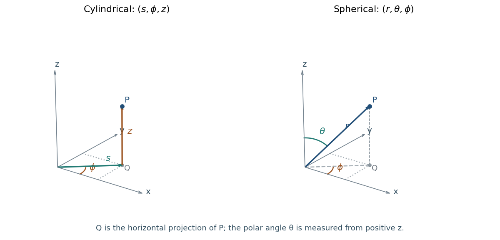

<h1 id="10/a/solution">Solution</h1>

↑ **Parent:** [A](../a.md)

Use $s$ for [cylindrical radius](../../../../cylindrical-radius.md), to distinguish it from spherical radius $r$. In [cylindrical coordinates](../../../../cylindrical-coordinate-system.md) $(s,\phi,z)$, the [azimuthal angle](../../../../azimuthal-angle-in-cylindrical-coordinates.md) $\phi$ is measured from positive $x$ in the horizontal plane:

$$
\boxed{x=s\cos\phi,\qquad y=s\sin\phi,\qquad z=z,\qquad s\geq0.}
$$

Here $0\leq\phi<2\pi$ and $z\in\mathbb R$.

In [spherical polar coordinates](../../../../spherical-coordinate-system.md) $(r,\theta,\phi)$, take $\theta$ as the polar [angle](../../../../angle.md) from positive $z$ and use the same [azimuthal angle](../../../../azimuthal-angle-in-cylindrical-coordinates.md) $\phi$:

$$
\boxed{x=r\sin\theta\cos\phi,\qquad y=r\sin\theta\sin\phi,\qquad z=r\cos\theta.}
$$

The ranges are $r\geq0$, $0\leq\theta\leq\pi$ and $0\leq\phi<2\pi$. The radial direction has horizontal projection of length $r\sin\theta$, which explains the extra factor in $x,y$. The azimuth is undefined on the polar axis, and both angles are nonunique at the origin; these are coordinate degeneracies rather than geometric singularities.

**[Figure 1](#10/a/image-cylindrical-and-spherical-polar-coordinates-the-spherical-polar-angle-is-measured-from-positive-z). Cylindrical and spherical polar coordinates; the spherical polar angle is measured from positive z.** The same point and its projection onto the horizontal plane are shown in both panels. The cylindrical radius is the projection length; the spherical radius is the distance from the origin.

## ↑ Ancestors (12)

1. [A](../a.md)
2. [10](../../10.md)
3. [2019](../../../2019-split.md)
4. [Past exam of the mathematical methods II course of the University of Oxford](../../../split.md)
5. [Mathematical methods II course of the University of Oxford](../../../../mathematical-methods-ii-course-of-the-university-of-oxford.md)
6. [Year 1 of the physics course of the University of Oxford](../../../../year-1-of-the-physics-course-of-the-university-of-oxford.md)
7. [Physics course of the University of Oxford](../../../../physics-course-of-the-university-of-oxford.md)
8. [Undergraduate course of the University of Oxford](../../../../undergraduate-course-of-the-university-of-oxford.md)
9. [Course of the University of Oxford](../../../../course-of-the-university-of-oxford.md)
10. [University of Oxford](../../../../university-of-oxford-split.md)
11. [List of universities](../../../../list-of-universities.md)
12. [Codex Wiki](../../../../split.md)
