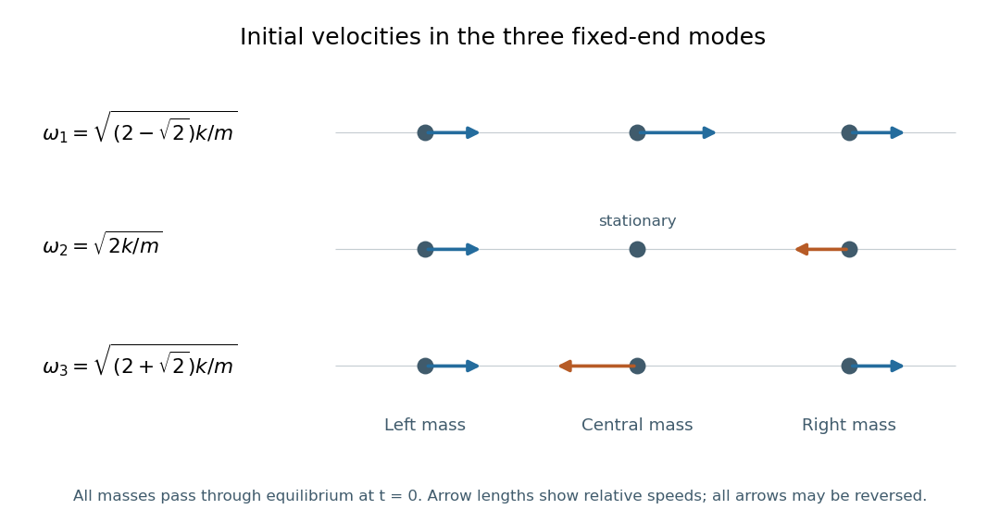

<h1 id="11/c/solution">Solution</h1>

↑ **Parent:** [C](../c.md)

To specify “initial motion” unambiguously, choose each mode to pass through equilibrium at $t=0$ with $\dot{\boldsymbol x}(0)$ proportional to its listed [mode shape](../../../../mode-shape.md). The arrows in the figure then describe relative initial [velocities](../../../../velocity.md):

- In mode 1, all three masses move in the same direction; the central mass has $\sqrt2$ times either outer [velocity](../../../../velocity.md).
- In mode 2, the two outer masses move with equal and opposite [velocities](../../../../velocity.md), while the central mass remains stationary.
- In mode 3, the outer masses move together while the central mass moves oppositely with $\sqrt2$ times their speed.

Reversing every arrow changes only the common [phase](../../../../phase-waves.md). A quarter-cycle later these same ratios describe the extremal [displacements](../../../../displacement.md), with zero instantaneous [velocity](../../../../velocity.md).

**[Figure 2](#11/c/image-relative-initial-velocities-of-the-three-fixed-end-normal-modes-starting-as-the-masses-pass-through-equilibrium). Relative initial velocities of the three fixed-end normal modes, starting as the masses pass through equilibrium.** Arrow lengths follow the mode shapes. The antisymmetric mode has equal and opposite outer velocities and zero central velocity; its angular frequency is unchanged by any positive change in central mass.

Now replace the central mass by $M$, leaving the outer [masses](../../../../mass.md) equal to $m$. The antisymmetric [mode shape](../../../../mode-shape.md) $q=(1,0,-1)^T$ gives zero net force on the central mass, since $k x_1+k x_3=0$. Each outer mass still obeys $m\ddot x=-2kx$. Consequently

$$
\boxed{\omega_2=\sqrt{\frac{2k}{m}}\text{ is unchanged for every }M>0.}
$$

This [middle-mass-independent mode of a fixed three-mass spring chain](../../../../middle-mass-independent-mode-of-a-fixed-three-mass-spring-chain.md) is exact, not merely a large-$M$ approximation. The other two modes move the central mass and generally change. For example, their symmetric-sector frequencies satisfy

$$
(2k-m\omega^2)(2k-M\omega^2)-2k^2=0,
$$

which explicitly depends on $M$.

## ↑ Ancestors (12)

1. [C](../c.md)
2. [11](../../11.md)
3. [2019](../../../2019-split.md)
4. [Past exam of the mathematical methods II course of the University of Oxford](../../../split.md)
5. [Mathematical methods II course of the University of Oxford](../../../../mathematical-methods-ii-course-of-the-university-of-oxford.md)
6. [Year 1 of the physics course of the University of Oxford](../../../../year-1-of-the-physics-course-of-the-university-of-oxford.md)
7. [Physics course of the University of Oxford](../../../../physics-course-of-the-university-of-oxford.md)
8. [Undergraduate course of the University of Oxford](../../../../undergraduate-course-of-the-university-of-oxford.md)
9. [Course of the University of Oxford](../../../../course-of-the-university-of-oxford.md)
10. [University of Oxford](../../../../university-of-oxford-split.md)
11. [List of universities](../../../../list-of-universities.md)
12. [Codex Wiki](../../../../split.md)
