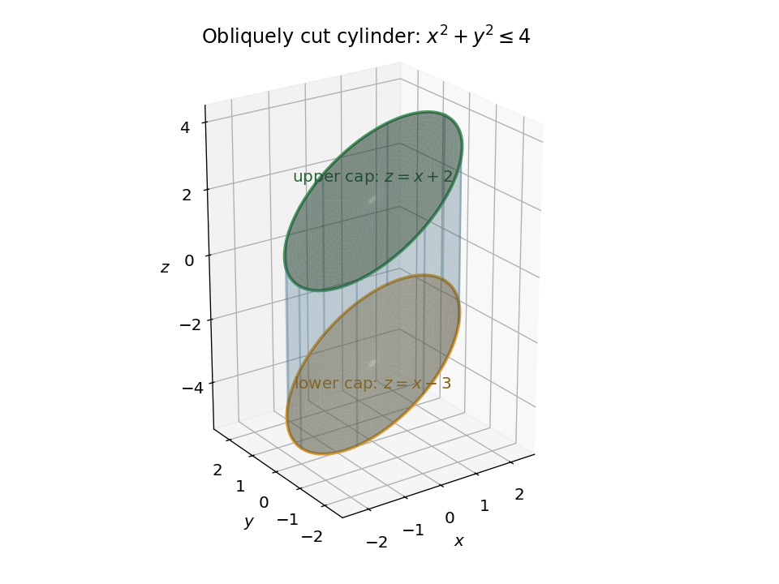
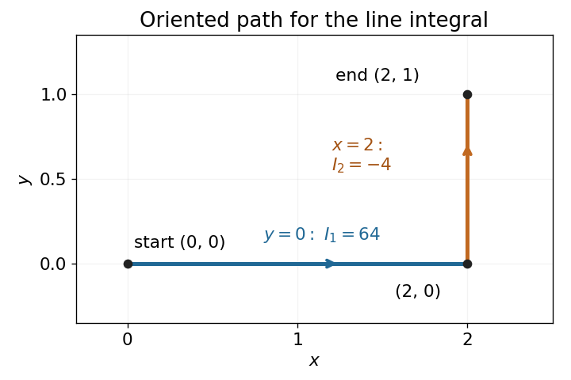
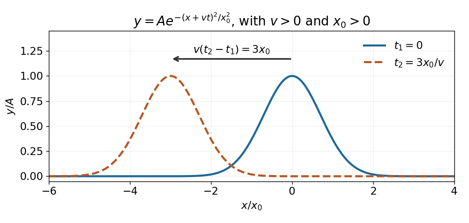

# 2021 resit

↑ **Parent:** [Past exam of the mathematical methods II course of the University of Oxford](../past-exam-of-the-mathematical-methods-ii-course-of-the-university-of-oxford.md)

Source paper: [https://www.whatdotheyknow.com/request/physics_preliminary_past_papers/response/2680788/attach/3/2018%202021%20Physics%20prelims.zip?cookie_passthrough=1](https://www.whatdotheyknow.com/request/physics_preliminary_past_papers/response/2680788/attach/3/2018%202021%20Physics%20prelims.zip?cookie_passthrough=1)

The examination date is 9 September 2021. The source archive labels its member `2020/L/a10289w1.pdf`; the date on the paper establishes the year. Solutions cover all questions, including every option in Section B.

**Table of contents**

- [1](#1)
  - [a](#1/a)
    - [Solution](#1/a/solution)
  - [b](#1/b)
    - [Solution](#1/b/solution)
- [2](#2)
  - [Solution](#2/solution)
- [3](#3)
  - [Solution](#3/solution)
- [4](#4)
  - [Solution](#4/solution)
- [5](#5)
  - [Solution](#5/solution)
- [6](#6)
  - [Solution](#6/solution)
- [7](#7)
  - [a](#7/a)
    - [Solution](#7/a/solution)
  - [b](#7/b)
    - [i](#7/b/i)
      - [Solution](#7/b/i/solution)
    - [ii](#7/b/ii)
      - [Solution](#7/b/ii/solution)
    - [iii](#7/b/iii)
      - [Solution](#7/b/iii/solution)
  - [c](#7/c)
    - [Solution](#7/c/solution)
- [8](#8)
  - [a](#8/a)
    - [Solution](#8/a/solution)
  - [b](#8/b)
    - [Solution](#8/b/solution)
  - [c](#8/c)
    - [Solution](#8/c/solution)
- [9](#9)
  - [a](#9/a)
    - [Solution](#9/a/solution)
  - [b](#9/b)
    - [Solution](#9/b/solution)
  - [c](#9/c)
    - [Solution](#9/c/solution)
  - [d](#9/d)
    - [Solution](#9/d/solution)
- [10](#10)
  - [a](#10/a)
    - [Solution](#10/a/solution)
  - [b](#10/b)
    - [Solution](#10/b/solution)
  - [c](#10/c)
    - [Solution](#10/c/solution)
- [11](#11)
  - [a](#11/a)
    - [Solution](#11/a/solution)
  - [b](#11/b)
    - [Solution](#11/b/solution)
  - [c](#11/c)
    - [Solution](#11/c/solution)
  - [d](#11/d)
    - [Solution](#11/d/solution)

## 1

↑ **Parent:** [2021 resit](2021-resit.md)

<h3 id="1/a">a</h3>

↑ **Parent:** [1](#1)

<h4 id="1/a/solution">Solution</h4>

↑ **Parent:** [A](#1/a)

The [Maclaurin series](../calculus.md#maclaurin-series) of the [exponential function](../calculus.md#exponential-function) and [sine](../geometry-and-topology.md#sine) give

$$
e^{x^2}=1+x^2+\frac{x^4}{2}+\frac{x^6}{6}+O(x^8),\qquad
x\sin x=x^2-\frac{x^4}{6}+\frac{x^6}{120}+O(x^8).
$$

Both the numerator and denominator first become nonzero at order $x^4$. Dividing by that common power gives the [limit](../calculus.md#limit-of-a-function)

$$
\boxed{\lim_{x\to0}\frac{1+x^2-e^{x^2}}{x\sin x-x^2}
=\lim_{x\to0}\frac{-1/2+O(x^2)}{-1/6+O(x^2)}=3.}
$$

<h3 id="1/b">b</h3>

↑ **Parent:** [1](#1)

<h4 id="1/b/solution">Solution</h4>

↑ **Parent:** [B](#1/b)

The [fundamental theorem of calculus](../calculus.md#fundamental-theorem-of-calculus) differentiates the variable upper endpoint:

$$
I'(x)=\frac2{\sqrt\pi}e^{-x^2},\qquad
I''(x)=-\frac{4x}{\sqrt\pi}e^{-x^2},\qquad
I'''(x)=\frac{-4+8x^2}{\sqrt\pi}e^{-x^2}.
$$

At zero, $I(0)=0$, $I'(0)=2/\sqrt\pi$, $I''(0)=0$ and $I'''(0)=-4/\sqrt\pi$. The integrand is even, so its [integral](../integral.md) from zero is an [odd function](../calculus.md#odd-function); all even coefficients in the [Maclaurin series](../calculus.md#maclaurin-series) vanish. Hence

$$
\boxed{I(x)=\frac2{\sqrt\pi}\left(x-\frac{x^3}{3}\right)+O(x^5).}
$$

This is the local expansion of the [error function](../integral.md#error-function).

## 2

↑ **Parent:** [2021 resit](2021-resit.md)

<h3 id="2/solution">Solution</h3>

↑ **Parent:** [2](#2)

**First method: substitute the trajectory.** Along the [parametric curve](../topology.md#parametric-curve), the [temperature](../temperature.md) is $T(t)=20e^{-\cos^2t}-(1+\sin t)^3$. The [chain rule](../calculus.md#chain-rule) gives

$$
\boxed{\frac{dT}{dt}
=40\sin t\cos t\,e^{-\cos^2t}-3(1+\sin t)^2\cos t.}
$$

**Second method: use the spatial derivatives.** The [partial derivatives](../multivariable-calculus.md#partial-derivative) of the [scalar field](../classical-field-theory.md#scalar-field) are $T_x=-40xe^{-x^2}$ and $T_z=-3(z+1)^2$, while the [velocity](../classical-mechanics.md#velocity) components are $\dot x=-\sin t$ and $\dot z=\cos t$. The [multivariable chain rule](../calculus.md#multivariable-chain-rule) therefore gives

$$
\frac{dT}{dt}=T_x\dot x+T_z\dot z
=(-40\cos t\,e^{-\cos^2t})(-\sin t)-3(1+\sin t)^2\cos t,
$$

which agrees with the first calculation. This is the [gradient](../multivariable-calculus.md#gradient) dotted with the [velocity](../classical-mechanics.md#velocity), rather than a [partial derivative](../multivariable-calculus.md#partial-derivative) at a fixed position.

## 3

↑ **Parent:** [2021 resit](2021-resit.md)

<h3 id="3/solution">Solution</h3>

↑ **Parent:** [3](#3)

Apply the [product-to-sum formula](../geometry-and-topology.md#product-to-sum-formula) $2\cos u\cos v=\cos(u+v)+\cos(u-v)$ to the [amplitude modulation](../electrical-engineering.md#amplitude-modulation):

$$
\boxed{A=a\cos(\omega t-kx)
+\frac b2\cos\bigl((\omega+\omega_m)t-kx\bigr)
+\frac b2\cos\bigl((\omega-\omega_m)t-kx\bigr).}
$$

The [amplitude modulation sidebands](../electrical-engineering.md#amplitude-modulation-sidebands) have [angular frequencies](../lagrangian-mechanics.md#angular-frequency) $\omega+\omega_m$ and $\omega-\omega_m$, each with [amplitude](../wave.md#wave-amplitude) $b/2$ in this real [cosine](../geometry-and-topology.md#cosine) convention. The [carrier wave](../dispersion-relation.md#carrier-wave) has [angular frequency](../lagrangian-mechanics.md#angular-frequency) $\omega$ and [amplitude](../wave.md#wave-amplitude) $a$.

This identity is exact for the supplied space-time expression. A physical qualification is needed if every term is meant to be a freely propagating [electromagnetic wave](../electromagnetic-wave.md) with [speed of light](../special-relativity.md#speed-of-light) $c$: the [dispersion relation](../dispersion-relation.md) requires $k_\pm=(\omega\pm\omega_m)/c$, whereas the prescribed modulation at every position leaves all three [wavenumbers](../wave-equation.md#wavenumber) equal to $k=\omega/c$. A freely propagating modulated [wave](../wave.md) instead has envelope $a+b\cos(\omega_m(t-x/c))$; its analogous expansion has $k_\pm$. For example, at $x=t=0$ the prescribed expression has $A_{tt}-c^2A_{xx}=-b\omega_m^2$, which is nonzero for nontrivial modulation. The given formula can describe modulation imposed throughout space or the temporal signal at one position.

## 4

↑ **Parent:** [2021 resit](2021-resit.md)

<h3 id="4/solution">Solution</h3>

↑ **Parent:** [4](#4)

Differentiate the [parametric curve](../topology.md#parametric-curve):

$$
\dot x=at\cos t,\qquad \dot y=at\sin t.
$$

The [arc length](../riemannian-geometry.md#arc-length) element is $ds=\sqrt{\dot x^2+\dot y^2}\,dt=|a|t\,dt$ on $0\le t\le2$. Thus

$$
\boxed{L=\int_0^2|a|t\,dt=2|a|.}
$$

For a positive geometric scale $a$, this is $2a$. The absolute value is necessary when the unspecified real constant $a$ is negative; $a=0$ gives zero [arc length](../riemannian-geometry.md#arc-length).

## 5

↑ **Parent:** [2021 resit](2021-resit.md)

<h3 id="5/solution">Solution</h3>

↑ **Parent:** [5](#5)

The [gradient](../multivariable-calculus.md#gradient) of the [scalar field](../classical-field-theory.md#scalar-field) is

$$
\nabla f=(2x+9y-2z^2,\;9x,\;-4xz),\qquad
\nabla f(2,4,8)=(-88,18,-64).
$$

For a [unit vector](../vector-space.md#unit-vector) $\hat{\mathbf n}$, the [directional derivative](../multivariable-calculus.md#directional-derivative) is $D_{\hat{\mathbf n}}f=\nabla f\cdot\hat{\mathbf n}$. The [Cauchy-Schwarz inequality](../probability-and-statistics.md#cauchy-schwarz-inequality) bounds its magnitude by $\|\nabla f\|=2\sqrt{3041}$, with equality precisely in the two directions parallel to the [gradient](../multivariable-calculus.md#gradient). Therefore

$$
\boxed{\hat{\mathbf n}=\pm\frac{(-44,9,-32)}{\sqrt{3041}},
\qquad \max_{\|\hat{\mathbf n}\|=1}|D_{\hat{\mathbf n}}f|=2\sqrt{3041}.}
$$

The plus choice gives the greatest positive [directional derivative](../multivariable-calculus.md#directional-derivative), and the minus choice gives the most negative [directional derivative](../multivariable-calculus.md#directional-derivative). Both maximize its magnitude.

## 6

↑ **Parent:** [2021 resit](2021-resit.md)

<h3 id="6/solution">Solution</h3>

↑ **Parent:** [6](#6)

For the [scalar surface integral over an obliquely cut cylinder](../multivariable-calculus.md#scalar-surface-integral-over-an-obliquely-cut-cylinder), split the [scalar surface integral](../multivariable-calculus.md#scalar-surface-integral) into the curved [cylinder](../geometry-and-topology.md#cylinder-geometry) and its two planar caps. Write $s=z-x$, so the solid has $x^2+y^2\le4$ and $-3\le s\le2$. On the curved [cylinder](../geometry-and-topology.md#cylinder-geometry), use the [parametrization](../geometry-and-topology.md#parametric-equation)

$$
\mathbf R(\theta,s)=(2\cos\theta,2\sin\theta,2\cos\theta+s),
\qquad 0\le\theta\le2\pi,\quad -3\le s\le2.
$$

The [surface area element](../multivariable-calculus.md#surface-area-element) follows from

$$
\mathbf R_\theta\times\mathbf R_s=(2\cos\theta,2\sin\theta,0),\qquad
dS=2\,d\theta\,ds,\qquad x-z=-s.
$$

Consequently the curved contribution is

$$
I_{\rm side}=\int_0^{2\pi}\int_{-3}^{2}(-s)\,2\,ds\,d\theta=10\pi.
$$

On either cap $z=x+s$, the [surface area element](../multivariable-calculus.md#surface-area-element) is $\sqrt{1+z_x^2+z_y^2}\,dx\,dy=\sqrt2\,dx\,dy$ over a radius-two [disk](../topology.md#disk-mathematics). The lower cap has $x-z=3$ and the upper cap has $x-z=-2$. Thus

$$
I_{\rm lower}=3\sqrt2(4\pi)=12\sqrt2\pi,\qquad
I_{\rm upper}=-2\sqrt2(4\pi)=-8\sqrt2\pi,
$$

and the complete [scalar surface integral](../multivariable-calculus.md#scalar-surface-integral) is

$$
\boxed{\iint_S(x-z)\,dS=\pi(10+4\sqrt2).}
$$

The [surface area element](../multivariable-calculus.md#surface-area-element) is unsigned: opposite outward normals on the caps do not introduce extra minus signs.

**[Figure 1](#6/image-original-sketch-of-the-solid-inside-the-cylinder-between-two-parallel-sloping-caps). Original sketch of the solid inside the cylinder between two parallel sloping caps**.

## 7

↑ **Parent:** [2021 resit](2021-resit.md)

<h3 id="7/a">a</h3>

↑ **Parent:** [7](#7)

<h4 id="7/a/solution">Solution</h4>

↑ **Parent:** [A](#7/a)

The [probability density function](../continuous-probability-distribution.md#probability-density-function) is nonnegative and vanishes on negative lifetimes. Since $0.04=1/25$, its [normalization of a probability distribution](../probability-distribution.md#normalization-of-a-probability-distribution) is

$$
\boxed{\int_{-\infty}^{\infty}f_T(t)\,dt
=\int_0^\infty\frac1{25}e^{-t/25}\,dt
=\left[-e^{-t/25}\right]_0^\infty=1.}
$$

It is an [exponential distribution](../continuous-probability-distribution.md#exponential-distribution) with rate $1/25$ per month.

<h3 id="7/b">b</h3>

↑ **Parent:** [7](#7)

<h4 id="7/b/i">i</h4>

↑ **Parent:** [B](#7/b)

<h5 id="7/b/i/solution">Solution</h5>

↑ **Parent:** [I](#7/b/i)

Integrating the [probability density function](../continuous-probability-distribution.md#probability-density-function) over the stated interval gives

$$
\boxed{\mathbb P(T<8)=\int_0^8\frac1{25}e^{-t/25}\,dt
=1-e^{-8/25}=0.274\quad\text{(three significant figures)}.}
$$

The strict endpoint does not affect the [probability](../probability-theory.md#probability) for this [continuous probability distribution](../continuous-probability-distribution.md).

<h4 id="7/b/ii">ii</h4>

↑ **Parent:** [B](#7/b)

<h5 id="7/b/ii/solution">Solution</h5>

↑ **Parent:** [Ii](#7/b/ii)

The [survival function](../survival-analysis.md#survival-function) of this [exponential distribution](../continuous-probability-distribution.md#exponential-distribution) is $\mathbb P(T>t)=e^{-t/25}$ for $t\ge0$. Therefore

$$
\boxed{\mathbb P(T>20)=\int_{20}^\infty\frac1{25}e^{-t/25}\,dt
=e^{-20/25}=0.449\quad\text{(three significant figures)}.}
$$

<h4 id="7/b/iii">iii</h4>

↑ **Parent:** [B](#7/b)

<h5 id="7/b/iii/solution">Solution</h5>

↑ **Parent:** [Iii](#7/b/iii)

Subtract the two values of the [survival function](../survival-analysis.md#survival-function), or integrate the [probability density function](../continuous-probability-distribution.md#probability-density-function) directly:

$$
\boxed{\mathbb P(14<T<30)
=\int_{14}^{30}\frac1{25}e^{-t/25}\,dt
=e^{-14/25}-e^{-30/25}
=0.270\quad\text{(three significant figures)}.}
$$

The final zero records the requested third significant figure.

<h3 id="7/c">c</h3>

↑ **Parent:** [7](#7)

<h4 id="7/c/solution">Solution</h4>

↑ **Parent:** [C](#7/c)

The [expectation](../expected-value.md) follows by [integration by parts](../calculus.md#integration-by-parts), with $u=t$ and $dv=e^{-t/25}\,dt/25$:

$$
\mathbb E[T]=\int_0^\infty t\,\frac1{25}e^{-t/25}\,dt
=\left[-te^{-t/25}\right]_0^\infty+\int_0^\infty e^{-t/25}\,dt.
$$

The endpoint term vanishes because the [exponential function](../calculus.md#exponential-function) decays faster than $t$ grows. Hence the mean lifetime is

$$
\boxed{\mathbb E[T]=25\ \text{months}.}
$$

## 8

↑ **Parent:** [2021 resit](2021-resit.md)

<h3 id="8/a">a</h3>

↑ **Parent:** [8](#8)

<h4 id="8/a/solution">Solution</h4>

↑ **Parent:** [A](#8/a)

For a continuously differentiable [vector field](../multivariable-calculus.md#vector-field) $\mathbf F$ on a neighborhood of an oriented, piecewise smooth [surface](../topological-surface.md) $S$, [Stokes theorem](../multivariable-calculus.md#stokes-theorem) states

$$
\boxed{\oint_{\partial S}\mathbf F\cdot d\mathbf r
=\iint_S(\nabla\times\mathbf F)\cdot\hat{\mathbf n}\,dS.}
$$

Here $\partial S$ is the boundary [curve](../topology.md#curve), $d\mathbf r$ is its directed tangent element, $\hat{\mathbf n}$ is the chosen [unit normal vector](../differential-geometry.md#unit-normal), $dS$ is the [surface area element](../multivariable-calculus.md#surface-area-element), and $\nabla\times\mathbf F$ is the [curl](../multivariable-calculus.md#curl). The [right-hand rule](../electromagnetism.md#right-hand-rule) relates the boundary direction to $\hat{\mathbf n}$. Thus [circulation](../vorticity.md#circulation-physics) around the edge equals the [flux](../mathematical-physics.md#flux) of [curl](../multivariable-calculus.md#curl) through the spanning [surface](../topological-surface.md). Reversing both orientations changes both signs. One can replace a difficult [line integral](../multivariable-calculus.md#line-integral) by an easier [surface integral](../multivariable-calculus.md#surface-integral), or replace one spanning [surface](../topological-surface.md) by another within the region of regularity.

For a bounded [volume](../geometry-and-topology.md#volume) $V$ with piecewise smooth closed boundary and a continuously differentiable [vector field](../multivariable-calculus.md#vector-field) on a neighborhood of its closure, the [divergence theorem](../multivariable-calculus.md#divergence-theorem) states

$$
\boxed{\iint_{\partial V}\mathbf F\cdot\hat{\mathbf n}_{\rm out}\,dS
=\iiint_V\nabla\cdot\mathbf F\,dV.}
$$

Here $\hat{\mathbf n}_{\rm out}$ points out of $V$, including into any holes, $dV$ is the [volume element](../integral.md#volume-element), and $\nabla\cdot\mathbf F$ is the [divergence](../multivariable-calculus.md#divergence). It equates total outward [flux](../mathematical-physics.md#flux) to integrated source strength. It converts a closed [surface integral](../multivariable-calculus.md#surface-integral) into a [volume integral](../multivariable-calculus.md#volume-integral), and explains why internal [fluxes](../mathematical-physics.md#flux) cancel in a subdivided region. Singularities cannot be included without checking the hypotheses.

For a [conservative force](../energy.md#conservative-force), the [work](../energy.md#work) around every closed path is zero. [Stokes theorem](../multivariable-calculus.md#stokes-theorem) gives zero [flux](../mathematical-physics.md#flux) of [curl](../multivariable-calculus.md#curl) through every sufficiently small patch. Dividing by its area and shrinking the patch shows that every component of the continuous [curl](../multivariable-calculus.md#curl) vanishes:

$$
\boxed{\oint_C\mathbf F\cdot d\mathbf r=0,\qquad
\nabla\times\mathbf F=0,\qquad \mathbf F=-\nabla U.}
$$

Here $U$ is [potential energy](../energy.md#potential-energy); conversely, zero [curl](../multivariable-calculus.md#curl) implies a [conservative vector field](../multivariable-calculus.md#conservative-vector-field) on a [simply connected domain](../complex-analysis.md#simply-connected-domain). The [divergence theorem](../multivariable-calculus.md#divergence-theorem) then gives the compatible relation $\iint_{\partial V}\mathbf F\cdot\hat{\mathbf n}\,dS=-\iiint_V\nabla^2U\,dV$. There is no general zero-[divergence](../multivariable-calculus.md#divergence) condition on a [conservative force](../energy.md#conservative-force): $\mathbf F=-\mathbf r=-\nabla(r^2/2)$ is a concrete counterexample, with $\nabla\cdot\mathbf F=-3$.

<h3 id="8/b">b</h3>

↑ **Parent:** [8](#8)

<h4 id="8/b/solution">Solution</h4>

↑ **Parent:** [B](#8/b)

Take $0<r_1<r_2$, so the shell excludes the possible singularity at the origin. The [divergence and curl of a radial vector field](../multivariable-calculus.md#divergence-and-curl-of-a-radial-vector-field) formula in [spherical coordinates](../multivariable-calculus.md#spherical-coordinate-system) gives

$$
\nabla\cdot\mathbf F
=\frac1{r^2}\frac{d}{dr}\left(r^2r^{-\beta}\right)
=(2-\beta)r^{-\beta-1}.
$$

With [volume element](../integral.md#volume-element) $dV=r^2\sin\theta\,dr\,d\theta\,d\phi$, direct integration gives

$$
\begin{aligned}
\iiint_V\nabla\cdot\mathbf F\,dV
&=\int_{r_1}^{r_2}\int_0^\pi\int_0^{2\pi}
(2-\beta)r^{1-\beta}\sin\theta\,d\phi\,d\theta\,dr\\
&=\boxed{4\pi\left(r_2^{2-\beta}-r_1^{2-\beta}\right).}
\end{aligned}
$$

For the independent boundary calculation, the outer [sphere](../euclidean-geometry.md#sphere) has outward [unit normal vector](../differential-geometry.md#unit-normal) $+\hat{\mathbf r}$ and the inner [sphere](../euclidean-geometry.md#sphere) has outward [unit normal vector](../differential-geometry.md#unit-normal) $-\hat{\mathbf r}$. Their [fluxes](../mathematical-physics.md#flux) are

$$
\Phi_{\rm outer}=4\pi r_2^2r_2^{-\beta},\qquad
\Phi_{\rm inner}=-4\pi r_1^2r_1^{-\beta}.
$$

Their sum equals the direct [volume integral](../multivariable-calculus.md#volume-integral), verifying the [divergence theorem](../multivariable-calculus.md#divergence-theorem). The restriction $\beta\ne2$ permits the displayed power-antiderivative step. At $\beta=2$, treated separately, both the shell [volume integral](../multivariable-calculus.md#volume-integral) and net boundary [flux](../mathematical-physics.md#flux) are zero; the excluded origin must still not be filled in.

<h3 id="8/c">c</h3>

↑ **Parent:** [8](#8)

<h4 id="8/c/solution">Solution</h4>

↑ **Parent:** [C](#8/c)

Away from the origin, write $\mathbf F=r^{-\beta-1}\mathbf r$. The [curl product rule for a scalar field](../multivariable-calculus.md#curl-product-rule-for-a-scalar-field) and the [gradient](../multivariable-calculus.md#gradient) of a radial function give

$$
\nabla\times\mathbf F
=\nabla(r^{-\beta-1})\times\mathbf r
+r^{-\beta-1}\nabla\times\mathbf r
=-(\beta+1)r^{-\beta-3}\mathbf r\times\mathbf r=0.
$$

Consequently the [surface integral](../multivariable-calculus.md#surface-integral) of [curl](../multivariable-calculus.md#curl) over the upper hemisphere is zero. Its outward [unit normal vector](../differential-geometry.md#unit-normal) induces a counterclockwise equator when viewed from above. Parametrize that boundary by

$$
\mathbf r(\phi)=r_2(\cos\phi,\sin\phi,0),\qquad
d\mathbf r=r_2(-\sin\phi,\cos\phi,0)\,d\phi.
$$

The radial [vector field](../multivariable-calculus.md#vector-field) is perpendicular to this tangent, so

$$
\boxed{\oint_{\partial S}\mathbf F\cdot d\mathbf r=0
=\iint_S(\nabla\times\mathbf F)\cdot\hat{\mathbf n}\,dS.}
$$

This verifies [Stokes theorem](../multivariable-calculus.md#stokes-theorem) directly without passing through the singular origin.

## 9

↑ **Parent:** [2021 resit](2021-resit.md)

<h3 id="9/a">a</h3>

↑ **Parent:** [9](#9)

<h4 id="9/a/solution">Solution</h4>

↑ **Parent:** [A](#9/a)

Regard the planar [vector field](../multivariable-calculus.md#vector-field) as $(A(x,y),B(x,y),0)$, with no dependence on $z$. Its [curl](../multivariable-calculus.md#curl) is

$$
\nabla\times\mathbf V=
\begin{vmatrix}
\mathbf i&\mathbf j&\mathbf k\\
\partial_x&\partial_y&\partial_z\\
A&B&0
\end{vmatrix}
=\left(\frac{\partial B}{\partial x}-\frac{\partial A}{\partial y}\right)\mathbf k.
$$

Thus, for continuously differentiable $A$ and $B$, the necessary and sufficient pointwise condition is

$$
\boxed{\frac{\partial B}{\partial x}=\frac{\partial A}{\partial y}.}
$$

To deduce global [path independence](../multivariable-calculus.md#path-independence) from this local condition also requires a suitable domain, for example a [simply connected domain](../complex-analysis.md#simply-connected-domain).

<h3 id="9/b">b</h3>

↑ **Parent:** [9](#9)

<h4 id="9/b/solution">Solution</h4>

↑ **Parent:** [B](#9/b)

Set $P=10x^4-2xy^3$ and $Q=-3x^2y^2$. Their [partial derivatives](../multivariable-calculus.md#partial-derivative) satisfy $P_y=-6xy^2=Q_x$ throughout $\mathbb R^2$. The [vector field](../multivariable-calculus.md#vector-field) is smooth on the entire [simply connected](../algebraic-topology.md#simply-connected-space) [plane](../geometry-and-topology.md#plane), so zero [curl](../multivariable-calculus.md#curl) proves [path independence](../multivariable-calculus.md#path-independence).

Choose the broken straight path $(0,0)\to(2,0)\to(2,1)$. Along its horizontal segment $y=0$ and $dy=0$, giving

$$
I_1=\int_0^2 10x^4\,dx=64.
$$

Along its vertical segment $x=2$ and $dx=0$, giving

$$
I_2=\int_0^1-12y^2\,dy=-4.
$$

Therefore the [line integral](../multivariable-calculus.md#line-integral) is

$$
\boxed{I=I_1+I_2=60.}
$$

**[Figure 2](#9/b/image-original-sketch-of-the-chosen-oriented-path-through-the-corner-at-2-0). Original sketch of the chosen oriented path through the corner at (2,0)**

<h3 id="9/c">c</h3>

↑ **Parent:** [9](#9)

<h4 id="9/c/solution">Solution</h4>

↑ **Parent:** [C](#9/c)

An [exact differential](../differential-form.md#exact-differential) is an expression $P\,dx+Q\,dy$ that equals $df=f_x\,dx+f_y\,dy$ for a single-valued differentiable [function](../function.md) $f$ on the domain. Its [line integral](../multivariable-calculus.md#line-integral) is an endpoint difference by the [fundamental theorem for line integrals](../multivariable-calculus.md#fundamental-theorem-for-line-integrals).

Integrating $f_x=P$ with respect to $x$ gives $f=2x^5-x^2y^3+g(y)$. Matching $f_y=-3x^2y^2+g'(y)$ to $Q$ requires $g'(y)=0$. Hence

$$
df=d(2x^5-x^2y^3),\qquad
\boxed{I=f(2,1)-f(0,0)=64-4=60.}
$$

The arbitrary additive constant cancels. This constructs the [vector-field potential](../multivariable-calculus.md#potential-of-a-conservative-vector-field) globally and provides a second proof of [path independence](../multivariable-calculus.md#path-independence).

<h3 id="9/d">d</h3>

↑ **Parent:** [9](#9)

<h4 id="9/d/solution">Solution</h4>

↑ **Parent:** [D](#9/d)

Assume a simple, piecewise smooth closed [curve](../topology.md#curve) oriented counterclockwise around its enclosed region $D$. Apply [Green's theorem](../multivariable-calculus.md#green-theorem) with $P=-y$ and $Q=x$:

$$
\oint_C(x\,dy-y\,dx)
=\iint_D(Q_x-P_y)\,dx\,dy
=\iint_D2\,dx\,dy
=\boxed{2\,\operatorname{area}(D).}
$$

The orientation assumption is essential. A clockwise unit [circle](../topology.md#circle), $x=\cos\theta$, $y=-\sin\theta$ for $0\le\theta\le2\pi$, gives $-2\pi$ although its enclosed [area](../differential-geometry.md#surface-area) is $\pi$. For a self-intersecting [curve](../topology.md#curve) the same [line integral](../multivariable-calculus.md#line-integral) measures twice the [signed area](../differential-geometry.md#signed-area), with multiplicity, rather than necessarily twice an ordinary enclosed [area](../differential-geometry.md#surface-area).

For positive semiaxes $a,b$, the [ellipse](../euclidean-geometry.md#ellipse) has the counterclockwise [parametrization](../geometry-and-topology.md#parametric-equation) $x=a\cos\theta$, $y=b\sin\theta$. Then

$$
x\,dy-y\,dx
=ab(\cos^2\theta+\sin^2\theta)\,d\theta=ab\,d\theta.
$$

Therefore

$$
\boxed{\operatorname{area}(\text{ellipse})=\frac12\int_0^{2\pi}ab\,d\theta=\pi ab.}
$$

If nonzero signed constants are allowed in place of positive semiaxes, the geometric [area](../differential-geometry.md#surface-area) is $\pi|ab|$.

## 10

↑ **Parent:** [2021 resit](2021-resit.md)

<h3 id="10/a">a</h3>

↑ **Parent:** [10](#10)

<h4 id="10/a/solution">Solution</h4>

↑ **Parent:** [A](#10/a)

Put $\xi=x+vt$ and $F(\xi)=Ae^{-\xi^2/x_0^2}$, with $x_0\ne0$. The [chain rule](../calculus.md#chain-rule) gives

$$
y_{xx}=\left(\frac{4\xi^2}{x_0^4}-\frac2{x_0^2}\right)y,\qquad
y_{tt}=v^2\left(\frac{4\xi^2}{x_0^4}-\frac2{x_0^2}\right)y.
$$

For a nonzero pulse the [wave equation on a string](../wave-equation.md#wave-equation-on-a-string) therefore requires

$$
\boxed{v^2=\frac T\mu,\qquad |v|=\sqrt{\frac T\mu}.}
$$

It is not a solution for arbitrary $v$; the zero pulse $A=0$ is the trivial exception. Here $\mu$ is [linear mass density](../fluid-mechanics.md#linear-mass-density), and $T>0$ is [tension](../force.md#tension). With $v>0$, the maximum lies at $x=-vt$, so the [Gaussian function](../calculus.md#gaussian-function) translates towards decreasing $x$ by $v(t_2-t_1)$ between the two times. Its [amplitude](../wave.md#wave-amplitude) and width stay constant.

**[Figure 3](#10/a/image-original-sketch-of-the-gaussian-pulse-translating-to-the-left-at-constant-speed). Original sketch of the Gaussian pulse translating to the left at constant speed**.

<h3 id="10/b">b</h3>

↑ **Parent:** [10](#10)

<h4 id="10/b/solution">Solution</h4>

↑ **Parent:** [B](#10/b)

A reference string segment $dx$ has [mass](../classical-mechanics.md#mass) $\mu\,dx$ and transverse [velocity](../classical-mechanics.md#velocity) $y_t$. Its [kinetic energy](../energy.md#kinetic-energy) is $dK=\mu y_t^2\,dx/2$. In the small-slope approximation its extra [arc length](../riemannian-geometry.md#arc-length) is

$$
d\ell-dx=\bigl(\sqrt{1+y_x^2}-1\bigr)dx
=\frac12y_x^2\,dx+O(y_x^4)\,dx.
$$

The [work](../energy.md#work) against constant [tension](../force.md#tension) $T$ supplies the corresponding [elastic potential energy](../elasticity-physics.md#elastic-energy) $dU=T(d\ell-dx)$. To quadratic order, the [energy density](../statistical-physics.md#energy-density) per unit reference length is therefore

$$
\boxed{u=\frac{d(K+U)}{dx}
=\frac12\left(\mu y_t^2+Ty_x^2\right).}
$$

For the [travelling wave](../analysis.md#travelling-wave) $y=A\cos(kx-\omega t+\phi)$, the [wave equation](../wave-equation.md) implies $\omega^2=(T/\mu)k^2$. Its [kinetic energy density](../energy.md#kinetic-energy-density) and elastic [energy density](../statistical-physics.md#energy-density) are equal, so

$$
u(x,t)=\mu A^2\omega^2\sin^2(kx-\omega t+\phi).
$$

The [energy per wavelength of a transverse string wave](../wave-equation.md#energy-per-wavelength-of-a-transverse-string-wave) comes from integration over any full [wavelength](../wave-equation.md#wavelength) $\lambda=2\pi/|k|$:

$$
\boxed{E_\lambda=\int_{x_*}^{x_*+\lambda}u(x,t)\,dx
=\frac12\mu A^2\omega^2\lambda,\qquad
\langle u\rangle=\frac12\mu A^2\omega^2.}
$$

**The printed expression for energy per wavelength is missing a factor $\lambda$.** Its right-hand side is the mean [energy density](../statistical-physics.md#energy-density), with units of [energy](../energy.md) per length. For a concrete counterexample within the small-slope regime, take $\mu=1\,\mathrm{kg\,m^{-1}}$, $T=1\,\mathrm N$, $A=0.01\,\mathrm m$ and $\omega=\pi\,\mathrm{s^{-1}}$. Then $\lambda=2\,\mathrm m$ and direct integration gives $E_\lambda=10^{-4}\pi^2\,\mathrm J$, whereas the printed right-hand side is $5\times10^{-5}\pi^2\,\mathrm{J\,m^{-1}}$. It cannot equal an [energy](../energy.md).

<h3 id="10/c">c</h3>

↑ **Parent:** [10](#10)

<h4 id="10/c/solution">Solution</h4>

↑ **Parent:** [C](#10/c)

For the [reflection of a string wave from a freely moving endpoint mass](../wave-equation.md#reflection-of-a-string-wave-from-a-freely-moving-endpoint-mass), let $c=\sqrt{T/\mu}$, $k=\omega/c>0$ and use the complex [time-harmonic wave](../wave.md#time-harmonic-wave) convention

$$
y(x,t)=\operatorname{Re}\left\{A_i\left(e^{ikx}+R e^{-ikx}\right)e^{-i\omega t}\right\},
\qquad x\le0.
$$

The string pulls its endpoint toward negative $x$, so its transverse [force](../force.md) on the attached [mass](../classical-mechanics.md#mass) is $-Ty_x(0,t)$. [Newton's second law](../force.md#newton-s-second-law) gives the [boundary condition](../differential-equation.md#boundary-condition) $my_{tt}(0,t)=-Ty_x(0,t)$. Substitution yields

$$
m\omega^2(1+R)=iTk(1-R),\qquad
\boxed{R=\frac{iTk-m\omega^2}{iTk+m\omega^2}
=\frac{Z+i m\omega}{Z-i m\omega},\quad Z=\frac Tc=\sqrt{T\mu}.}
$$

Here $Z$ is the [characteristic impedance of a stretched string](../wave-equation.md#characteristic-impedance-of-a-stretched-string). Since the incident and reflected [waves](../wave.md) share the same string, their mean [power](../energy.md#power) ratio is the squared modulus of this displacement [reflection coefficient](../partial-differential-equation.md#reflection-coefficient):

$$
\boxed{\mathcal R=|R|^2=1.}
$$

There is **no remaining fraction of the mean incident energy**: the freely moving [mass](../classical-mechanics.md#mass) provides no [dissipation](../thermodynamics.md#dissipation) and no onward transmission channel. It exchanges [kinetic energy](../energy.md#kinetic-energy) with the string during each cycle but has zero mean absorbed [power](../energy.md#power). Indeed the [energy flux of a transverse string wave](../wave-equation.md#energy-flux-of-a-transverse-string-wave) satisfies

$$
-Ty_xy_t\big|_{x=0}
=my_{tt}y_t
=\frac{d}{dt}\left(\frac12my_t(0,t)^2\right),
$$

whose cycle average is zero. As checks, $m\to0$ gives $R=+1$, the [free-end reflection of a transverse string wave](../wave-equation.md#free-end-reflection-of-a-transverse-string-wave), while $m\to\infty$ at fixed $\omega>0$ gives $R=-1$, the fixed-end limit.

## 11

↑ **Parent:** [2021 resit](2021-resit.md)

<h3 id="11/a">a</h3>

↑ **Parent:** [11](#11)

<h4 id="11/a/solution">Solution</h4>

↑ **Parent:** [A](#11/a)

Use signed [arc length](../riemannian-geometry.md#arc-length) displacements $x_1,x_2$ in the common clockwise sense shown by both arrows in the source diagram. Near the diametrically opposite equilibrium, one [spring](../elasticity-physics.md#spring) changes length by $x_2-x_1$ and the other by $x_1-x_2$. Their combined [elastic potential energy](../elasticity-physics.md#elastic-energy) is

$$
U=\frac k2(x_2-x_1)^2+\frac k2(x_1-x_2)^2=k(x_1-x_2)^2.
$$

The [kinetic energy](../energy.md#kinetic-energy) is $K=(m_1\dot x_1^2+qm_1\dot x_2^2)/2$. The tangential components of [Newton's second law](../force.md#newton-s-second-law), or the derivatives $-\partial U/\partial x_i$, give

$$
\boxed{m_1\ddot x_1=-2k(x_1-x_2),\qquad
qm_1\ddot x_2=2k(x_1-x_2),\quad q>0.}
$$

Both [springs](../elasticity-physics.md#spring) contribute to each restoring [force](../force.md). The hoop radius drops out because the coordinates are [arc lengths](../riemannian-geometry.md#arc-length); angular coordinates $x_i/r$ give the same equations after cancelling the common factor $r^2$ in the energies.

<h3 id="11/b">b</h3>

↑ **Parent:** [11](#11)

<h4 id="11/b/solution">Solution</h4>

↑ **Parent:** [B](#11/b)

To find the [normal modes of two arc-spring-coupled beads on a hoop](../lagrangian-mechanics.md#normal-modes-of-two-arc-spring-coupled-beads-on-a-hoop), take $x_i=a_i e^{i\Omega t}$ for a [normal mode](../wave-equation.md#normal-mode). The resulting [generalized eigenvalue problem](../linear-operator-theory.md#generalized-eigenvalue-problem) is

$$
\begin{pmatrix}
2k-m_1\Omega^2&-2k\\
-2k&2k-qm_1\Omega^2
\end{pmatrix}
\begin{pmatrix}a_1\\a_2\end{pmatrix}=0.
$$

Its [determinant](../multilinear-algebra.md#determinant) is

$$
(2k-m_1\Omega^2)(2k-qm_1\Omega^2)-4k^2
=m_1\Omega^2\left(qm_1\Omega^2-2k(1+q)\right).
$$

Thus the [angular frequencies](../lagrangian-mechanics.md#angular-frequency) are

$$
\boxed{\Omega_0=0,\qquad
\omega=\sqrt{\frac{2k(1+q)}{qm_1}}.}
$$

The ordinary nonzero [frequency](../wave.md#frequency) is $\omega/(2\pi)$. The [zero mode](../linear-operator-theory.md#zero-mode) has [mode shape](../wave-equation.md#mode-shape) $(1,1)$ and represents a common [rotation](../riemannian-geometry.md#rotation-mathematics) with no change in [spring](../elasticity-physics.md#spring) length. The oscillatory [mode shape](../wave-equation.md#mode-shape) is $(1,-1/q)$.

<h3 id="11/c">c</h3>

↑ **Parent:** [11](#11)

<h4 id="11/c/solution">Solution</h4>

↑ **Parent:** [C](#11/c)

Define a common displacement coordinate $X=(x_1+qx_2)/(1+q)$ and a relative displacement $\delta=x_1-x_2$. Adding and subtracting the equations of motion gives

$$
\ddot X=0,\qquad
\ddot\delta+\omega^2\delta=0.
$$

The general real motions of the two [normal modes](../wave-equation.md#normal-mode) are therefore

$$
\begin{aligned}
\text{zero mode:}\quad &(x_1,x_2)=(C+Dt)(1,1),\\
\text{oscillatory mode:}\quad &(x_1,x_2)=
\bigl(A\cos\omega t+B\sin\omega t\bigr)(1,-1/q).
\end{aligned}
$$

Here $C,D,A,B$ are independent real constants. The [zero mode](../linear-operator-theory.md#zero-mode) includes uniform drift as well as a static common displacement; writing only a constant times $\cos0t$ would miss the independent linear-in-time solution. Their [superposition](../vector-space.md#superposition-principle) is

$$
\boxed{x_1=C+Dt+A\cos\omega t+B\sin\omega t,\qquad
x_2=C+Dt-\frac1q(A\cos\omega t+B\sin\omega t).}
$$

In the oscillatory [normal mode](../wave-equation.md#normal-mode), $m_1x_1+m_2x_2=0$ and the two [amplitudes](../wave.md#wave-amplitude) have ratio $1/q$, with opposite [phases](../wave.md#phase-waves). Equivalently the oscillatory motion has zero total [angular momentum](../momentum.md#angular-momentum) about the hoop center.

As $q\to\infty$ with $m_1,k$ fixed, $\omega\to\sqrt{2k/m_1}$ and the heavier particle's oscillatory [amplitude](../wave.md#wave-amplitude) tends to zero for fixed lighter-particle [amplitude](../wave.md#wave-amplitude). The lighter particle then oscillates against two effectively anchored [springs](../elasticity-physics.md#spring) with combined [spring constant](../elasticity-physics.md#spring-constant) $2k$. A common uniform [rotation](../riemannian-geometry.md#rotation-mathematics) remains an allowed [zero mode](../linear-operator-theory.md#zero-mode); the heavy particle is stationary in the limit only if the initial common drift is zero or tends to zero, as it does for bounded total [angular momentum](../momentum.md#angular-momentum).

<h3 id="11/d">d</h3>

↑ **Parent:** [11](#11)

<h4 id="11/d/solution">Solution</h4>

↑ **Parent:** [D](#11/d)

For $q=2$, the common coordinate has $X(0)=(x_1(0)+2x_2(0))/3=0$ and $\dot X(0)=\pi\omega r/20$. The relative coordinate has $\delta(0)=3\pi r/20$ and $\dot\delta(0)=0$. Consequently

$$
X(t)=\frac{\pi\omega r}{20}t,\qquad
\delta(t)=\frac{3\pi r}{20}\cos\omega t.
$$

Since $x_1=X+2\delta/3$ and $x_2=X-\delta/3$, the full [superposition](../vector-space.md#superposition-principle) is

$$
x_1(t)=\frac{\pi\omega r}{20}t+\frac{\pi r}{10}\cos\omega t,\qquad
x_2(t)=\frac{\pi\omega r}{20}t-\frac{\pi r}{20}\cos\omega t.
$$

The heavier particle's [velocity](../classical-mechanics.md#velocity) is

$$
\dot x_2(t)=\frac{\pi\omega r}{20}(1+\sin\omega t).
$$

It first vanishes when $\sin\omega t=-1$, so

$$
\boxed{t_{\rm first}=\frac{3\pi}{2\omega}.}
$$

This [velocity](../classical-mechanics.md#velocity) is nonnegative and only touches zero: the heavier particle does not reverse its direction at that instant. Both the uniform [zero mode](../linear-operator-theory.md#zero-mode) and the oscillatory [normal mode](../wave-equation.md#normal-mode) are needed to obtain this result.

## ↑ Ancestors (9)

1. [Past exam of the mathematical methods II course of the University of Oxford](../past-exam-of-the-mathematical-methods-ii-course-of-the-university-of-oxford.md)
2. [Mathematical methods II course of the University of Oxford](../university-of-oxford.md#mathematical-methods-ii-course-of-the-university-of-oxford)
3. [Year 1 of the physics course of the University of Oxford](../university-of-oxford.md#year-1-of-the-physics-course-of-the-university-of-oxford)
4. [Physics course of the University of Oxford](../university-of-oxford.md#physics-course-of-the-university-of-oxford)
5. [Undergraduate course of the University of Oxford](../university-of-oxford.md#undergraduate-course-of-the-university-of-oxford)
6. [Course of the University of Oxford](../university-of-oxford.md#course-of-the-university-of-oxford)
7. [University of Oxford](../university-of-oxford.md)
8. [List of universities](../README.md#list-of-universities)
9. [Codex Wiki](../README.md)
