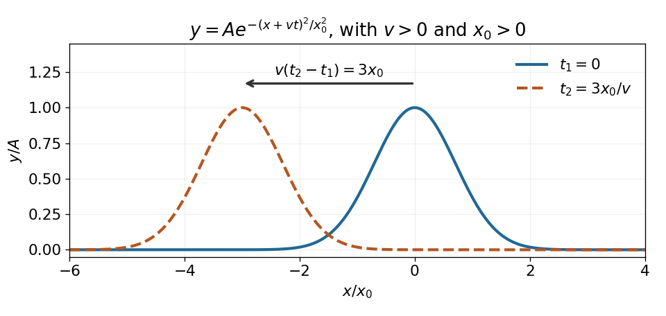

<h1 id="10/a/solution">Solution</h1>

↑ **Parent:** [A](../a.md)

Put $\xi=x+vt$ and $F(\xi)=Ae^{-\xi^2/x_0^2}$, with $x_0\ne0$. The [chain rule](../../../../chain-rule.md) gives

$$
y_{xx}=\left(\frac{4\xi^2}{x_0^4}-\frac2{x_0^2}\right)y,\qquad
y_{tt}=v^2\left(\frac{4\xi^2}{x_0^4}-\frac2{x_0^2}\right)y.
$$

For a nonzero pulse the [wave equation on a string](../../../../wave-equation-on-a-string.md) therefore requires

$$
\boxed{v^2=\frac T\mu,\qquad |v|=\sqrt{\frac T\mu}.}
$$

It is not a solution for arbitrary $v$; the zero pulse $A=0$ is the trivial exception. Here $\mu$ is [linear mass density](../../../../linear-mass-density.md), and $T>0$ is [tension](../../../../tension.md). With $v>0$, the maximum lies at $x=-vt$, so the [Gaussian function](../../../../gaussian-function.md) translates towards decreasing $x$ by $v(t_2-t_1)$ between the two times. Its [amplitude](../../../../wave-amplitude.md) and width stay constant.

**[Figure 3](#10/a/image-original-sketch-of-the-gaussian-pulse-translating-to-the-left-at-constant-speed). Original sketch of the Gaussian pulse translating to the left at constant speed**.

## ↑ Ancestors (12)

1. [A](../a.md)
2. [10](../../10.md)
3. [2021 resit](../../../2021-resit-split.md)
4. [Past exam of the mathematical methods II course of the University of Oxford](../../../split.md)
5. [Mathematical methods II course of the University of Oxford](../../../../mathematical-methods-ii-course-of-the-university-of-oxford.md)
6. [Year 1 of the physics course of the University of Oxford](../../../../year-1-of-the-physics-course-of-the-university-of-oxford.md)
7. [Physics course of the University of Oxford](../../../../physics-course-of-the-university-of-oxford.md)
8. [Undergraduate course of the University of Oxford](../../../../undergraduate-course-of-the-university-of-oxford.md)
9. [Course of the University of Oxford](../../../../course-of-the-university-of-oxford.md)
10. [University of Oxford](../../../../university-of-oxford-split.md)
11. [List of universities](../../../../list-of-universities.md)
12. [Codex Wiki](../../../../split.md)
